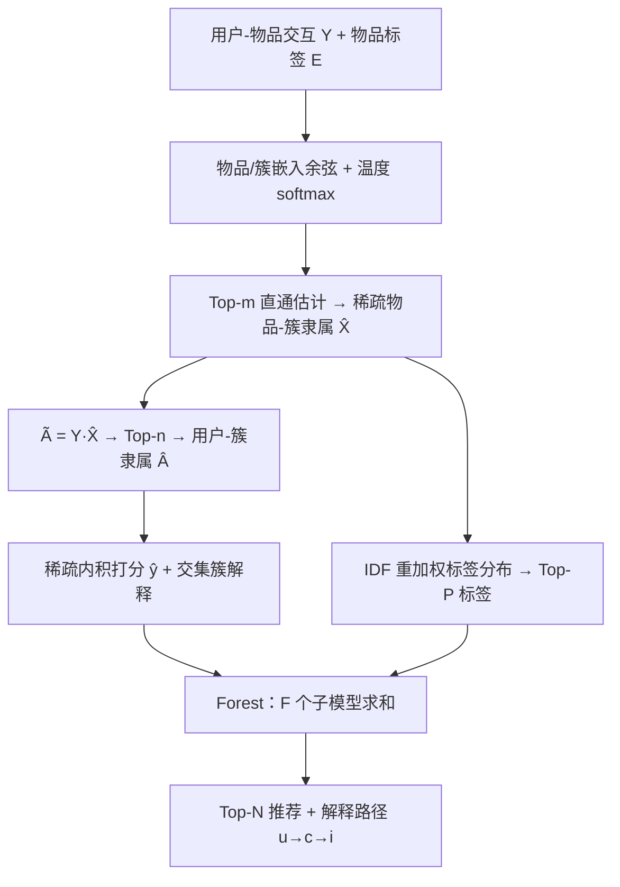

# Towards Explainable Collaborative Filtering with Taste Clusters Learning（基于口味簇学习的可解释协同过滤）

- **会议/期刊**: WWW 2023（The ACM Web Conference）
- **作者与机构**: Yuntao Du, Lu Chen, Yunjun Gao（浙江大学）；Jianxun Lian, Jing Yao, Xiting Wang, Xing Xie（微软亚洲研究院）；Mingqi Wu（Microsoft Gaming）
- **推荐链路定位**: 召回（Top-N 打分与解释生成一体化）
- **研究方向**: 协同过滤与双塔召回
- **论文原文**: [https://arxiv.org/abs/2304.13937v1](https://arxiv.org/abs/2304.13937v1)
- **开源代码**: [https://github.com/zealscott/ECF](https://github.com/zealscott/ECF)

## TL;DR (1分钟核心速览)

针对隐因子 CF「只能算分、不能自证」的痛点，ECF 把用户与物品同时映射到少数稀疏「口味簇」（隐空间相近且共享标签的物品组），用稀疏内积 $\hat{y}_{ui}=\langle\boldsymbol{a}_u,\boldsymbol{x}_i\rangle$打分，并用两方共同隶属的簇标签直接生成解释，使解释与决策同源而非后验翻译。配套的可微 Top-$m$ 直通估计、IDF 重加权标签选择与 Forest 集成，在 Xbox/MovieLens/Last-FM 的 Recall@20、NDCG@20 上全面超越 6 个基线，最高相对提升 14.6%。

## Background & Motivation (背景与核心矛盾)

- **主流范式**: 以 MF / NCF / LightGCN 为代表的隐因子 CF，把用户和物品压成稠密向量，用内积解码偏好；精度强但决策逻辑是黑箱。
- **前人局限**: 已有的可解释 CF 至少违背一条性质——HFT 要求主题维度与隐因子维度强制对齐（不 **flexible**）；EFM 的显式 aspect 打分与隐式因子打分是两个孤立分支（不 **coherent**）；AMCF 靠后验映射把 embedding 翻译成 aspect 特征（非 **intrinsic**，解释可偏离真实决策）。
- **核心洞察 (Key Insight)**: 用户兴趣的物品集合往往在隐空间成团且共享少数显式标签（如 "folk|acoustic|pop"）；若把"簇"本身作为打分单元，则打分依据与解释依据天然是同一组簇，无需二次解释。
- **本文切入点**: 用端到端学习的稀疏「用户-簇 / 物品-簇」隶属矩阵替代稠密 embedding 打分，簇由判别性标签描述，解释即交集簇的权重。

## Method (核心方法设计)

### 1. 整体框架 (Overall Architecture)

输入是隐式交互矩阵 $Y$与物品标签多热矩阵$E$。模型为每个簇维护嵌入$\boldsymbol{h}_c$，通过余弦相似度 + 温度 softmax 计算物品-簇相关度，用直通（straight-through）技巧实现可微的 Top-$m$稀疏选择得到$\hat{X}$；再令$\tilde{A}=Y\tilde{X}$并以同样的 Top-$n$机制得到用户-簇稀疏隶属$\hat{A}$。预测时只对两方共同隶属的簇做稀疏内积，解释即为这些交集簇的标签与重要性权重。训练端由 BPR 簇打分损失、标签选择似然损失、簇间互信息独立损失与辅助 CF 损失联合优化，推理端以$F$ 个随机初始化的子模型求和（Forest）输出最终分数。图 2 展示了 Last-FM 上 5 个真实学到的口味簇。

### 2. 关键设计拆解 (Key Designs)

1. **稀疏可微隶属（Sparse Affiliation with Straight-Through Top-$m$）**：直接按标签聚类会把高频标签主导的簇混在一起，纯 K-means 又丢失协同信号。ECF 先算$\tilde{x}_{ic}=\cos(\boldsymbol{v}_i,\boldsymbol{h}_c)$，再用温度 softmax 连续松弛硬掩码$m_{ic}=\mathbb{I}[c\in\mathrm{argTop}_m(\tilde{x}_i)]$，并以重参数化技巧弥合前后向差异：$\hat{m}_{ic}=\tilde{m}_{ic}+\mathrm{detach}\!\left(m_{ic}-\tilde{m}_{ic}\right)$。前向严格稀疏（保证解释可读、只走少数路径），反向梯度经$\tilde{m}_{ic}$平滑回传，巧妙绕开 argTop 不可导。用户侧复用同一机制，$\tilde{A}=Y\tilde{X}$ 让用户隶属继承其交互物品的簇分布。理由：稀疏性是"可读"的前提，可微性是"可训"的前提，直通估计把二者同时拿到。

2. **判别性标签生成（IDF-Reweighted Top-$P$Tag Selection）**：簇的标签若只取频次最高者，Xbox 上几乎所有簇都会退化为 "Multiplayer-Online"。ECF 先算簇标签频次$\tilde{D}=X^{\top}E$，用 IDF 抑制通用标签并放大区分性标签：$d_{ct}=\tilde{d}_{ct}\log\frac{N}{f_t+\epsilon}$，再用温度$\tau$的 softmax 归一化$\beta_{ct}$，最大化 Top-$P$（$P=4$）标签的似然$\mathcal{L}_{TS}=-\sum_{c}\sum_{t\in\mathrm{argTop}_P(\beta_c)}\log\beta_{ct}$。直觉：频次决定"覆盖"，IDF 决定"辨识"，温度决定"聚焦度"，三者共同把簇压成 4 个可读词。

3. **Forest 集成、训练目标与推理开销**：稀疏化本质上是对稠密隐因子的低秩近似，单模型精度必然受损（见实验）。ECF 的补救极简：每个子模型随机抽取 $|C|$个物品作为初始簇心、用不同随机种子训练，$F$个子模型分数求和。总损失为$\mathcal{L}_{ECF}=\mathcal{L}_{CS}+\mathcal{L}_{TS}+\mathcal{L}_{IND}+\lambda\mathcal{L}_{CF}$，其中$\mathcal{L}_{CS}$是簇打分的 BPR 成对损失（正负样本来自未交互采样），$\mathcal{L}_{IND}$用互信息$\mathcal{L}_{IND}=-\sum_c\log\frac{\exp(s(\boldsymbol{h}_c,\boldsymbol{h}_c))}{\sum_{c'}\exp(s(\boldsymbol{h}_c,\boldsymbol{h}_{c'}))}$拉开簇间距保证多样性，$\mathcal{L}_{CF}$为稠密 embedding 的辅助 BPR 信号（$\lambda=0.6$），专门解决 argTop 造成的监督信号稀疏难收敛问题。推理阶段只需存$F(m|I|+n|U|)$个稀疏隶属而非稠密向量，当$m,n\ll d$ 时模型体积甚至小于 MF。

## Experimental Setup & Evaluation Protocol (实验设置与评估协议)

- **数据集与预处理**（统一 `10-core` 过滤，即保留交互数 ≥ 10 的用户与物品）：

| 数据集 | #Users | #Items | #Interactions | #Tags | 特征/场景说明 |
| :--- | :---: | :---: | :---: | :---: | :--- |
| Xbox (GamePass) | 465,258 | 330 | 6,240,251 | 115 | 订阅制游戏库，物品极少、极稠密 |
| MovieLens | 6,033 | 3,378 | 836,434 | 18 | 电影类型标签，人工整理为 18 个净标签 |
| Last-FM | 53,486 | 2,062 | 2,228,949 | 54 | 音乐收听，标签经 Last.fm API 抓取并剔除 <50 人标注的稀有标签 |

- **数据划分与防穿越**: 比例划分（训练/验证/测试 = 80%/10%/10%），沿用 AMCF 的官方切分以保证可比；未使用全局时间戳切分，属随机划分。
- **排名评测协议**: 采用 `Recall@20` 与 `NDCG@20` 做 Top-$K$排序评测（附录含其他$K$）；**但原文未明确候选集是 Full-Ranking 全库未交互排序还是 Sampled 负采样排序及正负比**，仅注明沿用 BPR/EFM/AMCF 的评测口径——这是复现时的主要模糊点。
- **对比基线与超参设置**: 基线分两组——精度型（MF, NCF, CDAE, LightGCN）与可解释型（EFM, AMCF），外加消融版 `ECF_single`。固定 $P=4$、$m=n=20$、$\lambda=0.6$，显著性水平$p<0.05$（表中 † 标记）。

## Key Experimental Results (实验关键数据)

### 1. 主实验对比 (Main Results)

| 模型 | Xbox R@20 | Xbox N@20 | ML R@20 | ML N@20 | LastFM R@20 | LastFM N@20 |
| :--- | :---: | :---: | :---: | :---: | :---: | :---: |
| MF | 0.5048 | 0.3268 | 0.1603 | 0.2416 | 0.0658 | 0.0506 |
| NCF | 0.4746 | 0.2931 | 0.1606 | 0.2406 | 0.0618 | 0.0401 |
| CDAE | 0.5192 | 0.3286 | 0.1627 | 0.2499 | 0.0589 | 0.0534 |
| LightGCN | 0.4933 | 0.3261 | 0.1854 | 0.2698 | 0.0788 | 0.0675 |
| EFM | 0.5070 | 0.3312 | 0.1702 | 0.2525 | 0.0703 | 0.0549 |
| AMCF | 0.5036 | 0.3217 | 0.1604 | 0.2405 | 0.0675 | 0.0516 |
| ECF_single | 0.4231 | 0.2331 | 0.1068 | 0.1501 | 0.0467 | 0.0380 |
| **ECF** | **0.5922** | **0.3721** | **0.2124** | **0.2903** | **0.0851** | **0.0773** |
| **Improv.%** | +14.06% | +12.35% | +14.56% | +7.60% | +8.00% | +14.52% |

### 2. 消融实验 (Ablation Study)

| 变体 / 组件 | Xbox R@20 | Xbox N@20 | LastFM R@20 | LastFM N@20 | 说明 |
| :--- | :---: | :---: | :---: | :---: | :--- |
| ECF_single（去 Forest） | 0.4231 | 0.2331 | 0.0467 | 0.0380 | 精度跌破全部基线 |
| ECF（完整） | **0.5922** | **0.3721** | **0.0851** | **0.0773** | Forest 贡献 +40.0% / +59.6% |
| MF + Forest（原文 A.4 定性） | — | — | — | — | 仍劣于 ECF，说明收益非仅来自集成 |
| $\lambda<0.6$（辅助 CF 信号不足） | — | — | 显著下降 | 显著下降 | argTop 稀疏监督难收敛 |
| $m,n=10\to20$ | — | — | 明显上升后趋缓 | 同左 | 稀疏→稠密权衡可读性 |

**可解释性质量（表 3，三数据集均值，本笔记按原文数值平均）**：

| 方法 | Cov. | Util. | Sil. | Info. | Overall |
| :--- | :---: | :---: | :---: | :---: | :---: |
| **ECF** | 0.7881 | **0.7030** | 0.2051 | **0.3096** | **1.6155** |
| TagCluster | **0.9913** | 0.3947 | -0.2291 | 0.1434 | 0.9101 |
| K-means | 0.6085 | 0.4353 | **0.3583** | 0.0178 | 1.0296 |
| Random | 0.5571 | 0.2466 | -0.4246 | 0.0111 | 0.0000 |

### 3. 关键实验发现 (Key Findings)

1. **稀疏隶属本身是精度上的"负债"，Forest 才是"偿还"手段**：ECF_single 在 Xbox 上比 MF 低 16.2%（0.4231 vs 0.5048），但 Forest 把它推到 0.5922，反超最强基线 CDAE 14.06%，证明"可解释不必牺牲精度"成立的前提是集成补偿。
2. **纯标签聚类会把簇做"假"**：TagCluster 的覆盖率高达 0.9913（标签必然覆盖物品），但轮廓系数为 -0.2291，甚至低于随机基线，说明同标签物品在协同隐空间里并不同好；ECF 用协同 + 标签双约束把 Sil. 拉回 0.2051，同时 Informativeness 达 0.3096（K-means 仅 0.0178），标签真正能反查簇内物品。
3. **用户侧与物品侧稀疏度是"可读性 vs 表达力"的旋钮**：$m,n$从 10 增至 20 时 Last-FM/Xbox 的 Recall@20 大幅跃升、之后饱和；$m,n$ 过大则 u→c→i 的解释路径爆炸，故统一取 20——这是本文唯一需要人工调的"解释-精度"折中点。

## Highlights & Limitations (亮点、对比与审稿批判)

- **与代表作对比 (vs. Prior Work)**: HFT 强制簇维度与隐因子维度一一对应，维度不匹配即失效；EFM 的显式 aspect 分支与隐式因子分支各打一个分再加权，解释与决策可能互相矛盾；AMCF 用后验映射事后翻译 embedding，本质仍是 post-hoc。ECF 用同一组稀疏隶属同时完成打分与解释，是三者中唯一同时满足 flexible / coherent / intrinsic 的方案。
- **可迁移亮点**: (1) 直通 Top-$m$稀疏门控可直接搬到"可解释槽位召回""语义 ID 码本选择"等任何需要硬稀疏 + 可微训练的召回模块；(2) IDF 重加权 + 温度 softmax + Top-$P$ 似然的标签选择套路，可复用于商品类目打标、短视频话题生成等"从高频噪声中挑出辨识性词"的任务。
- **审稿级局限批判**: (1) 强依赖物品侧标签，冷启动物品若标签缺失则无法入簇，长尾扶持能力被高估；(2) Forest 使训练成本与参数存储变为 $F$倍，在线需同时存$F$ 份稀疏隶属做求和，虽然理论体积可控但工程上仍需压测；(3) Xbox 数据集仅 330 个物品、极稠密，Recall@20 已到 0.59 的量级，其结果未必能外推到千万级 SKU 的电商长尾场景；(4) 排名协议未交代候选集构造方式，与 LightGCN 等常用全库排序的结论存在可比性风险；(5) 解释仍是"标签串 + 路径权重"的模板式输出，缺少自然语言流畅度与个性化语气。

## Rating (四维评分)

- **方法创新性 (Novelty)**: ⭐⭐⭐⭐ （稀疏可微隶属 + IDF 标签选择 + Forest 三者组合干净，把"簇即解释单元"从概念落成可微算子；但单点技术均为已有技巧的组合）
- **评估协议与实验扎实度 (Protocol & Experiments)**: ⭐⭐⭐ （三数据集三类领域覆盖良好且有 4 项可解释性指标与 30 人用户研究，但划分用随机比例而非时间切分，排名候选集构造未交代，超参数仅短文说明）
- **写作与数学规范度 (Clarity & Rigor)**: ⭐⭐⭐⭐ （从簇定义、稀疏打分到可微松弛的推导链条完整，直通估计与复杂度分析交代清楚；代价函数无量纲调节却未讨论敏感性）
- **工业落地与复现价值 (Industrial & Practical Value)**: ⭐⭐⭐⭐ （代码已开源，推理只需稀疏隶属、体积可小于 MF，且簇隶属可直接复用为人群定向与冷启动画像，落地路径清晰；需承担 $F$ 倍训练开销）

