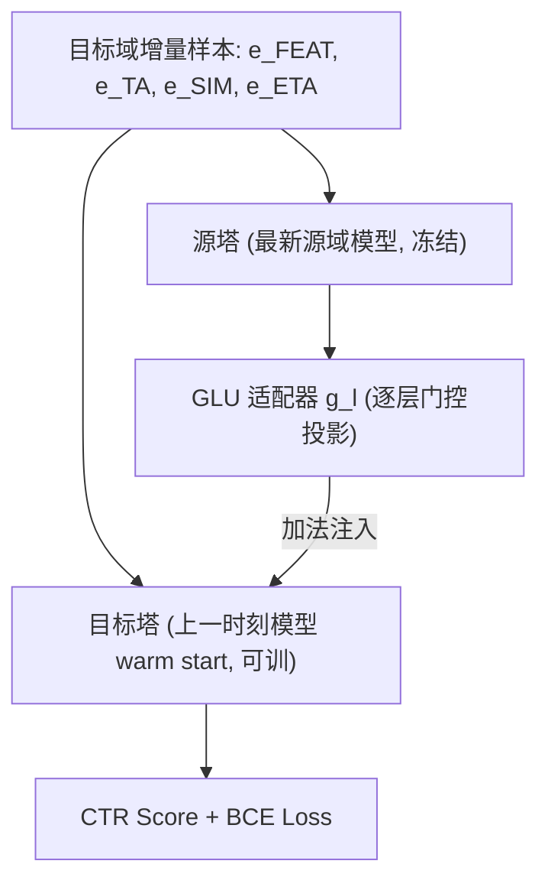
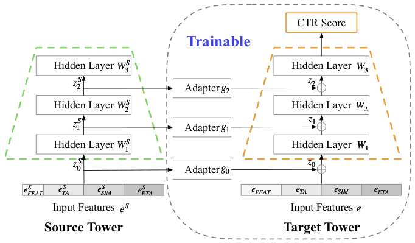

# Continual Transfer Learning for Cross-Domain Click-Through Rate Prediction at Taobao (淘宝跨域点击率预估的持续迁移学习)

- **会议/期刊**: WWW 2023 (Companion / Industry Track)
- **作者与机构**: Lixin Liu, Yanling Wang, Tianming Wang, Dong Guan, Jiawei Wu, Jingxu Chen, Rong Xiao, Wenxiang Zhu, Fei Fang（阿里巴巴集团、中国人民大学）
- **推荐链路定位**: 精排（CTR 预估）
- **研究方向**: 跨域与多场景推荐 / CTR 预估与特征交叉
- **论文原文**: [arXiv:2208.05728v2](https://arxiv.org/abs/2208.05728v2)
- **开源代码**: 暂未开源

## TL;DR (1分钟核心速览)

淘宝多推荐域规模差异悬殊（域 A 约 150B 交互，域 C 仅 1B），跨域迁移势在必行；但现有跨域 CTR 方法都假设源域与目标域静态不变，而工业模型是**两边同时持续演进**的。本文形式化出 Continual Transfer Learning (CTL) 任务，提出 CTNet：冻结最新源域塔作为"外部知识"，用 GLU 门控适配器逐层注入持续训练的目标塔，并以小初始化实现 warm start。在淘宝生产日志（末天测试、AUC/GAUC）上 A→B 提升 +0.95% AUC / +1.48% GAUC，A→C 提升 +4.89% AUC / +5.44% GAUC，线上 A/B 分别带来 +2.5%/+12.3% CTR 与 +7.7%/+31.9% GMV。

## Background & Motivation (背景与核心矛盾)

- **主流范式**: 跨域 CTR 分两派——联合学习（MLP++/Share Bottom/PLE/MiNet/DDTCDR/DASL）共享 user/item 底层 embedding 联合优化；预训练+微调（Finetune/Extra Embedding）把源域参数迁移到目标域。
- **前人局限**: 联合学习每个 step 需灌入大规模源域数据，线上部署低效，且多目标冲突可能反噬目标域优化；预训练+微调每次源域模型更新都会**直接丢弃目标域已训练好的参数**，要找回历史知识必须重灌大规模历史目标域数据——在工业场景不可行。
- **核心洞察 (Key Insight)**: 工业模型已在数十亿样本上长期训练至局部最优，参数本身就是最贵的资产；"遗忘目标域参数"才是 CTL 的真正瓶颈，而非"如何更好地拷贝源域参数"。
- **本文切入点**: 把源域表征当作**外部知识**而非参数初始化，冻结源塔、保留并续训目标塔，只训练轻量适配器 + 目标塔增量更新。

## Method (核心方法设计)

### 1. 整体框架 (Overall Architecture)

CTNet 把原目标域单域模型扩展为"源塔 + 目标塔 + 适配器"的双塔结构。每个训练时刻 $t$，源塔完整载入**最新源域模型**的全部参数（embedding 层、target attention/SIM/ETA 序列层、MLP 层）并**冻结**；目标塔初始化为上一时刻的目标域模型并持续用增量目标域数据训练；每层之间插入 GLU 适配器，将源塔隐层投影后以**加法**融进目标塔对应层。由于源塔只前向、目标塔全参数保留，训练只需增量数据即可完成一次 CTL；推理时两塔并行（源塔更轻、更快），实测不增加线上响应时间。

<figure class="paper-figure" markdown="span">
  <figcaption>图1：所提出的CTNet的架构。</figcaption>
</figure>

### 2. 关键设计拆解 (Key Designs)

1. **逐层 GLU 门控适配器（把源域知识做成"可选择的特征"）**：痛点是从源域传来的隐层并非处处有用，concatenation 又会破坏目标塔与旧模型的结构一致性。CTNet 用门控线性单元自适应控制信息流：$g_l(\mathbf{z}^S_l)=\mathbf{U}_{1l}\mathbf{z}^S_l \odot \sigma(\mathbf{U}_{2l}\mathbf{z}^S_l)$，并以加法融合$\mathbf{z}_l=\psi(\mathbf{W}_l\mathbf{z}_{l-1}+g_l(\mathbf{z}^S_l))$。门控让模型按样本决定"信多少源域"，加法保证目标塔层次结构与原生产模型完全同构，从而可直接热启动。
2. **Warm Start：用极小的适配器初始化保住已收敛解**：目标塔直接用旧目标域模型初始化，适配器参数 $\mathbf{U}$ 以极小值初始化，使初始前向输出几乎等同于已高度优化的生产模型，避免大扰动把模型推离局部最优。这是 CTL 只靠增量数据可行的前提。
3. **训练目标、共享序列特征与推理效率**：损失为标准 BCE（曝光点击为正、曝光未点击为负，无额外负采样）。关键工程技巧是把行为序列表征置为跨塔共享 $(e_{TA},e_{SIM},e_{ETA})=(e^S_{TA},e^S_{SIM},e^S_{ETA})$——因为淘宝全域序列本就同源，而 TA/SIM/ETA 模块恰是线上算力大头，共享后几乎消除全部额外开销；适配器采用层内（layer-wise）而非跨层连接以利并行。

## Experimental Setup & Evaluation Protocol (实验设置与评估协议)

- **数据集与预处理**: 无合适公开基准，直接使用淘宝生产日志（31 天），按交互时间切分为每段 6 天的周期，共 5 个 period。

| 数据集(域) | 规模(交互量级) | 用户/物品 | 场景说明 |
| :--- | :---: | :---: | :--- |
| Domain A (源) | ~150B | 覆盖淘宝绝大多数用户与物品 | 超大流量主域，特征数更多 |
| Domain B (目标) | ~2B | 与 A 部分重叠 | 中小域，数百万元活 |
| Domain C (目标) | ~1B | 与 A 部分重叠 | 更稀疏小域 |

- **数据划分与防穿越 (Splitting Strategy)**: 时间切分——31 天中**最后 1 天作测试**，其余作训练，并组成 5 个连续 period 以模拟 $t\to t+1$ 的持续演进（严格的未来预测，无穿越）。
- **排名评测协议 (Ranking Protocol)**: 属**pointwise CTR 分类评估**，非全库 ranking；指标为 AUC 与 GAUC（按用户曝光加权，与线上表现一致性已被验证）。Base 与所有基线均在**同一生产特征/同一网络结构**下重训，保证公平。
- **对比基线与超参设置**: 单域模型 Base(w/o Transfer)/Source Model；微调类 Finetune(Embeddings)、Finetune(All)、Extra Embedding；联合学习类 MLP++、Share Bottom、PLE、MiNet、DDTCDR、DASL。3 层 MLP 隐层 $[1024,512,256]$，8 头 target attention（256 维），SIM/ETA 子序列长度 64，batch 512，AdaGrad，学习率 0.01，单域模型均已持续训练 3 年。

## Key Experimental Results (实验关键数据)

### 1. 主实验对比 (Main Results)

| 模型 | A→B AUC | A→B GAUC | A→C AUC | A→C GAUC |
| :--- | :---: | :---: | :---: | :---: |
| Base (w/o Transfer) | 0.7404 | 0.6788 | 0.7104 | 0.6677 |
| Source Model | 0.6640 | 0.6200 | 0.5783 | 0.5771 |
| Finetune (Embeddings) | 0.7439 | 0.6828 | 0.7190 | 0.6769 |
| Finetune (All) | 0.7368 | 0.6739 | 0.6727 | 0.6352 |
| Extra Embedding | 0.7402 | 0.6787 | 0.7137 | 0.6693 |
| Share Bottom | 0.7417 | 0.6777 | 0.7119 | 0.6726 |
| PLE | 0.7395 | 0.6749 | 0.7103 | 0.6679 |
| MiNet | 0.7411 | 0.6765 | 0.7129 | 0.6712 |
| DASL | 0.7406 | 0.6763 | 0.7132 | 0.6714 |
| CTNet (w/o GLU) | 0.7465 | 0.6877 | 0.7432 | 0.7023 |
| **CTNet** | **0.7474** | **0.6888** | **0.7451** | **0.7040** |
| **Improv. (vs. 最强基线)** | **+0.47%** | **+0.88%** | **+3.63%** | **+4.00%** |

### 2. 消融实验 (Ablation Study)

| 变体 / 设置 | A→B AUC | A→B GAUC | A→C AUC | A→C GAUC |
| :--- | :---: | :---: | :---: | :---: |
| CTNet w/o GLU（线性适配器） | 0.7465 | 0.6877 | 0.7432 | 0.7023 |
| CTNet（GLU 适配器） | **0.7474** | **0.6888** | **0.7451** | **0.7040** |
| Base @ $t+\Delta t$ | 0.7483 | 0.6931 | — | — |
| CTNet (one-time) @ $t+\Delta t$ | 0.7548 (+0.65%) | 0.7022 (+0.91%) | — | — |
| CTNet (one-time) @ $t+2\Delta t$ | 0.7462 (+0.46%) | 0.6856 (+0.68%) | — | — |
| CTNet (one-time) @ $t+3\Delta t$ | 0.7436 (+0.32%) | 0.6861 (+0.73%) | — | — |
| CTNet (continual) @ $t+3\Delta t$ | **0.7474 (+0.70%)** | **0.6888 (+1.00%)** | — | — |

### 3. 关键实验发现 (Key Findings)

1. **"保住目标域参数"是决定性因素**：Finetune(All) 在 A→C 上把 AUC 从 Base 的 0.7104 拉低到 0.6727（甚至不如不迁移），而只替换 embedding 的 Finetune(Embeddings) 达 0.7190；说明整模型覆盖式迁移会抹掉千亿样本积累的知识，CTNet 保留全部目标塔参数正是其最大增益来源。
2. **联合学习类方法集体失效**：MLP++/Share Bottom/PLE/MiNet/DDTCDR/DASL 的 A→B AUC 全部落在 $[0.7395,0.7417]$，仅与 Base 持平甚至更低——它们只更新 user/item 等低层特征，忽略交互层高层表征，且只用到 30 天源域数据而非已训练 3 年的源域模型。
3. **持续迁移的收益随时间衰减对比验证了 CTL 必要性**：one-time 迁移相对增益从 $t+\Delta t$的 +0.91% GAUC 单调衰减至$t+3\Delta t$ 的 +0.73%，而 continual 保持 +1.00%；A→C 上 CTNet 相比最强基线 GAUC 提升 4.00%，线上对应域 C 的 +12.3% CTR / +31.9% GMV 远超 0.1% GAUC 即显著的工业阈值。

## Highlights & Limitations (亮点、对比与审稿批判)

- **与代表作对比 (vs. Prior Work)**: 与同期的 KEEP 相比，CTNet 直接复用**现成源域模型**而非另训精简模型，省去预训练与"缓存-推理"同步策略，并可实时抽取细粒度 user-item 交互知识；与 DDTCDR/DASL 等跨域方法相比，CTNet 不追求跨域共享 embedding，而是把源域当作"只读外脑"，从根上规避负迁移与联合优化的目标冲突；与经典持续学习不同，本文明确**不处理灾难性遗忘**——推荐系统只需预测未来兴趣，旧任务性能下降无妨。
- **可迁移亮点**: (1) "冻结源塔 + 加法适配器 + 极小初始化"是把任意成熟模型升级为跨域增强版的低风险配方，改造后结构与原模型同构，线上可直接热切换；(2) 共享跨域消耗最大的序列特征模块，是零成本获得跨域增益的工程范式。
- **审稿级局限批判**: (1) 实验完全基于淘宝私有生产数据，无公开基准、无重复实验与显著性检验（AUC/GAUC 差异在 0.001 量级，统计显著性未给出）；(2) 适配器仅用加法+GLU，未讨论源域噪声或负迁移的检测/门控退火策略，也未分析适配器规模、层数分配与周期长度 $\Delta t$ 的敏感性；(3) 需同时在线挂载两塔，虽称并行不增延迟，但对源塔模型体的存储与版本同步仍存运维成本。

## Rating (四维评分)

- **方法创新性 (Novelty)**: ⭐⭐⭐⭐ （首次形式化"双域同时演进"的 CTL 任务，双塔冻结+门控注入的设定朴素但切中工业要害）
- **评估协议与实验扎实度 (Protocol & Experiments)**: ⭐⭐⭐⭐ （时间切分严格、基线覆盖两类范式、线上 A/B 与多月持续对比齐全，缺公开数据集与显著性检验）
- **写作与数学规范度 (Clarity & Rigor)**: ⭐⭐⭐⭐ （公式仅三式但定义清晰、部署细节与工程技巧交代充分，理论分析偏薄）
- **工业落地与复现价值 (Industrial & Practical Value)**: ⭐⭐⭐⭐⭐ （已在淘宝全量上线服务亿级用户，warm start 与序列共享技巧可直接复用，惟代码未开源）

