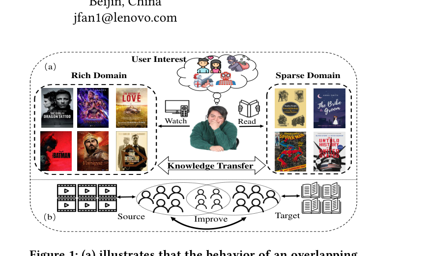
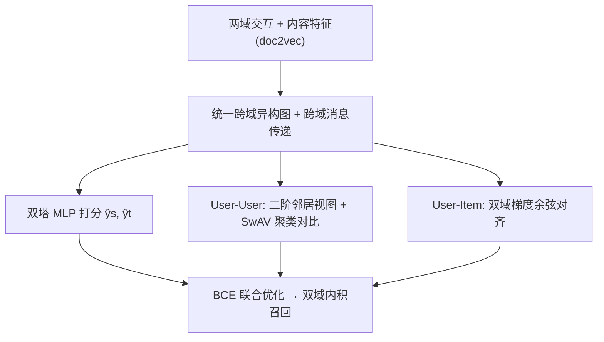

# Cross-domain recommendation via user interest alignment (基于用户兴趣对齐的跨域推荐)

- **会议/期刊**: The Web Conference (WWW) 2023
- **作者与机构**: Chuang Zhao, Hongke Zhao (天津大学), Ming HE, Jianping Fan (联想研究院 AI Lab), Jian Zhang (杭州电子科技大学)
- **推荐链路定位**: 召回（双域双塔向量内积打分，端到端训练）
- **研究方向**: 跨域与多场景推荐 / 图神经网络推荐
- **论文原文**: [论文原文链接](https://arxiv.org/abs/2301.11467v1)
- **开源代码**: 暂未开源（原文承诺录用后放出于匿名仓库）

## TL;DR (1分钟核心速览)

针对双域推荐中"分域独立训练 + 朴素拼接重叠用户表征"忽视跨域实体相似性与用户兴趣一致性的痛点，COAST 提出两条改造：一是把两域交互拼成统一跨域异构图，并在 GCN 消息传递中显式注入"跨域物品–用户"交互项；二是从 user-user（SwAV 式聚类对比）与 user-item（梯度余弦对齐）两个粒度约束重叠用户的兴趣不变性。在 Douban 与工业双场景共 4 个任务、Leave-One-Out + 1:99 采样排序协议下，Hit/NDCG@10 全面超越 8 个基线，最高相对提升 10.23%。

## Background & Motivation (背景与核心矛盾)

- **主流范式**: 双域 CDR 的第四类范式——"重叠实体表征组合"：两域各自学 embedding，再做 concat / dot / pooling 迁移；代表作为 DTCDR、DDTCDR、DML、GADTCDR、CDRIB。
- **前人局限 ①**: 分域独立训练在结构上切断了 user–item 交互，模型只能看到单域信息，无法感知实体间的高阶跨域相似性。
- **前人局限 ②**: 训练目标纯粹是推荐损失，没有任何正则约束，重叠用户在两域学到的表征可能背离其原始兴趣分布，甚至在同一用户的多个"视图"间产生相互冲突的兴趣；同时多数工作依赖全重叠用户的显式评分数据，与真实场景（部分重叠 + 富隐式内容）差距大。
- **核心洞察 (Key Insight)**: 同一重叠用户在不同域的行为由**同一兴趣分布**驱动（图 1(a)），因此其不同域视图在 K 个兴趣簇上的分布应保持一致；且被交互物品是兴趣的一次"观测"，故各视图面向同一物品的优化方向（梯度）也应一致。

<figure class="paper-figure" markdown="span">
  <figcaption>图1：(a) 表明重叠用户在不同领域的行为由相同的兴趣分布驱动。(b) 表明我们通过重叠用户的知识迁移提升两个领域的推荐性能。</figcaption>
</figure>

- **本文切入点**: 用统一图捕获跨域相似性，用两种自监督信号（聚类对比 + 梯度对齐）把"兴趣不变性"写成可微正则项。

## Method (核心方法设计)

### 1. 整体框架 (Overall Architecture)

输入侧先做内容特征工程：数值归一化、类别 one-hot，文本（评论/标签/画像）聚合成文档后用 doc2vec 编码；重叠用户表征取两域向量 max-pooling 融合。随后所有 user/item 节点进入统一跨域异构图（两域物品共享同一节点类型，仅边类型区分域），经跨域消息传递得到多层拼接的 $e_u,e_{v_S},e_{v_T}$；再送入双塔 MLP（隐层$[D,2D,4D,8D,4D,2D,D]$）计算余弦打分。训练时同时优化双域 BCE 推荐损失与两项兴趣对齐损失，推理端仅需塔结构做内积，属标准双塔召回。

### 2. 关键设计拆解 (Key Designs)

1. **跨域消息传递 (Cross-domain Message Passing)**：分域训练丢失跨域协同信号，本文在传统 GCN 消息上额外叠加"跨域物品–用户"交互项，使用户消息同时吸收源域与目标域的历史交互：
$m_{u\leftarrow v}=\frac{1}{\sqrt{|\mathcal{N}_u|}\sqrt{|\mathcal{N}^S_v||\mathcal{N}^T_v|}}\big(W_1e_u+W_2(e_{v_S}\odot e_u)+W_3(e_{v_T}\odot e_u)\big)$
其中元素积项让跨域物品成为用户表征的"调制门"，物理直觉是：同一用户在另一域买过的同类物品，可校验/修正本域的兴趣方向。多层堆叠后按层 concat 得到最终表征，实现高阶跨域相似性感知。

2. **User-User 兴趣对齐 (聚类式对比)**：同一用户两域视图应落在同一兴趣簇。作者先分别聚合用户在源/目标域的 2-hop 邻居（注意力加权）得到两个对比视图 $z_S,z_T$，另用$Q$提取器产生高阶投影$q$，以 SwAV 式 swapped prediction 让学生视图去预测另一视图的簇分配：
$\ell(z_T,q_S)=-\sum_{k}q_S^{(k)}\log p_T^{(k)},\quad p_T^{(k)}=\frac{\exp(\tfrac{1}{\tau}z_T^\top c_k)}{\sum_{k'}\exp(\tfrac{1}{\tau}z_T^\top c_{k'})},\quad \mathcal{L}_{U,U}=\ell(z_T,q_S)+\ell(z_S,q_T)$
相比 InfoNCE 逐样本对拉近，聚类目标在实例级区分用户（K 个兴趣中心），且沿用 SwAV 的 mini-batch 张量搬运技巧控制显存。

3. **User-Item 梯度对齐与训练目标**：为使两域视图对同一交互物品走"同一条优化路径"，用梯度余弦相似度代替表征距离。设 $g_S,g_T$为重叠用户在源/目标域对交互对$(u,v)$ 的期望交叉熵梯度，则
$\mathcal{L}_{U,I}=1-\frac{g_S^\top g_T}{\lVert g_S\rVert_2\lVert g_T\rVert_2},\qquad \mathcal{L}=\mathcal{L}_s+\lambda_2(\mathcal{L}_{U,U}+\mathcal{L}_{U,I})$总损失中$\mathcal{L}_s$为双域 BCE（每正样本随机采未观测负例），$\lambda_2=10^{-2}$ 平衡对齐强度；梯度对齐利用梯度的丰富语义，避免直接对齐表征导致的域特有信息塌缩。

## Experimental Setup & Evaluation Protocol (实验设置与评估协议)

- **数据集与预处理**: 全部按 **5-core** 过滤（用户与物品均保留 ≥5 次交互），评分归一到 [0,1]：

| 数据集 / 域 | #Users | #Items | #Interactions | 密度 | 说明 |
| :--- | :---: | :---: | :---: | :---: | :--- |
| Douban-Movie | 2,712 | 34,893 | 1,278,401 | 1.35% | 源域（富） |
| Douban-Book | 2,110 | 6,777 | 96,041 | 0.67% | 目标域（稀疏） |
| Douban-Music | 1,672 | 5,567 | 69,709 | 0.75% | 目标域（稀疏） |
| Industrial-Mall | 35,233 | 1,749 | 319,795 | 0.52% | 源域（富） |
| Industrial-Community | 29,355 | 2,452 | 175,802 | 0.24% | 目标域（稀疏） |

  构建 4 个双域任务：Movie-Book（重叠 2,106）、Movie-Music（1,666）、Book-Music（1,566）、Mall-Community（3,146）；物品仅属单域，用户可跨域。
- **数据划分与防穿越**: `Leave-One-Out`（每用户留最后一次交互作测试）。
- **排名评测协议**: `Sampled Ranking`，每测试用户随机采 **99 个未交互物品**作为负例（1:99），报告 `Hit@10` 与 `NDCG@10`；另做 Top-N 长度 $N\in\{1,3,5,7,10\}$ 的鲁棒测试。
- **对比基线与超参**: 单域 NMF、LightGCN；跨域 MVDNN、DTCDR、DDTCDR、DML、GADTCDR、CDRIB（覆盖映射式与表征组合式）。嵌入维度 $D=64$，兴趣簇数$K=256$，$\lambda_1=10^{-2}$，$\lambda_2=10^{-3}$（正文与超参实验给出 0.01 的描述，按其调参结论取用），Adam 学习率 5e-4，batch 4096，100 epoch。

## Key Experimental Results (实验关键数据)

### 1. 主实验对比 (Main Results)

| 模型 | Movie Hit | Movie NDCG | Book Hit | Book NDCG | Music Hit | Music NDCG | Comm. Hit | Comm. NDCG |
| :--- | :---: | :---: | :---: | :---: | :---: | :---: | :---: | :---: |
| NMF | 0.5445 | 0.3154 | 0.3916 | 0.2224 | 0.3959 | 0.2206 | 0.3793 | 0.2048 |
| LightGCN | 0.6174 | 0.3492 | 0.3805 | 0.2226 | 0.3528 | 0.2023 | 0.5119 | 0.2490 |
| MVDNN | 0.6382 | 0.3689 | 0.4654 | 0.2575 | 0.3965 | 0.2238 | 0.5211 | 0.2507 |
| DTCDR | 0.6420 | 0.3794 | 0.4302 | 0.2394 | 0.3593 | 0.2211 | 0.3632 | 0.2643 |
| DDTCDR | 0.5937 | 0.3558 | 0.4436 | 0.2511 | 0.3467 | 0.2189 | 0.3729 | 0.1886 |
| DML | 0.6060 | 0.3638 | 0.4662 | 0.2662 | 0.3821 | 0.2287 | 0.4283 | 0.2124 |
| GADTCDR | 0.6817 | 0.4205 | 0.4882 | 0.3026 | 0.4383 | 0.2498 | 0.5173 | 0.2907 |
| CDRIB | 0.6114 | 0.3301 | 0.4630 | 0.2772 | 0.4103 | 0.2272 | 0.4802 | 0.2814 |
| **COAST** | **0.6905** | **0.4271** | **0.5052** | **0.3174** | **0.4497** | **0.2515** | **0.5503** | **0.3195** |
| Improv.% | +1.29% | +1.57% | +3.48% | +4.89% | +2.60% | +0.68% | +6.38% | +9.91% |

（Book→Music 任务上 COAST 达 0.5138/0.3293 与 0.4688/0.2712，相对最优基线最高 **+10.23%** Hit、+6.44% NDCG。）

### 2. 消融实验 (Ablation Study)

原文以图 6 柱状图汇报，未给数值表；下表按趋势整理（↓ 表示相对 COAST 下降）：

| 变体 | 移除内容 | 性能趋势 | 主要归因 |
| :--- | :--- | :---: | :--- |
| COAST-NF | 仅用显式交互，弃内容特征 | ↓↓ 最大 | 语义信号缺失，仍强于多数基线 |
| COAST-NS | 取消统一图，分域独立训练 | ↓↓ | 丢失跨域协同信号与高阶相似性 |
| COAST-NM | 消息传递去掉跨域交互项 | ↓ | 无法用另一域物品调制本域兴趣 |
| COAST-NU | 去掉 user-user 对齐 | ↓ | 视图兴趣分布漂移，过拟合 |
| COAST-NI | 去掉 user-item 梯度对齐 | ↓ | 两域优化路径分叉，泛化下降 |
| COAST | 完整模型 | 最优 | — |

### 3. 关键实验发现 (Key Findings)

1. **重叠率越低越显优势**：25% 重叠下，Task1 目标域 COAST 仍达 Hit 0.4531 / NDCG 0.2735，显著高于 GADTCDR 的 0.3933 / 0.2412；且 25%→50% 的涨幅远大于 75%→100%，说明跨域知识迁移存在"重叠用户数量饱和点"。
2. **目标域增益系统性大于源域**：Task4 中 Community 侧 NDCG 提升 9.91%，而 Mall 侧仅 0.44%；Task3 中 Music 侧 Hit 提升 10.23% vs. Book 侧 0.59%——印证双域互促范式"先抬源域上界、再抬目标域"的机制，且稀疏域获益最大。
3. **表征组合式 > 映射式**：DTCDR/DDTCDR/DML 等映射类方法在重叠率变化下波动剧烈（Task3 中 GADTCDR 目标域 NDCG 仅 0.1933），说明单一正交映射函数难以刻画跨域复杂变换，而统一图 + 对齐约束更稳健；同时 COAST-NF 仍优于多数基线，证明增益部分来自图结构而非仅靠内容特征。

## Highlights & Limitations (亮点、对比与审稿批判)

- **与代表作对比**: 相比 GADTCDR（同样用异构图 + 内容相似边），COAST 把跨域交互写进**消息传递算子本身**而非事后加边，并额外引入两种兴趣对齐正则；相比 DTCDR/DDTCDR 的两阶段"先分域学、再映射/组合"，本文是单阶段端到端优化，规避了阶段间目标不一致；相比 CDRIB 的互信息上界裁剪，本文用 SwAV 聚类避免了对负样本对的依赖。
- **可迁移亮点**: ①"梯度余弦对齐"可作为任意多场景/多任务模型的轻量正则，无需对齐表征维度，天然适配异构塔结构；②用 2-hop 邻居聚合构造对比视图并做 swapped prediction，可复用到单域图推荐的冷启动用户增强。
- **审稿级局限批判**: ①评测采用 1:99 采样排序而非全库 Full-Ranking，负例采样会系统性高估 Hit/NDCG，且未报告多次采样方差与显著性检验；②统一异构图需一次性载入两域全量交互与 doc2vec 语义向量，工业场景下 3.5 万用户 × 32 万边的构图与多层 GCN 推理开销、以及新增域时的图重建成本均未讨论；③消融仅以柱状图呈现、无具体数值与置信区间，$K=256$、$\lambda_2$ 的敏感性较强，超参可复现性偏弱。

## Rating (四维评分)

- **方法创新性 (Novelty)**: ⭐⭐⭐⭐ （跨域交互项嵌入消息传递 + 聚类对比/梯度对齐双粒度兴趣不变性，组合新颖但单项技术均为已有组件的巧妙移植）
- **评估协议与实验扎实度 (Protocol & Experiments)**: ⭐⭐⭐ （4 任务双数据集 + 重叠率与 Top-N 鲁棒测试较完整，但仅 1:99 采样排序、缺显著性检验与消融数值）
- **写作与数学规范度 (Clarity & Rigor)**: ⭐⭐⭐⭐ （消息传递与对齐损失公式推导清晰、动机图示直观，$\lambda_2$ 取值在正文与设置处存在 1e-3/0.01 的不一致）
- **工业落地与复现价值 (Industrial & Practical Value)**: ⭐⭐⭐ （推理仍为标准双塔内积、易上线，但两域统一大图与内容编码带来较高训练/维护成本，且代码尚未开源）

