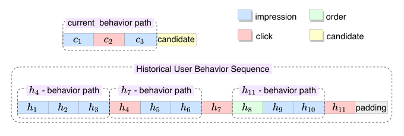
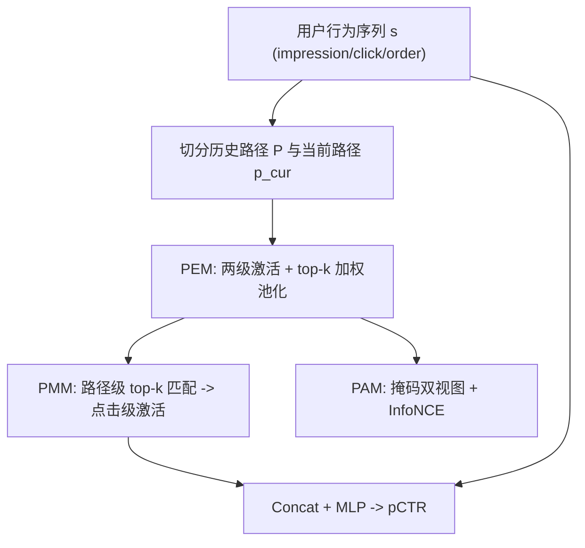
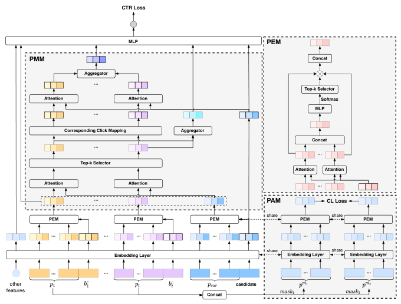

# A Deep Behavior Path Matching Network for Click-Through Rate Prediction (深度行为路径匹配网络)

- **会议/期刊**: WWW 2023
- **作者与机构**: Jian Dong, Yisong Yu, Yapeng Zhang, Yimin Lv, Shuli Wang, Beihong Jin, Yongkang Wang 等（美团 / 中科院软件所）
- **推荐链路定位**: 精排（CTR 预估）
- **研究方向**: CTR/CVR 预估与特征交叉 / 序列与会话推荐
- **论文原文**: [https://arxiv.org/abs/2302.00302v1](https://arxiv.org/abs/2302.00302v1)
- **开源代码**: [https://github.com/Ethan-Yys/DBPMaN](https://github.com/Ethan-Yys/DBPMaN)

## TL;DR (1分钟核心速览)

现有 CTR 模型只做「候选 × 单个历史行为」的点对点激活，忽略了构成用户决策链条的**顺序行为片段**。本文把「某次点击前的 $l$条 impression/click/order 混合行为」定义为**行为路径 (behavior path)**，用 DBPMaN 做「路径间」先粗选 top-$k$、"路径后点击"再细加权的两级匹配，并以掩码对比学习缓解路径稀疏、以两级激活抑制路径内噪声。在 Taobao/美团两套数据上 AUC 达 0.9381/0.6812（RelaImpr +0.24%/+0.50% vs. CAN），美团线上 14 天 A/B 提升 CTR +1.6%、CPM +1.8%，推理仅增 0.8ms。

## Background & Motivation (背景与核心矛盾)

- **主流范式**: DIN/DIEN/ONN/CAN 等以注意力或解耦共现单元刻画「候选-历史行为」相关性，近年则向长序列（SIM/MIMN）与多类型反馈（FeedRec）扩展。
- **前人局限**: ①点对点激活把每条历史行为独立打分，丢弃了「浏览→点击→下单」的先序链条语义；②长序列建模只堆长度，未刻画决策轨迹的**路径可比性**，在短周期、高频复购的外卖场景中激活信噪比低。
- **核心洞察 (Key Insight)**: 在美团数据上观察到「与当前路径高度相似的历史路径，其后的点击行为极具参考价值」，即路径是用户决策心理的可观测证据；同时路径天然面临稀疏、噪声、匹配难三重障碍。
- **本文切入点**: 把 CTR 建模重构为「当前路径 vs. 历史路径」的检索-激活问题，而非行为级匹配。

<figure class="paper-figure" markdown="span">
  <figcaption>图1：𝑙=3 时的用户行为路径示例。</figcaption>
</figure>

## Method (核心方法设计)

### 1. 整体框架 (Overall Architecture)

输入为用户画像、候选物品画像与用户近一年行为序列 $s=[b_1,\dots,b_T]$（含时间间隔、行为类型、相对位置）；由$s$抽出点击序列后，每次点击对应一条长$l$的前置路径$p_i=[b_{m(i)-l},\dots,b_{m(i)-1}]$，全部路径构成$P$；当前路径$p_{cur}$由候选点击前的最近$l$条行为构成。三条支路并行：PEM 对每条路径做「行为级 + 位置级」两级激活并 top-$k$加权池化得$\boldsymbol{p}^e_i$；PMM 先以$\boldsymbol{p}^e_{cur}$检索最相似的$k$条历史路径，再激活这$k$条路径**之后的点击行为**；PAM 用掩码构造双视图做 InfoNCE。最终$[\boldsymbol{p}^e_{cur};E_p;E_c;\boldsymbol{e}_u;\boldsymbol{e}_{ct}]$ 拼接过 MLP 输出 pCTR，与主损失联合训练。

<figure class="paper-figure" markdown="span">
  <figcaption>图2：DBPMaN 的结构。(1) PEM 增强路径表示。(2) PMM 匹配路径。(3) PAM 增广路径。</figcaption>
</figure>

### 2. 关键设计拆解 (Key Designs)

1. **PEM 路径自激活（去噪 + 稀疏缓解）**: 路径内行为对后续点击贡献不均（如误点即退是噪声）。先做局部激活 $\boldsymbol{e}^{te}_{m(i)-j}=a(\boldsymbol{e}_{m(i)-j},\boldsymbol{e}_{c_i})\cdot\boldsymbol{e}_{m(i)-j}$，拼接后经 MLP+softmax 得$l$维二层分数$\boldsymbol{score}_i=\text{softmax}(\text{MLP}(\boldsymbol{p}^{te}_i))$，仅保留 top-$k$位置加权拼成$\boldsymbol{p}^e_i$。物理直觉：一层算「行为-点击」相关性，二层算「行为在路径中的角色」，稀疏路径也因 top-$k$ 而获得稳定表征。
2. **PMM 两级匹配（先找路径再审点击）**: 路径级打分 $g_{p_i}=\text{MLP}([\boldsymbol{p}^e_{cur};\boldsymbol{p}^e_i;\boldsymbol{p}^e_{cur}\otimes\boldsymbol{p}^e_i])$（$\otimes$为 Hadamard 积，显式建模交互），排序取 top-$k$得$E_p=\text{concat}(\text{Filter}(g_p,[g_{p_i}\boldsymbol{p}^e_i],k))$；再对这$k$条路径后的点击做同样门控$g_{c_i}=\text{MLP}([\boldsymbol{e}_{ct};\boldsymbol{e}_{c_i};\boldsymbol{e}_{ct}\otimes\boldsymbol{e}_{c_i}])$得$E_c$。相比直接对全序列注意力，先在「决策模式」层面聚类、再在「结果」层面加权，等价于把注意力预算花在少数可比路径上，噪声路径被结构性过滤。
3. **PAM 与训练目标**: 对同一历史路径做两次随机掩码得正对，同 batch 其他路径为负，$\mathcal{L}=\mathcal{L}_{NLL}+\lambda\mathcal{L}_{InfoNCE}$联合优化，缓解单用户交互过少导致的路径稀疏；主损失为常规对数损失，负样本来自曝光未点击（隐式负采样，无硬负例挖掘），推理时仅增加路径级 MLP 打分与 top-$k$ 排序，线上实测 +0.8ms。

## Experimental Setup & Evaluation Protocol (实验设置与评估协议)

- **数据集与预处理**:

| 数据集 | #Users | #Items | #Interactions | 稀疏度/密度 | 特征/场景说明 |
| :--- | :---: | :---: | :---: | :---: | :--- |
| Taobao | 987,991 | 4,161,138 | 100,095,182 | 2.4e-5 | 10 天行为，9437 类目，沿用 CAN 预处理 |
| Meituan | 100,000,000 | 15,755,909 | 5,648,932,411 | 3.6e-6 | 14 天外卖工业日志，184 类目 |

- **数据划分与防穿越 (Splitting Strategy)**: 沿用 CAN 的时间顺序切分（训练/验证/测试按日期向后推进），末段作为测试，保证行为序列不穿越。
- **排名评测协议 (Ranking Protocol)**: **并非 Full-Ranking**；以曝光级样本做 point-wise 二分类（点击为正、曝光未点击为负），指标为 AUC 与相对提升 RelaImpr（以 CAN 为基准 0% 归一）。
- **对比基线与超参设置**: 对比 DeepFM / xDeepFM / ONN 特征交叉类与 DIN / DIEN 序列类共 6 个 SOTA；嵌入维度 $d=18$，Adam，学习率 0.001，高斯初始化$\mathcal{N}(0,0.01)$；未报告显著性检验。

## Key Experimental Results (实验关键数据)

### 1. 主实验对比 (Main Results)

| Model | Taobao AUC | Taobao RelaImpr | Meituan AUC | Meituan RelaImpr |
| :--- | :---: | :---: | :---: | :---: |
| DeepFM | 0.8125 | -13.19% | 0.6673 | -1.55% |
| xDeepFM | 0.8366 | -10.61% | 0.6693 | -1.25% |
| ONN | 0.8689 | -7.16% | 0.6705 | -1.08% |
| DIN | 0.9308 | -0.54% | 0.6753 | -0.37% |
| DIEN | 0.9324 | -0.37% | 0.6761 | -0.25% |
| CAN | 0.9359 | 0.00% | 0.6778 | 0.00% |
| **DBPMaN (Ours)** | **0.9381** | **+0.24%** | **0.6812** | **+0.50%** |

### 2. 消融实验 (Ablation Study)

| 变体 (Meituan) | AUC | ΔCTR | ΔCPM |
| :--- | :---: | :---: | :---: |
| DBPMaN 完整 | **0.6812** | - | - |
| w/o PEM | 0.6789 | -0.6% | -0.5% |
| w/o PMM | 0.6769 | -1.0% | -1.1% |
| w/o PAM | 0.6801 | -0.2% | -0.2% |

### 3. 关键实验发现 (Key Findings)

1. **路径级匹配是主贡献源**：去掉 PMM 后 AUC 掉 0.0043、线上 CTR/CPM 各掉 1.0%/1.1%，是三个模块中最大跌幅，说明「先选可比路径再激活点击」的检索式注意力比路径表征本身更关键。
2. **场景重复性放大收益**：美团 AUC 相对提升 +0.50% 明显高于 Taobao 的 +0.24%，作者归因于外卖商圈有限、复购重复度高，历史路径与当前路径更易对齐，验证了方法对「低多样性、高重复」场景的适配性。
3. **噪声抑制的边际收益递减且需权衡延迟**：PAM 仅带来 +0.2% CTR，属锦上添花；而路径长度 $l$从 8 增至 16 后 CTR 由 +1.6% 降为 +1.3%、推理从 +0.8ms 涨到 +2.1ms，说明过长路径引入噪声并抬高线上开销，$l=8$ 为线上最优折中。

## Highlights & Limitations (亮点、对比与审稿批判)

- **与代表作对比 (vs. Prior Work)**: 相较 DIN/DIEN 的「候选-单行为」点对点激活与 CAN 的候选-行为共现解耦，DBPMaN 把匹配粒度抬升到「路径-路径」，并显式利用路径之后的点击作为证据；相较 SIM/MIMN 的长序列检索，它检索的是**语义完整的决策片段**而非孤立行为，序列更短却信息密度更高。
- **可迁移亮点**: ①「先在模式层 top-$k$ 粗筛、再在结果层加权」的两级门控可直接用于任意长序列精排以压缩注意力开销；②掩码双视图对比增广对交互稀疏的路径/会话表征是低成本通用正则。
- **审稿级局限批判**: ①评估仅用 AUC + point-wise 曝光样本，缺少全库排序与校准/GAUC 等业务指标，且未做显著性检验，+0.24% 的离线增益说服力有限；②路径长度 $l$、top-$k$等超参未做敏感性分析，且线上$l=8$与$l=16$ 的收益-延迟权衡提示该设计对延迟预算敏感，在超长行为序列场景下额外 MLP 打分与排序的工程成本需重新评估。

## Rating (四维评分)

- **方法创新性 (Novelty)**: ⭐⭐⭐⭐ （首次把「行为路径」与路径级匹配引入工业 CTR，两级匹配机制有清晰决策心理学动机，但模块本身仍是注意力+对比学习的组合式创新）
- **评估协议与实验扎实度 (Protocol & Experiments)**: ⭐⭐⭐ （含两套真实数据与 14 天线上 A/B，说服力较强；但只有 AUC 与曝光级 point-wise 协议，无全库排序/显著性检验，超参分析缺失）
- **写作与数学规范度 (Clarity & Rigor)**: ⭐⭐⭐⭐ （路径定义与三级公式链条清晰，篇幅紧凑；但 PAM 与最终损失的具体形式、$\lambda$ 取值仅一笔带过，符号重复使用略显省略）
- **工业落地与复现价值 (Industrial & Practical Value)**: ⭐⭐⭐⭐⭐ （代码开源、线上已承接美团主流量、推理仅 +0.8ms，路径切分与两级门控极易在现有精排链路复刻）

