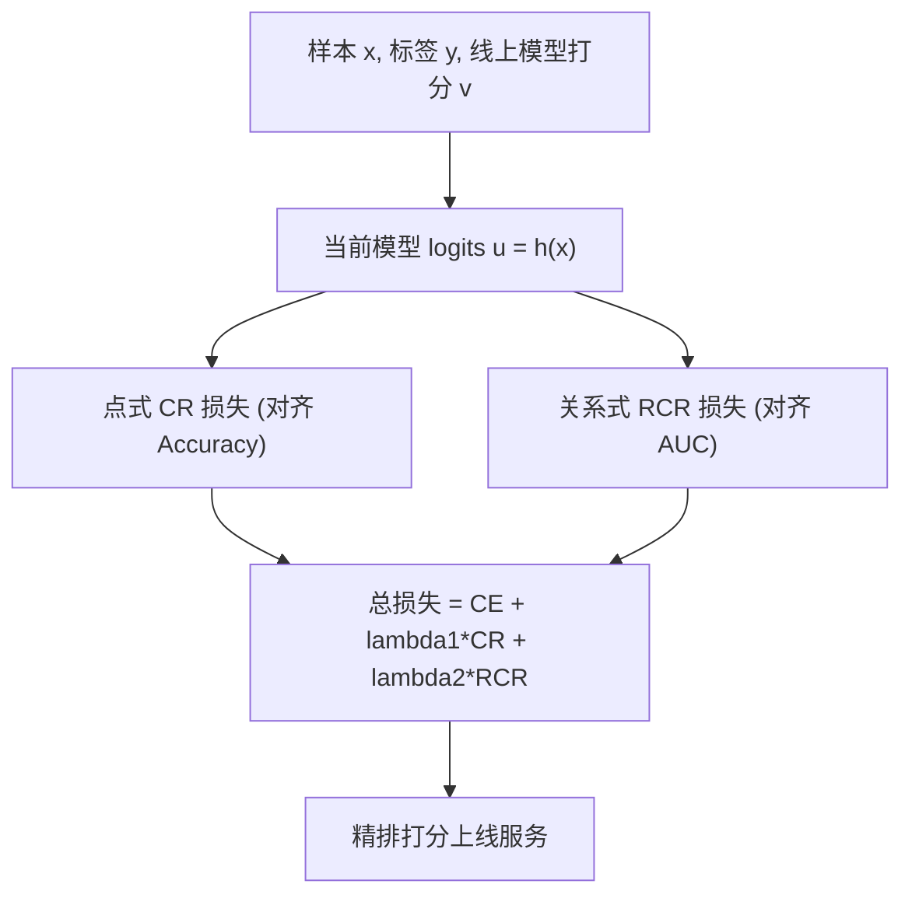

# Confidence Ranking for CTR Prediction (面向 CTR 预估的置信度排序损失)

- **会议/期刊**: WWW 2023
- **作者与机构**: Jian Zhu, Congcong Liu, Pei Wang, Xiwei Zhao, Zhangang Lin, Jingping Shao（京东 JD.com）
- **推荐链路定位**: 精排（fine-rank），同时覆盖离线重训与在线学习两个阶段
- **研究方向**: CTR/CVR 预估与特征交叉 / 工业级架构与在线学习
- **论文原文**: [论文原文链接](https://arxiv.org/abs/2307.01206v1)
- **开源代码**: 暂未开源

## TL;DR (1分钟核心速览)

工业 CTR 系统靠"周期性全量重训 + 分钟级在线学习"追分布漂移，但 ERM 只用标签监督，浪费了线上已部署模型携带的决策边界信息；知识蒸馏又要求 teacher 严格强于 student，而重训模型容量往往不弱于线上模型，蒸馏反而成为约束。本文提出 **Confidence Ranking (CR)**：把优化目标写成"当前模型指标须优于线上模型"的约束排序问题，导出点式 $\ell_{CR}$（对齐 Accuracy）与关系式$\ell_{RCR}$（对齐 AUC）两个代理损失，与交叉熵联合训练。在 Avazu/Avito/京东 12B 工业数据上全库 AUC 全面超越 DCN/PNN/DeepFM/KD/RKD/SC，线上 5 天 A/B 平均 **+1.75% CTR**。

## Background & Motivation (背景与核心矛盾)

- **主流范式**: 线上系统按 $\Delta=24h$全量重训、$\Delta<10min$ 增量在线学习，模型统一用二元交叉熵 ERM 拟合点击标签，收敛后即上线服务。
- **前人局限**: ① 蒸馏类方法（KD/RKD）要求 teacher 强于 student 且容量差距不大，而重训模型能力未必弱于线上模型，dark knowledge 的梯度方向可能是"拉平"而非"抬升"；② ERM 只建模 $P(y\mid x)$，完全忽略"数据由哪一版线上模型产生"这一事实，模型演进带来的决策边界漂移无从校正。
- **核心洞察 (Key Insight)**: 线上模型的 logits 是一个天然的**参照锚点**——不必去逼近它，而应要求新模型在**同一排序意义上严格超越它一个 margin**。作者把"更好"形式化为 $\mathcal{C}(f)=\mathcal{M}(y,f(x))-\mathcal{M}(y,f_{online}(x))>0$，并给出偏差-方差界$\mathbb{E}[(\hat{R}(f)-R(f))^2]\le\mathbb{E}[(R(f_t))^2]$，说明 CR 风险始终在逼近 Bayes 概率。
- **本文切入点**: 用可微的排序代理损失替代不可微的 0-1 指标约束，让"超越线上模型"成为可训练的优化目标。

## Method (核心方法设计)

### 1. 整体框架 (Overall Architecture)

训练样本除 $(x,y)$外额外落一份线上模型打分$v=h_{online}(x)$（上线时即记录，零额外特征工程）。当前模型输出$u=h(x;\theta)$，分别进入点式 CR 分支（对每个样本独立比较$u$与$v$）与关系式 RCR 分支（对 batch 内正负样本对的 logit 间隔进行比较），二者与交叉熵加权求和后反传；推理阶段只保留当前模型，与普通精排模型完全一致，**无任何在线开销增量**。关键点在于 teacher 是"上一版部署模型/上一 epoch 快照"，随训练滚动更新，因此是自洽的、不依赖外部强模型的自蒸馏式排序约束。

### 2. 关键设计拆解 (Key Designs)

1. **点式 Confidence Ranking（对齐 Accuracy）**：Accuracy 的期望增益 $C_{acc}(f)=\frac{1}{n}\sum_i\mathbb{I}[y_i f(x_i)>y_i f_{online}(x_i)]$不可微，故用严格 proper 的 logistic 排序代理替换，令$u,v$ 为两者 logits：
$\ell_{CR}=\frac{1}{n}\sum_{i=1}^{n}y_i\log(1+e^{-(u-v)})+(1-y_i)\log(1+e^{u-v})$其物理直觉极强：正样本被推向$u\gg v$、负样本被推向$u\ll v$，即**相对线上模型拉开置信度间隔**，而不是像 KD 那样把$u$拉回$v$。这也解释了图 2 中 CR 同时压低正负样本均值、样本间隔仅微增的现象（CTR 数据负样本主导）。

2. **关系式 Relational CR（对齐 AUC）**：AUC 关心的是 bipartite 排序间隔，故把比较对象从"单点 logit"换成"正负对间隔" $d_h(x_i^+,x_j^-)=h(x_i^+)-h(x_j^-)$：
$\ell_{RCR}=\frac{1}{nm}\sum_{i=1}^{n}\sum_{j=1}^{m}\log\big(1+e^{-(u-v)}\big),\quad u=d_h(x_i^+,x_j^-),\ v=d_{h_{online}}(x_i^+,x_j^-)$
只要求新模型的类间间隔大于线上模型的间隔，直接对应 AUC 的优化方向。图 2 显示 RCR 同时**压低负样本均值并抬高正样本均值**，是三种变体中 bipartite 间隔最大、AUC 最高的原因。

3. **训练目标、负采样与推理效率**：总损失
$\mathcal{L}=\ell_{ce}+\lambda_{CR_{acc}}\ell_{CR}+\lambda_{RCR_{auc}}\ell_{RCR}$RCR 的配对采样不做任何筛选，**直接枚举 mini-batch 内全部正负对**（无需 hard negative 挖掘，成本可忽略）。$\lambda$在$[0.1,2.0]$内搜索，公开数据集取$[0.4,0.5]$、工业数据取$[0.5,1.0]$。推理阶段与 backbone 完全相同，零延迟增加。

## Experimental Setup & Evaluation Protocol (实验设置与评估协议)

- **数据集与预处理**: 特征全部离散化为稀疏匿名 ID，无 5-core 过滤（工业日志全量保留）：

| 数据集 | #Users | #Items | #Interactions | 稀疏度/密度 | 特征/场景说明 |
| :--- | :---: | :---: | :---: | :---: | :--- |
| Avazu | N/A | N/A | 40,428,967 | 22 fields / 2,018,012 特征 | Kaggle 展示广告点击 |
| Avito | 3,163,597 | 28,529 | 190,107,687 | 16 fields / 3,419,165 特征 | Kaggle 分类广告点击 |
| Industrial | N/A | N/A | ~12 Billion | 59 fields | 京东搜索广告一个月日志 |

- **数据划分与防穿越 (Splitting Strategy)**: **全局时间戳切分**——公开集最后一天为 test、倒数第二天为 validation、其余为 train；工业集前 15 天训练、最后一天测试。严格避免未来信息泄漏。
- **排名评测协议 (Ranking Protocol)**: 在完整测试集上计算 **AUC**（全量样本，非负采样排序），3 次运行取均值，std $\le 0.1\%$；作者明确 0.1% AUC 在 Avazu/Avito 上即视为显著。
- **对比基线与超参设置**: backbone 覆盖 DNN / DCN / PNN / DeepFM；对照损失覆盖 ERM、KD、logit 版 RKD$_l$、Self-Correction (SC)。Embedding 维度未特别强调，统一 backbone 保证公平。两种训练设置：**Standard**（多 epoch 至验证收敛，用上一 epoch 输出作参照）与 **One-Pass**（模拟线上：先在$T$天训练，再在$T+1$天服务取$f_{online}(x)$ 后训练，仅一轮）。

## Key Experimental Results (实验关键数据)

### 1. 主实验对比 (Main Results)

AUC(%)，`*` 表示 One-Pass 设置，加粗为最优：

| Methods | Avazu | Avito | Avazu* | Avito* | Industrial* |
| :--- | :---: | :---: | :---: | :---: | :---: |
| DNN | 75.05 | 77.71 | 74.32 | 77.50 | 75.92 |
| DCN | 74.99 | 77.66 | 74.30 | 77.58 | 75.99 |
| PNN | 75.06 | 77.80 | 74.49 | 77.57 | n/a |
| DeepFM | 75.24 | 77.73 | 74.69 | 77.50 | 76.02 |
| DeepFM+KD | 75.41 | 78.01 | 74.83 | 77.54 | 76.18 |
| DeepFM+RKD$_l$ | 75.34 | 77.83 | 74.90 | 77.58 | 76.10 |
| DeepFM+SC | 75.36 | 77.78 | 74.85 | 77.53 | 76.14 |
| DeepFM+CR$_{acc}$ | 75.63 | 78.33 | 74.98 | 77.70 | 76.25 |
| DeepFM+RCR$_{auc}$ | 75.59 | **78.59** | 75.05 | **77.73** | 76.20 |
| **DeepFM+Both** | **75.66** | **78.62** | **75.14** | 77.70 | **76.32** |
| **Improv. (vs DeepFM)** | **+0.42** | **+0.89** | **+0.45** | **+0.20** | **+0.30** |

线上 A/B（2022-08-15 ~ 08-19，5 天，精排主流量）：CTR 提升 +1.62% / +1.73% / +1.90% / +1.83% / +1.67%，**平均 +1.75%**。

### 2. 消融实验 (Ablation Study)

| 配置 | Avazu | Avito | Avazu* | Industrial* | 说明 |
| :--- | :---: | :---: | :---: | :---: | :--- |
| DeepFM (ERM) | 75.24 | 77.73 | 74.69 | 76.02 | 基线 |
| w/o CR, w/ KD | 75.41 | 78.01 | 74.83 | 76.18 | 蒸馏替代 CR |
| w/o CR, w/ RKD$_l$ | 75.34 | 77.83 | 74.90 | 76.10 | 关系式蒸馏 |
| w/o RCR (仅 CR$_{acc}$) | 75.63 | 78.33 | 74.98 | 76.25 | 缺类间间隔约束 |
| w/o CR (仅 RCR$_{auc}$) | 75.59 | 78.59 | 75.05 | 76.20 | 缺逐点约束 |
| Both (完整) | **75.66** | **78.62** | **75.14** | **76.32** | 二者互补 |

### 3. 关键实验发现 (Key Findings)

1. **CR 相对蒸馏的增益是稳定且非平凡的**：Both 相比 DeepFM+KD 在五列上分别 +0.25 / +0.61 / +0.31 / +0.16 / +0.14 AUC，且 KD/RKD 的曲线最平滑（图 2），说明蒸馏把新模型"拉向旧模型"确实抑制了学习能力，而 CR 的"必须超越"方向才提供有效梯度。
2. **RCR 主导排序收益、CR 主导校准收益**：Avito 上 RCR 单独即达 78.59（+0.86），接近 Both 的 78.62；而工业 One-Pass 场景 CR 单独 76.25 略优于 RCR 的 76.20，二者组合取到 76.32，说明在数据量极大的在线场景应保留点式项以稳定 logits 尺度。
3. **One-Pass 场景增益收缩但依然显著**：Avazu 从 Standard 的 +0.42 降到 +0.45→(74.69→75.14)、Avito 从 +0.89 降到 +0.20，原因是单轮训练未充分拟合公开数据集、teacher 快照质量偏低；工业集 +0.30 AUC 已直接对应线上 +1.75% CTR，验证了"重训模型超越部署模型"这一目标的可实现性。

## Highlights & Limitations (亮点、对比与审稿批判)

- **与代表作对比 (vs. Prior Work)**: 与 KD/RKD 的本质区别在于**梯度符号相反**——蒸馏最小化 $u$与$v$的散度，CR 最大化$u$与$v$ 的排序间隔；与 Self-Correction (SC) 相比，SC 只做标签层面的自纠正，CR 引入了成对类间结构信息；与常规 pairwise BPR 相比，CR 的参照物不是另一个样本而是**另一个模型**，因此不改变样本间相对关系而只改变相对模型的置信度。
- **可迁移亮点**: ① "把已部署模型 logits 当作 margin 锚点"这一 trick 可零成本迁移到任何有模型版本迭代的场景（召回双塔、多任务精排、生成式推荐）；② 用 batch 内全配对做 RCR、免负采样挖掘，实现成本极低，适合工程落地。
- **审稿级局限批判**: ① 理论仅给出定性偏差-方差界，作者自承对深度网络"可能松且不稳定"，缺乏泛化误差的定量刻画；② 参照模型 $f_{online}$的获取在公开数据集上依赖人为构造的 serving-and-training 循环（$T+1$天服务取分），与真实工业分布仍有 gap，One-Pass 增益明显偏小；③ 未报告训练时间/显存开销与$\lambda$敏感性曲线，RCR 的$O(nm)$ 配对在超大 batch 下的复杂度未讨论；④ 主实验 backbone 固定 DeepFM，未验证在 DCN-v2、多任务 MMoE 等更强结构上是否仍有增量。

## Rating (四维评分)

- **方法创新性 (Novelty)**: ⭐⭐⭐⭐ （把"超越线上模型"形式化为约束排序问题、并区分点式/关系式两种代理，视角新颖，但本质仍是 pairwise logistic 损失的变体迁移）
- **评估协议与实验扎实度 (Protocol & Experiments)**: ⭐⭐⭐⭐ （时间戳切分 + 全量 AUC + Standard/One-Pass 双设置 + 12B 工业集 + 5 天线上 A/B，工业验证充分；但缺少 λ 敏感性与效率分析）
- **写作与数学规范度 (Clarity & Rigor)**: ⭐⭐⭐ （公式简洁易复现，但 Theorem 1 表述仓促、符号 $u,v$ 在 CR/RCR 中复用未清晰区分，理论部分偏定性）
- **工业落地与复现价值 (Industrial & Practical Value)**: ⭐⭐⭐⭐⭐ （推理零开销、实现仅需多存一列线上打分、已在京东广告精排主流量服务，工程性价比极高）

