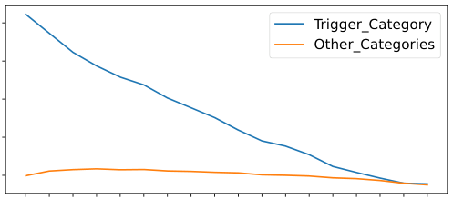
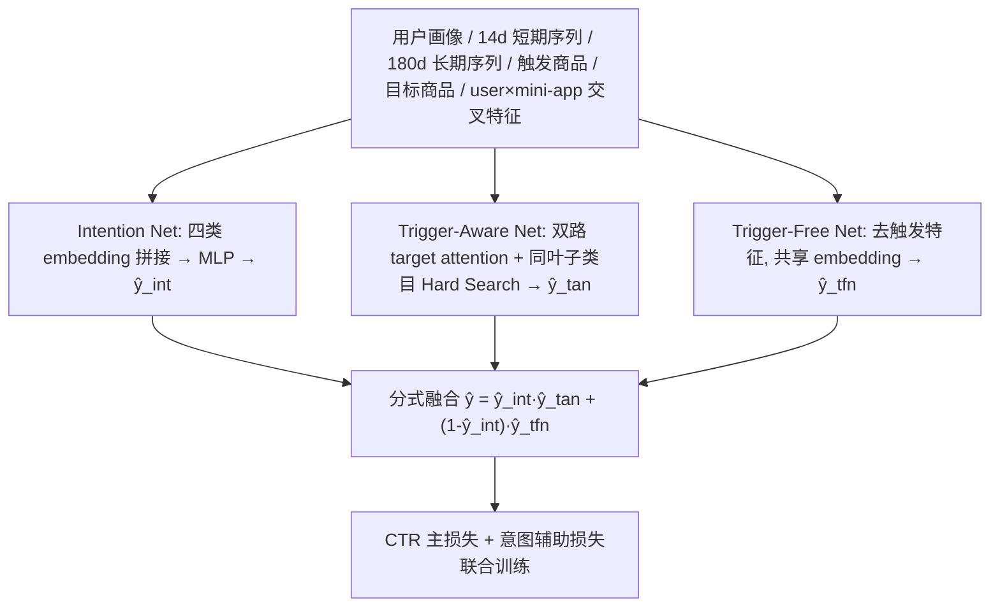

# Deep Intention-Aware Network for Click-Through Rate Prediction (深度意图感知的点击率预估网络)

- **会议/期刊**: WWW 2023 (The Web Conference 2023, Austin, Texas)
- **作者与机构**: Yaxian Xia, Yi Cao, Tong Liu (阿里巴巴), Sihao Hu (佐治亚理工, 通讯), Lingling Lu (浙江大学)
- **推荐链路定位**: 精排 (mini-app feeds 内商品 CTR 预估)
- **研究方向**: CTR/CVR 预估与特征交叉 / 多任务学习
- **论文原文**: [https://arxiv.org/abs/2211.08650v1](https://arxiv.org/abs/2211.08650v1)
- **开源代码**: 暂未开源

## TL;DR (1分钟核心速览)

针对小程序入口「触发商品 (trigger item) 诱导进入」的新场景 TIRA：非触发式模型 (DIN/SIM) 无视触发商品揭示的即时兴趣，而触发式模型 (DIHN) 又过度强调触发相关性、伤害小程序高粘性老用户的日常习惯型需求。DIAN 将 CTR 写成「意图先验 × 两路条件 CTR」的分式边缘化，用「进入后是否仍点击触发品/同叶子类目」构造后验意图标签训练 Intention Net (准确率 91.3%)，动态门控 Trigger-Aware / Trigger-Free 两路专家。10.43B 训练样本的淘宝聚划算数据上 AUC 0.812，线上 IPV +9.39%、CTR +4.74%，已全量部署。

## Background & Motivation (背景与核心矛盾)

- **主流范式**: 电商首页图标位展示 1–2 个个性化触发商品，用户点击后进入 mini-app feeds；follow-up 商品排序沿用 DIN/SIM 类序列 CTR 模型，或 DIHN 类「触发-目标相关性高亮」模型。
- **前人局限 1**: Trigger-free 模型 (DIN/SIM) 把触发商品当作无关输入丢弃，丧失进入瞬间的即时兴趣信号，在触发驱动的流量上系统性低估 CTR。
- **前人局限 2**: Trigger-based 模型 (DIHN) 强行拉高推荐结果与触发品的相关性；但小程序粘性极强，大量进入源于日常购物习惯，强行贴合触发品会破坏老用户需要的多样性。
- **核心洞察 (Key Insight)**: 图 2 显示月访问 >15 次的重度用户，触发品类与其他品类商品的平均 CTR 几乎重合（轻度用户则显著分化）——触发信号的价值取决于「这次进入到底是被触发品吸引，还是习惯驱动」这一未观测意图。
- **本文切入点**: 把进入意图 $Intent\in\{0,1\}$ 显式当作隐变量，用分式分解 + 意图监督让模型自己决定该放大还是抑制触发信号。

<figure class="paper-figure" markdown="span">
  <figcaption>图2：在Juhuasuan中，触发品类与其他品类商品的平均CTR随用户月访问次数的变化</figcaption>
</figure>

## Method (核心方法设计)

### 1. 整体框架 (Overall Architecture)

DIAN 由三个子网构成：Intention Net 输入用户画像、14 天短期序列池化、user×mini-app 交叉特征（月访问次数、平均停留时长）与触发品特征，输出意图概率 $\hat{y}_{int}$；Trigger-Aware Net (TAN) 以触发品与目标品分别作 query，对短期序列做 multi-head target attention、对 180 天长期序列做 SIM 式同叶子类目 Hard Search 后再 attention，得到双路兴趣表示并拼接出$\hat{y}_{tan}$；Trigger-Free Net (TFN) 去掉触发品特征与触发兴趣抽取，退化为 SIM 结构、与 TAN 共享 embedding 层，输出$\hat{y}_{tfn}$。三者在联合损失下一同训练，推理时以$\hat{y}_{int}$ 为门控融合两路 CTR，实现按用户的策略切换。

### 2. 关键设计拆解 (Key Designs)

1. **分式意图边缘化 (Separate Estimation)**：痛点是把两路不同性质的兴趣塞进一个网络只会互相干扰。作者改为按全概率公式拆开，让「意图判据」成为可解释的显式门控：$\hat{y}=\hat{y}_{int}\hat{y}_{tan}+(1-\hat{y}_{int})\hat{y}_{tfn}$，即$P(Click|Target)=\sum_{i}P(Click|Target,Intent=i)P(Intent=i)$。直觉上，触发信号被“按需加权”，重度粘性用户自动回落到 TFN 的多样化输出，轻度用户则由 TAN 承接即时兴趣。

2. **后验意图标注 + 意图辅助任务**：意图在线不可观测，作者用「进入 feeds 后是否仍点击触发品或同叶子类目商品」这一后验行为打标 ($Intent=1$)，再由 Intention Net 在进入时刻（仅依赖先验特征）做预测，避免标签穿越。该辅助任务把隐变量变为可监督目标（acc 91.3%、AUC 0.943），实测若只靠点击主损失让网络“自己学”平衡权重，AUC 反而下降。

3. **双粒度兴趣抽取与参数共享**: TAN 内短期 (14d, attention) 与长期 (180d, Hard Search 后 attention) 的投影矩阵不共享，防止长短期兴趣互相污染；TFN 与 TAN 共享 embedding（CTR 模型参数主体），显著压缩三子网带来的参数膨胀。总损失为 $\mathcal{L}=\mathrm{BCE}(y,\hat{y})+\alpha\,\mathrm{BCE}(y_{int},\hat{y}_{int})$，$\alpha=0.1$；训练在曝光日志上做点式二分类，未使用额外负采样（曝光未点击即负样本），线上推理为一次三塔前向 + 门控加权，开销近似单模型。

## Experimental Setup & Evaluation Protocol (实验设置与评估协议)

- **数据集与预处理**: 淘宝聚划算 (Juhuasuan) 真实曝光/点击日志，未做 k-core 过滤：

| 数据集 | #Users | #Items | #Interactions | 稀疏度/密度 | 特征/场景说明 |
| :--- | :---: | :---: | :---: | :---: | :--- |
| Juhuasuan (工业日志) | 173,406,246 | 6,500,833 | 10,430,212,219 (训练) + 352,959,879 (测试) | ~60 样本/用户，极度稀疏 | 画像、14d 短期/180d 长期点击序列、触发品与目标品特征、月访问次数/平均停留时长等交叉特征 |

- **数据划分与防穿越**: **全局时间戳切分**——训练采样自 2022-08-01 至 09-01，测试采样自 2022-09-02，严格模拟线上 serving，避免未来信息泄漏。
- **排名评测协议**: 非列表级排序，而是**点式 CTR 预估 + AUC**（工业标准），全量曝光样本参与评估，**不做负采样、不报 Full-Ranking 指标**。
- **对比基线与超参设置**: Trigger-free 类 Wide & Deep、DIN、SIM(TFN)；Trigger-based 类 DIHN、TAN。隐层统一 1024×512×256，Adam lr=0.01，attention head 数 4，$\alpha=0.1$；未报告显著性检验。

## Key Experimental Results (实验关键数据)

### 1. 主实验对比 (Main Results)

| 方法 | 类型 | AUC | Improv. (vs DIAN) |
| :--- | :--- | :---: | :---: |
| Wide & Deep | Trigger-free | 0.767 | -5.54% |
| DIN | Trigger-free | 0.791 | -2.59% |
| SIM (TFN) | Trigger-free | 0.800 | -1.48% |
| DIHN | Trigger-based | 0.805 | -0.86% |
| TAN | Trigger-based | 0.806 | -0.74% |
| **DIAN** | 意图感知 | **0.812** | — |

线上 A/B (2022-09-16 至 10-15，对比线上基线 SIM)：

| 方法 | IPV | PV | CTR |
| :--- | :---: | :---: | :---: |
| SIM | 0.555 | 23.93 | 2.32% |
| **DIAN** | **0.607** | **24.91** | **2.43%** |
| Lift | **+9.39%** | +4.10% | **+4.74%** |

### 2. 消融实验 (Ablation Study)

| 变体 | AUC | Δ vs DIAN | 说明 |
| :--- | :---: | :---: | :--- |
| **DIAN (完整)** | **0.812** | — | 三子网 + 意图损失 |
| w/o Intention Net (TAN/TFN 等权平均) | 0.806 | -0.74% | 门控退化为 0.5 固定混合 |
| w/o intention loss (仅 CTR 主损失) | 0.808 | -0.49% | 意图概率无显式监督 |
| Intention Net 单任务 | acc 91.3% / AUC 0.943 | — | 意图辨识本身高度可分 |

### 3. 关键实验发现 (Key Findings)

1. **触发信号有效但“只强化相关性”会饱和**：SIM→TAN 提升 0.75%（0.800→0.806），证明触发即时兴趣确有增量；但专攻触发-目标相关性的 DIHN 仅 0.805，与其在粘性用户群体上破坏多样性的动机分析一致，说明收益瓶颈不在特征而在于“该不该用触发”。
2. **意图门控是主要增益来源**：去掉 Intention Net 改等权平均即掉 0.74%（0.812→0.806），比去掉意图辅助损失（-0.49%）更伤，说明「按人切换策略」比「参数更多」更关键；且仅靠曝光-点击样本无法自监督辨识意图。
3. **意图可高精度弱监督**：后验标注策略使 Intention Net 达 91.3% 准确率 / 0.943 AUC；线上 IPV 提升 +9.39% 显著高于 CTR +4.74% 与 PV +4.10%，表明意图平衡不仅提高单点点击率，还拉长了用户的浏览深度（多样性收益被兑现）。

## Highlights & Limitations (亮点、对比与审稿批判)

- **与代表作对比**: vs **DIHN (WWW'22)**：同样面向 trigger-induced 场景，但 DIHN 只做 trigger-target 相关性高亮（单一触发专家），DIAN 引入意图隐变量做两专家门控，避免对粘性用户过度贴合触发品；vs **SIM**：SIM 的 Hard Search 长序兴趣被完整继承进 TAN/TFN 两路，但缺少触发与意图建模；vs **DIN**：DIN 只有短期序列、无意图分支，AUC 低 2.6 个点。
- **可迁移亮点**: (1)「后验行为构造隐变量标签 + 进入时刻先验特征预测」这套弱监督范式，可直接迁移到 landing page、开屏、直播间入口等"入口诱导"场景；(2) 分式分解 + 门控融合多专家（而非 MMoE 式隐式门控）在需要可解释策略切换的业务里更易调试与灰度。
- **审稿级局限批判**: (1) 意图被强假设为二值，未考虑「多意图并存」或意图强度连续值，且后验标签依赖进入后短窗口的点击行为，探索性点击可能被误标为 $Intent=1$；(2) 三子网 + 14d/180d 双序列 attention 的推理延迟、参数量与吞吐均未报告，工业落地成本缺乏量化证据；(3) 仅单一小程序数据集 + 单一 AUC 指标，无列表级/校准指标，也未做显著性检验，跨场景泛化性有待验证。

## Rating (四维评分)

- **方法创新性 (Novelty)**: ⭐⭐⭐⭐ （分式意图分解本身不复杂，但精准切中“触发 vs 习惯”的场景矛盾，并用后验标注把不可观测意图变成可学习目标，问题建模价值高于算子新颖度）
- **评估协议与实验扎实度 (Protocol & Experiments)**: ⭐⭐⭐ （10B 级工业数据 + 严格时间切分 + 两月线上 A/B 很扎实，但只有单数据集、单 AUC 指标，且缺显著性检验与列表级评估）
- **写作与数学规范度 (Clarity & Rigor)**: ⭐⭐⭐⭐ （三子网公式与损失定义清晰、符号一致，动机图与数据证据呼应；但对意图二值假设的合理性缺乏讨论，复杂度分析缺失）
- **工业落地与复现价值 (Industrial & Practical Value)**: ⭐⭐⭐⭐⭐ （已在淘宝聚划算全量流量上线，线上 IPV +9.39%、CTR +4.74%，工程闭环完整；遗憾的是未开源，且 embedding 共享等实现细节需靠复现推断）

