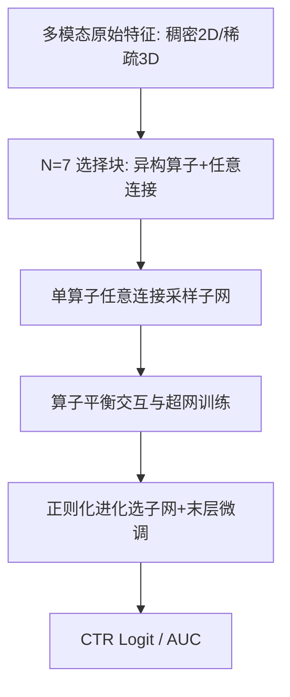
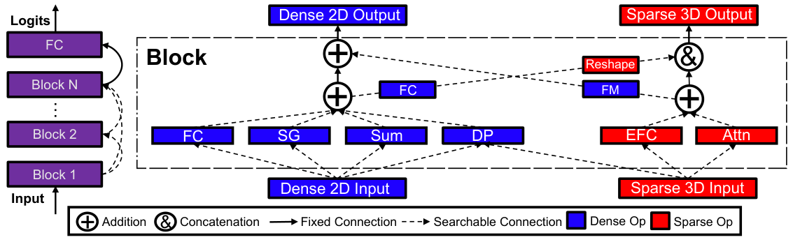
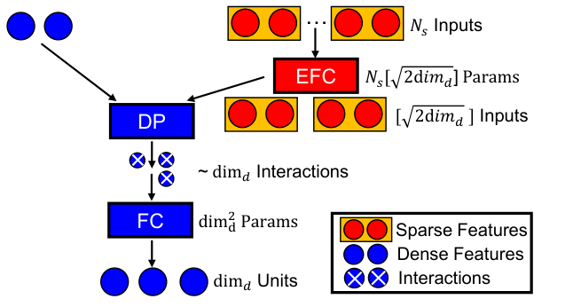

# NASRec: Weight Sharing Neural Architecture Search for Recommender Systems (NASRec：面向推荐系统的权重共享神经架构搜索)

- **会议/期刊**: WWW 2023
- **作者与机构**: Tunhou Zhang, Dehua Cheng, Yuchen He, Zhengxing Chen, Xiaoliang Dai, Liang Xiong, Feng Yan, Hai Li, Yiran Chen, Wei Wen；Duke University / Meta AI / University of Houston
- **推荐链路定位**: 精排（CTR 预估）
- **研究方向**: CTR/CVR 预估与特征交叉
- **论文原文**: [https://arxiv.org/abs/2207.07187v2](https://arxiv.org/abs/2207.07187v2)
- **开源代码**: [https://github.com/facebookresearch/NasRec](https://github.com/facebookresearch/NasRec)

## TL;DR (1分钟核心速览)

针对 CTR 模型依赖人工设计特征交叉、现有 NAS 搜索空间窄且异构算子难训练的问题，NASRec 构建含稠密/稀疏算子与任意连接的超网，以单算子任意连接采样、算子平衡交互和训练后微调提升子网排序，在 Criteo/Avazu/KDD 全量测试上取得 SOTA，搜索仅约 0.3 GPU 天。

## Background & Motivation (背景与核心矛盾)

- **主流范式**: Wide&Deep、DeepFM、DLRM、AutoInt 等以人工设计的特征交叉与稠密连接构建 CTR 精排模型；NAS 方法尝试自动搜索，但多沿用视觉 NAS 的窄空间。
- **前人局限**: AutoCTR/DNAS 主要搜索 FC 与 Dot-Product，空间窄且依赖人工先验；PROFIT 只配置部分架构。推荐数据含 2D 稠密与 3D 稀疏多模态输入，视觉 NAS 的同构块假设失效。
- **核心洞察 (Key Insight)**: 参数化算子采样与连接采样应解耦；Dot-Product 的二次参数开销会造成“算子失衡”，使超网偏好高参数子网并破坏子网排序。
- **本文切入点**: 用大超网覆盖异构算子与任意连接，再用单算子任意连接采样、算子平衡交互、训练后微调恢复排序质量。

## Method (核心方法设计)

### 1. 整体框架 (Overall Architecture)

NASRec 将稠密 2D 与稀疏 3D 特征送入 $N=7$ 个选择块；每块可任选前序块/原始特征连接，并在 FC、Gating、Sum、Dot-Product、EFC、Attention 中采样算子，输出经维度掩码后相加/拼接。超网一次训练、子网共享权重；搜索阶段用单算子任意连接采样训练超网，算子平衡交互抑制 DP 过参数，正则化进化选 top 子网，最后仅微调末层 FC 并在全量嵌入表上重训评估。

<figure class="paper-figure" markdown="span">
  <figcaption>图1：NASRec 搜索空间概览。NASRec 搜索空间支持对构建算子和稠密连接进行完整架构搜索。其中，“蓝色”块产生稠密输出，“红色”块产生稀疏输出。</figcaption>
</figure>
*图1：NASRec 搜索空间概览，蓝色为稠密分支、红色为稀疏分支。*

### 2. 关键设计拆解 (Key Designs)

1. **单算子任意连接采样（Single-operator Any-connection）**：痛点在于 Any-op Any-conn 覆盖广但共适应严重，Single-op Single-conn 覆盖不足。本文每块只采一个稠密/稀疏算子以解耦参数，但允许任意数量连接覆盖连接模式。块输入为  
$X_d^{(N)}=\operatorname{Concat}_{i=1}^{N-1}[Y_d^{(i)}\cdot\mathbb{I}\{\langle i,N\rangle\in C_{\text{sample}}^{(N)}\}]$，  
算子输出为  
$Y_d^{(N)}=\sum_{o\in O}\mathbb{I}\{o\in O_{\text{sample}}^{(N)}\}\cdot\operatorname{Mask}(o(X_d^{(N)}),D_{\text{sample}}^{(N)})$。  
该策略让中等规模子网更常被训练，Criteo 上 Pearson/Kendall 排序相关显著优于两种极端采样。

2. **算子平衡交互（Operator-Balancing Interaction）**：Dot-Product 产生 $N_s^2/2$个 pair，若再接 FC 投影会引入$O(N_s^2 d_{\text{dim}})$参数，导致超网偏好 DP。本文在 DP 前插入 EFC，将稀疏输入投影到$\lceil\sqrt{2d_{\text{dim}}}\rceil$ 维，使  
$W_{\text{EFC}}\in\mathbb{R}^{N_s\times\lceil\sqrt{2d_{\text{dim}}}\rceil}$，DP 参数降为线性增长。这样各算子收敛速度更均衡，超网训练 4h 降至 1.5h，Kendall$\tau$ 从 0.32 升至 0.43。

<figure class="paper-figure" markdown="span">
  <figcaption>图4：算子平衡交互在 Dot-Product 前插入一个简单的 EFC 层，以确保线性参数消耗并平衡构建算子。</figcaption>
</figure>
*图4：在 Dot-Product 前插入 EFC 的算子平衡交互。*

3. **训练目标、负采样与推理效率**：CTR 为 pointwise 二分类，使用全部曝光样本，不做负采样，损失为  
$\mathcal{L}=-\frac{1}{B}\sum_{i=1}^{B}[y_i\log\hat{y}_i+(1-y_i)\log(1-\hat{y}_i)]$。  
超网用 Adagrad、lr=0.12、1 epoch、cosine 训练；子网评估时仅微调末层 FC 约 0.5K 步，缓解权重共适应。在线只部署单个子网，Criteo FLOPs 1.45M，较 AutoCTR 降 8.5×。

## Experimental Setup & Evaluation Protocol (实验设置与评估协议)

- **数据集与预处理**: 原文未给用户/物品统计，三个数据集均沿用 AutoCTR 预处理。

| 数据集 | #Users | #Items | #Interactions | 稀疏度/密度 | 特征/场景说明 |
| :--- | :---: | :---: | :---: | :---: | :--- |
| Criteo | 未列 | 未列 | 未列（沿用 AutoCTR） | 未列 | 稠密+类别，展示广告 CTR |
| Avazu | 未列 | 未列 | 未列（沿用 AutoCTR） | 未列 | 移动广告点击 |
| KDD Cup 2012 | 未列 | 未列 | 未列（沿用 AutoCTR） | 未列 | 搜索广告 CTR |

- **数据划分与防穿越 (Splitting Strategy)**: 按 80%/10%/10% 划分 train/validation/test，测试集全部曝光参与评估，未使用未来信息。
- **排名评测协议 (Ranking Protocol)**: CTR pointwise 二分类评估，报告 Log Loss 与 AUC；测试阶段对全量测试曝光打分，非采样负例排序。
- **对比基线与超参设置**: 对比 DLRM、DeepFM、AutoInt+、AutoCTR、PROFIT、DNAS 等；$N=7$，稠密维度搜 {16,…,1024}，稀疏维度搜 {16,32,48,64}；搜索期嵌入表上限 0.5M，最终评估用全量嵌入表。原文未报告显著性检验。

## Key Experimental Results (实验关键数据)

### 1. 主实验对比 (Main Results)

| 方法 | Criteo LogLoss | Criteo AUC | Avazu LogLoss | Avazu AUC | KDD LogLoss | KDD AUC |
| :--- | :---: | :---: | :---: | :---: | :---: | :---: |
| DLRM | 0.4436 | 0.8085 | 0.3814 | 0.7766 | 0.1523 | 0.8004 |
| DeepFM | 0.4432 | 0.8086 | 0.3816 | 0.7767 | 0.1529 | 0.7974 |
| AutoInt+ | 0.4427 | 0.8090 | 0.3813 | 0.7772 | 0.1523 | 0.8002 |
| AutoCTR | 0.4413 | 0.8104 | 0.3800 | 0.7791 | 0.1520 | 0.8011 |
| PROFIT | 0.4427 | 0.8095 | **0.3735** | 0.7883 | - | - |
| NASRecNet-Small | **0.4399** | **0.8118** | 0.3747 | 0.7887 | 0.1495 | 0.8135 |
| NASRecNet-Full | 0.4408 | 0.8107 | 0.3737 | **0.7903** | **0.1491** | **0.8154** |

相对最强基线：Criteo LogLoss 较 AutoCTR ↓0.32%、AUC ↑0.17%；Avazu AUC 较 PROFIT ↑0.25%，LogLoss 与 PROFIT 基本持平；KDD 较 AutoCTR LogLoss ↓1.91%、AUC ↑1.79%。搜索成本约 0.25–0.3 GPU 天，低于 AutoCTR 的约 0.75 GPU 天。

### 2. 消融实验 (Ablation Study)

| 消融项 | 设置 | Criteo LogLoss | FLOPs(M) | 排序/成本 |
| :--- | :--- | :---: | :---: | :--- |
| 路径采样 | Single-op Any-conn + FT | **0.4408** | **1.45** | 最佳 |
| 路径采样 | Single-op Single-conn + FT | 0.4417 | 1.78 | 下降 |
| 路径采样 | Any-op Any-conn + FT | 0.4413 | 2.04 | 下降 |
| 微调 | Single-op Any-conn, no FT | 0.4410 | 3.62 | 下降 |
| 算子平衡 | Imbalanced DP | - | - | 4h, ρ=.31, τ=.32 |
| 算子平衡 | Balanced DP | - | - | **1.5h, ρ=.46, τ=.43** |

### 3. 关键实验发现 (Key Findings)

1. 全搜索空间并非总在 Criteo 最优：NASRec-Full 在 Avazu/KDD 更强（AUC 0.7903、LogLoss 0.1491），但 Criteo 上 Small 的 0.4399 更优，说明搜索空间应与数据规模匹配。
2. 路径采样决定上限：Single-op Any-conn+FT 的 0.4408 优于 Single-op Single-conn 的 0.4417 与 Any-op Any-conn 的 0.4413；去掉 FT 退化到 0.4410 且 FLOPs 从 1.45M 升至 3.62M。
3. 算子平衡把超网训练 4h 降至 1.5h，Kendall τ 从 0.32 升至 0.43；最终 Criteo 仅 1.45M FLOPs，较 AutoCTR 降 8.5×，说明“搜得准”与“部署轻”可同时成立。

## Highlights & Limitations (亮点、对比与审稿批判)

- **与代表作对比 (vs. Prior Work)**: AutoCTR 只搜 FC/DP 且需多模型训练；DNAS 依赖双层优化；PROFIT 只配置部分架构。NASRec 用单超网覆盖异构算子+稠密连接，搜索成本更低且架构更全。
- **可迁移亮点**: 算子平衡思想可迁移到任意异构算子 NAS；训练后末层微调可低成本修复权重共享 NAS 的排序偏差。
- **审稿级局限批判**: 仅在 3 个公开 CTR 数据集验证，无线上 A/B 与端到端延迟；超网排序相关仍非完美（Pearson 0.57），且搜索期嵌入表截断可能引入偏差。

## Rating (四维评分)

- **方法创新性 (Novelty)**: ⭐⭐⭐⭐ （首次将全架构权重共享 NAS 系统用于异构 CTR 特征交叉，采样与算子平衡有针对性）
- **评估协议与实验扎实度 (Protocol & Experiments)**: ⭐⭐⭐⭐ （三数据集、全量测试、多类基线完整；但缺少显著性检验与线上验证）
- **写作与数学规范度 (Clarity & Rigor)**: ⭐⭐⭐⭐ （搜索空间与采样公式清晰，复杂度分析直观；部分表格信息密度高但略拥挤）
- **工业落地与复现价值 (Industrial & Practical Value)**: ⭐⭐⭐⭐ （开源、搜索约 0.3 GPU 天、FLOPs 低；但工业级特征规模与延迟仍需补充）

