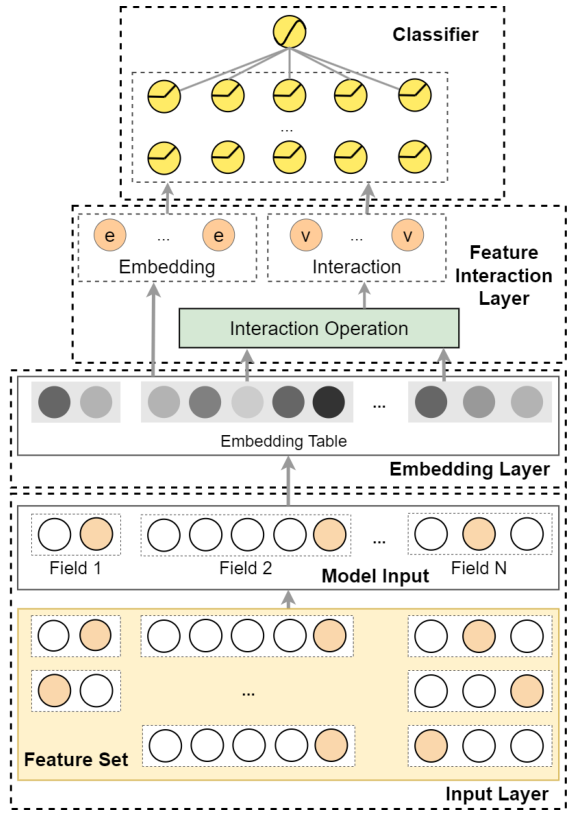
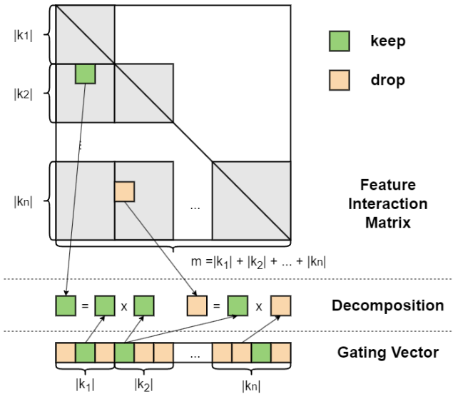
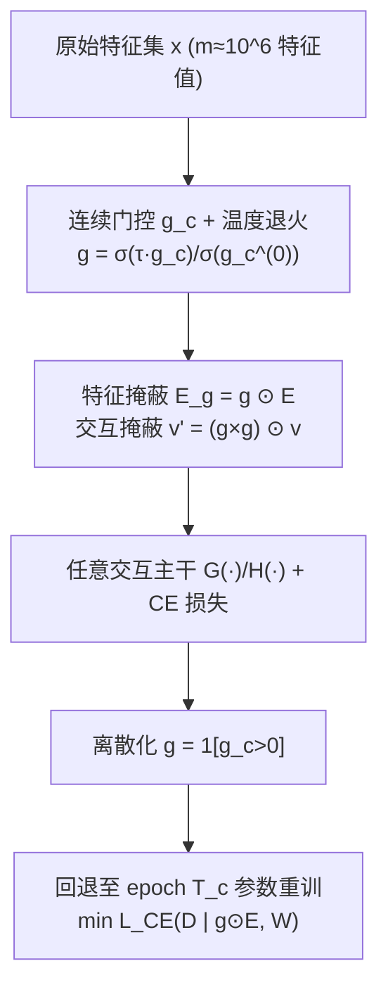

# Optimizing Feature Set for Click-Through Rate Prediction (面向点击率预估的最优特征集优化)

- **会议/期刊**: WWW 2023 (Research Track)
- **作者与机构**: Fuyuan Lyu、Xue Liu（McGill University）；Xing Tang、Liang Chen、Xiuqiang He（腾讯 FiT）；Dugang Liu（广东AI与数字经济实验室/SZ）
- **推荐链路定位**: 精排（输入特征集构造层，可外挂于任意 CTR 主干）
- **研究方向**: CTR/CVR 预估与特征交叉
- **论文原文**: [arXiv:2301.10909v2](https://arxiv.org/abs/2301.10909v2)
- **开源代码**: [fuyuanlyu/OptFS](https://github.com/fuyuanlyu/OptFS)（另有 AutoFS-in-CTR 复现库）

## TL;DR (1分钟核心速览)

盲目把所有特征值灌入特征集既会引入过拟合噪声，也浪费 embedding 存储与交互算力；而现有工作要么做**域级 (field-level)** 粗粒度筛选、要么在**固定特征集**上只筛交互。本文提出 OptFS：给每个特征值配一个可学习门控 $g$，并把二阶交互门控**分解**为$g'_{(k_i,k_j)}=g_{k_i}g_{k_j}$，使特征与交互的选择统一成$m$维搜索问题，再用温度退火的 learning-by-continuation 训练。Criteo 上仅保留 **4.2%** 特征，DeepFM AUC 从 0.8089 升至 **0.8100**；Avazu 上 AUC **+0.45%~0.55%**（$p<0.05$）。

## Background & Motivation (背景与核心矛盾)

- **主流范式**: 通用 CTR 框架先用 embedding 表把域 $z_i$内的某个特征值$x_{k_i}$ 映射为向量，再枚举特征集做内积 / cross / MLP 等显式交互（图 1）。因此**输入特征集**同时决定参数规模与交互质量。

<figure class="paper-figure" markdown="span">
  <figcaption>图1：通用CTR框架概览。</figcaption>
</figure>

- **前人局限 A（粒度过粗）**: AutoField、LPFS 只做**域级**筛选（$n\le 100$个域闸门），对$m\approx 10^6$ 个特征值无分辨力；典型反例是 ID 类域内部冷门 id 应被单独剔除，域级操作只能整域保留或整域丢弃。
- **前人局限 B（交互与特征割裂）**: AutoFIS、OptInter 在**固定全量特征集**上筛交互，冗余特征仍留在表内；AutoCross 分阶段贪心，依赖大量人工规则。
- **核心洞察 (Key Insight)**: 特征与交互互相决定——若 $x_i$被剔除，则所有$\langle x_i,\cdot\rangle$也应失效；反过来说，$\langle x_i,x_j\rangle$有效是保留$x_i$ 的强信号。因此二者必须在**同一端到端目标**下联合决定。
- **本文切入点**: 用一次门控向量 $g$同时定义特征集与特征交互集，把$\binom{m}{2}\approx 10^{12}$的交互空间压缩回$m$。

## Method (核心方法设计)

### 1. 整体框架 (Overall Architecture)

OptFS 分两阶段。**搜索阶段**：为每个特征值引入连续门控 $g_c\in\mathbb{R}^m$，通过温度递增的 sigmoid 得到近似二值门$g$；特征 embedding 与交互向量分别被$\mathbf{g}\odot\mathbf{E}$与$\mathbf{g}\times\mathbf{g}\odot\mathbf{v}$掩蔽后送入主干$G(\cdot),H(\cdot)$与 log-loss 联合优化（图 2）。**重训阶段**：用$g_c>0$离散化得到 0/1 门$g$，回退到第$T_c$轮参数$\{\hat{\mathbf{E}},\hat{\mathbf{W}}\}$ 作为初始化，仅在保留特征集上重训，从而摆脱搜索期非二值门造成的次优解污染。

<figure class="paper-figure" markdown="span">
  <figcaption>图2：OptFS概览。</figcaption>
</figure>

### 2. 关键设计拆解 (Key Designs)

1. **特征级门控（把搜索粒度降到特征值）**：域级选择会把同域的有用/无用特征值一起保留或丢弃。OptFS 改为 $\mathbf{e}^{g}_{k_i}=g_{k_i}\odot(\mathbf{E}\times\mathbf{x}_{k_i})$，即$\hat{y}=F(\mathbf{g}\odot\mathbf{E}\times\mathbf{x}\mid\mathbf{W})$，等价于在 embedding 表上做行级软剪枝。直觉：embedding 表主导 CTR 模型参数量，行级剪枝能同时压缩存储与交互算力。

2. **交互门控分解（让 $m$维门控统管交互）**：直接为每对特征设门需$10^{12}$个变量不可行，而域级交互门$g'_{(i,j)}$无法区分同域内有用/无用交互。作者依据"有用高阶交互源于有用低阶单元"的性质，令$g'_{(k_i,k_j)}=g_{k_i}\times g_{k_j}$，于是
$$\hat{y}=H\big((\mathbf{g}\times\mathbf{g}\odot\mathbf{v})\oplus G(\mathbf{g}\odot\mathbf{e})\big),$$
搜索空间由 $m+\binom{m}{2}$坍缩到$m$，且对 inner product / cross / MLP 等任意算子$O(\cdot)$ 都可端到端求导。

3. **Learning-by-Continuation 与重训**：$g=\sigma(g_c\tau)/\sigma(g_c^{(0)})$，$\tau=\gamma^{t/T}$，早期梯度平滑、后期逐步逼近似 0/1 门；目标加入$\ell_1$项（二值下$\|g\|_0=\|g\|_1$）：
$$\min_{g_c,\mathbf{E},\mathbf{W}}\ \mathcal{L}_{\mathrm{CE}}\big(\mathcal{D}\mid\{g_c\odot\mathbf{E},\mathbf{W}\}\big)+\lambda\|g\|_1 .$$
训练负采样即 CTR 的正常曝光样本流（无额外负采样）；推理时被剪特征直接不查表、不计交互，因此**推理更快**而非更慢。

## Experimental Setup & Evaluation Protocol (实验设置与评估协议)

- **数据集与预处理**（原文未给 #Users/#Items 统计，仅给出字段与预处理）：

| 数据集 | 场景/规模说明 | #域 | 预处理 |
| :--- | :--- | :---: | :--- |
| Criteo | 一周广告点击日志（工业级） | 26 类 + 13 数值 | 数值 $x\to\lfloor\log_2 x\rfloor$；类别 min_count=2，其余置 `OOV` |
| Avazu | 10 天移动广告日志 | 24（全类别） | 删 `instance_id`，时间戳拆为 hour/weekday/is_weekend；min_count=2 → `OOV` |
| KDD12 | 搜索会话广告日志 | 11 | 同上去低频，置 `OOV` |

- **数据划分与防穿越 (Splitting Strategy)**: 原文未显式声明划分方式，实现基于 `pytorch-fm` 库默认的随机切分（非全局时间戳切分），故严格来说存在轻度时间穿越风险。
- **排名评测协议 (Ranking Protocol)**: 点式 CTR 评估，指标为 **AUC** 与 **Logloss**，在完整曝光样本上计算（非采样负例、非 Full-Ranking 列表排序）；AUC 提升 0.1% 视为显著，另用双侧 t 检验（$p<0.05$）标注显著性。
- **对比基线与超参**: 特征选择基线 AutoField / LPFS / AdaFS，交互选择基线 AutoFIS，主干为 FM / DeepFM / DCN / IPNN；embedding 维 $d=16$，batch 4096，MLP$[1024,512,256]$，Adam + BN + Xavier；$\lambda\in\{1\text{e-}8,\dots,1\text{e-}9\}$，$T\in\{5,10,15\}$，$\gamma\in\{2\text{e}2,\dots,1\text{e}4\}$，$T_c\in\{1,\dots,T-1\}$。指标另设特征保留率$\text{Ratio}=\#\text{Remaining Features}/m$。

## Key Experimental Results (实验关键数据)

### 1. 主实验对比 (Main Results)

| 数据集 / 主干 | 方法 | AUC↑ | Logloss↓ | Ratio↓ |
| :--- | :--- | :---: | :---: | :---: |
| Criteo / DeepFM | Backbone | 0.8089 | 0.4426 | 1.0000 |
| | LPFS | 0.7915 | 0.4579 | 0.2415 |
| | AutoField | 0.8072 | 0.4439 | 0.3811 |
| | AdaFS | 0.8005 | 0.4501 | 1.0000 |
| | **OptFS** | **0.8100** | **0.4415** | **0.0422** |
| Criteo / IPNN | Backbone / AutoField / **OptFS** | 0.8110 / 0.8115 / **0.8116** | 0.4407 / 0.4401 / **0.4401** | 1.0 / 0.9997 / **0.0719** |
| Avazu / DeepFM | Backbone | 0.7901 | 0.3757 | 1.0000 |
| | LPFS / AutoField / AdaFS | 0.7635 / 0.7870 / 0.7797 | 0.3942 / 0.3773 / 0.3837 | 0.9975 / 1.0 / 1.0 |
| | **OptFS** | **0.7946** (+0.97%) | **0.3712** | **0.8686** |
| Avazu / IPNN | Backbone / AutoField / **OptFS** | 0.7913 / 0.7865 / **0.7950** | 0.3744 / 0.3770 / **0.3709** | 1.0 / 0.9992 / **0.9118** |
| KDD12 / DeepFM | Backbone / LPFS / AutoField | 0.7967 / 0.7964 / 0.7919 | 0.1531 / 0.1532 / 0.1542 | 1.0 / 1.0 / 0.9962 |
| | **OptFS** | **0.7988** (+0.30%) | **0.1527** | **0.9046** |

与交互选择基线 AutoFIS 对比：Criteo/DeepFM 上 AutoFIS 0.8097（Ratio 1.0）vs **OptFS 0.8100（Ratio 0.0422）**；Avazu/DeepFM 上 0.7928 vs **0.7946**（Ratio 0.8686），即在更小特征集上更优。

### 2. 消融实验 (Ablation Study)

重训策略消融（`w.o.` 不重训、`r.i.` 随机初始化、`l.t.h.` 彩票假设同种子、`c.i.` 本文回退 $T_c$ 初始化）：

| 主干 | Criteo w.o./r.i./l.t.h./**c.i.** | Avazu w.o./r.i./l.t.h./**c.i.** |
| :--- | :--- | :--- |
| DeepFM | 0.8012 / 0.8100 / 0.8100 / **0.8100** | 0.6972 / 0.7873 / 0.7883 / **0.7946** |
| DCN | 0.8077 / 0.8109 / 0.8108 / **0.8111** | 0.7122 / 0.7870 / 0.7858 / **0.7932** |
| IPNN | 0.7757 / 0.8113 / 0.8114 / **0.8116** | 0.7560 / 0.7912 / 0.7910 / **0.7950** |

### 3. 关键实验发现 (Key Findings)

1. **域级基线会伤效果，特征级不会**：Criteo 上 LPFS/AdaFS 在 DeepFM 分别掉 **−1.74pt / −0.84pt** AUC，而 OptFS 在仅保留 4.2% 特征时仍 **+0.11pt**；说明粗粒度筛选"整域丢弃"必然误删同域内有效特征值。
2. **交互分解带来数量级稀疏而不损精度**：AutoFIS 保留 100% 特征换取 0.8097，OptFS 用 4.22% 特征取得 0.8100，等价于把交互搜索空间从 $\binom{m}{2}$降到$m$后精度不退化——验证$g'=g_ig_j$ 的乘性假设在本任务上成立。
3. **重训不可省且初始化敏感**：Avazu 上不重训 AUC 从 0.7946 崩到 0.6972（**−9.7pt**），因搜索期门 $g$ 非二值污染了 embedding；回退初始化比随机初始化再高 **+0.73pt**，源于 Avazu 主干常在 1 个 epoch 即早停，对初始化极敏感。

## Highlights & Limitations (亮点、对比与审稿批判)

- **与代表作对比**: 相比 AutoField/LPFS（域级硬选，无交互视角）与 AutoFIS/OptInter（固定特征集上筛交互，不降存储），OptFS 首次把两者统一为**一个** $m$ 维门控；相比 AutoCross 的分阶段贪心，本文是单目标端到端可微搜索，无需人工规则。
- **可迁移亮点**: (i) 用 $g_ig_j$乘性分解替代成对门控，可迁移到任意"高阶组合选择"场景（如序列物品集剪枝、多任务专家选择）；(ii) 搜索→离散化→回退重训三段式，是把$\ell_0$ 硬约束落到工业训练流水线的通用配方。
- **审稿级局限批判**: ① 搜索阶段需额外训练 $T\le 15$轮再重训，总训练开销约 2 倍以上，论文只报告**推理**时间与特征率，未给搜索期 wall-clock 成本；② 评估仅点式 AUC/Logloss、仅离线公开数据集，缺乏 Full-Ranking 视角与线上 A/B；③ 对$\lambda,\gamma,T,T_c$ 四个强耦合超参未做敏感性分析，泛化性存疑；④ `min_count=2` 把低频值统一置 `OOV`，等价于提前做了粗粒度剪枝，与"特征级最优"的主张存在一定口径重叠。

## Rating (四维评分)

- **方法创新性 (Novelty)**: ⭐⭐⭐⭐ （$g'=g_ig_j$乘性分解把$10^{12}$交互门控压回$m$，优雅且理论上有低阶支撑，但整体属 NAS/稀疏化在 CTR 的应用迁移）
- **评估协议与实验扎实度 (Protocol & Experiments)**: ⭐⭐⭐⭐ （3 数据集 × 4 主干、含显著性检验、迁移性与效率分析齐全；扣分在划分方式未声明、无线上验证）
- **写作与数学规范度 (Clarity & Rigor)**: ⭐⭐⭐⭐ （问题形式化清晰、门控与退火公式完整、附算法伪码；但式 (9)(13) 符号 $g$与$g'$ 混用略欠严谨）
- **工业落地与复现价值 (Industrial & Practical Value)**: ⭐⭐⭐⭐⭐ （代码与三个基线复现均开源，直接降低 embedding 存储与推理时延，可直接挂在现有精排链路上）

