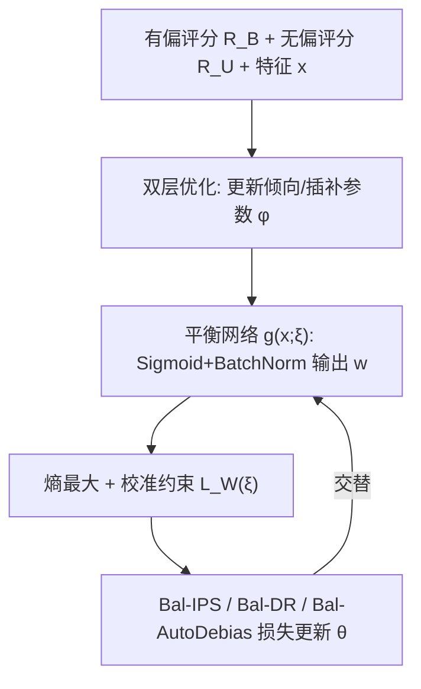
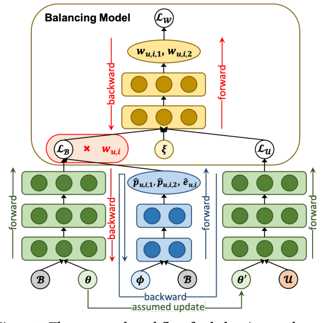

# Balancing Unobserved Confounding with a Few Unbiased Ratings in Debiased Recommendations (基于少量无偏评分平衡未观测混杂的去偏推荐)

- **会议/期刊**: WWW 2023 (Proceedings of the ACM Web Conference)
- **作者与机构**: Haoxuan Li (北京大学)、Yanghao Xiao (中国科学院大学)、Chunyuan Zheng (UCSD)、Peng Wu (北京工商大学，通讯)
- **推荐链路定位**: 精排（评分预测 / 排序打分）
- **研究方向**: 去偏公平、可信隐私与工业架构（因果去偏）
- **论文原文**: [https://arxiv.org/abs/2304.09085v1](https://arxiv.org/abs/2304.09085v1)
- **开源代码**: 暂未开源

## TL;DR (1分钟核心速览)

现有去偏方法（IPS/DR/AutoDebias）只用少量无偏评分去**调参**倾向与插补模型，一旦存在未观测混杂或模型误设，估计仍然有偏。本文把假设空间从 $\mathcal{H}_\phi$扩到$\mathcal{H}_{Bal}$，为每个有偏样本学一个平衡权重$w_{u,i}$，以「重加权有偏损失 = 无偏损失」为约束、以权重熵最大为目标解一个凸优化问题，并与预测模型交替更新。方法模型无关，可直接套在任意去偏器上；在 Music/Coat 上以全库排序评测，Bal-AutoDebias 相对最优基线 NDCG@5 提升 3.88%/4.21%。

## Background & Motivation (背景与核心矛盾)

- **主流范式**: 用 IPS 逆概率加权、DR 双稳健插补，或以双层优化 (LTD/AutoDebias) 拿少量无偏评分修正倾向/插补模型参数 $\phi$，再用修正后的$\phi$训练预测模型$\theta$。
- **前人局限**: ① 无偏性依赖无混杂假设 $o_{u,i}\perp\!\!\perp e_{u,i}\mid x_{u,i}$，但真实系统中存在同时影响曝光与评分的隐变量$h$；② 双层优化只把无偏数据用于$\phi$的**模型选择**，预测模型的假设空间仍被限制在$\mathcal{H}_\phi=\{L_B(\theta,\phi)\mid\phi\in\Phi\}$，当$\mathcal{L}_{ideal}\notin\mathcal{H}_\phi$（模型误设）时无法纠偏。
- **核心洞察 (Key Insight)**: Lemma 1 证明即使 $\hat{p}=p$、$\hat{e}=g$完全准确，偏差仍为一个协方差项$\mathbb{E}[\hat{\mathcal{L}}_{DR}]-\mathbb{E}[\mathcal{L}_{ideal}]=\mathrm{Cov}\!\left(\frac{o_{u,i}-p_{u,i}}{p_{u,i}},\,e_{u,i}-g_{u,i}\right)\neq 0$——偏差不能靠"更准的倾向模型"消掉，只能靠**扩大假设空间**吸收。
- **本文切入点**: 把无偏评分从"调参工具"升级为"约束锚点"，用可学习的平衡系数把有偏损失整体校准到无偏损失上。

## Method (核心方法设计)

### 1. 整体框架 (Overall Architecture)

四步闭环：(1) 在 $\mathcal{R}_B$上做一次**假定**的预测模型更新$\theta(\phi)\!\to\!\theta'(\phi)$；(2) 用$\mathcal{R}_U$通过双层优化更新倾向/插补参数$\phi$；(3) 用$\mathcal{R}_B$与$\mathcal{R}_U$联合训练平衡网络$g(x;\xi)$输出$w_{u,i}$；(4) 用平衡后的损失$\boldsymbol{w}^{\top}L_B$**真正**更新$\theta$。步骤 (3)(4) 交替进行，使无偏评分不仅修正$\phi$，还持续牵引$\theta$ 的更新方向。

<figure class="paper-figure" markdown="span">
  <figcaption>图1：所提出的用于平衡未观测混杂的工作流包含四个步骤：(1) 假设使用 RB 将预测模型参数从 𝜃(𝜙) 更新为 𝜃′(𝜙)</figcaption>
</figure>

### 2. 关键设计拆解 (Key Designs)

1. **熵最大平衡权重（Balancing Weights）**：痛点是有偏损失与无偏损失的期望不相等，且逐样本权重不可辨识。本文将权重求解写成凸规划：最大化经验熵以防极端权重，同时施加正性、归一化与校准三条约束，对 IPS 即
$\max_{\boldsymbol{w}}\sum_{(u,i)\in\mathcal{B}}w_{u,i}\log w_{u,i}\ \ \text{s.t.}\ w_{u,i}>0,\ \tfrac{1}{|\mathcal{B}|}\sum_{\mathcal{B}}w_{u,i}=\tfrac{1}{|\mathcal{D}|},\ \sum_{\mathcal{B}}w_{u,i}\tfrac{e_{u,i}}{\hat{p}_{u,i}}=\tfrac{1}{|\mathcal{U}|}\sum_{\mathcal{U}}e_{u,i}$。
直觉：$w\equiv|\mathcal{D}|^{-1}$时退化为标准 IPS（熵最大但无纠偏），约束式强制有偏侧的加权误差与无偏侧经验误差对齐，从而把混杂造成的系统性偏移"吸收"进权重；DR/AutoDebias 版本只是把左侧替换为$\sum_{\mathcal{D}}w_{1}\hat{e}+\sum_{\mathcal{B}}w_{2}\tfrac{e-\hat{e}}{\hat{p}}$或$\sum_{\mathcal{D}}w_1\tfrac{\hat{e}}{\hat{p}_1}+\sum_{\mathcal{B}}w_2\tfrac{e}{\hat{p}_2}$。Theorem 4 用 KKT 条件证明全局最优解存在（目标严格凸、等式约束仿射）。
2. **权重重参数化 + 交替训练**：$\mathcal{R}_B$规模巨大时逐样本求解不可行，故令$w_{u,i}=g(x_{u,i};\xi)$，末层用 Sigmoid 保证正性、BatchNorm 保证归一化，损失为
$\mathcal{L}_{W\text{-}IPS}(\xi)=-\sum_{\mathcal{B}}w_{u,i}\log w_{u,i}+\lambda\Big[\sum_{\mathcal{B}}w_{u,i}\tfrac{e_{u,i}}{\hat{p}_{u,i}}-\tfrac{1}{|\mathcal{U}|}\sum_{\mathcal{U}}e_{u,i}\Big]^2$，
$\lambda$权衡熵正则与校准强度；$\lambda=0$即退化为原方法。给定$w$后预测模型最小化$\mathcal{L}_{Bal\text{-}IPS}(\theta)=\sum_{\mathcal{B}}w_{u,i}e_{u,i}/\hat{p}_{u,i}$（或对应 Bal-DR / Bal-AutoDebias），二者交替更新。
3. **训练目标与开销**：总损失即 $\mathcal{L}_{W}(\xi)$与$\mathcal{L}_{Bal}(\theta)$的交替最小化，无需额外负采样（评分预测任务在全库上排序）；相比 LTD/AutoDebias 约 1.5× 训练时间，相比两阶段学习 ≤3×，推理阶段无任何附加开销（$w$ 只参与训练）。

## Experimental Setup & Evaluation Protocol (实验设置与评估协议)

| 数据集 | #Users | #Items | #Interactions | 稀疏度 | 特征/场景说明 |
| :--- | :---: | :---: | :---: | :---: | :--- |
| Music | 15,400 | 1,000 | 311,704 (MNAR) + 54,000 (MAR) | 训练集 2.0% | Yahoo Music，含 MNAR 选择偏差与 MAR 均匀评分 |
| Coat | 290 | 300 | 6,960 (MNAR) + 4,640 (MAR) | 训练集 8.0% | Coat 自选评分，MNAR/MAR 双份评分 |

- **数据划分与防穿越**: 全部有偏评分作训练集；无偏评分随机切分为 **5% 平衡集 / 5% 验证集 / 90% 测试集**（Music 测试 48,600、Coat 测试 4,176，均为无偏样本）。
- **排名评测协议**: 在无偏测试集上做 **Full-Ranking 全库排序**（对每个测试用户按其全部候选物品的预测分排序），指标 AUC、NDCG@5、NDCG@10，完全避开有偏训练分布，评测协议干净。
- **对比基线**: MF(biased/uniform/combine)、IPS、DR、CausE、KD-Label、AutoDebias；$\lambda\in\{0,2^{-9},2^{-6},2^{-3},1\}$，Adam 优化$\phi$（lr 1e-4~1e-2），SGD 优化$\theta$与$\xi$（lr 1e-7~1），全部超参在验证集上选择。

## Key Experimental Results (实验关键数据)

### 1. 主实验对比 (Main Results)

| Method | Music AUC | Music N@5 | Music N@10 | Coat AUC | Coat N@5 | Coat N@10 |
| :--- | :---: | :---: | :---: | :---: | :---: | :---: |
| MF (uniform) | 0.573 | 0.449 | 0.591 | 0.579 | 0.358 | 0.482 |
| MF (biased) | 0.727 | 0.550 | 0.655 | 0.747 | 0.500 | 0.606 |
| CausE | 0.731 | 0.551 | 0.656 | 0.761 | 0.500 | 0.605 |
| KD-Label | 0.740 | 0.580 | 0.680 | 0.750 | 0.504 | 0.610 |
| IPS | 0.723 | 0.549 | 0.656 | 0.760 | 0.509 | 0.613 |
| DR | 0.724 | 0.550 | 0.656 | 0.765 | 0.521 | 0.620 |
| AutoDebias | 0.741 | 0.645 | 0.725 | 0.766 | 0.522 | 0.621 |
| Bal-IPS | 0.727 | 0.564 | 0.668 | 0.771 | 0.521 | 0.628 |
| Bal-DR | 0.731 | 0.569 | 0.669 | 0.770 | 0.523 | 0.628 |
| **Bal-AutoDebias** | **0.749** | **0.670** | **0.744** | **0.772** | **0.544** | **0.640** |
| Improv.% (vs. 对应基线) | +1.08% | +3.88% | +2.62% | +0.78% | +4.21% | +3.06% |

### 2. 消融实验 (Ablation Study)

| 变体（$w_{u,i,1}$/$w_{u,i,2}$ 建模器） | Music AUC | Music N@5 | Music N@10 | Coat AUC | Coat N@5 | Coat N@10 |
| :--- | :---: | :---: | :---: | :---: | :---: | :---: |
| $\lambda=0$（退化为 AutoDebias，无平衡） | 0.741 | 0.645 | 0.725 | 0.766 | 0.522 | 0.621 |
| MF / MF | 0.749 | 0.670 | 0.744 | 0.772 | 0.544 | 0.640 |
| MF / NCF | 0.745 | 0.667 | 0.742 | 0.769 | 0.539 | 0.635 |
| **NCF / MF** | **0.762** | **0.675** | **0.748** | **0.774** | **0.548** | **0.646** |
| NCF / NCF | 0.749 | 0.671 | 0.745 | 0.771 | 0.545 | 0.639 |

### 3. 关键实验发现 (Key Findings)

1. **平衡项是唯一增益来源**：$\lambda=0$时权重恒为$1/|\mathcal{D}|$并严格退化为 AutoDebias（Music N@5 0.645），打开约束后升至 0.670；且 Figure 2 显示$\lambda$呈倒 U 形，最优约$2^{-6}$，说明纠偏强度与损失估计保真之间存在真实权衡，而非单调"越强越好"。
2. **无偏数据不能直接训练，但足以校准时**：MF(uniform) 仅用无偏评分训练在 Music 上 AUC 低至 0.573（远劣于 biased MF 的 0.727），验证小样本过拟合；然而 Bal-AutoDebias 仅用 5% 无偏数据做约束锚点即取得最优，在无偏数据比例降到 1% 时仍全面领先，而 CausE 在该档甚至不如 biased MF。
3. **模型无关性可迁移**：以 IPS/DR/AutoDebias 的预训练参数初始化后再跑 Bal 训练，Music 上相对各自初始化分别提升至 N@10 0.733/0.734/0.744，Coat 上 Bal-AutoDebias 相比 DR 初始化仍有 +4.2% N@5；同时因 $|\mathcal{D}|\gg|\mathcal{B}|$，用 NCF 建模稠密的$w_1$、MF 建模稀疏的$w_2$ 最优（Music AUC 0.762），提示平衡网络的容量应随样本规模分配。

## Highlights & Limitations (亮点、对比与审稿批判)

- **与代表作对比 (vs. Prior Work)**: 相比 AutoDebias/LTD 只用无偏数据选 $\phi$、假设空间受限，本文直接学逐样本权重把$\mathcal{L}_{ideal}$ 纳入假设空间；相比 RD 的对抗式敏感性分析只给偏差上界且假设不可验证，本文用少量无偏数据给出**可验证的等式约束**；相比 CausE/KD-Label 的知识蒸馏路线，本文不引入教师—学生结构，是纯损失层面的 wrapper。
- **可迁移亮点**: ① 「熵最大 + 校准等式约束」的权重学习模板可直接搬到点击后转化延迟反馈、多场景损失对齐等需要"少量金标数据校准大规模有偏日志"的场景；② Sigmoid+BatchNorm 的归一化重参数化技巧可用于任何需满足和为定值约束的样本加权模块。
- **审稿级局限批判**: ① 实验仅限 Music/Coat 两个小规模评分预测数据集（Coat 仅 290 用户），缺少大规模工业点击日志与线上 A/B 验证，且无开源代码；② 平衡约束要求 5% 无偏集与有偏集覆盖同一批 $(u,i)$特征空间，若采集机制不同（不同人群/物品）约束可能失配，且$\lambda$ 呈倒 U 形需逐数据集调参，工程上增加了验证成本。

## Rating (四维评分)

- **方法创新性 (Novelty)**: ⭐⭐⭐⭐ （把"无偏数据调参"升级为"无偏数据约束的熵最大重加权"，Lemma 1 的协方差偏差刻画与 Theorem 4 的凸性/KKT 存在性论证构成完整链条）
- **评估协议与实验扎实度 (Protocol & Experiments)**: ⭐⭐⭐⭐ （在独立无偏测试集上做 Full-Ranking，无偏比例 1%–10% 敏感性 + 初始化鲁棒性 + 平衡网络选择消融齐全，但仅两个小规模数据集）
- **写作与数学规范度 (Clarity & Rigor)**: ⭐⭐⭐⭐ （命题—定理—算法三层层层递进，三种去偏器的平衡形式统一书写，符号一致；正文将大量推导置于附录略显紧凑）
- **工业落地与复现价值 (Industrial & Practical Value)**: ⭐⭐⭐⭐ （模型无关即插即用、推理零额外开销、训练仅约 1.5× 于 AutoDebias，代价是需要持续采集少量随机曝光评分且未开源）

