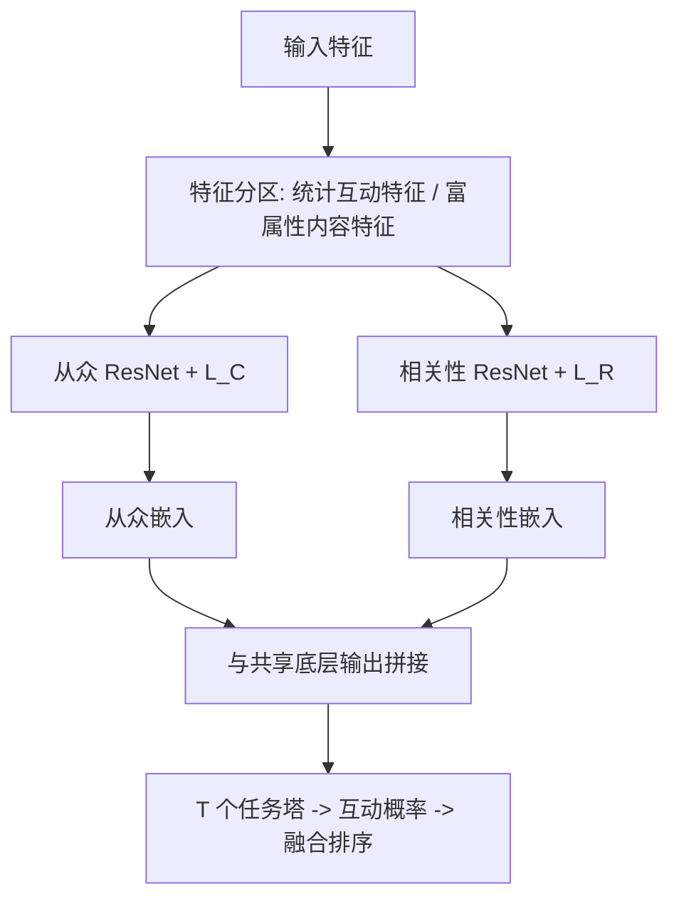
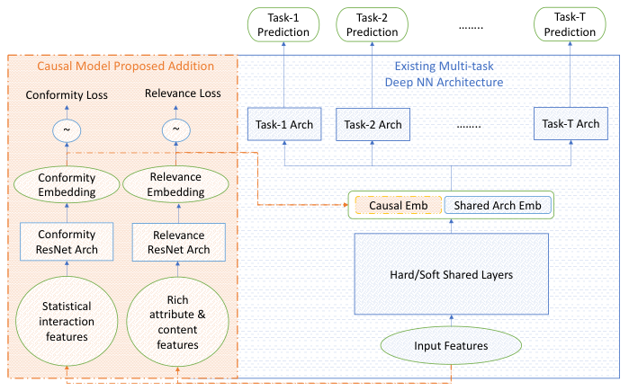
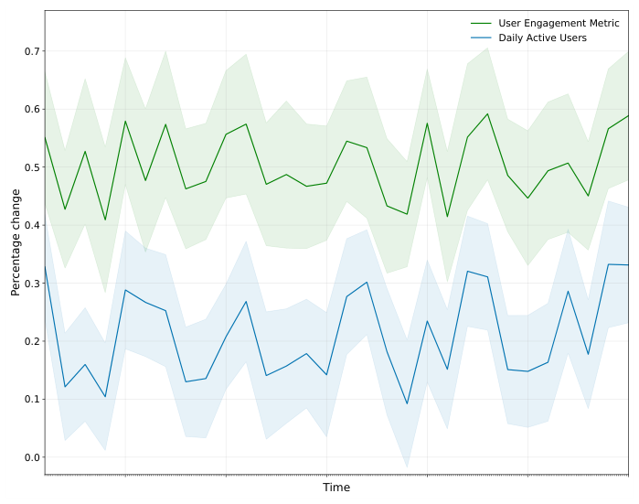

# CAM2: Conformity-Aware Multi-Task Ranking Model for Large-Scale Recommender Systems (面向大规模推荐系统的从众感知多任务排序模型)

- **会议/期刊**: WWW 2023 (Companion, Industrial Track)
- **作者与机构**: Ameya Raul, Amey Porobo Dharwadker, Brad Schumitsch (Meta Inc.)
- **推荐链路定位**: 精排 (Ranking Stage，候选数百条的多任务打分)
- **研究方向**: 去偏公平、可信隐私与工业架构 / 多任务学习与列表级重排
- **论文原文**: [https://arxiv.org/abs/2304.08562v1](https://arxiv.org/abs/2304.08562v1)
- **开源代码**: 暂未开源

## TL;DR (1分钟核心速览)

工业级多任务排序模型直接拟合历史交互，会把“因为视频很火才看”的从众行为误当成用户真实兴趣，导致流行度偏差与长尾内容曝光不足。CAM2 在既有生产 MT-DNN 上并行挂载两个因果辅助子网（从众 / 相关性），以**输入特征分区**替代 DICE 的**训练数据分区**，并用与主任务损失解耦的独立因果损失 + 梯度阻断训练解耦嵌入，再把嵌入拼回共享底层。离线 NE 相对生产模型下降 0.139%，线上 Facebook Watch 互动指标 +0.50%、DAU +0.21%。

## Background & Motivation (背景与核心矛盾)

- **主流范式**: 用多任务深度网络拟合点击/互动/评论等历史标签，soft/hard 参数共享 + 交叉熵训练；去偏侧代表作为 IPS 重加权与 DICE 式因果解耦表征。
- **前人局限**: ①IPS 在物品侧施加静态全局流行度惩罚，忽略**用户间从众程度差异**，且把“病毒式热门”这类合理相关性一并打压；②DICE 需按因果原因切分训练数据子集，因子专属数据稀疏、覆盖不全，且因果模块仍受主任务梯度污染。
- **核心洞察 (Key Insight)**: 从众信号几乎全部沉淀在**统计型互动特征**（曝光数、播放数、CTR、社交互动率）中，而真实兴趣更多体现在**属性/内容特征**（年龄、历史观看、兴趣主题、内容质量）中——因此可用“特征分区”在**全量数据**上完成因果分离。
- **本文切入点**: 把因果表征学习降格为**与主任务解耦的辅助任务**，只借梯度不回传，使表征服务排序而不干扰排序。

## Method (核心方法设计)

### 1. 整体框架 (Overall Architecture)

模型右侧为生产 MT-DNN：输入经 embedding 与硬/软共享底层后分成 T 个任务塔，输出各互动概率。左侧新增橙色因果分支：输入先做特征分区，统计互动特征送入从众 ResNet 得从众嵌入，富属性/内容特征送入相关性 ResNet 得兴趣嵌入；两分支各带独立损失训练，且**禁止任务塔梯度回传**。训练收敛后，两枚解耦嵌入与共享底层输出拼接送入各任务塔；因果模块**不参与线上推理**，故线上打分链路零改动、零额外延迟。推理仅需原模型前向。

<figure class="paper-figure" markdown="span">
  <figcaption>图1：所提出的从众感知多任务排序模型架构，包含现有生产模型架构（右侧蓝色框）以及在其上新增的所提出因果模型（左侧橙色框）。</figcaption>
</figure>

### 2. 关键设计拆解 (Key Designs)

1. **输入特征分区替代数据分区（Feature Partitioning）**：痛点是用原因切数据会浪费样本。本文保持全量样本，仅按语义切分特征列，从众分支只见曝光/播放/CTR 等“社会统计”特征，相关分支只见内容与画像特征。强制两分支看到互斥证据源，从信息瓶颈上阻止流行度信息渗入兴趣表征，比数据切分更省数据且不引入子集选择偏差。两个子网均用 ResNet 结构以保留特征交叉能力。

2. **任务无关的因果损失与梯度阻断（Causal Losses + Gradient Blocking）**：从众损失把用户全局活跃度 $\hat{u}$与物品全局热度$\hat{i}$分解为加性组合，标签$c$由“是否互动且历史互动标量$X \ge \tau$”定义：

$$\mathcal{L}_C=\big\|c-(\hat{u}+\hat{i})\big\|_2^2,\qquad \mathcal{L}_R=\sum_{x=1}^{k}\big\|r_x-(\hat{u}_x\cdot\hat{i}_x)\big\|_2^2$$

其中相关性分支采用多兴趣分解（$k$个兴趣，$r_x$为该兴趣下真实互动率），以**内积**而非加法刻画兴趣匹配，天然区分“人人都在看”与“我爱看”。总损失$\mathcal{L}=\sum_{t=1}^{T}w_t\mathcal{L}_t+w_C\mathcal{L}_C+w_R\mathcal{L}_R$，但反向传播时切断任务塔→因果模块的梯度，避免辅助损失被主任务主导（消融显示联合训练反而掉点）。

3. **嵌入注入位置与训练开销**：因果嵌入在**共享底层输出处**拼接而非任务塔末层，理由是让解耦信息参与共享非线性变换、对所有任务生效。超参上仅新增 $w_C,w_R$与阈值$\tau$；训练为 pointwise logistic + 归一化交叉熵（NE），**无需负采样**，代价是多两条轻量 ResNet 的前向/反向，线上服务成本不变。

## Experimental Setup & Evaluation Protocol (实验设置与评估协议)

- **数据集与预处理**: 单一超大规模工业日志，无公开数据集：

| 数据集 | #Users | #Items | #Interactions | 稀疏度/密度 | 特征/场景说明 |
| :--- | :---: | :---: | :---: | :---: | :--- |
| Facebook Watch 日志 | 1.2B+ | 未披露（视频级） | 100B+ 样本 / 35B+ 互动 | 极稀疏（未披露具体值） | 用户画像、视频内容/质量、社交与统计互动特征；视频发现与分享场景 |

- **数据划分与防穿越 (Splitting Strategy)**: **全局时间戳切分**——按时间顺序训练，取次日 holdout 作测试；且逐日增量训练（热启动权重与优化器状态），与线上持续学习一致。
- **排名评测协议 (Ranking Protocol)**: 采用逐样本**概率预测质量**（Normalized Cross-Entropy，越低越好），而非 Top-K 排序指标；作者明确目标是校准良好的点击率预测而非仅排序序关系。线上以三周 A/B 测试（95% 置信区间）评估。
- **对比基线与超参设置**: 基线即线上生产 MT-DNN（与其他工业大规模视频排序模型同量级）；本文未与 DICE 或 IPS 类方法做离线数值对比，仅做 4 组内部变体消融。Embedding 维度、$\tau$、$w_C/w_R$ 未在正文披露。

## Key Experimental Results (实验关键数据)

### 1. 主实验对比 (Main Results)

由于缺少公开基线，主表以生产模型为参照的相对 NE 变化呈现（负值即优于生产）：

| 模型变体 | 因果损失 | 特征分区 | 嵌入拼接位置 | Aggregated NE (相对生产) |
| :--- | :---: | :---: | :--- | :---: |
| Production MT-DNN（控制组） | ✗ | ✗ | — | 0.000% |
| CAM2-TaskArch | ✓ | ✓ | 任务塔末层 | -0.060% |
| CAM2-JointLoss | ✗（与任务联合） | ✓ | 共享底层 | -0.016% |
| CAM2-AllFeats | ✓ | ✗（全特征混用） | 共享底层 | **+0.029%** |
| **CAM2-Proposed** | ✓ | ✓ | 共享底层 | **-0.139%** |

线上 A/B（相对控制组，均 95% 显著）：

| 评估口径 | 指标 | 变化 |
| :--- | :--- | :---: |
| 全量 | Aggregated User Engagement | **+0.50%** |
| 全量 | Facebook Watch DAU | **+0.21%** |
| 获 50% / 75% 互动的视频数 | 长尾覆盖 | **+2.35% / +2.06%** |
| 视频年龄 [0-1d) / [1-3d) / [3-10d) / [10d+) | 互动指标 | **+2.43% / +1.17% / -0.28% / 持平** |
| 休闲用户 (近 28 天活跃 1–2 天) | 互动 / DAU | **+0.83% / +0.62%** |

### 2. 消融实验 (Ablation Study)

见表 1 前三行（论文本身即以消融表作为主要离线证据）：移除因果损失（JointLoss）增益从 -0.139% 缩至 -0.016%，说明**任务无关损失是主要增益来源**，占整体收益约 88%；移除特征分区（AllFeats）则直接劣于生产模型 (+0.029%)，证明分区是防信息纠缠的必要条件；嵌入在任务塔末层拼接（TaskArch）只拿到 -0.060%，约为最优配置的一半。

### 3. 关键实验发现 (Key Findings)

1. **因果分离的主要贡献来自“损失解耦”而非“因果结构”**：CAM2-JointLoss 仅 -0.016%，与完整模型 -0.139% 相差 0.123 个百分点；把因果标签混入任务损失会让辅助任务被主任务梯度淹没，梯度阻断比网络设计更关键。
2. **特征分区是不可省的硬约束**：CAM2-AllFeats 相对生产模型 +0.029%，即全特征混用时“因果模块”不仅无益反而有害，说明一旦流行度特征泄漏进兴趣分支，解耦表征退化为噪声。
3. **去偏红利集中在冷启与长尾侧**：新视频（<1 天）+2.43%、休闲用户互动 +0.83%/DAU +0.62%，均高于全量均值 +0.50%；而 3–10 天龄视频 -0.28%，表明模型以牺牲部分“陈旧但高热”内容的曝光为代价换取新鲜度与留存，符合从众偏差被削弱的机制解释。

<figure class="paper-figure" markdown="span">
  <figcaption>图2：在线 A/B 测试中 Facebook Watch 的整体用户参与度指标和日活跃用户数提升。</figcaption>
</figure>

## Highlights & Limitations (亮点、对比与审稿批判)

- **与代表作对比 (vs. Prior Work)**: 相较 IPS 类方法（静态物品侧重加权、易受权重敏感影响、误伤病毒式内容），CAM2 是**用户 × 物品双向个性化**的从众建模；相较 DICE（按原因切数据 + 联合训练），CAM2 用特征分区吃满全量数据，并用梯度阻断保证因果损失不被主任务吞并，是“同思想、更工程可用”的落地版本。
- **可迁移亮点**: ①“因果模块只训练不推理”的辅助任务范式，可零服务成本迁移到任何已有精排模型；②用特征语义分区代替数据分区，可复用到位置偏差、曝光偏差等其他混淆因子的解耦。
- **审稿级局限批判**: ①**评估封闭**：全部数据与基线为内部生产模型，无公开数据集、无 DICE/IPS 数值对比、离线仅报单一 NE 指标且未做显著性检验，可复现性弱；②**阈值与权重敏感**：$c$与$r$标签依赖静态阈值$\tau$与$w_1,w_2$，正文未给出敏感性分析；③**机制未验证**：缺乏对解耦嵌入的直接探针（如从众嵌入与流行度的相关性），增益归因仍偏现象学。

## Rating (四维评分)

- **方法创新性 (Novelty)**: ⭐⭐⭐ （特征分区+梯度阻断是对 DICE 的实质性工程改良，但因果分解式与多兴趣内积形式基本沿用前人框架，理论新意有限）
- **评估协议与实验扎实度 (Protocol & Experiments)**: ⭐⭐⭐ （十亿级线上 A/B 与长尾/新视频/休闲用户多口径拆解很有说服力，但离线无公开基线、单指标、无显著性检验与超参敏感性分析）
- **写作与数学规范度 (Clarity & Rigor)**: ⭐⭐⭐ （工业洞见清晰、行文紧凑，但部分公式排版残缺、$\tau$与$w$ 的取值和向量维度符号未明确，推导严谨度一般）
- **工业落地与复现价值 (Industrial & Practical Value)**: ⭐⭐⭐⭐⭐ （因果模块不参与推理、线上零额外延迟、可按需替换从众表示，是少见的高可迁移工业去偏范式）

