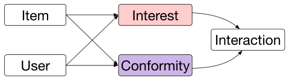
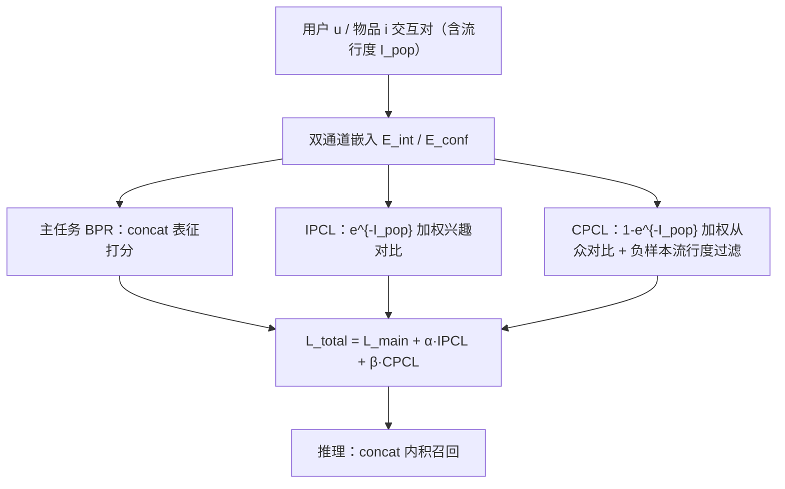
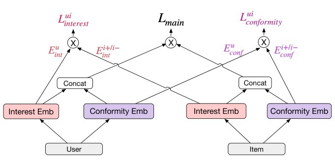

# Disentangled Causal Embedding With Contrastive Learning For Recommender System (基于对比学习的解耦因果嵌入推荐)

- **会议/期刊**: WWW 2023 (ACM Web Conference)
- **作者与机构**: Weiqi Zhao, Dian Tang, Xin Chen, Dawei Lv, Daoli Ou, Biao Li, Peng Jiang, Kun Gai（快手科技）
- **推荐链路定位**: 召回（双塔向量式 MF/LightGCN 表征层，可直接替换任意 backbone）
- **研究方向**: 去偏公平、可信隐私与工业架构（主）/ 自监督对比学习与交互去噪（次）
- **论文原文**: [https://arxiv.org/abs/2302.03248v2](https://arxiv.org/abs/2302.03248v2)
- **开源代码**: [https://github.com/somestudies/DCCL](https://github.com/somestudies/DCCL)

## TL;DR (1分钟核心速览)

现有因果去偏工作把"从众（conformity，跟风热门）"当作有害噪声一律用 IPS 削掉，或只能给全用户共享一个静态流行度偏移，既丢掉了从众本身的个性化价值，也无法应对训练/测试流行度分布漂移（OOD）。本文认为一次交互同时由兴趣与从众两类原因生成，提出 DCCL：在任意 backbone 的用户/物品嵌入上分裂出兴趣与从众两套通道，用一正一反（$e^{-I_{pop}}$vs.$1-e^{-I_{pop}}$）的流行度加权对比损失分别做样本增广，在 Yelp 与快手 Short-video 上以 HR@20/NDCG@20 全面超越 5 个 SOTA，并给出线上 A/B（EVTR +7.36%、LTR +41.8%）与长尾扶持证据。

## Background & Motivation (背景与核心矛盾)

- **主流范式**: 因果推荐通过因果图把交互拆成若干原因（兴趣/流行度/质量），用 IPS 逆倾向加权、CausE 双域共享、DICE 按流行度硬切训练集、PD 与 MACR 显式建模流行度与"从众"来自监督解耦。
- **前人局限**: ① IPS 类方法直接把流行度效应视为偏差并消除，等于丢弃了"从众"这一真实且个性化的用户需求；② PD 的流行度偏移对所有用户相同，无法表达"不同用户对热门的敏感度差异"；③ DICE 依赖按物品相对流行度对数据做**硬划分**，在长尾/稀疏场景下把本就稀缺的"纯因果"样本切得更碎，噪声大、样本不足。
- **核心洞察 (Key Insight)**: 用户看《复仇者联盟》可能既非科幻爱好者、也非完全无兴趣——交互意图是兴趣与从众的**连续混合比例**（如图 1 中同一用户对不同影片给出 $0.6\text{conf}+0.4\text{int}$到$1.0\text{int}$ 的不同配比）；而救命信号恰好在 **流行度**上：越热门的物品，交互越倾向由从众解释；越冷门的物品，交互越倾向由兴趣解释。
- **本文切入点**: 不做数据硬划分，直接在原始交互数据上让两个对比任务"抢"样本——用方向相反的流行度权重把热门交互推给从众通道、冷门交互推给兴趣通道，同时借对比学习的样本增广缓解长尾稀疏。

<figure class="paper-figure" markdown="span">
  <figcaption>图2：因果图与嵌入。我们对每个由兴趣和从众组合而成的交互进行简洁的因果建模。</figcaption>
</figure>

## Method (核心方法设计)

### 1. 整体框架 (Overall Architecture)

DCCL 是一个**纯嵌入层插件**：用户侧拆成 $E^{int}_u, E^{conf}_u$，物品侧拆成$E^{int}_i, E^{conf}_i$；主任务（BPR）用两通道**拼接**后的表征$[E^{int}_u \| E^{conf}_u]$与$[E^{int}_i \| E^{conf}_i]$ 打分，保证解耦不损失拟合能力。在此之上并行挂两个成对对比任务：兴趣通道用"热门物品降权"的正样本把用户拉向内容偏好，从众通道用"热门物品升权 + 负样本流行度过滤"把用户拉向大众注意力。三任务联合多目标训练，推理阶段只做一次前向、与原 backbone 完全一致。因果图将 User 与 Item 作为两条原因的共同父节点，使两通道各自携带"用户侧个性化 × 物品侧属性"的交叉信息，而非单一全局偏置。

<figure class="paper-figure" markdown="span">
  <figcaption>图3：DCCL 的框架。𝐸𝑖+/𝑖−</figcaption>
</figure>

### 2. 关键设计拆解 (Key Designs)

1. **流行度加权的兴趣成对对比损失（IPCL）**：痛点是"热交互到底是不是真兴趣"无法判定，硬切会放大稀疏。核心算子是给正样本乘一个**单调递减**的流行度权重，并对批内其余用户交互的全部物品作负样本：

$$\mathcal{L}^{ui}_{int}=-\frac{1}{N}\sum_{u}\log\frac{e^{-I_{pop}}\cdot e^{S(E^{int}_u,E^{int}_{i^+})}}{e^{S(E^{int}_u,E^{int}_{i^+})}+\sum_{i^-}e^{S(E^{int}_u,E^{int}_{i^-})}}$$

其中 $I_{pop}$为物品"交互数/总曝光数"的归一化流行度，$S(w,v)=w^{\top}v$。关键细节：$e^{-I_{pop}}$在$I_{pop}=1$时仍等于$e^{-1}\approx0.368$ 而非 0，因此热门交互**不会被完全丢弃**，兴趣通道仍能从中学到弱信号——这正是相对 DICE 硬划分的绕过稀疏的关键直觉。

2. **流行度加权的从众成对对比损失（CPCL）**：对称地令权重为 $1-e^{-I_{pop}}$（热门→接近 1，冷门→接近 0），使热门交互主要归因于从众：

$$\mathcal{L}^{ui}_{conf}=-\frac{1}{N}\sum_{u}\log\frac{(1-e^{-I_{pop}})\cdot e^{S(E^{conf}_u,E^{conf}_{i^+})}}{e^{S(E^{conf}_u,E^{conf}_{i^+})}+\sum_{i^-}e^{S(E^{conf}_u,E^{conf}_{i^-})}}$$

同时**从从众负样本集中过滤掉流行度高于目标物品的候选**，否则"用户没点更热的东西"会被误当作不从众，污染从众表征。两任务权重反向单调，形成互斥式分工，无需显式标签即完成 disentangle。

3. **训练目标、负采样与推理效率**：总损失 $\mathcal{L}_{total}=\mathcal{L}_{main}+\alpha\mathcal{L}^{ui}_{int}+\beta\mathcal{L}^{ui}_{conf}$，$\alpha=\beta=0.1$，$\mathcal{L}_{main}$统一用 BPR 以保证公平比较；负样本为 **in-batch 免采样**（批内其他用户交互物品即负样本，仅对从众通道加一道流行度过滤）。训练复杂度由$O(Bd)$升至$O(B^2d)$（$B=512,d=64$），但**推理阶段与 backbone 完全相同**，线上零额外延迟，这是其可插拔落地的核心卖点。

## Experimental Setup & Evaluation Protocol (实验设置与评估协议)

- **数据集与预处理**: 两个真实数据集均转成隐式 0/1 反馈并取 **10-core**（交互少于 10 条的用户/物品剔除）：

| 数据集 | #Users | #Items | #Interactions(推算) | 稀疏度 | 特征/场景说明 |
| :--- | :---: | :---: | :---: | :---: | :--- |
| Yelp | 27,057 | 17,843 | ≈4.87×10⁵ | $1.007\times10^{-3}$ | 本地生活商户点评，开放数据 |
| Short-video | 30,957 | 71,006 | ≈2.52×10⁶ | $1.145\times10^{-3}$ | 快手短视频工业数据，长尾显著 |

- **数据划分与防穿越 (Splitting Strategy)**: 论文沿用 DICE 的实验设定，正文未显式给出逐用户时序切分细节；额外构造 3 个**干预测试集**（热门物品比例 50%/40%/30%，原始测试集为 60%），模拟分布偏移，属典型的 OOD 划分。
- **排名评测协议 (Ranking Protocol)**: 报告 $K=20$ 的 HR@20 与 NDCG@20，依据 DICE 系列惯例为**每个测试正样本配固定数量负样本的 Sampled Ranking**；正文未明确正负比与是否为 Full-Ranking，这是复现时需向作者确认的一点。
- **对比基线与超参设置**: 基线含无偏/因果五强 IPS、CausE、DICE、PD、MACR；backbone 取 MF 与 LightGCN（$d=64$，$B=512$，lr$=0.001$，Adam），主损失统一 BPR；线上用 MF + Adam（$B=8196$）跑 5 天 A/B。

## Key Experimental Results (实验关键数据)

### 1. 主实验对比 (Main Results)

| Backbone | Method | Yelp HR@20 | Yelp NDCG@20 | Short-video HR@20 | Short-video NDCG@20 |
| :--- | :--- | :---: | :---: | :---: | :---: |
| MF | MF (base) | 5.070 | 1.951 | 2.613 | 1.018 |
| MF | IPS | 4.822 | 1.917 | 2.235 | 0.879 |
| MF | CausE | 5.072 | 1.973 | 2.629 | 1.021 |
| MF | DICE | 5.172 | 2.044 | 2.645 | 1.034 |
| MF | PD | 5.183 | 2.062 | 2.754 | 1.076 |
| MF | MACR | 5.224 | 2.104 | 2.867 | 1.137 |
| MF | **DCCL** | **6.171** | **2.415** | **3.783** | **1.463** |
| MF | *Improv.* | *+21.7%* | *+23.8%* | *+44.8%* | *+43.7%* |
| LightGCN | LightGCN (base) | 5.944 | 2.372 | 3.727 | 1.476 |
| LightGCN | MACR | 6.573 | 2.552 | 4.142 | 1.613 |
| LightGCN | **DCCL** | **7.254** | **2.816** | **4.613** | **1.713** |
| LightGCN | *Improv.* | *+22.0%* | *+18.7%* | *+23.8%* | *+16.1%* |

（Improv. 相对各自 backbone；原文称 DCCL_MF 平均 HR@20 提升 33.24%，DCCL_LightGCN 提升 22.91%。）

### 2. 消融实验 (Ablation Study)

| 变体 | Yelp HR@20 | Yelp NDCG@20 | Short-video HR@20 | Short-video NDCG@20 |
| :--- | :---: | :---: | :---: | :---: |
| DCCL w/o IPCL (MF) | 5.431 | 2.143 | 3.202 | 1.241 |
| DCCL w/o CPCL (MF) | 5.607 | 2.216 | 3.489 | 1.343 |
| **DCCL full (MF)** | **6.171** | **2.415** | **3.783** | **1.463** |
| DCCL w/o IPCL (LightGCN) | 6.717 | 2.672 | 4.151 | 1.626 |
| DCCL w/o CPCL (LightGCN) | 6.821 | 2.705 | 4.311 | 1.653 |
| **DCCL full (LightGCN)** | **7.254** | **2.816** | **4.613** | **1.713** |

### 3. 关键实验发现 (Key Findings)

1. **双通道缺一不可，但兴趣通道更"值钱"**：去掉 IPCL 比去掉 CPCL 掉得更多（MF/Yelp HR@20：5.431 vs. 5.607，全模型 6.171），说明解耦后"纯兴趣"表征是主收益来源；即便只保留单通道的退化版本，仍普遍高于 MACR（5.224），证明增广式对比学习的增益独立于双通道结构。
2. **分布偏移越强，解耦优势越大**：在热门占比 30% 的干预测试集上，DCCL 相对 MACR 的 HR@20 优势从原始集 32% 扩大到 **93%**，而对所有对比方法而言偏移都会掉点——这说明从众通道吸收流行度信号后，兴趣通道对流行度分布变化近似不变，构成真正意义上的因果不变性。
3. **线上收益集中在长尾与"强意愿"行为**：快手 5 天 A/B 相对 MACR 平均 EVTR **+7.362%**、LTR **+41.82%**；按流行度分桶后，冷门视频组的 EVTR 提升显著高于热门组，验证离线"长尾扶持"结论在十亿级用户系统中可复现。

## Highlights & Limitations (亮点、对比与审稿批判)

- **与代表作对比 (vs. Prior Work)**: 与 **DICE** 的本质差异是不做数据硬划分，而用连续流行度权重在同一批样本上做软分工，避免加剧稀疏；与 **PD/MACR** 的差异是流行度效应由"全局共享偏移"升级为"每用户 × 每物品的从众嵌入"，实现个性化从众；与 **IPS** 的差异是承认从众为正价值原因而非需消除的偏差。
- **可迁移亮点**: ① "一正一反单调权重 + 同一批数据"的双任务软解耦范式，可平移到"点击 vs. 转化""曝光 vs. 消费"等多原因分解；② 从众通道的**负样本流行度过滤**是一个非常廉价而有效的去噪 trick，可直接用于任意对比召回。
- **审稿级局限批判**: ① ② 因果充分性未验证——仅建模兴趣与从众两类原因，未讨论类别偏好、位置偏差等混淆因子；② 评测协议交代不全（未明"采样负样本数"与是否 Full-Ranking），且 10-core 过滤会系统性删除极长尾用户，与"长尾扶持"的核心主张存在轻微张力；③ 训练复杂度 $O(B^2d)$且依赖大 batch 才能提供足量 in-batch 负样本，小 batch 场景下从众通道的负样本过滤可能几近失效，$\alpha,\beta$ 敏感性未做网格分析。

## Rating (四维评分)

- **方法创新性 (Novelty)**: ⭐⭐⭐⭐ （因果图 + 反向流行度权重对比解耦的思路简洁、可解释，但"用流行度当监督信号"沿袭 DICE，增量在软划分而非全新因果发现）
- **评估协议与实验扎实度 (Protocol & Experiments)**: ⭐⭐⭐⭐ （双数据集 × 双 backbone × 五种子对比基线 + 三种 OOD 干预集 + 线上 A/B 相当完整，扣分在排序协议与显著性检验未明示）
- **写作与数学规范度 (Clarity & Rigor)**: ⭐⭐⭐⭐ （两个对比损失定义清晰、权重直觉讲透，但因果图缺少形式化的 SCM 与可识别性推导，负样本过滤规则仅在文字层面描述）
- **工业落地与复现价值 (Industrial & Practical Value)**: ⭐⭐⭐⭐⭐ （训练期零结构改动、推理零额外延迟、纯嵌入插件，十亿级系统 A/B 实证 + 代码开源，落地价值极高）

