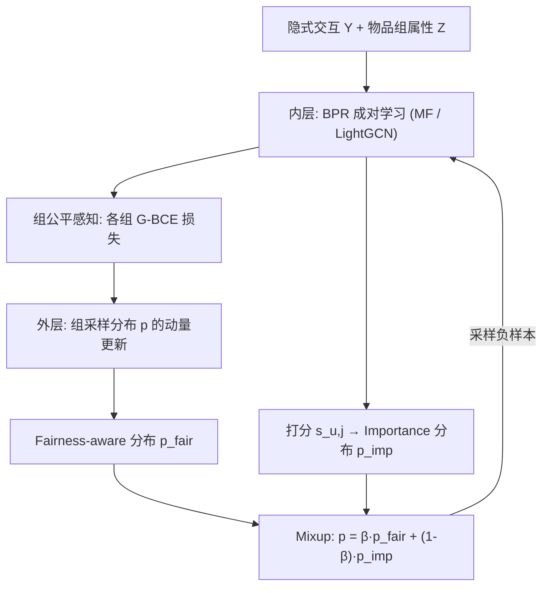
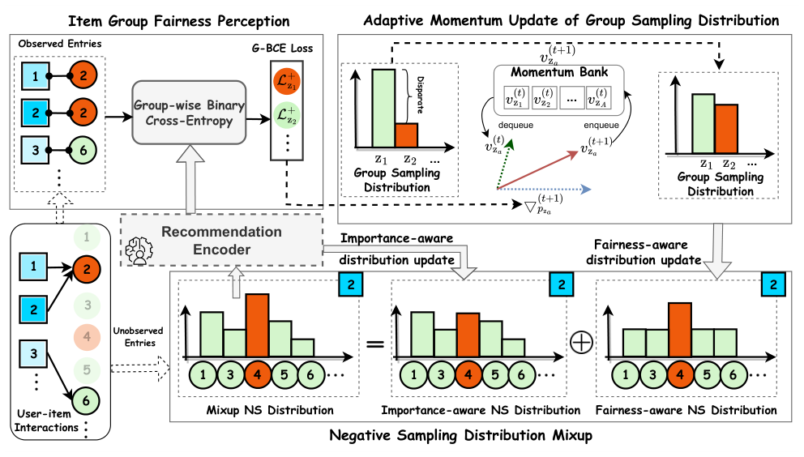

# Fairly Adaptive Negative Sampling for Recommendations (面向推荐的公平自适应负采样)

- **会议/期刊**: WWW 2023 (The Web Conference)
- **作者与机构**: Xiao Chen, Wenqi Fan, Jingfan Chen, Haochen Liu, Zitao Liu, Zhaoxiang Zhang, Qing Li（香港理工大学、密歇根州立大学、中科院自动化所、暨南大学）
- **推荐链路定位**: 召回（BPR 成对训练阶段的负采样策略）
- **研究方向**: 去偏公平、可信隐私与工业架构 / 协同过滤与负采样理论
- **论文原文**: [https://arxiv.org/abs/2302.08266v1](https://arxiv.org/abs/2302.08266v1)
- **开源代码**: 暂未开源

## TL;DR (1分钟核心速览)

隐式反馈的 BPR 训练普遍使用**均匀负采样 (UNS)**，而物品组（如电影类型、职位薪酬档）天然不均衡，多数组被过量采成负样本、被 BPR 梯度系统性压低打分，造成物品侧组间 Recall 严重不公。本文提出 **FairNeg**：以组级 G-BCE 损失作为 Recall 的可微代理，用自适应动量在**外层优化器**中调整组级负采样分布，再通过 Mixup 与重要性采样（DNS 式）融合。在 ML1M-2 上 Recall-Disp@20 由 0.3179 降至 0.0287（相对降 90.97%），Recall-Min 升 55.97%，同时 R@20 反升 2.42%。

## Background & Motivation (背景与核心矛盾)

- **主流范式**: 隐式反馈推荐以 BPR 成对损失为核心，负样本从用户未交互集中按**均匀分布**采样，模型只优化"正样本分数高于负样本"。
- **前人局限 ①**: UNS 直接继承物品侧数据不均衡——多数组被采为负样本的概率更高（图 1），BPR 对其持续施加抑制梯度，导致该组无论用户是否真正喜欢都得不到曝光；图中 ML1M-2 的 Sci-Fi/Horror 两组在 MF、LightGCN 上 Recall@20 差距巨大。
- **前人局限 ②**: 静态修正式 **FairStatic**（组采样概率按占比固定）虽能压缩差距，却"贪心地"牺牲整体 Recall；而 Reg / DPR / FairGAN 等公平推荐方法依赖正则、对抗解耦或曝光分配，需改动模型结构或后处理，**均未触及负采样这一训练环节**。
- **核心洞察 (Key Insight)**: 图 4 梯度分析显示，劣势组（Horror）物品嵌入层收到的**负样本梯度 L2 范数显著更大**——不公平的根源不是表征容量，而是负梯度被多数组"淹没"。因此组采样分布本身就是一个可优化的公平变量。
- **本文切入点**: 把"组负采样分布 $\boldsymbol{p}$"当作外层可学习参数、BPR 当内层优化器，构成双层优化，自适应地给劣势组"减负"。

## Method (核心方法设计)

### 1. 整体框架 (Overall Architecture)

FairNeg 不改模型结构、不改训练数据，只在"采样器"上做文章。每个 epoch：内层用当前 Mixup 采样分布抽负样本、以 BPR 更新用户/物品嵌入；随后固定模型参数，统计各物品组的 G-BCE 损失作为组 Recall 的可微代理，按"偏离组均值"的方向计算组采样概率梯度，经动量平滑后更新 $\boldsymbol{p}$；下一 epoch 的组分布再与基于当前打分的 importance 分布混合。训练以验证集早停，推理阶段完全回归标准 Top-K 排序，**零额外在线开销**。

<figure class="paper-figure" markdown="span">
  <figcaption>图3：所提出的 FairNeg 框架示意图。该公平自适应负采样（FairNeg）框架包含三个组件：(i) 物品组公平性感知；(ii) 组采样分布的自适应动量更新；(iii) 负采样（NS）概率分布 Mixup。</figcaption>
</figure>

### 2. 关键设计拆解 (Key Designs)

1. **组公平感知的 G-BCE 代理（把不可微的 Recall-Disp 变成可训练信号）**：Recall-Disp@k 含排序与标准差，无法反传。作者仅在**正样本集**上取组内平均交叉熵 $\mathcal{L}^{+}_{z_a}=-\frac{1}{|Y^{+}_{z_a}|}\sum_{(u,v)\in Y^{+}_{z_a}}\log\sigma(\hat{y}_{u,v})$，它是对$-\log P(\hat{y}=1\mid y=1,z=z_a)$的无偏估计，从而单调逼近$-\log(\text{Recall}\mid z=z_a)$。直觉：某组 G-BCE 大，说明模型给"用户真正喜欢的该组物品"打分偏低，即该组正处于劣势。
2. **组采样分布的自适应动量更新（差异化地压制负梯度）**：静态占比分配太粗。定义组梯度为该组 G-BCE 与全体组均值的偏差 $\nabla^{(t)}_{p_{z_a}}=\mathcal{L}^{+(t)}_{z_a}-\frac{1}{|A|}\sum_{z\in Z}\mathcal{L}^{+(t)}_{z}$；劣势组偏差为正，取负号后即**下调**其被采为负样本的概率。再用动量抑制梯度噪声与方向震荡：$v^{(t+1)}_{z_a}=\gamma v^{(t)}_{z_a}+\alpha\nabla^{(t+1)}_{p_{z_a}}$，$p^{(t+1)}_{z_a}=p^{(t)}_{z_a}-v^{(t+1)}_{z_a}$。物理直觉：方向一致时加速收敛，方向冲突时自动衰减，避免组分布来回抖动。
3. **负采样分布 Mixup（公平与"难负样本"信息量的联合）**：纯公平分布会让同组物品等概率被采，倾向抽到易区分的"垃圾负样本"，损害表征判别力。故令 $p^{fair}_j=p_{z_a}/\sum_{i\in V^{-}_u}G_{z_a}(i)$、$p^{imp}_j=\exp(s_{u,j}/\tau)/\sum_{i\in V^{-}_u}\exp(s_{u,i}/\tau)$，最终$p_j=\beta\,p^{fair}_j+(1-\beta)\,p^{imp}_j$。
4. **双层优化与开销**：外层 $\min_{\boldsymbol{p}}\sum_{z_a}|\mathcal{L}^{+}_{z_a}-\overline{\mathcal{L}^{+}}|$，内层$\min_{\Theta}$BPR；交替更新、验证集早停。负采样仍需对候选集做 softmax（$O(|V^{-}_u|)$），训练开销高于 UNS，但推理与 UNS 完全一致。

## Experimental Setup & Evaluation Protocol (实验设置与评估协议)

- **数据集与预处理**: 从 ML1M 与 Amazon 商品评论抽取子集，按物品类型划分组（2 组：最热 vs 最冷；4 组：四类）：

| 数据集 | #Users | #Items | #Interactions | 稀疏度/密度 | 特征/场景说明 |
| :--- | :---: | :---: | :---: | :---: | :--- |
| ML1M-2 | 4,680 | 472 | 194,610 | 8.81% | Sci-Fi vs Horror |
| ML1M-4 | 5,120 | 685 | 242,419 | 6.91% | 四类型电影 |
| Amazon-2 | 3,845 | 2,487 | 84,656 | 0.89% | Grocery vs Tool |
| Amazon-4 | 3,954 | 3,061 | 129,433 | 1.07% | 四类商品 |

- **数据划分与防穿越**: **随机 60%/20%/20% 划分**（非全局时间戳切分，存在轻度时序穿越风险，论文未讨论）。
- **排名评测协议**: 基于 Top-20 结果按物品组**分层计算 Recall@20**，据此聚合 Recall-Disp@20（标准差/均值，越低越公平）、Recall-Min@20（最差组，越高越好）、Recall-Avg@20（宏平均），并报用户侧 N@20/P@20/R@20。论文未明确声明是否对全库未交互物品做无偏 **Full-Ranking**（未给采样负例规模），此为协议透明度短板。
- **对比基线与超参**: 负采样类 UNS(BPR)/NNCF/DNS/FairStatic；公平类 Reg/DPR/FairGAN-1、-2；骨干为 MF 与 LightGCN，隐藏维在 $[10,80]$ 内搜索，每组实验 5 个随机种子取均值，未报显著性检验。

## Key Experimental Results (实验关键数据)

### 1. 主实验对比 (Main Results)

| 方法 | ML1M-2 (MF) Disp↓ | Min↑ | Avg↑ | R@20↑ | ML1M-4 (LightGCN) Disp↓ | Min↑ | R@20↑ |
| :--- | :---: | :---: | :---: | :---: | :---: | :---: | :---: |
| UNS | 0.3179 | 0.2346 | 0.3386 | 0.4622 | 0.1794 | 0.2455 | 0.4279 |
| NNCF | 0.1689 | 0.2550 | 0.3069 | 0.4157 | 0.1091 | 0.2571 | 0.4033 |
| DNS | 0.3065 | 0.2485 | 0.3584 | 0.4974 | 0.1806 | 0.2463 | **0.4374** |
| FairStatic | 0.0958 | 0.3208 | 0.3548 | 0.4541 | 0.1022 | 0.2819 | 0.4131 |
| Reg | 0.1908 | 0.2808 | 0.3471 | 0.4518 | — | — | — |
| DPR | 0.0959 | 0.3147 | 0.3481 | 0.4295 | 0.0495 | 0.2994 | 0.4084 |
| FairGAN | 0.3607 | 0.2056 | 0.3217 | 0.4287 | 0.3251 | 0.1799 | 0.3980 |
| **FairNeg** | **0.0287** | **0.3659** | **0.3764** | 0.4734 | **0.0394** | **0.3117** | 0.4222 |
| **Improv.** | **90.97%** | **55.97%** | **11.16%** | +2.42% | **78.04%** | **26.97%** | −1.33% |

（Amazon-2/LightGCN 上 FairNeg 的 Disp 0.6588→0.5217、Min 升 40.64%；Amazon-4/MF 上 Disp 降 22.29%、Min 升 71.48%。）

### 2. 消融实验 (Ablation Study)

原文以图 5（ML1M-4，双骨干的 F1@20 vs Recall-Disp@20）呈现，未给数值表，此处为定性归纳：

| 变体 | 移除组件 | 观测影响 |
| :--- | :--- | :--- |
| FairNeg-Dynamic | 自适应组分布（退化为 FairStatic） | 公平性大幅变差，且效用受损——**自适应调整最关键** |
| FairNeg-Imp | importance-aware 分布 | F1@20 明显下降，公平性略好但效用-公平权衡变差 |
| FairNeg-Momentum | 动量平滑 | Recall-Disp 变差，训练震荡加剧 |
| **FairNeg** | — | 在双骨干上均位于 F1–Disp 的 Pareto 最优点 |

### 3. 关键实验发现 (Key Findings)

1. **不公平的主因是可优化的采样分布，而非模型容量**：仅改采样器即可把 ML1M-2/MF 的 Disp 从 0.3179 压到 0.0287（相对 90.97%），比对抗解耦的 DPR（0.0959）再降一个量级，且优于同为"改采样"的静态 FairStatic（0.0958）——证明**动态自适应**而非静态配额才是关键。
2. **公平与效用基本不冲突，甚至小幅双赢**：ML1M-2/MF 上 R@20 从 0.4622 升至 0.4734（+2.42%）、N@20 +1.53%；ML1M-4/LightGCN 上 R@20 仅降 1.33%。而 FairGAN 为压差距把 Avg Recall 拉到 0.3217（低于 UNS 0.3386），FairStatic 也普遍牺牲整体召回。
3. **最稀疏场景收益主要体现在"救最差组"**：Amazon 两数据集密度仅 0.89%/1.07%，FairNeg 的 Disp 降幅 20.81%–25.73%，但 **Recall-Min 提升高达 40.64%–71.48%**，说明方法在组极度不均衡时优先抬升长尾组而非均摊收益。

## Highlights & Limitations (亮点、对比与审稿批判)

- **与代表作对比**: 相较 DPR / Reg / FairGAN 需引入对抗判别器、正则项或曝光后处理，FairNeg **完全不改模型与前向计算**，只把"负采样分布"作为外层变量；相较 DNS 等难负采样方法只追效用，它显式引入组公平维度；相较 FairStatic，它把静态配额升级为闭环反馈控制。
- **可迁移亮点**: ①"用组内正样本平均 BCE 作为 Recall 可微代理"这一技巧可无缝迁移到任何需要分层监控却不可微的排序目标（如曝光公平、长尾覆盖）；②把采样分布做**双层优化 + 动量平滑**的范式，可直接套用到 popularity-debiasing 采样、跨域负采样配比调节。
- **审稿级局限批判**: ①importance 分布需对每个用户的整个负候选集做 softmax，训练开销显著高于 UNS，大规模工业场景需近似采样；②要求物品具备**互斥且已知**的敏感属性分组，多属性重叠或属性缺失时定义困难；③评测仅用随机 60/20/20 划分与组间 Recall 差距，未做时间切分、未报显著性检验，也未验证采样排序还是全库排序，公平性结论的稳健性有待补强；④$\beta,\gamma,\alpha$ 三个超参耦合，论文未给敏感度分析。

## Rating (四维评分)

- **方法创新性 (Novelty)**: ⭐⭐⭐⭐ （首次把物品组公平问题重构为负采样分布优化问题，双层优化 + 动量反馈的视角新颖，且有梯度范数实证支撑）
- **评估协议与实验扎实度 (Protocol & Experiments)**: ⭐⭐⭐ （4 数据集 × 2 骨干 × 5 种子的覆盖不错，但随机划分、无显著性检验、未明确 Full/Sampled Ranking，消融仅给柱状图无表）
- **写作与数学规范度 (Clarity & Rigor)**: ⭐⭐⭐⭐ （G-BCE 逼近 Recall 的论证与组梯度定义清晰，双层优化表述规范；超参敏感度与复杂度分析偏薄）
- **工业落地与复现价值 (Industrial & Practical Value)**: ⭐⭐⭐⭐ （推理零额外开销、实现只需换采样器、可插拔到任意 BPR 类召回模型；代价是训练期候选集 softmax 开销与组属性依赖，且暂未开源）

