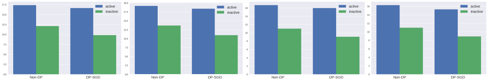
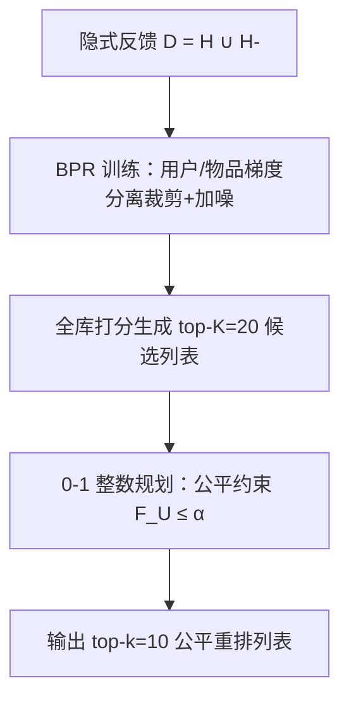

# Fairness-aware Differentially Private Collaborative Filtering (公平感知的差分隐私协同过滤)

- **会议/期刊**: WWW '23 Companion (Short Paper, 5 pages)
- **作者与机构**: Zhenhuan Yang, Congzhe Su, Dingxian Wang, Xiaoting Zhao (Etsy Inc)；Yingqiang Ge (Rutgers)；Yiming Ying (SUNY Albany)
- **推荐链路定位**: 训练阶段（隐私化表征学习）+ 重排阶段（列表后处理）
- **研究方向**: 去偏公平、可信隐私与工业架构 / 协同过滤
- **论文原文**: [论文原文链接](https://arxiv.org/abs/2303.09527v1)
- **开源代码**: 暂未开源

## TL;DR (1分钟核心速览)

本文指出协同过滤一旦叠加 DP-SGD，非活跃用户（占 80%）的 NDCG 跌幅显著大于活跃用户，使原本的活跃度偏置被进一步放大 15–20%。作者提出 **DP-Fair**：阶段一对用户/物品梯度分别裁剪与加噪以减少无效扰动，阶段二在 top-$K$候选上求解带用户组公平约束的 0-1 整数规划重排。在 Amazon 与 Etsy 四个数据集上，NDCG/F1 全面优于 vanilla DP-SGD，同时$F_U$ 下降 23–37%。评估为 8:1:1 随机划分的全库排序、top-10 截断指标。

## Background & Motivation (背景与核心矛盾)

- **主流范式**: 隐私保护推荐普遍用 DP-SGD（梯度范数裁剪 $C$+ 高斯噪声$\mathcal{N}(0,\sigma^2 I)$）训练 BPR-MF / NeuMF，以获得$(\epsilon,\delta)$-DP 的形式化隐私保证。
- **前人局限**: 其一，DP 噪声对效用并非均匀衰减，图像分类中已发现弱势子群受损更重；其二，协同过滤本身依赖交互量，天然偏向高活跃用户——两者叠加时损失被乘性放大。
- **核心洞察 (Key Insight)**: 作者在四个数据集上量化确认“穷人更穷”（Matthew 效应）：引入 $\epsilon=1$ 的 DP-SGD 后，活跃组与非活跃组的 NDCG 差距相对非隐私设置扩大约 15–20%，即隐私预算越紧、组间不公平越严重。
- **本文切入点**: 既然 DP 无法放弃，就在 DP 训练侧“少加无用噪声”、在输出侧“事后纠偏”，用两阶段解耦的方式同时守住隐私与公平。

<figure class="paper-figure" markdown="span">
  <figcaption>图1：不同数据集上活跃用户（蓝色）与非活跃用户（绿色）的 NDCG@10（%）（见第4节说明）。每个子图中，左侧两个标有 Non-DP 的柱子为使用标准 SGD 训练的 NeuMF 模型；右侧两个柱子由 DP-SGD 学习得到，𝜖=1。</figcaption>
</figure>

## Method (核心方法设计)

### 1. 整体框架 (Overall Architecture)

DP-Fair 分两阶段串行。阶段一在隐私数据集 $D=\mathcal{H}\cup\mathcal{H}^-$上用 BPR 损失训练，但把统一 DP-SGD 拆成用户梯度与物品梯度两条独立扰动链路——各自维护裁剪界$C_u$、$C_v$与噪声强度，避免一侧梯度的范数被另一侧“绑架”而凭白多注噪声。阶段二为纯后处理：先用训练好的$f_\Theta$打出长度$K=20$的长候选列表$R^K_u$，再求解带公平约束的整数规划，从每个用户的 20 个候选中挑出$k=10$ 个输出。由于阶段二只作用于推荐列表、不触碰模型参数，隐私保证不被破坏。

### 2. 关键设计拆解 (Key Designs)

1. **分离式梯度扰动（Separate DP Gradient Mapping）**: 痛点起因是标准 DP-SGD 用单一 $C$同时对用户与物品梯度做$\ell_2$裁剪，而两者量纲随时训练阶段差异巨大，导致某一侧被过度裁剪（引入偏差）或另一侧噪声过量。作者对$g\in\{u,v\}$分别执行$\bar{G}^{g}_t(S)=G^{g}_t(S)/\max\{1,\lVert G^{g}_t(S)\rVert_2/C_g\}$、$\tilde{G}^{g}_t(S)=\bar{G}^{g}_t(S)+\mathcal{N}(0,\sigma^2 I)$。直觉：让裁剪界贴合各自梯度尺度，等价于在相同隐私预算下注入“有效噪声更少”的梯度，故效用必然回升。
2. **公平约束的整数规划重排（Fairness Re-ranking via ILP）**: 痛点起因是组间精度差由训练数据量差异引起，单靠训练侧无法显式控制。作者把每个用户的 top-$K$选择写成二值矩阵$R\in\{0,1\}^{n_1\times K}$，最大化保留分数并约束公平差距：
$$\max_{R^k}\sum_{u\in\mathcal{U}}\sum_{v\in R^k_u}f_\Theta(x_u,x_v)\quad \text{s.t.}\ F_U(R^k;A,B)\le\alpha,\ R^k_u\subseteq R^K_u\ \forall u\in\mathcal{U},$$
其中 $F_U=\big\lvert\frac{1}{|A|}\sum_{u\in A}M(R^k_u)-\frac{1}{|B|}\sum_{u\in B}M(R^k_u)\big\rvert$，$A$为活跃度前 20% 用户、$B$为其余 80%。关键工程取舍：$M$选用 **F1** 而非 NDCG，因为 F1 无位置折扣项，使约束关于$R$ 线性，可直接交给 Gurobi 求解 0-1 规划；NDCG 会因非线性折扣使问题变成难以求解的非线性整数规划。
3. **训练目标、负采样与推理效率**: 总目标即上式 BPR 排序损失加 $\ell_2$正则，负样本从$\mathcal{H}^-_u=\mathcal{V}\setminus\mathcal{H}_u$中**均匀下采样**至与正样本等量（$|\mathcal{H}^-|=|\mathcal{H}|=n$），未使用 in-batch 或难负样本。推理开销集中在阶段二：为每个用户求解一次$K\to k$的选择问题，规模为$n_1\times K$ 的 0-1 规划，实践中可通过用户分块并行、或仅在公平违例时触发求解来控制延迟。

## Experimental Setup & Evaluation Protocol (实验设置与评估协议)

- **数据集与预处理**: Amazon review（`5-core`）两个类目 + Etsy 线上一个月真实点击日志两个类目；评分 >3 的显式反馈二值化为 1，Etsy 点击即正反馈。

| 数据集 | #Users | #Items | #Interactions | 稀疏度 | 来源/场景 |
| :--- | :---: | :---: | :---: | :---: | :--- |
| Home & Living | 6,538 | 3,924 | 100,855 | 99.61% | Etsy 线上日志 |
| Craft Supplies & Tools | 4,488 | 5,569 | 159,445 | 99.36% | Etsy 线上日志 |
| Grocery & Gourmet Food | 14,681 | 8,713 | 151,254 | 99.88% | Amazon 5-core |
| Beauty | 22,363 | 12,101 | 198,502 | 99.93% | Amazon 5-core |

- **数据划分与防穿越**: 随机 **8:1:1** 划分 train/valid/test（非时间序切分，存在轻度未来信息穿越风险）。
- **排名评测协议**: 在完整物品库上打分后截断 **top-10**，报告 NDCG@10 与 F1@10，并按活跃组/非活跃组分别汇报；未采用负采样排序。
- **对比基线与超参**: 基线为 BPR-MF（浅层 MF）与 NeuMF（深层 MLP）各自搭配 vanilla DP-SGD；隐私预算取 $\epsilon\in\{\infty,10,1\}$，$\delta=1/n_1^{1.5}$，DP-SGD 由 Opacus 实现，裁剪界经预训练调优；预排名$K=20$、重排$k=10$；使用 Gurobi 求解整数规划。

## Key Experimental Results (实验关键数据)

### 1. 主实验对比 (Main Results)

下表摘取 **NDCG@10 (%)** 在紧隐私预算 $\epsilon=1$下的结果（Total↑ / InAct.↑ /$F_U$↓），基线为同类模型 + DP-SGD：

| 数据集 | 模型 | DP-SGD Total | DP-SGD InAct. | DP-SGD $F_U$| DP-Fair Total | DP-Fair InAct. | DP-Fair$F_U$| Total Improv. |$F_U$ 降幅 |
| :--- | :--- | :---: | :---: | :---: | :---: | :---: | :---: | :---: | :---: |
| Home & Living | BPR-MF | 10.21 | 9.15 | 5.29 | **10.61** | **9.87** | **3.68** | +3.9% | −30.4% |
| Home & Living | NeuMF | 11.19 | 9.82 | 6.82 | **11.59** | **10.74** | **4.27** | +3.6% | −37.4% |
| Craft Supplies | NeuMF | 12.41 | 10.93 | 7.41 | **13.16** | **12.08** | **5.40** | +6.0% | −27.1% |
| Grocery & Gourmet | BPR-MF | 9.21 | 8.12 | 5.45 | **9.79** | **9.08** | **3.56** | +6.3% | −34.7% |
| Grocery & Gourmet | NeuMF | 10.42 | 9.03 | 6.95 | **10.73** | **9.74** | **4.95** | +3.0% | −28.8% |
| Beauty | BPR-MF | 9.20 | 8.22 | 4.94 | **9.76** | **9.14** | **3.06** | +6.1% | −38.1% |
| Beauty | NeuMF | 10.18 | 8.90 | 6.39 | **10.47** | **9.48** | **4.94** | +2.8% | −22.7% |

F1@10 呈同向趋势（如 Beauty BPR-MF, $\epsilon=1$：$F_U$ 2.29 → 1.91；Craft NeuMF：4.15 → 3.73）。

### 2. 消融实验 (Ablation Study)

原文未做显式组件消融，最接近的是隐私预算/裁剪界/公平阈值的敏感性分析，此处以“隐私预算扫描”作代理消融（NeuMF, NDCG@10）：

| 配置 | 数据集 | DP-SGD Total | DP-Fair Total | DP-SGD $F_U$| DP-Fair$F_U$ |
| :--- | :--- | :---: | :---: | :---: | :---: |
| $\epsilon=\infty$（无噪声，仅重排） | Craft Supplies | 13.57 | **14.55** | 6.74 | **4.11** |
| $\epsilon=10$ | Craft Supplies | 12.88 | **13.56** | 7.05 | **5.11** |
| $\epsilon=1$ | Craft Supplies | 12.41 | **13.16** | 7.41 | **5.40** |
| $\epsilon=\infty$ | Beauty | 11.22 | **11.75** | 5.05 | **4.52** |
| $\epsilon=1$ | Beauty | 10.18 | **10.47** | 6.39 | **4.94** |

超参敏感性（图 2）：裁剪界 $C_u=C_v=C$过小会使平均梯度有偏、过大则注入更多噪声，NDCG 呈倒 U 型；公平阈值$\alpha$ 收紧时活跃组指标单调下降、非活跃组单调上升（典型 fairness–accuracy 前沿）。

### 3. 关键实验发现 (Key Findings)

- **加公平约束反而提升整体精度**：所有数据集、两种模型、三档 $\epsilon$ 下 Total NDCG/F1 均上升 2.8–6.3%，根因是非活跃用户占 80%，其 InAct. NDCG 提升 6.5–10.5% 的收益压过了活跃组 3–10% 的让利，形成“多数派红利”。
- **DP 噪声确实加剧不公平**：从非隐私到 $\epsilon=1$，DP-SGD 的$F_U$由 4.02→4.94（Beauty BPR-MF）、6.74→7.41（Craft NeuMF）逐级恶化，与摘要所称 15–20% 的差距扩张一致；DP-Fair 在$\epsilon=\infty$时即可把$F_U$ 压到 4.11，说明阶段二的纠偏与噪声无关、是纯列表级效应。
- **分离式扰动是“免费”的增益**：仅靠阶段一改动即可在相同 $\epsilon$下取得 NDCG 增长，且$\epsilon=1$时增益（+3.6%）小于$\epsilon=\infty$（+5.6% 中部分来自重排），说明噪声越强、梯度尺度差异越大，分离裁剪的边际价值越显著。

## Highlights & Limitations (亮点、对比与审稿批判)

- **与代表作对比 (vs. Prior Work)**: 相比 Bagdasaryan 等指出的 DP 训练对少数子群的差异化伤害（图像域），本文首次在 CF 场景量化“活跃度—DP 不公平”耦合；相比 Kamishima 等的公平正则化（需重训、破坏隐私），本文采用**后处理**路线（与 Geyik 等的公平重排同源），因不触碰参数而天然兼容 DP；相比联邦推荐中的公平工作，本文直接处理集中式 DP-SGD 的裁剪-噪声链路。
- **可迁移亮点**: (1) 按特征域（用户/物品、稠密/稀疏）拆分梯度裁剪与加噪，可迁移到任意 DP 训练的双塔/双嵌入结构；(2) 用无位置折扣的 F1 作为公平度量以便线性化 0-1 规划，是把“公平约束”工程化的实用技巧。
- **审稿级局限批判**: 其一，随机 8:1:1 划分而非全局时间戳切分，交互稀疏度 99.6%+ 下易高估泛化，且未做显著性检验与重复实验方差报告；其二，阶段二需为每个用户求解 0-1 整数规划，$K=20\to k=10$的规模在百万级用户下推理延迟与 Gurobi 许可成本均未评估，缺乏线上 A/B 与延迟指标；此外$K$、$k$固定、$\alpha$ 与具体业务公平口径的映射亦未讨论。

## Rating (四维评分)

- **方法创新性 (Novelty)**: ⭐⭐⭐ （“DP 加剧 Matthew 效应”的实证发现有价值，但分离裁剪与公平重排各自均为已有技术的组合，理论分析停留在直觉层面）
- **评估协议与实验扎实度 (Protocol & Experiments)**: ⭐⭐⭐ （四个数据集含真实工业日志是加分项，但随机划分、无显著性检验、无显式组件消融，公平度量仅 F1/NDCG 单一维度）
- **写作与数学规范度 (Clarity & Rigor)**: ⭐⭐⭐⭐ （5 页短文定义清晰、算法伪代码与公式紧凑，隐私保证与后处理不冲突的论证到位，但缺少 $(\epsilon,\delta)$ 累计隐私预算的完整会计报告）
- **工业落地与复现价值 (Industrial & Practical Value)**: ⭐⭐⭐⭐ （来自 Etsy 真实场景、Opacus + Gurobi 组合易复现，两阶段解耦便于线上灰度；主要障碍是未开源与整数规划的服务化开销）

