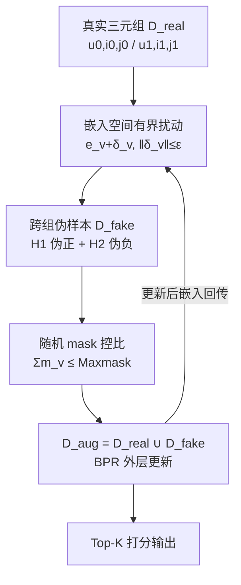
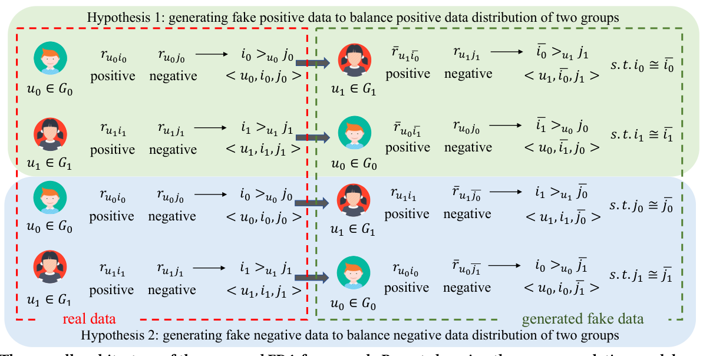

# Improving Recommendation Fairness via Data Augmentation (基于数据增广的推荐公平性提升)

- **会议/期刊**: WWW 2023 (The ACM Web Conference)
- **作者与机构**: Lei Chen, Le Wu(通讯), Kun Zhang, Richang Hong, Meng Wang (合肥工业大学)、Defu Lian (中国科学技术大学)、Zhiqiang Zhang, Jun Zhou (蚂蚁集团)
- **推荐链路定位**: 召回 (embedding-based CF 的 Top-K 排序打分)
- **研究方向**: 去偏公平、可信隐私与工业架构 / 自监督与数据增广
- **论文原文**: [https://arxiv.org/abs/2302.06333v2](https://arxiv.org/abs/2302.06333v2)
- **开源代码**: [https://github.com/newlei/FDA](https://github.com/newlei/FDA)

## TL;DR (1分钟核心速览)

本文针对「推荐模型会放大训练数据中用户群组（性别等敏感属性）不平衡」这一痛点：MovieLens 上训练数据两组的 JS 散度为 0.1303，而 BPR/GCCF 的 Top-20 命中分布散度飙到 0.4842/0.4879。作者提出 FDA——不做模型改造、不预定义公平指标，而是在嵌入空间对物品加有界噪声构造「相似物品」，据此生成跨组伪正/伪负交互，并以「内层生成伪数据、外层训练推荐」的双层优化注入增广数据。在两数据集、三种骨干（BPR/NCF/GCCF）上，DP/EO 相对最优公平基线再降 3.9%–9.2%，且精度几乎不损。

## Background & Motivation (背景与核心矛盾)

- **主流范式**: 群组公平研究多在**建模侧**发力——加公平正则（BPR_DP/BPR_EO）、解耦敏感属性、对抗去除敏感信息，目标函数里显式写入 DP/EO 等指标。
- **前人局限**: (1) 正则类方法绑死某个公平指标，换指标即换模型；DP 强制两组预测分布相同，忽略天然偏好差异，往往牺牲大量精度。(2) 数据侧方法（BN-SLIM 的重采样平衡邻域、FairUser 生成虚拟用户）要么只适配稀疏线性模型，要么每轮需计算全量 user-item 矩阵、代价极高且在 EO 上甚至不如无公平约束的 BPR。
- **核心洞察**: 不公平有两个来源——数据本身的组间不平衡 + 算法对不平衡的**放大**。Table 1 量化了「放大」：训练集两组物品偏好分布散度仅 0.1303，但两个骨干的 Top-K 命中分布散度升至 0.42–0.49。既然放大发生在数据到结果的映射上，那么**把输入数据补平**即可在不改模型的前提下抑制放大。
- **本文切入点**: 不做样本重采样，而是沿「每个真实交互都应在对侧群组存在同偏好、同相似物品的对应交互」这一对称假设，**生成伪交互补全数据**，并把伪数据的构造本身变成一个可微优化问题。

## Method (核心方法设计)

### 1. 整体框架 (Overall Architecture)

FDA 是套在任何 embedding 推荐骨干外的「数据增广壳」。输入原始三元组 $\mathcal{D}_{real}=\{<u_0,i_0,j_0>,<u_1,i_1,j_1>\}$（$u_0\in G_0,u_1\in G_1$，$i$为正反馈、$j$为负反馈）。内层：固定当前嵌入$\mathbf{E}$，优化一组物品噪声$\Theta=\{\delta_{i_0},\delta_{i_1},\delta_{j_0},\delta_{j_1}\}$，使「加噪后的相似物品」构成的伪三元组满足跨组对称假设，并让伪样本的 BPR 损失最小；外层：用随机 mask 抽选部分伪样本与真实样本拼接成$\mathcal{D}_{aug}$，按常规 BPR 更新推荐参数$\mathbf{E}$。两步交替迭代至收敛，推理阶段与原骨干完全一致（无额外开销）。

### 2. 关键设计拆解 (Key Designs)

1. **双假设伪数据生成（H1 伪正 / H2 伪负）**：痛点是不平衡既体现在「谁被点击」也体现在「谁被忽略」，只补正样本会偏。H1：若 $r_{u_0i_0}=1$，则存在$u_1\in G_1$使$\bar{r}_{u_1\bar{i}_0}=1,\ i_0\simeq\bar{i}_0$；H2：若$r_{u_0j_0}=0$，则$\bar{r}_{u_1\bar{j}_0}=0,\ j_0\simeq\bar{j}_0$（对$G_1\to G_0$ 对称成立）。合起来得到四种伪三元组，使两组在正/负两侧的样本量同时被拉平；物理直觉是「偏好模式应跨组可迁移，被迁移的只是行为记录的归属」。
2. **相似物品 = 有界嵌入扰动，而非真实近邻**：稀疏交互下直接算物品相似度既慢又不准（$j$的共现极少）。作者改为$\bar{\mathbf{e}}_v=\mathbf{e}_v+\delta_v,\ \|\delta_v\|_2\le\epsilon$，即把「相似物品」定义为同一嵌入分布内的小位移，保证$\bar{\mathbf{e}}_v$ 仍在原分布支撑集内、不破坏精度。于是内层目标写成可微形式

$$\min_{\Theta}\mathcal{L}_{fake}=-\!\!\sum_{\mathcal{D}_{fake}}\!\!\ln\sigma\!\left(\mathbf{e}_{u_0}^{\top}(\mathbf{e}_{i_1}+\delta_{i_1})-\mathbf{e}_{u_0}^{\top}\mathbf{e}_{j_0}\right)-\dots$$

   即用 $\delta$ 把伪交互「软实现」在连续空间里，无需真的采样出一个 item ID——这正是它能适配任意 embedding 骨干的关键。
3. **训练目标、mask 控比与推理效率**：总目标为双层

$$\min_{\mathbf{E}}\min_{\Theta}\ \mathcal{L}=\sum_{\mathcal{D}_{aug}}-\ln\sigma\big(\hat{r}^{aug}_{u,\ i}-\hat{r}^{aug}_{u,\ j}\big),\quad \hat{r}^{aug}_{u_1\bar{i}_0}=m_{i_0}\bar{r}_{u_1\bar{i}_0}+(1-m_{i_0})\hat{r}_{u_1i_1}$$

   其中 $m_v\in\{0,1\}$且$\sum_v m_v\le \text{Maxmask}$（$<N$），用随机 mask 限制伪数据占比，避免过度改写原分布。负样本沿用原三元组内的未点击物品（免额外采样）；Adam 内外层学习率均 0.001，嵌入维度 64。

<figure class="paper-figure" markdown="span">
  <figcaption>图 1：所提出 FDA 框架的整体架构。在不改变推荐模型的情况下，我们的核心思想是通过数据增强改善不同用户组之间的数据平衡。对于训练数据中用户 𝑢0（𝑢0∈𝐺0）、物品 𝑖 及其隐式反馈值 𝑟 构成的每条真实数据 (𝑢0,𝑖,𝑟)，我们希望剩余组 𝐺1 中存在一个用户对相似物品 ¯𝑖 表现出相同的偏好值 𝑟。由于具体隐式反馈值 𝑟 可为正或未知，我们将上述想法转化为两个假设。图中上半部分，……</figcaption>
</figure>

## Experimental Setup & Evaluation Protocol (实验设置与评估协议)

- **数据集与预处理**:

| 数据集 | #Users | #Items | #Interactions(训练) | 稀疏度/密度 | 特征/场景说明 |
| :--- | :---: | :---: | :---: | :---: | :--- |
| MovieLens | 6,040 | 3,952 | 513,112 | 2.150% | 评分 >3 记为正值；敏感属性 = 性别 |
| LastFM | 139,371 | 60,081 | 4,017,311 | 0.048% | `10-core` 过滤；播放即正反馈；性别分组 |

- **数据划分与防穿越**: MovieLens 沿用公平推荐惯例，随机 **80%/20% 训练-测试比例划分**；LastFM 按 **7:1:2** 比例划分训练/验证/测试。未使用时间戳切分，属随机划分。
- **排名评测协议**: Top-K 在全物品集 $V$上排序（$K\in\{10,20,30,40,50\}$），DP 的分母遍历全库物品，可视为**全库排序**口径；论文未明确声明是否剔除训练集已交互物品，也未使用采样负例排序。公平指标 DP/EO 均**越小越好**，精度指标 HR/NDCG **越大越好**。
- **对比基线与超参**: 基线含纯精度骨干 BPR、GCCF；正则类 BPR_DP/BPR_EO/GCCF_DP/GCCF_EO；数据侧 BN-SLIM、FairUser（因需全量矩阵迭代，仅在 MovieLens 上评测）。FDA 分别挂载 BPR/NCF/GCCF，$d=64$，配对 t 检验显著性。

## Key Experimental Results (实验关键数据)

### 1. 主实验对比 (Main Results)

MovieLens @K=20（HR↑/NDCG↑/DP↓/EO↓）：

| Model | HR@20 | NDCG@20 | DP@20↓ | EO@20↓ |
| :--- | :---: | :---: | :---: | :---: |
| BPR | 0.2770 | 0.2498 | 0.6198 | 0.6868 |
| GCCF | **0.2913** | **0.2617** | 0.6182 | 0.6869 |
| BPR_DP | 0.2446 | 0.2229 | 0.6063 | 0.6802 |
| BPR_EO | 0.2507 | 0.2279 | 0.6194 | 0.6712 |
| GCCF_EO | 0.2698 | 0.2437 | 0.6211 | 0.6784 |
| FairUser | 0.2656 | 0.2318 | 0.6167 | 0.7162 |
| BN-SLIM | 0.2671 | 0.2334 | 0.6078 | 0.7061 |
| FDA_BPR | 0.2716 | 0.2321 | **0.5730** | **0.6562** |
| FDA_GCCF | 0.2857 | 0.2487 | 0.5786 | 0.6593 |
| **Improv. (公平 vs 最优基线)** | — | — | **−4.6%** | **−1.8%** |

LastFM @K=20：

| Model | HR@20 | NDCG@20 | DP@20↓ | EO@20↓ |
| :--- | :---: | :---: | :---: | :---: |
| BPR | 0.1991 | 0.1602 | 0.6235 | 0.6450 |
| GCCF | **0.2038** | **0.1640** | 0.6220 | 0.6477 |
| BPR_EO | 0.1958 | 0.1557 | 0.5738 | 0.6271 |
| GCCF_EO | 0.1969 | 0.1558 | 0.5681 | 0.6308 |
| BN-SLIM | 0.1546 | 0.1204 | 0.6017 | 0.6557 |
| FDA_NCF | 0.1970 | 0.1575 | 0.5505 | 0.5801 |
| FDA_GCCF | 0.1976 | 0.1580 | **0.5450** | **0.5693** |
| **Improv. (公平 vs 最优基线)** | — | — | **−4.1%** | **−9.2%** |

### 2. 消融实验 (Ablation Study)

| 变体 | H1 | H2 | ML HR@20 | ML DP@20↓ | ML EO@20↓ | LFM DP@20↓ | LFM EO@20↓ |
| :--- | :---: | :---: | :---: | :---: | :---: | :---: | :---: |
| FDA_BPR | ✓ | ✕ | 0.2706 | 0.6099 | 0.6564 | 0.6017 | 0.6202 |
| FDA_BPR | ✕ | ✓ | 0.2721 | 0.5841 | 0.6682 | 0.5585 | 0.6016 |
| FDA_BPR | ✓ | ✓ | 0.2716 | **0.5731** | **0.6562** | **0.5392** | **0.5656** |
| FDA_GCCF | ✓ | ✕ | 0.2650 | 0.6078 | 0.6610 | 0.5905 | 0.6021 |
| FDA_GCCF | ✕ | ✓ | 0.2876 | 0.5824 | 0.6696 | 0.5647 | 0.5991 |
| FDA_GCCF | ✓ | ✓ | 0.2857 | **0.5786** | **0.6593** | **0.5450** | **0.5693** |

### 3. 关键实验发现 (Key Findings)

1. **稀疏度决定公平增益上限**：LastFM（密度 0.048%、13.9 万用户）上 FDA_GCCF 把 DP 从 0.6220 压到 0.5450（−12.4%）、EO 从 0.6477 压到 0.5693（−12.1%），而稠密的 MovieLens 仅 −6.4%/−4.0%。说明数据侧补平对长尾/小样本组更有效，稠密数据中组间偏差更多来自算法放大而非样本量缺口。
2. **伪负样本（H2）才是公平主力**：单开 H1 时 MovieLens DP 仅 0.6099（比 GCCF 的 0.6182 几乎无改进），单开 H2 就降到 0.5841；两者合用得 0.5786/0.5731。即「让对侧组也共享未点击物品」比「共享点击」更能纠正曝光偏差——因为不平衡主要体现在负反馈的稀疏覆盖上。
3. **精度几乎零代价，且 K 越大越占优**：MovieLens @K=50 时 FDA_GCCF 的 HR 0.4075 反超骨干 GCCF 的 0.4059，而正则类 BPR_DP 在 K=20 就把 HR 从 0.2770 砍到 0.2446（−11.7%）。伪数据只扰动有限比例（最优 $Maxmask/N$ 为 0.3(BPR)/0.4(GCCF)），因此不重写分布；当比例从 0.1 扫到 0.6，NDCG 基本不降。

## Highlights & Limitations (亮点、对比与审稿批判)

- **与代表作对比**: 相比公平正则类（BPR_DP/BPR_EO），FDA 不写任何公平项、一套流程同时改善 DP 与 EO，且不牺牲骨干精度；相比 BN-SLIM，它不绑定稀疏线性模型；相比 FairUser，它不需要每轮构造全量 user-item 矩阵，因而是目前少见的**模型无关 + 指标无关**公平框架。
- **可迁移亮点**: (1) 「相似物品 = 有界嵌入扰动」这一技巧可迁移到冷启动增广、对比学习正样本构造等场景，无需真实近邻检索；(2) 用随机 mask + 上限约束控制增广强度的做法，可直接复用到任何「合成样本易污染分布」的增广流程。
- **审稿级局限批判**: (1) 伪数据只存在于嵌入空间（$\mathbf{e}_v+\delta_v$无对应 item ID），因此严格来说无法作用于非 embedding 模型，所谓 model-agnostic 有边界；(2) 双层优化使训练成本约为原模型的 2 倍，且噪声$\Theta$ 需对每个伪样本单独存一份，规模随物品数线性增长；(3) 只处理二元敏感属性，多值/多敏感属性仅给出朴素扩展，且假设敏感属性完全可得，忽略了属性推断误差；(4) 随机比例划分未做时间切分，JS 散度作为动机证据而非评测指标，公平评估的线下-线上一致性存疑。

## Rating (四维评分)

- **方法创新性 (Novelty)**: ⭐⭐⭐⭐ （把「公平」转化为数据对称性假设 + 嵌入空间有界扰动，双层优化建模伪样本生成，思路干净且有说服力）
- **评估协议与实验扎实度 (Protocol & Experiments)**: ⭐⭐⭐ （两数据集 × 三骨干 × 五档 K 值 + 消融齐全，但划分未做时间切分、排序协议未声明是否过滤已交互、公平指标仅 DP/EO）
- **写作与数学规范度 (Clarity & Rigor)**: ⭐⭐⭐⭐ （双假设推导与 Eq.23 的 mask 融合式表述清晰，符号表完备；伪数据与真实数据的等价性缺理论证明）
- **工业落地与复现价值 (Industrial & Practical Value)**: ⭐⭐⭐⭐ （代码已开源、即插即用于任意双塔/图嵌入召回骨干，推理零额外开销，仅训练期成本翻倍）

