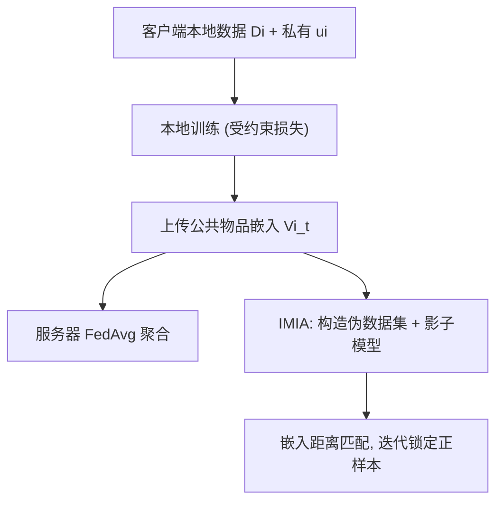
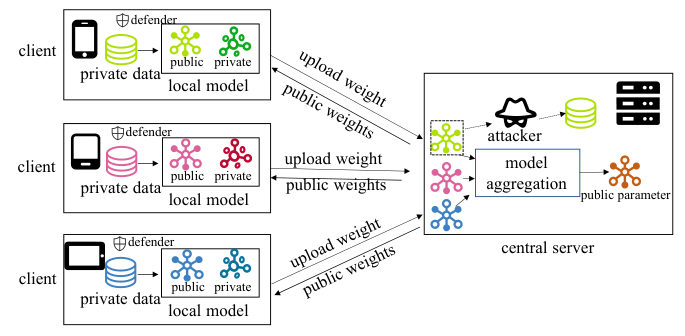

# Interaction-level Membership Inference Attack Against Federated Recommender Systems (面向联邦推荐系统的交互级成员推理攻击)

- **会议/期刊**: The Web Conference (WWW) 2023
- **作者与机构**: Wei Yuan、Hongzhi Yin（昆士兰大学），Chaoqun Yang、Quoc Viet Hung Nguyen（格里菲斯大学），Lizhen Cui（山东大学），Tieke He（南京大学）
- **推荐链路定位**: 联邦召回/表征训练阶段（Fed-NCF、Fed-LightGCN 的本地训练与参数上传环节）
- **研究方向**: 去偏公平、可信隐私与工业架构 / 协同过滤与双塔召回
- **论文原文**: [https://arxiv.org/abs/2301.10964v2](https://arxiv.org/abs/2301.10964v2)
- **开源代码**: 暂未开源

## TL;DR (1分钟核心速览)

联邦推荐（FedRec）把用户嵌入留在本地、只上传物品嵌入，长期被视为隐私安全方案。本文首次系统研究**交互级成员推理攻击（IMIA）**：诚实的服务器仅凭上传的公共物品嵌入与负采样比 $\eta$，迭代构造伪数据集、训练影子模型并按嵌入距离猜测正样本，在 Fed-NCF 上 F1 达 0.59–0.67（随机猜测仅 0.20）。进一步证明 LDP 需把 Hit@10 腰斩才能压制攻击，遂提出公共参数更新约束正则，将攻击压回随机水平而推荐性能几乎不变。

## Background & Motivation (背景与核心矛盾)

- **主流范式**: FedRec 将用户嵌入 $\mathbf{u}_i$作为私有参数留在客户端，仅上传/聚合物品嵌入$\mathbf{V}$（FedAvg），并普遍采用 LDP 加噪作为隐私兜底。
- **前人局限**: 已有工作只覆盖**属性推断**（Zhang et al.）与**显式反馈评分泄漏**；联邦分类中的 MIA 无法迁移——分类 MIA 判断"样本是否被用于训练"，而 FedRec 中只要比对 $\mathbf{V}_i^t$与$\mathbf{V}^t$ 就能知道哪些物品参与了本地训练，难点在于区分其中的**正样本与负样本**；且攻击者既无 i.i.d. 辅助数据，也无用户私有嵌入。
- **核心洞察 (Key Insight)**: 表 1 的概念验证显示，对同一用户仅翻转单个物品评分重训影子模型，通过比较 $\mathrm{dist}(\mathbf{v}_j,\mathbf{v}_j')$与$\mathrm{dist}(\mathbf{v}_j,\mathbf{v}_j'')$ 判断原始评分的准确率在多数设置下 >90%；推广后可得：若两个数据集大部分评分相同，同 ratings 物品的嵌入会相互靠近。
- **本文切入点**: 用随机评分（按 $\eta$比例）构造与真实$D_i$ 仍有约 50% 评分重合的伪数据集，用影子模型嵌入距离反推正样本，并把"公共参数少学一点"作为防御抓手。

## Method (核心方法设计)

### 1. 整体框架 (Overall Architecture)

系统沿用标准 FedRec 四步协议（选客户端→下发全局参数→本地训练→上传公共参数聚合），但把中央服务器视为 honest-but-curious 攻击者：它在完成正常聚合的同时，缓存目标用户上传的 $\mathbf{V}_i^t$，并异步运行 IMIA 推断模块。防御端在每个客户端本地损失中加入对公共参数的更新约束，迫使模型把判别信息压缩进私有用户嵌入，从源头减少共享参数承载的用户交互信号。

<figure class="paper-figure" markdown="span">
  <figcaption>图 1：带有 IMIA 攻击者和防御者的典型联邦推荐系统。</figcaption>
</figure>

### 2. 关键设计拆解 (Key Designs)

1. **影子模型距离匹配攻击（IMIA Attacker）**：由于不知道任何真实评分，服务器先按 $\eta=1{:}4$随机给$u_i$的关联物品$\mathcal{V}_i$赋 0/1 构造伪数据集$D_i^{fake}$，用与客户端一致的超参训练影子模型得到$\tilde{\mathbf{V}}_i^{fake}$，再取距离最小的$\gamma|\mathcal{V}_i|$个物品判为正样本并固定其标签，迭代至正样本数达$\eta|\mathcal{V}_i|$：$\hat{\mathcal{V}}_i^{+}\leftarrow \arg\min_{|\mathcal{S}|=\gamma|\mathcal{V}_i|}\sum_{v_j\in\mathcal{S}}\|\mathbf{v}_{j,i}^{t}-\tilde{\mathbf{v}}_j^{fake}\|_2$。物理直觉是：正样本对损失贡献方向一致，其嵌入在真/伪模型间偏移最小，而随机赋值的负样本会引入系统性扰动。
2. **公共参数更新约束防御（IMIA Defender）**：观察到 Fed-LightGCN 比 Fed-NCF 更难被攻击（ML-100K F1 0.39 vs 0.59），图 2 显示 NCF 的用户嵌入偏移量远小于物品嵌入、几乎"不学东西"；据此在本地损失上加一项约束，压住公共参数的学习能力、逼迫私有嵌入承担表征：$\mathcal{L}=\mathcal{L}_{rec}+\mu\|\mathbf{V}_i^{t}-\mathbf{V}^{t}\|_F^{2}$。它等价于对共享通道做信息瓶颈，只削减"可被服务器观测到的信息量"，而非像 LDP 那样直接破坏参数数值。
3. **训练目标、负采样与推理开销**：本地损失为二值交叉熵 $\mathcal{L}_{rec}=-\sum r_{ij}\log\hat{r}_{ij}+(1-r_{ij})\log(1-\hat{r}_{ij})$，负采样固定 1:4，嵌入维 64，本地 batch 64、20 个本地 epoch、Adam 1e-3、全局 200 轮；攻击免负采样但需在服务器端为**每个**目标用户反复训练影子模型，开销随目标用户数近似线性增长。

## Experimental Setup & Evaluation Protocol (实验设置与评估协议)

- **数据集与预处理**: 三个跨域真实数据集，评分统一二值化，负样本按 1:4 采样：

| 数据集 | #Users | #Items | #Interactions | 稀疏度/密度 | 特征/场景说明 |
| :--- | :---: | :---: | :---: | :---: | :--- |
| MovieLens-100K | 943 | 1,682 | 100,000 | 6.30%（最稠密，人均 106） | 电影评分 |
| Steam-200K | 3,753 | 5,134 | 114,713 | 0.59%（人均 31） | 游戏购买 |
| Amazon Cell Phone | 13,174 | 5,970 | 103,593 | 0.13%（最稀疏，人均 8） | 手机商品评论 |

- **数据划分与防穿越 (Splitting Strategy)**: 采用 `Leave-One-Out` 划分训练/验证/测试，测试目标为最后一条交互。
- **排名评测协议 (Ranking Protocol)**: 属于 `Sampled Ranking`（1 正样本 + 4 负采样候选），指标为 Hit@10；攻击侧使用分类 F1，评价"正样本识别"精度。
- **对比基线与超参设置**: 攻击基线为 Random Attack 与 K-means Attack（对上传嵌入做二聚类、取低 SSE 簇为正样本）；防御基线为 LDP（$\lambda\in\{0.001,0.01,0.1\}$）与无防御$\mu=0$；$\gamma=20\%$。

## Key Experimental Results (实验关键数据)

### 1. 主实验对比 (Main Results)

无防御（vanilla FedRec）下三种攻击者的 F1（越低越安全，本文攻击者越高越危险）：

| 模型 | 攻击方法 | ML-100K | Steam-200K | Amazon |
| :--- | :--- | :---: | :---: | :---: |
| — | Random | 0.2079 | 0.2019 | 0.1998 |
| Fed-NCF | K-means | 0.3183 | 0.2477 | 0.2458 |
| Fed-NCF | **IMIA (Ours)** | **0.5928** | **0.6707** | **0.6516** |
| Fed-LightGCN | K-means | 0.1460 | 0.2573 | 0.2697 |
| Fed-LightGCN | **IMIA (Ours)** | **0.3900** | **0.6007** | **0.4328** |

### 2. 消融实验 (Ablation Study)

防御强度 $\mu$ 扫描（格式：F1↓ / Hit@10↑）：

| 模型 | 数据集 | $\mu=0.0$|$\mu=0.1$|$\mu=0.4$|$\mu=1.0$ |
| :--- | :--- | :---: | :---: | :---: | :---: |
| Fed-NCF | ML-100K | 0.5928 / 0.3690 | 0.2638 / 0.3605 | 0.2140 / **0.3743** | 0.2145 / 0.3531 |
| Fed-NCF | Steam-200K | 0.6707 / 0.6645 | 0.3888 / 0.6005 | 0.2667 / **0.6011** | 0.2058 / 0.5960 |
| Fed-NCF | Amazon | 0.6516 / 0.2176 | 0.4761 / 0.2142 | 0.3368 / 0.2129 | 0.3079 / 0.2126 |
| Fed-LightGCN | ML-100K | 0.3900 / 0.4072 | 0.2130 / **0.4082** | 0.1892 / 0.3891 | 0.1741 / 0.3870 |
| Fed-LightGCN | Steam-200K | 0.6007 / 0.6943 | 0.4730 / 0.6584 | 0.4620 / 0.5830 | 0.2246 / 0.5472 |
| Fed-LightGCN | Amazon | 0.4328 / 0.1796 | 0.4730 / **0.1920** | 0.2847 / 0.1821 | 0.3308 / 0.1615 |

LDP 对照（Fed-NCF）：ML-100K 在 $\lambda=0.1$ 时 F1 降至 0.2520，但 Hit@10 由 0.3690 崩至 0.1696；Steam-200K 由 0.6645 崩至 0.2224。

### 3. 关键实验发现 (Key Findings)

1. **攻击确实可行且远超朴素基线**：IMIA 在 Steam-200K 上把 Fed-NCF 的 F1 从随机猜测 0.2019 拉到 0.6707（约 3.3 倍），而 K-means 仅 0.2477；说明"兴趣一致性导致正样本嵌入更聚拢"的朴素聚类假设不足以利用联邦泄漏，必须借助影子模型的距离排序。
2. **模型结构与数据稀疏度共同决定泄漏面**：Fed-LightGCN 普遍更抗攻击（ML-100K 0.3900 vs 0.5928），与图 2 中"用户嵌入偏移远大于 NCF"一致——私有参数吸收的信息越多，公共参数可泄漏的边际越少；图 3 进一步显示交互数越少的用户 F1 越高，最稠密的 ML-100K 反而最安全（0.5928），最稀疏的 Amazon 达 0.6516。
3. **LDP 性价比极低、约束正则显著更优**：以 $|\Delta F1|/|\Delta Hit@10|$衡量，LDP 仅 1.01–9.05，而本文防御为 2.55–71.47（NCF 在 ML-100K 上高出近 40 倍）；$\mu=0.1$ 即可把 Fed-NCF/ML-100K 的攻击 F1 从 0.5928 压到 0.2638，而 Hit@10 仅从 0.3690 变到 0.3605，甚至因正则化略有提升。

## Highlights & Limitations (亮点、对比与审稿批判)

- **与代表作对比 (vs. Prior Work)**: 相较 Zhang et al. 的属性推断与显式反馈评分泄漏研究，本文把威胁模型细化到隐式反馈的**单条交互**粒度；相较联邦分类 MIA（Nasr et al.）依赖额外 i.i.d. 数据，本文只需上传参数与 $\eta$、$lr$ 等公开超参；相较 LDP 加噪路线，本文改"破坏数值"为"限制公共参数容量"，避免了精度-隐私的硬 trade-off。
- **可迁移亮点**: ①"私有/公共参数容量再分配"可作为通用联邦推荐防御范式，与安全聚合、DP-SGD 正交叠加；②影子模型嵌入距离排序可作为模型审计工具，用于上线前量化交互泄漏风险。
- **审稿级局限批判**: ①攻击需为每个目标用户迭代重训影子模型，服务器侧算力开销随用户规模线性膨胀，论文未给出收敛轮数与时间成本分析；②防御对 $\mu$与数据稀疏度高度耦合——Fed-LightGCN 在 Amazon 上$\mu=0.1$时 F1 反升至 0.4730（高于无防御 0.4328），Steam 上$\mu=1.0$使 Hit@10 从 0.6943 掉到 0.5472，缺少自适应$\mu$ 选择机制；③仅覆盖 Fed-NCF/Fed-LightGCN 与二值隐式反馈，未讨论多恶意客户端合谋、序列/图神经推荐器等更强攻击面。

## Rating (四维评分)

- **方法创新性 (Novelty)**: ⭐⭐⭐⭐ （首次定义交互级 MIA 并给出影子模型距离匹配的攻击范式，"公共参数信息瓶颈"式防御视角新颖且简洁）
- **评估协议与实验扎实度 (Protocol & Experiments)**: ⭐⭐⭐ （三数据集两模型 + LDP 对照 + 稀疏度分桶较完整，但仅采样排序 Hit@10、缺全库排序与显著性检验，防御在部分设置失效未深入剖析）
- **写作与数学规范度 (Clarity & Rigor)**: ⭐⭐⭐⭐ （攻击伪代码与形式化定义清晰，公式简洁；LDP 与防御的对比指标定义明确，但防御的理论隐私保证仅有经验支撑）
- **工业落地与复现价值 (Industrial & Practical Value)**: ⭐⭐⭐ （防御仅需一行正则、几乎零额外推理开销，易落地；但攻击侧影子模型训练成本高、无开源代码，复现与线上审计成本偏高）

