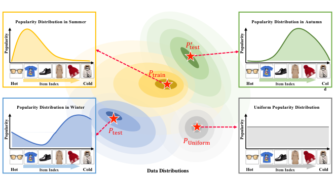
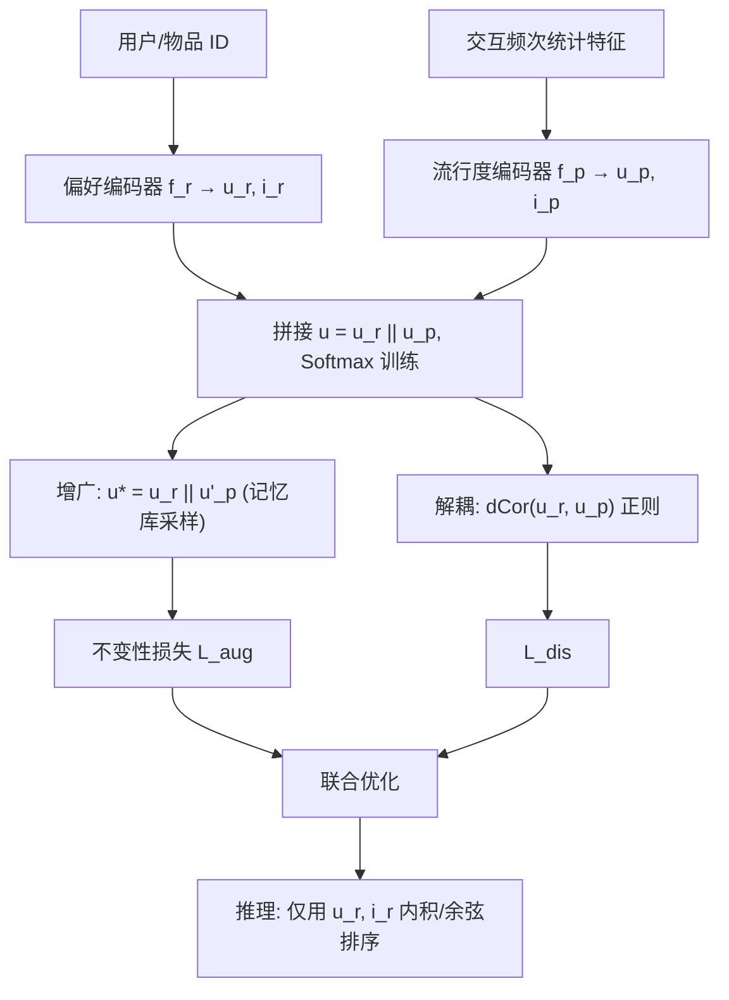
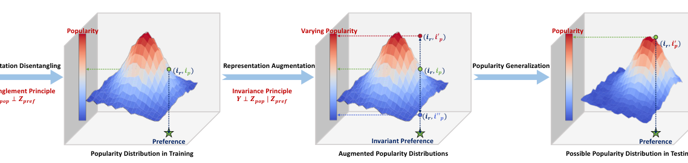

# Invariant Collaborative Filtering to Popularity Distribution Shift (面向流行度分布偏移的不变协同过滤)

- **会议/期刊**: WWW 2023 (The Web Conference)
- **作者与机构**: An Zhang, Jingnan Zheng, Xiang Wang, Yancheng Yuan, Tat-Seng Chua（NUS / Sea-NExT Joint Lab / USTC / PolyU）
- **推荐链路定位**: 召回（表征学习层，可插拔于任意 CF 主干）
- **研究方向**: 去偏公平可信隐私与工业架构 / 协同过滤与双塔召回
- **论文原文**: [https://arxiv.org/abs/2302.05328v3](https://arxiv.org/abs/2302.05328v3)
- **开源代码**: [https://github.com/anzhang314/InvCF](https://github.com/anzhang314/InvCF)

## TL;DR (1分钟核心速览)

现有流行度去偏方法（IPS 重加权、因果嵌入等）都**隐含假设测试集流行度分布已知**，一旦真实场景发生流行度偏移（季节、周末、地域）即失效。本文把该问题重构为**流行度分布偏移下的泛化问题**，提出 InvCF：将用户/物品表征显式拆成 `偏好分量 + 流行度分量`，用"交叉拼接增广"逼迫预测对流行度分量不变，用"距离相关正则"逼迫两分量独立。在 5 个真实数据集、4 类评测协议（合成长尾 γ=200、无偏、时间切分、OOD）上，NDCG@20 相对最强基线平均提升约 10.2%(MF)/5.9%(LightGCN)。

## Background & Motivation (背景与核心矛盾)

- **主流范式**: 以 MF、LightGCN 为代表，用 ID 协同信号编码统一表征，并用 BPR/Softmax 拟合交互；去偏阵营则分三支——正则化（sam+reg）、逆倾向重加权（IPS-CN）、因果嵌入（CausE / MACR）。
- **前人局限一**: 重加权族把"均匀流行度分布"当作无偏目标，等于**预先知道测试分布**；因果族依赖与测试同分布的验证集或少量无偏数据调参，否则偏差度量本身就是错的。
- **前人局限二**: 所有方法都把流行度信息**纠缠**进同一表征，作者用贝叶斯分解指出测试风险含两项：偏置项 $P_{test}(Z_{pop}|Y)$与纠缠项$P_{test}(Z_{pref}|Y,Z_{pop})$，而现有工作直接假设后者在训练/测试间不变——这与"流行度-偏好相关性本身在漂移"的事实矛盾。
- **核心洞察 (Key Insight)**: 交互由**因果的偏好**（用户对物品属性的兴趣，稳定）与**虚假的流行度**（从众、曝光，不稳定）共同生成，只有前者跨分布不变。
- **本文切入点**: 不做"去偏"，而做"解耦 + 不变性约束"，学一个与流行度语义无关的偏好表征。

<figure class="paper-figure" markdown="span">
  <figcaption>图1：真实场景中流行度分布偏移的示意图。季节变化会自然影响物品流行度分布，其中 𝑃𝑡𝑒𝑠𝑡 和 𝑃</figcaption>
</figure>

## Method (核心方法设计)

### 1. 整体框架 (Overall Architecture)

在任意 CF 主干上并置两个同构编码器：**偏好编码器** $f_r$输入用户/物品 ID 得到$\mathbf{u}_r,\mathbf{i}_r$；**流行度编码器**$f_p$输入该用户/物品的历史交互数（当作 ID 类类别特征）得到$\mathbf{u}_p,\mathbf{i}_p$。二者拼接$\mathbf{u}=\mathbf{u}_r\|\mathbf{u}_p$作为完整表征参与 Softmax 训练。训练时额外挂两个模块：表示增广模块从记忆库采样他人的流行度分量替换自身分量，迫使打分对流行度不变；解耦模块用距离相关把两分量推离。**推理阶段直接用偏好分量$\mathbf{u}_r$ 打分，彻底丢弃流行度编码器**，因此线上开销与原始 MF/LightGCN 完全一致，且无需任何测试分布先验。

<figure class="paper-figure" markdown="span">
  <figcaption>图2：由InvCF得到的物品表示及其流行度泛化的示意图。</figcaption>
</figure>

### 2. 关键设计拆解 (Key Designs)

1. **双流分解 + 双 Softmax 经验风险**：痛点在于"一个表征同时背偏好与流行度，测试分布一变就被污染"。做法是把流行度统计量作为另一路输入单独编码，并在两路各自施加采样 Softmax 损失：$\mathcal{L}_{rep}=l(\mathbf{u}_r,\mathbf{i}_r)+\alpha\cdot l(\mathbf{u}_p,\mathbf{i}_p)$，其中$l$为带温度$\tau$、负样本集$\mathcal{N}_u$ 的 sampled softmax。直觉：让流行度分量"有地方可去"，从而不挤占偏好分量的容量。

2. **表示级增广（不变性原理 $Y\perp Z_{pop}\,|\,Z_{pref}$）**：构建记忆库$\mathcal{U}_p=\{\mathbf{u}'_p\}$、$\mathcal{I}_p=\{\mathbf{i}'_p\}$，用他者的流行度分量替换自身分量，构造反事实表征$\mathbf{u}^{*}=\mathbf{u}_r\|\mathbf{u}'_p$、$\mathbf{i}^{*}=\mathbf{i}_r\|\mathbf{i}'_p$，再要求预测保持一致：

$$\mathcal{L}_{aug}=\mathbb{E}_{\mathbf{u}'_p\in\mathcal{U}_p}\,l(\mathbf{u}^{*},\mathbf{i})+\mathbb{E}_{\mathbf{i}'_p\in\mathcal{I}_p}\,l(\mathbf{u},\mathbf{i}^{*}).$$

由于替换只动流行度、不动偏好，该损失等价于在"多种可能流行度世界"下做风险最小化，逼迫模型把判别信号全部压进 $\mathbf{u}_r/\mathbf{i}_r$——这正是把"测试分布未知"变成"训练时枚举多种流行度分布"的关键技巧。

3. **距离相关解耦（$Z_{pop}\perp Z_{pref}$）+ 联合训练**：仅靠增广时两分量仍可能互相泄漏，故加正则$\mathcal{L}_{dis}=dCor(\mathbf{u}_r,\mathbf{u}_p)+dCor(\mathbf{i}_r,\mathbf{i}_p)$，距离相关能捕捉**非线性**依赖（优于 Pearson/MMD，见原文表 10）。总目标：

$$\mathcal{L}=\mathbb{E}_{(u,i)\in\mathcal{D}_{train}}\big[\mathcal{L}_{rep}+\lambda_1\mathcal{L}_{aug}+\lambda_2\mathcal{L}_{dis}\big].$$

负采样沿用 in-batch + 均匀采样负例；增广的记忆库随 batch 更新，成本近似 O(1)，无额外推理开销。

## Experimental Setup & Evaluation Protocol (实验设置与评估协议)

- **数据集与预处理**: 5 个真实集 + 1 个合成集，均为隐式反馈；以 KL 散度 $D_{KL}(P_{train}\|P_{test})$ 量化偏移强度。

| 数据集 | #Users | #Items | #Interactions | 密度 | 场景说明 |
| :--- | :---: | :---: | :---: | :---: | :--- |
| Yahoo!R3 | 14,382 | 1,000 | 129,748 | 0.0090 | 含无偏测试集，$D_{KL}$=0.3561 |
| Coat | 290 | 295 | 2,776 | 0.0324 | 无偏测试集，$D_{KL}$=0.1745 |
| Douban Movie | 36,644 | 22,226 | 5,397,926 | 0.0066 | 时间切分，$D_{KL}$=0.1601 |
| Meituan | 67,529 | 29,785 | 2,190,658 | 0.0011 | 工作日→周末 OOD，$D_{KL}$=0.0110 |
| Yelp2018 | 95,709 | 41,602 | 2,937,228 | 0.0007 | 表征可视化基准 |
| Tencent (合成) | 4,886 | 4,804 | 134,031 | 0.0057 | 人工构造 γ 长尾测试集 |

- **数据划分与防穿越 (Splitting Strategy)**: 四类协议——(i) **合成长尾划分**：Tencent 按流行度分 50 组、第 $i$组采$N_i=N_0\gamma^{-\frac{i-1}{49}}$条（$\gamma\in\{200,10,2\}$，$\gamma$ 越小偏移越强），余下按 60:10 划训练/验证；(ii) **无偏划分**：Yahoo!R3/Coat 使用随机抽取物品构成的 unbiased test；(iii) **时间戳切分**：Douban 按 7:1:2 时间切分；(iv) **OOD 划分**：Meituan 工作日 60:10 训练/验证、周末 30% 测试。
- **排名评测协议 (Ranking Protocol)**: 无偏 **Full-Ranking**（除训练正例外全库排序），指标 HR@20 / Recall@20 / NDCG@20。
- **对比基线与超参设置**: 主干为 MF 与 LightGCN；基线含 sam+reg、IPS-CN、CausE、MACR（去偏族）与 sDRO、CD2AN（分布外泛化族）。改进显著性以 $p\ll0.05$ 的 t 检验验证。

## Key Experimental Results (实验关键数据)

### 1. 主实验对比 (Main Results)

NDCG@20 结果（MF 主干；Tencent 取 γ=200 最强偏移）：

| Method | Tencent(MF) | Tencent(LGCN) | Yahoo!R3 | Coat | Douban | Meituan |
| :--- | :---: | :---: | :---: | :---: | :---: | :---: |
| Backbone (MF/LightGCN) | 0.0167 | 0.0240 | 0.0476 | 0.0361 | 0.0552 | 0.2250 |
| + sam+reg | 0.0168 | 0.0307 | 0.0548 | 0.1869 | 0.0577 | 0.2272 |
| + IPS-CN | 0.0273 | 0.0280 | 0.0487 | 0.1377 | 0.0403 | 0.2046 |
| + CausE | 0.0192 | 0.0259 | 0.0573 | 0.1713 | 0.0579 | 0.2409 |
| + MACR | 0.0173 | 0.0208 | 0.0539 | 0.0358 | 0.0584 | 0.2129 |
| + sDRO | 0.0311 | 0.0286 | 0.0661 | 0.1767 | 0.0553 | 0.3002 |
| + CD2AN | 0.0286 | 0.0305 | 0.0690 | 0.1885 | 0.0553 | 0.2664 |
| **+ InvCF** | **0.0342** | **0.0331** | **0.0732** | **0.2059** | **0.0604** | **0.3073** |
| Improv.% | +9.97% | +7.82% | +6.09% | +9.23% | +3.42% | +2.37% |

### 2. 消融实验 (Ablation Study)

Yahoo!R3 + MF 主干，`InvCF-i` 去掉增广模块，`InvCF-d` 去掉解耦模块：

| Variant | HR@20 | Recall@20 | NDCG@20 | #epoch (收敛) |
| :--- | :---: | :---: | :---: | :---: |
| Softmax (ERM) | 0.2224 | 0.1470 | 0.0688 | 264.5 |
| InvCF-i (w/o 增广) | 0.2195 (−1.30%) | 0.1457 (−0.88%) | 0.0701 (+1.89%) | 304.8 |
| InvCF-d (w/o 解耦) | 0.2241 (+0.76%) | 0.1464 (−0.41%) | 0.0696 (+1.16%) | 419.1 |
| **InvCF (full)** | **0.2333 (+4.90%)** | **0.1566 (+6.53%)** | **0.0732 (+6.40%)** | **164.2** |

### 3. 关键实验发现 (Key Findings)

1. **两个原理互为必要条件，单独拆开几乎无效甚至退化**：只留解耦（InvCF-i）Recall 反降 0.88%，只留增广（InvCF-d）Recall 降 0.41%；而完整 InvCF 的 Recall 提升 6.53%，且收敛 epoch 从 264.5 降到 164.2（−38%），说明解耦正则与反事实增广共同把优化地形"拉直"。
2. **去偏族在偏移加剧时反噬，泛化族与 InvCF 单调稳健**：Tencent 上 γ 从 200 收紧到 2 时，IPS-CN 在 MF 上 NDCG 从 0.0273 掉到 0.0147，而 InvCF 稳定领先（0.0342→0.0165），验证"预先知道测试分布"假设在未知偏移下必然失效。
3. **表征角度分布给出了机制证据**：图 5 显示 BPR/Softmax 学到的偏好-流行度夹角分布发散难分，InvCF 的夹角显著集中；3D 可视化中头用户历史物品的偏好点与流行度点形成清晰边界，直接对应下游的泛化增益。

## Highlights & Limitations (亮点、对比与审稿批判)

- **与代表作对比 (vs. Prior Work)**: 相较 IPS-CN/MACR 把流行度当作需**消除的偏置**（需目标分布先验），InvCF 把流行度当作**可迁移到独立通道的虚假因子**；相较 CD2AN 的双网络共训练与 sDRO 的分布鲁棒优化，InvCF 无需 unbiased 子集、无需最坏组划分，只用一次记忆库采样即枚举"流行度世界"，且推理零额外成本。
- **可迁移亮点**: (1) "**统计特征单独编码 + 交叉拼接增广**"可平移到曝光位置偏置、时间/地域偏置等任意可枚举的混杂因子；(2) 用距离相关做非线性解耦，比 Pearson/MMD 更贴合 embedding 空间的非线性依赖。
- **审稿级局限批判**: (1) 流行度编码器的输入是"交互计数"类别化特征，本质仍是训练集统计量，在**冷启动物品**（计数缺失或恒为 0）上该路信号近乎常量，不变性约束可能退化为普通正则；(2) 增广依赖全局记忆库的采样分布，负样本与记忆库均未做方差分析，$\lambda_1,\lambda_2$ 在 5 个数据集上的敏感性未充分披露；(3) 评测仍为离线全库排序，缺少曝光日志与线上 A/B，无法验证"牺牲训练集拟合换泛化"（验证集指标略低于 sDRO）在真实流量下是否划算。

## Rating (四维评分)

- **方法创新性 (Novelty)**: ⭐⭐⭐⭐ （把去偏问题重述为分布偏移泛化，双原理+记忆库反事实增广的组合简洁自洽，但不变学习/解耦均为成熟工具的巧妙移植）
- **评估协议与实验扎实度 (Protocol & Experiments)**: ⭐⭐⭐⭐⭐ （5 真实集 + 合成集、4 类划分协议、Full-Ranking、双主干、显著性检验与 3D 可视化证据链完整）
- **写作与数学规范度 (Clarity & Rigor)**: ⭐⭐⭐⭐ （贝叶斯分解清晰给出偏置项/纠缠项两条动机，公式简洁；但增广模块的理论保证与泛化界仅有直觉论证）
- **工业落地与复现价值 (Industrial & Practical Value)**: ⭐⭐⭐⭐⭐ （代码开源、推理只用偏好分量、开销与原主干完全一致，可直接插入现有召回双塔/图召回管线）

