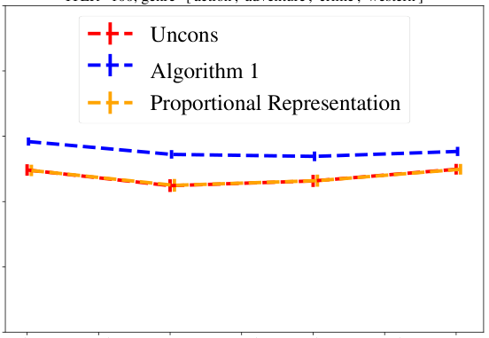
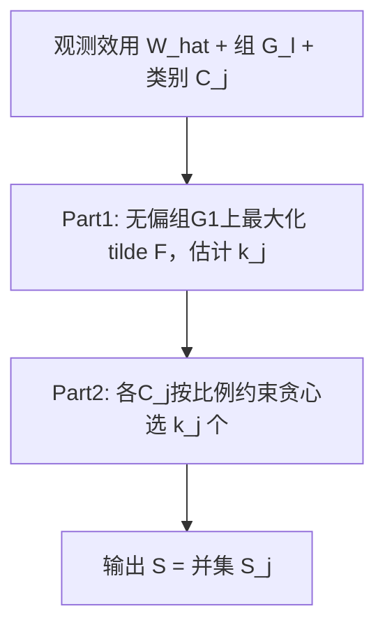

# Maximizing Submodular Functions for Recommendation in the Presence of Biases (存在偏置时面向推荐的子模函数最大化)

- **会议/期刊**: WWW 2023
- **作者与机构**: Anay Mehrotra, Nisheeth K. Vishnoi (Yale University)
- **推荐链路定位**: 重排/列表子集选择
- **研究方向**: 去偏公平、可信隐私与工业架构
- **论文原文**: [论文原文链接](https://arxiv.org/abs/2305.02806v1)
- **开源代码**: [开源代码仓库链接](https://github.com/AnayMehrotra/Submodular-Maximization-in-the-Presence-of-Biases)

## TL;DR (1分钟核心速览)

针对观测效用含组别偏置时子模推荐子集选择失效的问题，本文证明固定公平约束对子模目标不能保证任意常数近似，并提出用无偏参考组估计数据依赖配额的两阶段贪心。MovieLens 20M 离线模拟以用户评分为潜在效用，Alg1 在 14/31 类型集合上提升≥3%，在>87%集合不劣于基线。

## Background & Motivation (背景与核心矛盾)

- **主流范式**: 推荐/搜索中的列表子集选择常用子模函数建模边际递减，即 $F(S)=\sum_{j=1}^{m}g_j(\sum_{i\in S}W_{ij})$，再用标准贪心或公平约束贪心近似最大化。
- **前人局限**: 线性目标下，比例表示等公平约束可同时保证表示与近最优潜在效用；但该结论依赖线性可分解性，对子模目标不成立。且已有偏置模型常假设效用独立同分布，限制较强。
- **核心洞察 (Key Insight)**: 若存在一个无偏参考组 $G_1$，其均匀随机抽样可用来估计各类别$C_j$的最优配额$k_j$；固定比例约束反而可能把预算错配到被偏置抬高的组。
- **本文切入点**: 先由无偏组估计数据依赖配额，再在配额与比例表示约束下做子模贪心，从而在未知偏置函数下逼近潜在最优。

<figure class="paper-figure" markdown="span">
  <figcaption>图 2：MovieLens 20M 数据上的模拟：在刻板印象上与男性相关的类型中，由男性演员领衔的电影的相关性分数相比由非男性演员领衔的电影不成比例地更高（最高达 3 倍）。相比之下，这些电影集合的用户评分在各类型内的差异在 6% 以内。我们使用相关性分数从男性刻板印象类型的不同子集中推荐 k ∈{50,100,150,200} 部电影，并使用用户评分估计推荐电影的潜在效用。图 2(a) 和图 2(b) 展示了两个大小为 4 的子集的结果——我们观察到 Alg</figcaption>
</figure>

## Method (核心方法设计)

### 1. 整体框架 (Overall Architecture)

输入为观测效用矩阵 $\hat{W}$、受保护组$G_1,\dots,G_p$与类别集合$C_j=\{i:W_{ij}>0\}$。Algorithm 1 分两阶段：Part 1 在无偏组$G_1$上最大化重标定目标$\tilde{F}$，得到各类别配额$k_j$；Part 2 对每个$C_j$在比例表示约束下贪心选$k_j$个物品，合并输出$S=\cup_jS_j$。无训练与负采样，推理即贪心子集选择。

### 2. 关键设计拆解 (Key Designs)

1. **偏置建模与失效定理**：观测效用 $\hat{W}_{ij}=\phi_{\ell}(W_{ij})$，$\phi_{\ell}$未知递增；固定公平约束形如$|S\cap G_{\ell}|\le(u_{\ell}+v_{\ell}\gamma_{\ell})k$。Theorem 4.1 构造子模$F$与乘性偏置，使任意该族约束的解满足$F(S_{uv})\le\varepsilon\mathrm{OPT}$，说明线性下的公平约束近优性不能外推到子模。

2. **数据依赖配额估计**：定义 $\tilde{F}(T)=\sum_{j=1}^{m}g_j(\frac{n}{|G_1|}\sum_{i\in T\cap G_1}\hat{W}_{ij})$，在$G_1$上选$|\tilde{S}|=k|G_1|/n$并令$k_j=|\tilde{S}\cap C_j|$。直觉是$G_1$为均匀抽样，缩放$n/|G_1|$可抵消抽样偏差；对过小的$k_j$过估计到$\sqrt{k}$，保证高效用物品以高概率入集。

3. **比例约束贪心与复杂度**：Part 2 对每个 $j$贪心最大化$g_j(\sum_{i\in S_j}\hat{W}_{ij})$，每步仅在“加入后不违反比例表示”的候选中选最大边际增益。无训练损失、无负采样；复杂度为$O(nk)$次$g_j$查询与$O(nk\log n)$额外算术。Assumption 1（$C_j$互斥）且$\phi_1$为恒等时，大$k$下以$1-\varepsilon$概率有$F(S)\ge(1-\varepsilon)\mathrm{OPT}$。

## Experimental Setup & Evaluation Protocol (实验设置与评估协议)

- **数据集与预处理**:

| 数据集 | #Users | #Items | #Interactions | 稀疏度/密度 | 特征/场景说明 |
| :--- | :---: | :---: | :---: | :---: | :--- |
| MovieLens 20M | 138,000 | 27,000（过滤后8,602） | 20M | 原始≈0.54% | 电影类型 relevance $r_{ig}$、主演性别；用户评分作 latent utility |
| Synthetic-1 | — | 250 | — | — | Spotify 式 $F=\sum_iW_{i1}+\lambda\sum_{j=2}^{3}\sqrt{\sum_iW_{ij}}$，$\lambda=1/20$ |
| Synthetic-2 | — | 250 | — | — | Amazon Music 式 $F=\sum_j\log(1+\sum_iW_{ij})$，类别互斥 |

- **数据划分与防穿越 (Splitting Strategy)**: 无训练/测试时间切分；MovieLens 对每个 $(k,T)$重复100次，每次随机抽评分≥200的用户（占19%），候选集$M$为其已评分电影；合成数据按$\beta$ 网格重复10/20次。属离线模拟，需警惕与在线分布差异。
- **排名评测协议 (Ranking Protocol)**: 非传统 Full-Ranking；在候选集 $M$上做全候选子集选择，无负采样。观测效用为$\hat{F}(S)=\sum_{g\in T}\sqrt{\sum_{i\in S}r_{ig}}$，潜在效用为用户平均评分$F(S)=\frac{1}{|S|}\sum_{i\in S}\mathrm{rating}_i$。
- **对比基线与超参设置**: Uncons（标准贪心最大化观测效用）、ProportionalRepr（比例表示约束贪心）；无 embedding 维度。MovieLens $k\in\{50,100,150,200\}$，$T$取5个男性刻板类型的31个非空子集；合成$n=250,m=3,k=50$，$|G_1|/n\in\{1/4,1/2,3/4\}$。报告均值标准误，未报告显著性检验。

## Key Experimental Results (实验关键数据)

### 1. 主实验对比 (Main Results)

| 场景/设置 | 指标 | Uncons | ProportionalRepr | Algorithm 1 | Improv. |
| :--- | :--- | :---: | :---: | :---: | :---: |
| Synthetic-1, $\beta\to0$ | NLU↑ | ~0.85 | — | **>0.95** | ≥+10pt |
| Synthetic-2, $\beta\to0$ | NLU↑ | ~0.85 | — | **>0.95** | ≥+10pt |
| MovieLens, T={action,adventure,crime,war} | 平均评分↑ | 基准 | 低0.28% | **最高** | +1.40% vs Uncons |
| MovieLens, T={action,adventure,crime,western} | 平均评分↑ | 基准 | 略低 | **最高** | 全 $k$ 最优 |
| MovieLens, 31个类型集合汇总 | 胜率 | — | — | **14/31 +≥3%** | >87%集合不劣 |

### 2. 消融实验 (Ablation Study)

| 变体/条件 | Synthetic NLU($\beta\to0$) | MovieLens 31集合 | 结论 |
| :--- | :---: | :--- | :--- |
| Uncons（去公平约束） | ~0.85 | 14/31低≥3%，4/31低≤2% | 偏置直接放大 |
| ProportionalRepr（固定比例） | 未报告 | 部分集合低0.28%~3% | 固定配额非最优 |
| Alg1完整 | **>0.95** | 14/31 +≥3%，13/31±1% | 数据依赖配额有效 |

### 3. 关键实验发现 (Key Findings)

1. 合成数据中 $\beta\to0$时，Uncons 的 NLU 可降至约0.85，而 Alg1 仍>0.95；$\beta\to1$ 偏置消失后两者趋同，说明收益来自对偏置的校准而非目标松弛。
2. MovieLens 中男性主演电影在男性刻板类型上的 relevance 最高约为非男性主演的3倍，但用户评分差≤6%，验证 relevance 是偏置代理；以评分为潜在效用时，Alg1 在14/31集合提升≥3%。
3. 理论反例表明固定公平约束在子模下可任意差；Alg1 在 Assumption 1 与大 $k$下达到$(1-\varepsilon)\mathrm{OPT}$，但 MovieLens 类别不互斥，仍取得>87%集合不劣，显示一定鲁棒性。

## Highlights & Limitations (亮点、对比与审稿批判)

- **与代表作对比 (vs. Prior Work)**: 前人[43,18,48]在线性目标下证明比例约束可近最优；本文指出子模目标下固定约束可失效，并用无偏组校准配额替代固定比例。与标准贪心[58]相比，Alg1 不是直接最大化观测效用，而是先修正配额再贪心。
- **可迁移亮点**: 用无偏参考组估计数据依赖配额，可迁移到多群体曝光配额与创作者公平；以凹函数建模类别边际递减，适合多样化列表重排。
- **审稿级局限批判**: 理论保证依赖 Assumption 1（类别互斥）、已知无偏组 $G_1$与大$k$，实际场景常不满足；实验仅两个基线、离线模拟且未做显著性检验，线上延迟与动态偏置未验证。

## Rating (四维评分)

- **方法创新性 (Novelty)**: ⭐⭐⭐⭐ （首次揭示公平约束在线性到子模的失效边界，并提出数据依赖配额算法，理论构造扎实）
- **评估协议与实验扎实度 (Protocol & Experiments)**: ⭐⭐⭐ （MovieLens模拟贴近真实偏置，但基线仅两个、无显著性检验且非在线A/B）
- **写作与数学规范度 (Clarity & Rigor)**: ⭐⭐⭐⭐ （定理与证明完整，偏置模型清晰；但符号较多、常数未优化）
- **工业落地与复现价值 (Industrial & Practical Value)**: ⭐⭐⭐ （代码开源、贪心可落地；依赖无偏参考组与类别互斥，部署前需校准）

