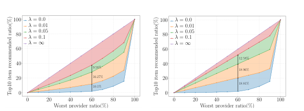
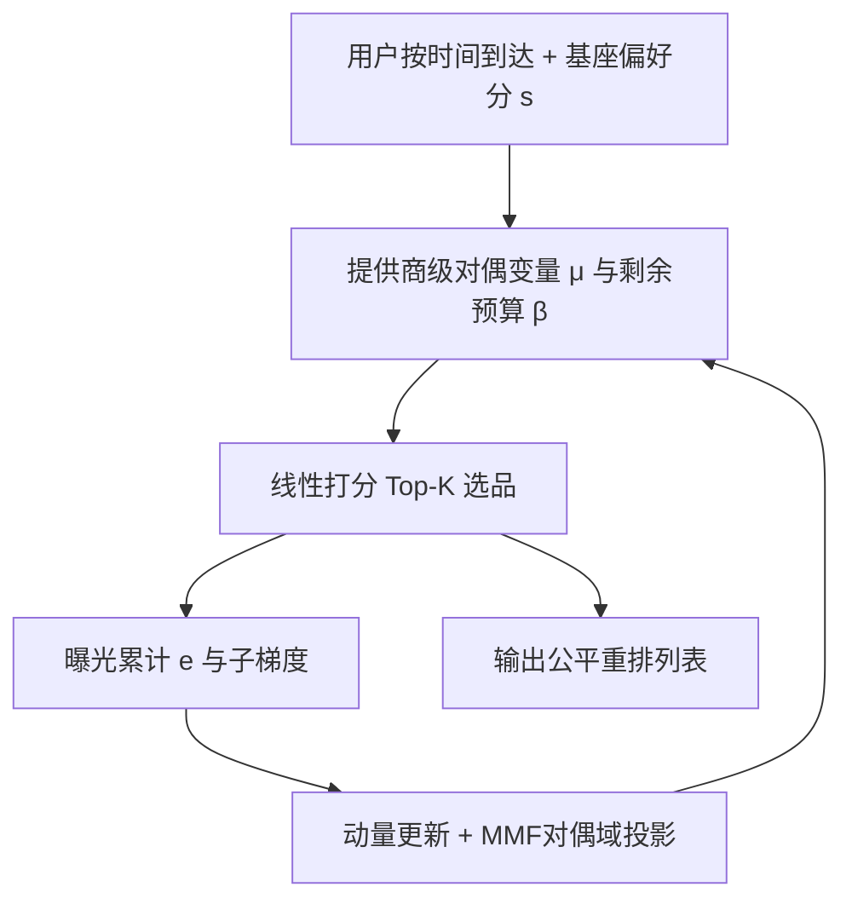

# P-MMF: Provider Max-min Fairness Re-ranking in Recommender System (面向推荐系统提供商极大极小公平的重排模型)

- **会议/期刊**: WWW 2023
- **作者与机构**: Chen Xu, Sirui Chen, Jun Xu, Weiran Shen, Xiao Zhang (Renmin University of China)；Gang Wang, Zhenghua Dong (Huawei Noah's Ark Lab)
- **推荐链路定位**: 重排
- **研究方向**: 去偏公平、可信隐私与工业架构
- **论文原文**: [论文原文链接](https://arxiv.org/abs/2303.06660v1)
- **开源代码**: [开源代码仓库链接](https://github.com/XuChen0427/P-MMF)

## TL;DR (1分钟核心速览)

针对现有提供商公平重排偏重比例公平(PF)、忽视弱势提供商生存的问题，P-MMF将曝光槽视为资源，以极大极小公平(MMF)为正则，在对偶空间用动量梯度在线求解。按时间80/20切分、基座BPR的Top-K重排协议，在Yelp/Beauty/Baby/Steam上W1@10相对最强基线提升0.6–2.0%，并具$O(T^{1/2})$ regret。

## Background & Motivation (背景与核心矛盾)

- **主流范式**: 多利益方推荐中的提供商公平重排，通常用PF/log曝光约束、MMS硬保底或贪心背包来分配Top-K曝光。
- **前人局限**: FairRec+/CPFair等PF类方法优化系统比例公平，可能牺牲最弱提供商；Welf/ROAP等MMF或资源分配方法又偏离线/通用在线分配，在线理论保证与用户效用权衡不足。
- **核心洞察 (Key Insight)**: 社会学equity/Rawls原则下，MMF优先抬高最差提供商曝光，更利于平台生态稳定；Lorenz曲线显示同等$\lambda$下MMF比PF更照顾底部提供商。
- **本文切入点**: 把提供商公平重排写成MMF正则的资源分配问题，转到提供商级对偶空间做在线动量更新。

<figure class="paper-figure" markdown="span">
  <figcaption>图3：分别使用PF正则化器（a）和MMF正则化器（b）时提供者曝光度的洛伦兹曲线。实验基于Yelp数据集的5%进行。</figcaption>
</figure>
图3：PF与MMF正则下提供商曝光的Lorenz曲线（Yelp 5%子集）。

## Method (核心方法设计)

### 1. 整体框架 (Overall Architecture)

用户按时间到达，基座给出物品偏好分$s_{u_t,i}$；系统维护提供商级对偶变量$\boldsymbol\mu_t$与剩余曝光预算$\boldsymbol\beta_t$。每步先以线性打分做Top-K选品，再按曝光累计与子梯度更新动量，并在MMF对偶域投影；无需训练新深度网络，输出即公平重排列表。

### 2. 关键设计拆解 (Key Designs)

1. **MMF资源分配建模**：PF用$r_{\mathrm{PF}}(\mathbf e)=\sum_p\log(1+e_p/\gamma_p)$追求系统比例公平，易被高曝光提供商主导；本文令$r_{\mathrm{MMF}}(\mathbf e)=\min_p e_p/\gamma_p$，优化$\max_{\mathbf x_t}\frac1T\sum_t g(\mathbf x_t)+\lambda r_{\mathrm{MMF}}(\mathbf e)$，约束$\sum_i x_{ti}=K$、$e_p=\sum_t\sum_{i\in I_p}x_{ti}$、$\mathbf e\le\boldsymbol\gamma$、$x_{ti}\in\{0,1\}$。直觉是直接抬高最弱提供商的相对曝光，而非只缩小整体比例差。

2. **对偶降维与闭式Top-K**：整数$\mathbf x_t$维度$|\mathcal I|$难解；对偶变量$\boldsymbol\mu\in\mathbb R^{|\mathcal P|}$，$|\mathcal P|\ll|\mathcal I|$。对偶为$W_{\mathrm{OPT}}\le\min_{\boldsymbol\mu\in\mathcal D}[g^*(\mathbf A\boldsymbol\mu)+\lambda r^*(-\boldsymbol\mu)]$，MMF可行域$\mathcal D=\{\boldsymbol\mu|\sum_{p\in S}\gamma_p\mu_p\ge-\lambda,\forall S\subseteq\mathcal P\}$，且$r^*$有闭式，使每步只需线性Top-K排序。

3. **动量在线更新与Regret**：子梯度含曝光缺口，动量平滑用户到达噪声；$\mathbf g_t=\alpha\tilde{\mathbf g}_t+(1-\alpha)\mathbf g_{t-1}$，$\boldsymbol\mu_{t+1}=\arg\min_{\boldsymbol\mu\in\mathcal D}[\langle\mathbf g_t,\boldsymbol\mu\rangle+\eta\|\boldsymbol\mu-\boldsymbol\mu_t\|_{\boldsymbol\gamma}^2]$。当$\eta=O(T^{-1/2})$时regret为$O(T^{1/2})$；总目标即式(1)的$W$，P-MMF无负采样，基座BPR单独训练，重排每用户仅一次排序加投影。

## Experimental Setup & Evaluation Protocol (实验设置与评估协议)

- **数据集与预处理**: 采用5-core过滤（用户/物品/提供商均至少5次交互）。

| 数据集 | #Users | #Items | #Providers | #Interactions | 稀疏度 | 特征/场景 |
| :--- | :---: | :---: | :---: | :---: | :---: | :--- |
| Yelp | 17,034 | 11,821 | 23 | 154,543 | 0.077% | 城市为提供商 |
| Amazon-Beauty | 9,625 | 2,756 | 1,024 | 49,217 | 0.186% | 品牌为提供商 |
| Amazon-Baby | 11,680 | 2,687 | 112 | 59,836 | 0.191% | 品牌为提供商 |
| Steam | 5,902 | 591 | 81 | 29,530 | 0.847% | 发行商为提供商 |

- **数据划分与防穿越**: 按全局时间排序，前80%训练BPR，后20%测试；测试流按$T=256$切序列，逐序列计算后平均。
- **排名评测协议**: Top-K Listwise Re-ranking：基座BPR对全物品打分，但评估只重排原始Top-K列表；指标为NDCG@K、MMF@K、$W_\lambda$@K；非全库Full-Ranking，无采样负例排序。
- **对比基线与超参**: PF类FairRec/FairRec+/CPFair；MMF/在线类k-neighbor/Welf/min-regularizer/ROAP；$\lambda=1$，$K\in\{5,10,20\}$，$T=256$，动量$\alpha\in[0.2,0.6]$；基座BPR嵌入维度按原文默认（未单独报告$d$），未报告显著性$p$值。

## Key Experimental Results (实验关键数据)

### 1. 主实验对比 (Main Results)

表1：$W_1@10$（$\lambda=1$，基座BPR）；Improv.%相对最强基线。

| 数据集 | FairRec | FairRec+ | CPFair | k-neighbor | Welf | min-reg | ROAP | P-MMF | Improv. |
| :--- | :---: | :---: | :---: | :---: | :---: | :---: | :---: | :---: | :---: |
| Yelp | 5.046 | 5.335 | 6.124 | 5.345 | 5.639 | 6.125 | 6.126 | **6.247** | ↑2.0% |
| Beauty | 5.197 | 7.244 | 9.195 | 7.312 | 9.166 | 9.309 | 9.147 | **9.434** | ↑1.3% |
| Baby | 5.388 | 6.499 | 8.080 | 6.384 | 8.187 | 8.345 | 8.137 | **8.440** | ↑1.1% |
| Steam | 5.486 | 5.716 | 7.736 | 5.479 | 7.678 | 8.033 | 7.893 | **8.148** | ↑1.4% |

### 2. 消融实验 (Ablation Study)

原文未做逐组件消融；表2为基座替换分析（Yelp，$W_1@10$），验证P-MMF不依赖单一打分器。

| 基座模型 | 最强基线（$W_1@10$） | P-MMF（$W_1@10$） | Improv. |
| :--- | :---: | :---: | :---: |
| BPR | ROAP 6.126 | **6.247** | ↑2.0% |
| DMF | min-reg 9.968 | **10.003** | ↑0.3% |
| LINE | min-reg 10.124 | **10.280** | ↑1.5% |
| LightGCN | ROAP 9.144 | **9.283** | ↑1.5% |

### 3. 关键实验发现 (Key Findings)

1. **MMF比PF更照顾底部提供商**：Yelp 5%子集上，$\lambda=0.01/0.05/0.1$时底部60%提供商曝光增量分别为18.81%/18.96%/12.58%，PF仅10.10%/16.27%/9.58%；全量Yelp$W_1@10$仍提升2.0%。
2. **Pareto前沿右上占优**：四个数据集上P-MMF在同NDCG下取得更高MMF、同MMF下取得更高NDCG；主表Beauty/Baby/Steam分别提升1.3%/1.1%/1.4%，说明公平提升未以用户效用大幅牺牲为代价。
3. **在线效率与regret双优**：CPU推理约20–40ms、GPU约17–18ms，物品数0→200k仅增约19ms；regret低于ROAP/min-reg且随$T$下降，符合$O(T^{1/2})$界。

## Highlights & Limitations (亮点、对比与审稿批判)

- **与代表作对比 (vs. Prior Work)**: FairRec/FairRec+用MMS硬约束，CPFair解背包贪心，Welf/ROAP偏离线或通用在线分配；P-MMF把MMF显式写进对偶正则并做动量在线更新，兼顾regret界与Top-K重排效率。
- **可迁移亮点**: 将$|\mathcal I|$维整数选品降为$|\mathcal P|$维对偶变量，适合提供商/创作者数远小于物品数的场景；Lorenz+Pareto双视角评估可直接复用。
- **审稿级局限批判**: ①时间可分离公平假设弱时效、$\boldsymbol\gamma$静态；②Top-K候选评估非全库，且未报告显著性检验；③对偶投影依赖凸优化求解器，$\lambda$与用户到达顺序可能敏感。

## Rating (四维评分)

- **方法创新性 (Novelty)**: ⭐⭐⭐⭐ （MMF资源分配+对偶在线重排结合清晰，regret分析完整；PF/MMF概念本身非首次提出）
- **评估协议与实验扎实度 (Protocol & Experiments)**: ⭐⭐⭐ （四数据集与多基线充分，但Top-K重排非全库、无显著性检验、缺逐组件消融）
- **写作与数学规范度 (Clarity & Rigor)**: ⭐⭐⭐⭐ （建模、对偶推导与算法伪代码清楚，理论界明确；部分细节依赖附录）
- **工业落地与复现价值 (Industrial & Practical Value)**: ⭐⭐⭐⭐ （开源CPU/GPU实现，推理17–40ms且对物品数不敏感；对偶投影工程化仍需优化）

