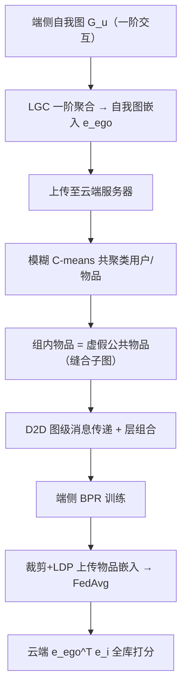
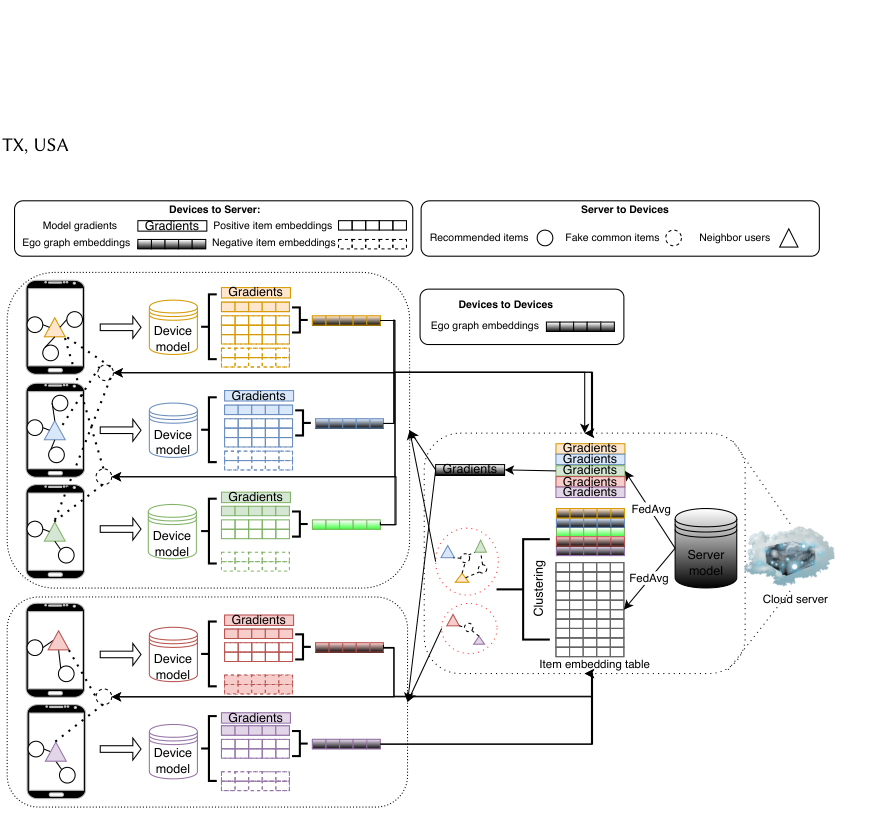

# Semi-decentralized Federated Ego Graph Learning for Recommendation (面向推荐的半去中心化联邦自我图学习)

- **会议/期刊**: WWW 2023 (The ACM Web Conference)
- **作者与机构**: Liang Qu, Ningzhi Tang, Ruiqi Zheng, Quoc Viet Hung Nguyen, Zi Huang, Yuhui Shi, Hongzhi Yin（南方科技大学、昆士兰大学、格里菲斯大学）
- **推荐链路定位**: 召回（Top-K 排序，云端打分）
- **研究方向**: 去偏公平、可信隐私与工业架构 / 图神经网络与知识图谱推荐
- **论文原文**: [https://arxiv.org/abs/2302.10900v1](https://arxiv.org/abs/2302.10900v1)
- **开源代码**: 暂未开源

## TL;DR (1分钟核心速览)

现有联邦推荐（FedRecs）要么把本地训练锁死在孤立的自我图（ego graph）里，学不到高阶协同信号；要么依赖第三方服务器做邻居发现，管线笨重；且要求端侧存整张物品嵌入表，通信开销巨大。本文提出 SemiDFEGL：客户端上传自我图嵌入，服务器用模糊 C-means 联合聚类用户与物品，将每组分配的物品作为「虚假公共物品（fake common items）」把孤立自我图缝合成高阶局部子图，从而支持设备间（D2D）图级消息传递；最终由云端完成打分。在三个公开数据集、全库排序协议下，Recall@20 相对 FedPerGNN 提升 2.09%（MovieLens-1M）至 29.8%（Yelp2018），同时通信量最低。

## Background & Motivation (背景与核心矛盾)

- **主流范式**: 集中式 CF/GNN 把所有用户自我图拼成全局二部图做高阶消息传递（LightGCN 为代表）；联邦推荐则用 FedAvg 聚合端侧梯度/参数以规避隐私风险。
- **前人局限**: ① 可扩展性差——星型 FedRecs 强依赖中心协调者，百万级设备通信即成瓶颈；② 端侧资源受限——FCF/FedMF 类方法要求设备维护整张物品嵌入表；③ 管线笨重——FedPerGNN 需可信第三方服务器寻找共交互邻居，MetaMF/FedMF 需额外加密服务，反而放大泄露面。
- **核心洞察 (Key Insight)**: 联邦推荐场景下的每台设备只有**一阶**用户-物品交互（不同于常规 FedGL 假设设备持有大子图）；但用户之间共享的**共同物品极多**，这正是可被利用的协同锚点——只要能在不泄露自我图的前提下「伪造」出共同物品节点，就能重建高阶结构。
- **本文切入点**: 用云端聚类结果反推「预测交互物品」作为虚假公共节点，把孤立自我图连成局部协作子图，让 GNN 消息传递在设备间照常进行。

## Method (核心方法设计)

### 1. 整体框架 (Overall Architecture)

框架由三条协作通道构成：**D2S（设备→服务器）**——每台设备用 LightGCN 式一阶聚合学习本地自我图嵌入 $\mathbf{e}_{ego}$并上传；**云端聚类**——服务器基于用户自我图嵌入与全局物品嵌入表做模糊 C-means 共聚类，用户取最大隶属度归入唯一组，物品取 Top-$k$隶属度可属多组，组内物品即「虚假公共物品」，把组内所有用户连成高阶局部子图；**D2D（设备↔设备）**——组内用户仅在虚假公共物品上交换**图级聚合嵌入**（不共享自我图），执行多层 LGC 得到含高阶信息的最终嵌入。训练完成后，客户端只上传正/负物品嵌入（经 L1 裁剪 + 拉普拉斯噪声）供服务器 FedAvg 更新物品表；最终推荐在云端以$\mathbf{e}_{ego}^{\top}\mathbf{e}_i$ 打分，端侧无需下载整张嵌入表。

<figure class="paper-figure" markdown="span">
  <figcaption>图2：SemiDFEGL 概览。用户-物品交互数据（即自我图）和物品数据分别存储在设备端和云端。设备为本地自我图学习嵌入表示并上传至中央服务器。中央服务器根据嵌入将用户/物品聚类为若干组。分配给每组的物品称为预测交互物品节点，用于连接组内每个用户以形成更高阶的局部子图。</figcaption>
</figure>

### 2. 关键设计拆解 (Key Designs)

1. **虚假公共物品缝合自我图（Local Ego Graph Augmentation）**：痛点是孤立 ego graph 只有一阶邻居，GNN 退化为加权 MF。本文让服务器最小化模糊聚类目标
$J_l(P,C)=\sum_{i=1}^{M+N}\sum_{j=1}^{C}P_{ij}^{\,l}\,d(\mathbf{x}_i,\mathbf{c}_j)^2$并按$P_{ij}=d(\mathbf{x}_i,\mathbf{c}_j)^{2/(1-l)}\big/\sum_{k}\big(d(\mathbf{x}_i,\mathbf{c}_k)\big)^{2/(1-l)}$ 交替更新隶属度与组心。直觉：隶属度高的物品天然是「该人群大概率交互过的物品」，用它当锚点，等价于在隐私约束下近似还原了全局二部图中真实存在的共交互边；物品允许多组隶属则避免了硬聚类的过度割裂。
2. **D2D 图级消息传递（而非节点级）**：痛点是一旦按节点交换嵌入，攻击者可由邻居物品集合反推自我图。本文只交换**整图级**的 $\mathbf{e}_{ego}$与各层嵌入，并按 LightGCN 层组合$\mathbf{e}_u=\sum_{k=0}^{K}\alpha_k\mathbf{e}_u^{(k)}$完成高阶聚合；权重沿用对称归一化$\frac{1}{\sqrt{|\mathcal{N}(u)|}\sqrt{|\mathcal{N}(i)|}}$。这样共享的信息是「用户整体偏好向量」而非交互明细，泄露面最小。
3. **训练目标、隐私强化与推理开销**：端侧损失为标准 BPR
$\mathcal{L}=-\sum_{i\in\mathcal{N}_u}\sum_{j\notin\mathcal{N}_u}\ln\sigma(y_{ui}-y_{uj})+\lambda\|\mathbf{e}\|^2$负样本从全库均匀采样并**随机生成同均值同方差嵌入**以掩盖真实交互；上传前做$\hat{\mathbf{e}}_i=\mathrm{clip}(\mathbf{e}_i,\delta)+\mathrm{Laplace}(0,\lambda)$ 的 L1 裁剪 + 本地差分隐私。关键工程收益：设备**不持有物品嵌入表**，每轮仅上传少量正/负物品嵌入，推理在云端一次内积完成。

## Experimental Setup & Evaluation Protocol (实验设置与评估协议)

| 数据集 | #Users | #Items | #Interactions | 稀疏度 | 特征/场景说明 |
| :--- | :---: | :---: | :---: | :---: | :--- |
| MovieLens-1M | 6,040 | 3,900 | 1,000,209 | 4.25% | 电影评分，稠密场景 |
| Yelp2018 | 31,668 | 38,048 | 1,561,406 | 0.13% | 本地商户点评，极稀疏 |
| Gowalla | 29,858 | 40,981 | 1,027,370 | 0.084% | LBSN 签到，时序签到聚合 |

- **数据集过滤**: 按交互数阈值过滤——MovieLens-1M 保留 $\ge 20$条交互的用户/物品，Yelp2018 与 Gowalla 为$\ge 10$。
- **数据划分与防穿越**: **随机比例划分 8:1:1**（训练/验证/测试），非时间戳切分，因此 Gowalla 等含时序信号的数据集存在轻度信息穿越风险。
- **排名评测协议**: **Full-Ranking（全库未交互物品作为候选）**，指标 Recall@20 与 NDCG@20，对全部用户取平均——协议无偏，可信度较高。
- **对比基线与超参**: 云端方法 NeuMF、LightGCN；联邦方法 FCF、FedMF、MetaMF、FedPerGNN。统一嵌入维度 $d=64$，Xavier 初始化，Adam（lr=1e-3，weight decay=1e-4）；虚假公共节点数 1、层数 4、组数 100（ML-1M）/200（Yelp、Gowalla）。未报告显著性检验。

## Key Experimental Results (实验关键数据)

### 1. 主实验对比 (Main Results)

| 方法 | ML-1M R@20 | ML-1M N@20 | Yelp R@20 | Yelp N@20 | Gowalla R@20 | Gowalla N@20 |
| :--- | :---: | :---: | :---: | :---: | :---: | :---: |
| NeuMF (云端) | 0.2402 | 0.3641 | 0.0572 | 0.0489 | 0.1506 | 0.1307 |
| LightGCN (云端) | **0.2559** | **0.3859** | **0.0626** | **0.0511** | **0.1800** | **0.1523** |
| FCF | 0.2301 | 0.3556 | 0.0517 | 0.0417 | 0.1434 | 0.1211 |
| FedMF | 0.2397 | 0.3632 | 0.0491 | 0.0402 | 0.1432 | 0.1227 |
| MetaMF | 0.2135 | 0.3342 | 0.0346 | 0.0283 | 0.1005 | 0.0830 |
| FedPerGNN | 0.2435 | 0.3686 | 0.0449 | 0.0445 | 0.1446 | 0.1127 |
| **SemiDFEGL** | 0.2486 | 0.3771 | 0.0583 | 0.0491 | 0.1680 | 0.1372 |
| Improv. vs 最佳 FedRec | +2.09% | +2.30% | +12.8% | +10.3% | +16.2% | +21.7% |

### 2. 消融实验 (Ablation Study)

| 变体 | ML-1M R@20 | ML-1M N@20 | Yelp R@20 | Yelp N@20 | Gowalla R@20 | Gowalla N@20 |
| :--- | :---: | :---: | :---: | :---: | :---: | :---: |
| w/o fake items（仅本地 ego graph） | 0.2314 | 0.3502 | 0.0467 | 0.0400 | 0.1490 | 0.1277 |
| **SemiDFEGL 完整模型** | **0.2486** | **0.3771** | **0.0583** | **0.0491** | **0.1680** | **0.1372** |
| 相对增益 | +7.4% | +7.7% | +24.8% | +22.8% | +12.8% | +7.4% |

模型无关性验证（ML-1M，更换聚合算子）：GCN 0.2466/0.3764、GAT 0.2472/0.3765、GraphSAGE 0.2467/0.3764、LightGCN **0.2486/0.3771**。

### 3. 关键实验发现 (Key Findings)

1. **虚假公共物品是唯一真正的增益来源**：去掉后 Yelp2018 Recall@20 从 0.0583 掉到 0.0467（-19.9%），甚至低于只做本地 MF 的 FCF（0.0517）；说明在极稀疏场景下，「越出自我图」的高阶协同是精度分水岭，而非 GNN 聚合算子本身。
2. **越稀疏、越受益，且逼近集中式上界**：Gowalla/Yelp 稀疏度低于 0.15%，SemiDFEGL 相对 FedPerGNN 增益（+16.2%/+29.8%）显著高于稠密的 MovieLens-1M（+2.09%）；但同时仍落后于无隐私约束的 LightGCN（0.2486 vs 0.2559），说明隐私噪声与聚类近似带来的精度损失未被完全消除。
3. **通信-精度帕累托最优**：SemiDFEGL 在三个数据集上取得最低上传/下载参数量（约 12–24 MB/轮量级），而 FedMF/MetaMF 因需上传整张嵌入表通信量最高却精度最差；增益源于「端侧不存物品表 + 只传正负物品嵌入」的架构设计，而非单纯的模型容量。
4. **超参敏感，需精细调参**：虚假公共节点数从 1 增至 20 时性能单调下降（引入分布噪声）；组数 100、层数 4 为峰值，层数 5 出现过平滑；负样本数过少虽指标略高但隐私风险上升，构成隐私-精度的显式权衡。

## Highlights & Limitations (亮点、对比与审稿批判)

- **与代表作对比**: 相比 FCF/FedMF（纯端侧 MF，无高阶信号），本文补上了协同结构；相比 FedPerGNN（需可信第三方找共交互邻居），本文用云端聚类**取代**第三方，管线更短；相比去中心化 D2D 推荐（如 D-Cluster 类），本文不要求设备存储海量非隐私物品数据，只保留「图级嵌入」交换，资源开销小一个量级。
- **可迁移亮点**: ①「用聚类隶属度反推虚拟锚点节点」的图增广思路可迁移到跨域/多场景联邦建模、隐私受限的社交推荐；② 端侧只存用户嵌入 + 云端打分的不对称部署范式，天然适配「端侧算力弱、云端物品表巨大」的工业推荐架构。
- **审稿级局限批判**: ① 推理完全依赖云端物品表，实质上把隐私保护降级为「训练期保护」，云端仍持有全量物品嵌入与用户自我图嵌入，成员推断攻击面未被评估；② 论文明确说明虚假公共物品在训练中**被当作负样本**处理，与其「预测交互物品」的语义相矛盾，缺少对该矛盾的理论或用例分析；③ 聚类需在服务器上迭代模糊 C-means，用户规模增长时聚类本身成为新的中心化瓶颈，且论文未给出聚类开销随 $N$ 增长的复杂度分析；④ 随机 8:1:1 划分而非时间切分，且无显著性检验，评估严谨度可再加强。

## Rating (四维评分)

- **方法创新性 (Novelty)**: ⭐⭐⭐⭐ （以模糊共聚类生成「虚假公共物品」缝合孤立自我图，是联邦图推荐里少见的轻量高阶化方案，思路干净但理论刻画偏弱）
- **评估协议与实验扎实度 (Protocol & Experiments)**: ⭐⭐⭐ （采用无偏 Full-Ranking 与三数据集，但随机划分未做时间切分、无显著性检验，超参分析仅在 ML-1M 上开展）
- **写作与数学规范度 (Clarity & Rigor)**: ⭐⭐⭐⭐ （公式与三通道协作流程表述清晰，LGC/模糊 C-means/LDP 组合自然；但虚假节点的正负样本语义、聚类复杂度分析缺失）
- **工业落地与复现价值 (Industrial & Practical Value)**: ⭐⭐⭐⭐ （端侧免存物品表 + 最低通信开销 + 模型无关可插拔，工程价值高；可惜未开源，且云端打分与聚类瓶颈需自行验证）

