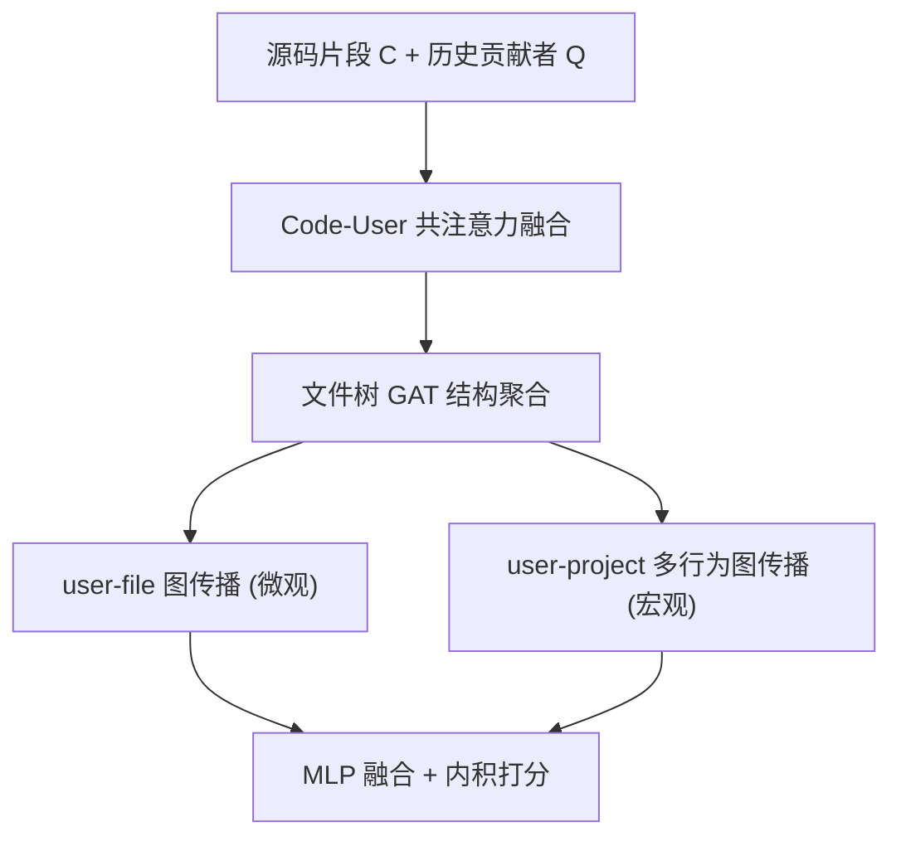
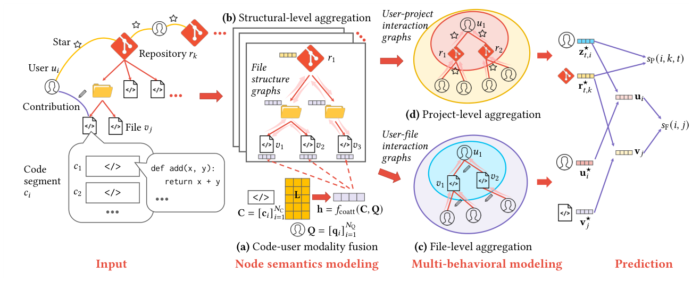

# Code Recommendation for Open Source Software Developers (面向开源软件开发者的代码推荐)

- **会议/期刊**: WWW 2023 (The Web Conference)
- **作者与机构**: Yiqiao Jin (Georgia Tech)、Yunsheng Bai、Yanqiao Zhu、Yizhou Sun、Wei Wang (UCLA)
- **推荐链路定位**: 召回（文件级贡献任务匹配）
- **研究方向**: 图神经网络与知识图谱推荐 / 多模态推荐
- **论文原文**: [论文原文链接](https://arxiv.org/abs/2210.08332v3)
- **开源代码**: 暂未开源（原文声明录用后释放数据集与代码；文中 PyGithub 链接仅为数据抓取依赖）

## TL;DR (1分钟核心速览)

面向 OSS 开发任务匹配，本文首次形式化"代码推荐"问题：在给定开发者历史交互、源码语义与项目层级文件结构下预测其未来提交（commit）的文件。痛点在于 commit 信号极稀疏（密度 5×10⁻⁵~1.5×10⁻⁴），且文件之间存在目录层级语义。CODER 以用户-文件-仓库异构图联合建模微观贡献与宏观 star/watch 行为，用 CodeBERT + 共注意力把代码片段与历史贡献者融合成文件表征，再在文件树 GAT 上聚合。全库排序协议下，FS 数据集 NDCG@5 相对最强基线 NCL 提升 37.1%，冷启动用户 NDCG@3 提升 38.7%~53.0%。

## Background & Motivation (背景与核心矛盾)

- **主流范式**: 传统协同过滤/图协同过滤（NGCF、LightGCN、NCL）把用户-物品交互建成二部图做链路预测，物品侧仅有一个可学习 ID 向量。
- **前人局限**: ① commit 属"高成本自愿行为"，交互极度稀疏，直接建模贡献关系导致用户/物品表征失真并加剧冷启动；② 文件不是独立物品——`models/roberta/modeling_roberta.py` 与 `models/bert/modeling_bert.py` 的功能相似性由目录树而非 ID 决定，传统模型无法把代码语义与项目结构对齐。
- **核心洞察 (Key Insight)**: 相似主题仓库常复用相同的命名约定与文件组织方式（图 1 的 `transformers` 例），因此文件树是可跨项目迁移的结构先验；同时 star/watch 等宏观行为反映"广泛兴趣"，可在微观 commit 缺席时提供监督。
- **本文切入点**: 将"预测用户下一条 commit 文件"重构为异构图上的 user–file 链路预测，并把宏观行为信号通过 MLP 注入文件级打分的双方表征。

## Method (核心方法设计)

### 1. 整体框架 (Overall Architecture)

CODER 分两大组件。**Node Semantics Modeling**：把每个文件源码切成 $N_C$个代码片段并经 CodeBERT 编码成特征图$C\in\mathbb{R}^{N_C\times d}$，把采样到的$N_Q$个历史贡献者编码成$Q$，用共注意力（co-attention）把"用户注意力空间"变换到"代码注意力空间"，选出显著代码片段得到文件表征$h$；随后把仓库展开为"文件–目录–仓库"层级异构图，用 3 层 GAT 聚合目录 TF-IDF 与仓库元信息，得到结构增强表征$\tilde{h}$，作为文件/仓库的初始嵌入。**Multi-behavioral Modeling**：在 user–file 二部图上做 LightGCN 式传播得微观偏好，在每类 user–project 行为图（star/watch/fork）上各做一次传播得宏观兴趣，层间均值池化后按行为聚合，再与微观表征拼接经 MLP 融合，内积打分、BPR + 结构对比损失联合优化。

<figure class="paper-figure" markdown="span">
  <figcaption>图2：我们提出的用于代码推荐的 CODER 框架。CODER 联合考虑项目文件结构、代码语义和用户行为。CODER 通过 Multi-Behavioral Modeling 建模微观文件级交互和宏观项目级交互，并通过 Node Semantics Modeling 连接微观/宏观信号。</figcaption>
</figure>

### 2. 关键设计拆解 (Key Designs)

1. **Code-User 共注意力模态融合（解决"文件语义多峰 + 贡献者属性注入"）**: 整文件池化会混淆同一文件中 BERT 实现、参数加载、词嵌入等多类语义；同时一次 commit 相当于把作者的编程风格注入文件。故先算代码-用户亲和矩阵再做代码侧注意力：
$\mathbf{L}=\tanh(\mathbf{C}\mathbf{W}_O\mathbf{Q}^{\top}),\ \mathbf{H}=\tanh(\mathbf{W}_C\mathbf{C}^{\top}+\mathbf{W}_Q(\mathbf{L}\mathbf{Q})^{\top}),\ \mathbf{a}=\mathrm{softmax}(\mathbf{w}_H^{\top}\mathbf{H}),\ \mathbf{h}=\mathbf{a}^{\top}\mathbf{C}$
直觉：把"谁写过这个文件"作为 query 去检索最相关的代码片段，使文件向量同时携带语义与"贡献者画像"。
2. **文件树结构聚合（解决"物品侧无层级关系"）**: 目录名按下划线/驼峰切词后 TF-IDF 编码，仓库用 owner、创建时间、Top-5 语言编码，统一映射到文件同一潜空间，在层级图 $G_S$上做 GAT 聚合$\tilde{\mathbf{h}}=f_{\mathrm{GNN}}(\mathbf{h},G_S)$。这样同一目录下文件共享邻居信息，等价于给稀疏文件补上"结构近邻"的协同信号。
3. **多行为分解传播 + 训练目标**: 文件级用 $\mathbf{E}^{(l)}=\mathbf{D}^{-\frac{1}{2}}\mathbf{A}\mathbf{D}^{-\frac{1}{2}}\mathbf{E}^{(l-1)}$（$\mathbf{A}$为 user–file 邻接），行为$t$用$\mathbf{Z}_t^{l}=\mathbf{D}_t^{-\frac{1}{2}}\boldsymbol{\Lambda}_t\mathbf{D}_t^{-\frac{1}{2}}\mathbf{Z}_t^{(l-1)}$，各层均值池化后$\mathbf{u}_i=\mathrm{MLP}([\mathbf{u}_i^{\star}\|\mathbf{z}_i^{\star}])$、$\mathbf{v}_j=\mathrm{MLP}([\mathbf{v}_j^{\star}\|\mathbf{r}_{\phi(j)}^{\star}])$。损失为
$\mathcal{L}=\mathcal{L}_{F}+\lambda_1\sum_t\mathcal{L}_{P}^{t}+\lambda_2(\mathcal{L}_{UC}+\mathcal{L}_{VC})+\lambda_3\|\Theta\|^2$其中各项均为 BPR 成对损失，$\mathcal{L}_{UC}/\mathcal{L}_{VC}$为 InfoNCE 式结构对比（$\eta=2$、$\tau$为温度）。负采样为**均匀随机负采样**（非 in-batch/hard negative）；CodeBERT 表征离线算一次并缓存，每测试样本推理 1.138 ms（LightGCN 1.073 ms、MF 0.804 ms），总复杂度$O((N_C+N_Q)|V|+|E|+|\mathbf{A}^{+}|+\sum_t|\boldsymbol{\Lambda}_t^{+}|)$。

## Experimental Setup & Evaluation Protocol (实验设置与评估协议)

- **数据集与预处理**: 从 GitHub API + PyGithub 抓取，保留 star ≥ 250 且贡献者 ≥ 3 的仓库（排除私用仓库）、贡献史 ≥ 3 个月；按 GitHub topics 选 ML/DB/FS 三个子领域各随机采 300 个仓库。

| 数据集 | #Users | #Items(Files) | #Interactions | 密度 | 场景说明 |
| :--- | :---: | :---: | :---: | :---: | :--- |
| ML | 21,913 | 239,232 | 663,046 | 1.26×10⁻⁴ | 机器学习主题仓库 |
| DB | 30,185 | 415,154 | 1,935,155 | 1.54×10⁻⁴ | 数据库主题，最稠密 |
| FS | 51,664 | 568,972 | 1,512,809 | 5.14×10⁻⁵ | 全栈主题，最稀疏 |

- **数据划分与防穿越**: **全局时间戳切分**——以 Unix 时间戳 `1550000000` 与 `1602000000` 为界划分 train/valid/test，测试期交互严格晚于训练期；仅保留在 train 与 test 均有 ≥1 交互的用户。
- **排名评测协议**: **全候选排序（Full-Ranking）**，不做负采样截断。intra-project 设置下对用户已交互仓库内的文件排序；cross-project 设置下对用户未交互仓库内的文件排序（候选池更大）；冷启动定义为训练集交互 ≤2 的用户，报 NDCG/Hit/MRR@{3,5}。
- **对比基线与超参**: 三组基线——G1 矩阵分解 MF；G2 神经类 MLP、NeuMF；G3 图类 NGCF、LightGCN、NCL。所有基线共享同一 CodeBERT 文件嵌入，并把仓库 one-hot 与项目级 multi-hot 注入用户表征以保证公平。嵌入维度 $d=32$、$N_C=8$、$N_Q=4$、传播层数$L=4$、batch 1024、Adam，$\lambda_1\in\{10^{-2},10^{-1},1\}$、$\lambda_2=10^{-6}$。

## Key Experimental Results (实验关键数据)

### 1. 主实验对比 (Main Results)

| 数据集 | 指标 | MF | MLP | NeuMF | NGCF | LightGCN | NCL | **CODER** | Improv. |
| :--- | :--- | :---: | :---: | :---: | :---: | :---: | :---: | :---: | :---: |
| ML | NDCG@20 | 0.072 | 0.081 | 0.084 | 0.100 | 0.116 | 0.120 | **0.141** | 17.9% |
| ML | Hit@20 | 0.324 | 0.343 | 0.346 | 0.407 | 0.457 | 0.466 | **0.540** | 15.8% |
| ML | MRR@20 | 0.113 | 0.127 | 0.130 | 0.154 | 0.185 | 0.213 | **0.230** | 8.2% |
| DB | NDCG@20 | 0.088 | 0.083 | 0.088 | 0.103 | 0.091 | 0.125 | **0.160** | 27.3% |
| DB | Hit@20 | 0.335 | 0.338 | 0.362 | 0.454 | 0.422 | 0.437 | **0.588** | 29.5% |
| DB | MRR@20 | 0.143 | 0.132 | 0.143 | 0.182 | 0.150 | 0.264 | **0.280** | 6.0% |
| FS | NDCG@20 | 0.067 | 0.070 | 0.073 | 0.090 | 0.095 | 0.110 | **0.146** | 32.7% |
| FS | Hit@20 | 0.307 | 0.321 | 0.335 | 0.406 | 0.414 | 0.451 | **0.559** | 23.9% |
| FS | MRR@20 | 0.114 | 0.115 | 0.122 | 0.150 | 0.163 | 0.187 | **0.245** | 31.4% |

冷启动（交互 ≤2 用户，NDCG@3）：ML **0.126** vs NCL 0.090 (↑40.9%)；DB **0.119** vs 0.075 (↑53.0%)；FS **0.128** vs 0.092 (↑38.7%)。跨项目设置下在 $K\ge 20$ 时优势最明显。

### 2. 消融实验 (Ablation Study)

| 变体 | 移除/替换的组件 | ML 上相对全模型 CD 的变化 |
| :--- | :--- | :--- |
| CD (full) | — | 最优（6 个变体中最高） |
| CD-P | 去掉项目级多行为聚合 | **跌幅最大**（显著↓） |
| CD-S | 去掉文件树结构聚合 | 明显↓（次之） |
| CD-C | 去掉结构对比损失 $\mathcal{L}_{UC},\mathcal{L}_{VC}$ | 中等↓ |
| CD-F | 去掉 code-user 共注意力融合 | 较小↓ |
| CD-E | CodeBERT 换为 TF-IDF 代码特征 | 小幅↓（但仍劣于 CD-F） |

### 3. 关键实验发现 (Key Findings)

1. **越稀疏收益越大**：FS 密度最低（5.14×10⁻⁵），NDCG@5 相对提升达 37.1%，而较稠密的 DB 仅 29.0%，说明项目级宏观行为确实在文件级 commit 稀缺时补足了监督信号。
2. **宏观行为是第一功臣**：消融中 CD-P（去项目级聚合）跌幅最大、CD-S（去结构聚合）次之，而 CD-E（丢弃 CodeBERT 语义）跌幅最小且仍优于 NCL——即"行为 > 结构 > 代码语义"是该任务的信号强度排序。
3. **冷启动与跨项目双赢**：冷启动用户 NDCG@3 提升 38.7%~53.0%（远高于全体用户的 3%~6% MRR 提升），说明共注意力融合的"贡献者画像"在少量交互下替代了协同信号；跨项目场景 $K\ge 20$ 优势扩大，验证模型同时学到"跨仓库选哪个项目"与"项目内选哪个文件"。

## Highlights & Limitations (亮点、对比与审稿批判)

- **与代表作对比 (vs. Prior Work)**: 相较 LightGCN/NCL 这类"物品 = 单 ID 向量"的图协同过滤，CODER 把物品拆成"语义片段 + 结构位置 + 所属仓库"三元组，并在物品侧完成跨层级桥接，因此本质区别在于**物品表征不再依赖 ID 学习**；相较 API 推荐、Good-First-Issue 推荐等 OSS 推荐工作，本文把行为粒度下沉到文件级 commit 且覆盖多语言（300+ 语言），任务定义本身即贡献。
- **可迁移亮点**: ① "用历史交互者作为 query 做内容侧共注意力"可迁移到短视频/商品图文等冷启动物品表征；② 用"层级文件树/类目树"作为结构先验给稀疏长尾物品补协同邻居，思路可移植到电商类目或 POI 地理层级。
- **审稿级局限批判**: ① 代码片段编码依赖 CodeBERT 离线缓存，论文未给出整体训练耗时与显存占用，1.138 ms/样本的推理代价在高并发下仍高于 MF 约 40%，且 $N_C=8$截断会丢失长文件语义；② 评估仅覆盖 GitHub 单一平台、且只做"已有文件"推荐，无法处理新建文件（作者亦承认）；③ 基线虽注入仓库 one-hot 与项目级 multi-hot，但未做显著性检验（无$p$ 值/方差报告），跨项目曲线也缺少误差棒。

## Rating (四维评分)

- **方法创新性 (Novelty)**: ⭐⭐⭐⭐ （首次形式化文件级代码推荐，宏观/微观异构图桥接 + 层级结构聚合的组合虽为成熟算子的新拼装，但问题定义与物品侧建模思路新颖）
- **评估协议与实验扎实度 (Protocol & Experiments)**: ⭐⭐⭐⭐ （三套大规模真实数据集 + 全局时间戳防穿越 + 全库排序 + intra/cross/cold-start 三种设定齐全，扣分在缺少显著性检验与方差报告）
- **写作与数学规范度 (Clarity & Rigor)**: ⭐⭐⭐⭐ （符号统一、复杂度与推理时延分析到位，但共注意力各矩阵的角色解释略简，部分基线注入方式在正文中描述偏短）
- **工业落地与复现价值 (Industrial & Practical Value)**: ⭐⭐⭐⭐ （GitHub 场景可直接部署为 maintainer 任务分配工具，代码/数据承诺开源；扣分在 CodeBERT 缓存与文件树构建的工程成本未量化）

