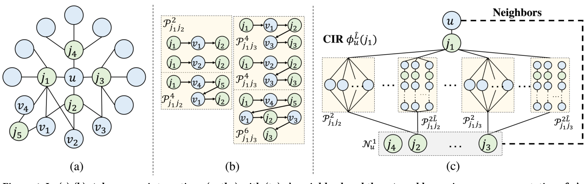
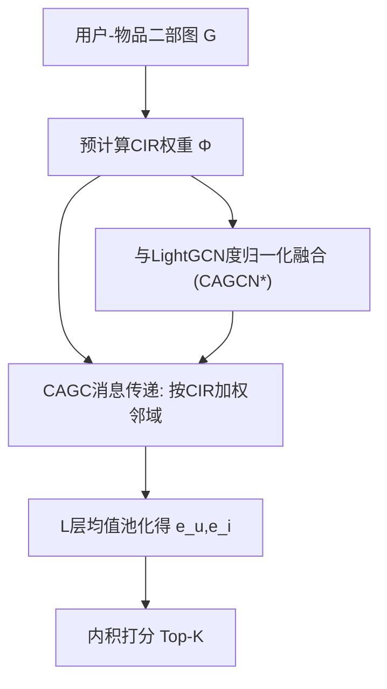
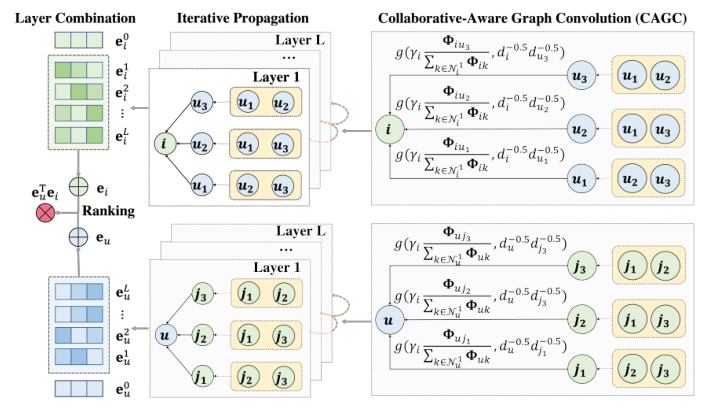

# Collaboration-Aware Graph Convolutional Network for Recommender Systems (面向推荐系统的协同感知图卷积网络)

- **会议/期刊**: WWW 2023
- **作者与机构**: Yu Wang, Yuying Zhao, Yi Zhang, Tyler Derr；Vanderbilt University
- **推荐链路定位**: 召回 / 表示学习
- **研究方向**: 图神经网络与知识图谱推荐
- **论文原文**: [论文原文链接](https://arxiv.org/abs/2207.06221v4)
- **开源代码**: [开源代码仓库链接](https://github.com/YuWVandy/CAGCN)

## TL;DR (1分钟核心速览)

针对GNN推荐中无差别消息传递会放大不可靠交互的问题，本文提出CIR拓扑度量与CAGC协同感知图卷积，按邻居与用户邻域的共同交互比例重加权，并用双路融合CAGCN*兼顾LightGCN信号。在6个数据集、Leave-One-Out+Full-Ranking协议下，Recall@20较LightGCN平均提升约9.1%，训练总时间降低最高96.3%。

## Background & Motivation (背景与核心矛盾)

- **主流范式**: LightGCN/NGCF在用户-物品二部图上做度归一化消息传递，将协同信号注入user/item embedding，再以内积完成Top-K排序。
- **前人局限**: 现有GNN直接继承通用消息传递，未判断捕获的协同效应是否真利于偏好预测；不可靠交互会被放大。GTN用学习embedding算边权，噪声循环且在线算边权昂贵；SGCN用随机二值mask+无偏梯度估计，计算负担重。
- **核心洞察 (Key Insight)**: 将LightGCN排序展开为路径加权和后发现，与用户其余邻域共同交互更多的邻居$j$更能代表用户行为；按CIR加边比随机加边训练损失更低、性能更高。如图1所示，$j_1$与$u$邻域的路径多于$j_4$，应传递更强消息。
- **本文切入点**: 用纯拓扑CIR先验重加权边，构造CAGC，并证明其在二分图上可超越1-WL。

<figure class="paper-figure" markdown="span">
  <figcaption>图1：在(a)-(b)中，𝑗1与𝑢的邻域之间的交互（路径）比𝑗4更多，因此比𝑗4更能代表𝑢的购买行为。在(c)中，我们通过𝑗1与N1𝑢之间的路径（及相关节点）量化𝑗1与𝑢之间的CIR。</figcaption>
</figure>

## Method (核心方法设计)

### 1. 整体框架 (Overall Architecture)

输入是用户-物品二部图与仅可学习的初始embedding。先离线计算每条边的CIR权重$\Phi$，再在每层CAGC中按$\Phi$归一化与度归一化两路信号聚合邻居；CAGCN只保留CIR路，CAGCN*用常数$\gamma$融合LightGCN路。L层均值池化得到最终表示，以内积打分，BPR训练，Top-K全库排序。

<figure class="paper-figure" markdown="span">
  <figcaption>图4：所提出的CAGCN(*)的架构。</figcaption>
</figure>

### 2. 关键设计拆解 (Key Designs)

1. **CIR：衡量邻居对邻域的代表性**：痛点是把所有邻居同权，噪声边被放大。对$j\in\mathcal{N}^1_u$计算其与$u$全部邻居通过长度$\leq2\hat L$路径的共同交互比例：
$\phi_u^{\hat L}(j)=\frac{1}{|\mathcal{N}^1_u|}\sum_{i\in\mathcal{N}^1_u}\sum_{l=1}^{\hat L}\alpha_{2l}\sum_{P^{2l}_{ji}\in\mathcal{P}^{2l}_{ji}}\frac{1}{f(\{\mathcal{N}^1_k\mid k\in P^{2l}_{ji}\})}$其中$f$可取JC/SC/CN/LHN。直觉是高CIR邻居与用户邻域共享更多结构，传递其消息更能拉近待预测邻居；CN易偏向高度节点，会引入假阳性。

2. **CAGC：不对称协同感知传播**：对称度归一化无法表达“$j$对$i$邻域”与“$i$对$j$邻域”的不同重要性。令$\Phi_{ij}=\phi_i(j)$（$A_{ij}>0$），否则为0，并传播：
$\mathbf{e}_i^{l+1}=\sum_{j\in\mathcal{N}^1_i}g\left(\gamma_i\frac{\Phi_{ij}}{\sum_{k\in\mathcal{N}^1_i}\Phi_{ik}},d_i^{-0.5}d_j^{-0.5}\right)\mathbf{e}_j^l$CAGCN取$g(A,B)=A$并令$\gamma_i$保持总权重；CAGCN*取加权和，$\gamma$控制两路贡献。理论上，当$g$为MLP时其多重集聚合为单射，CAGC可区分1-WL无法区分的“子树同构但非二分-子图同构”图。

3. **训练目标、负采样与推理效率**：总损失为
$\mathcal{L}_{\mathrm{BPR}}=-\sum_{(u,i,i^-)\in\mathcal{O}}\ln\sigma(\hat y_{ui}-\hat y_{ui^-})+\lambda\|\Theta\|_2^2$其中$\hat y_{ui}=\mathbf{e}_u^\top\mathbf{e}_i$。CAGCN每个正样本采样1个随机负样本；UltraGCN对比时用多负样本。推理前预计算$\Phi$，传播复杂度与LightGCN同阶，主要额外开销为CIR矩阵预计算/存储。

## Experimental Setup & Evaluation Protocol (实验设置与评估协议)

- **数据集与预处理**: 沿用LightGCN/NGCF预处理；新增Loseit、News采用10-core。

| 数据集 | #Users | #Items | #Interactions | 稀疏度/密度 | 特征/场景说明 |
| :--- | :---: | :---: | :---: | :---: | :--- |
| Gowalla | 29,858 | 40,981 | 1,027,370 | 0.084% | LBS签到 |
| Yelp | 31,668 | 38,048 | 1,561,406 | 0.130% | 本地商户 |
| Amazon | 52,643 | 91,599 | 2,984,108 | 0.062% | 图书评论 |
| ML-1M | 6,022 | 3,043 | 895,699 | 4.888% | 电影评分 |
| Loseit | 5,334 | 54,595 | 230,866 | 0.08% | 减重社区帖子 |
| News | 29,785 | 21,549 | 766,874 | 0.119% | 新闻社区帖子 |

- **数据划分与防穿越 (Splitting Strategy)**: 采用`Leave-One-Out`，最后交互测试、倒数第二验证；训练只用更早交互，避免测试边泄漏。
- **排名评测协议 (Ranking Protocol)**: 无偏`Full-Ranking`，将训练集未交互物品作为候选全集排序；报告Recall@20、NDCG@20。
- **对比基线与超参设置**: 对比MF、NGCF、LightGCN、UltraGCN、GTN；默认$d=64$，与GTN对齐时$d=256$。原文未报告显著性检验，仅给均值。

## Key Experimental Results (实验关键数据)

### 1. 主实验对比 (Main Results)

下表为Recall@20，加粗为列最优。

| 模型 | Gowalla | Yelp | Amazon | ML-1M | Loseit | News |
| :--- | ---: | ---: | ---: | ---: | ---: | ---: |
| MF | .1554 | .0539 | .0337 | .2604 | .0539 | .1942 |
| NGCF | .1563 | .0596 | .0336 | .2619 | .0574 | .1994 |
| LightGCN | .1817 | .0659 | .0420 | .2752 | .0588 | .2035 |
| UltraGCN | .1867 | .0675 | **.0682** | .2783 | .0621 | .2034 |
| CAGCN-jc | .1825 | .0674 | .0435 | .2780 | .0622 | .2135 |
| CAGCN*-jc | **.1878** | .0708 | .0510 | .2822 | .0654 | **.2182** |
| CAGCN*-sc | **.1878** | **.0711** | .0506 | **.2827** | **.0658** | .2172 |
| CAGCN*-lhn | .1857 | .0676 | .0457 | .2799 | **.0658** | .2053 |

最佳CAGCN*相对LightGCN提升：+3.4%/+7.9%/+21.4%/+2.7%/+11.9%/+7.2%，均值约+9.1%；NDCG@20同步提升约+1.3%/+6.5%/+21.8%/+2.2%/+5.2%/+7.9%。Amazon上UltraGCN因每正样本500负样本仍最优，但CAGCN*从0.0420升至0.0510。与GTN在$d=256$对比：Gowalla/Yelp/Amazon的Recall@20为0.1901/0.0731/0.0573，GTN为0.1870/0.0679/0.0450。

### 2. 消融实验 (Ablation Study)

原文未给标准`w/o`表，以下按等价变体整理（Recall@20）。

| 变体 | Gowalla | Yelp | Amazon | 作用 |
| :--- | ---: | ---: | ---: | :--- |
| LightGCN (w/o CIR) | .1817 | .0659 | .0420 | 无拓扑重加权 |
| CAGCN-jc (单路CIR) | .1825 | .0674 | .0435 | 仅CIR传播 |
| CAGCN-cn (误用CN) | .1632 | .0661 | .0403 | 高度节点假阳性 |
| CAGCN*-jc (双路融合) | .1878 | .0708 | .0510 | CIR+LightGCN |
| CAGCN*-sc (双路+SC) | .1878 | .0711 | .0506 | 拓扑度量SC |

### 3. 关键实验发现 (Key Findings)

1. **CIR重加权有效但度量选择关键**：CAGCN*-sc在Yelp/ML-1M/Loseit达0.0711/0.2827/0.0658，较LightGCN提升7.9%/2.7%/11.9%；而CAGCN-cn在Gowalla跌至0.1632，说明“共同邻居多”不等于“协同价值高”，CN易被高度节点主导。
2. **双路融合显著优于单路CIR**：Amazon上CAGCN*-jc为0.0510，单路CAGCN-jc仅0.0435、LightGCN为0.0420；双路保留LightGCN的度归一化信号，避免过度聚焦高CIR邻居而牺牲其他邻域信息。
3. **效率与表达力双赢**：CAGCN*达到LightGCN最佳性能所需总时间在Gowalla/Yelp/Amazon降低80.9%/92.4%/96.3%（含CIR预处理）；且在同$d=256$下三项数据集全面优于GTN，验证纯拓扑先验比学习embedding边权更稳。

## Highlights & Limitations (亮点、对比与审稿批判)

- **与代表作对比 (vs. Prior Work)**: LightGCN所有邻居按度归一化同权，CAGCN用CIR显式区分协同价值；GTN依赖含噪embedding算边权且开销高，CAGCN离线纯拓扑预计算更可解释；SGCN用随机mask去噪且难超1-WL，CAGCN给出超越1-WL的表达力证明。
- **可迁移亮点**: CIR可作为边剪枝/持续学习中的保边优先级；双路$g$融合思路可迁移到其他“拓扑先验+GNN”场景。
- **审稿级局限批判**: CIR矩阵对高度节点预计算/存储成本较高，工业超大规模图需分块或近似；$f$与$\hat L$为静态超参，跨域需调参，且原文未给显著性检验，结论稳健性略打折。

## Rating (四维评分)

- **方法创新性 (Novelty)**: ⭐⭐⭐⭐ （CIR把协同效应落到拓扑路径，并给出超越1-WL的二分图表达力证明，机制新颖）
- **评估协议与实验扎实度 (Protocol & Experiments)**: ⭐⭐⭐⭐ （6数据集+Full-Ranking较扎实，但缺标准w/o与显著性检验）
- **写作与数学规范度 (Clarity & Rigor)**: ⭐⭐⭐⭐ （CIR与CAGC公式清晰，证明放附录；变体与超参较多，阅读门槛略高）
- **工业落地与复现价值 (Industrial & Practical Value)**: ⭐⭐⭐⭐ （代码开源，预计算后训练最高80%+加速；超大规模图仍需解决CIR存储与近似）

