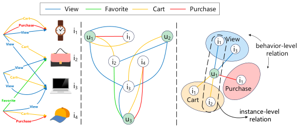
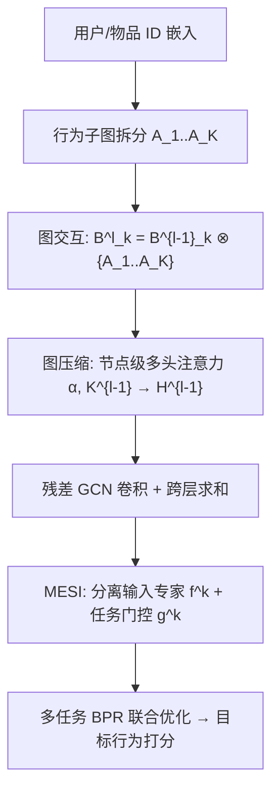

# Compressed Interaction Graph based Framework for Multi-behavior Recommendation (基于压缩交互图的多行为推荐框架)

- **会议/期刊**: WWW 2023 (The ACM Web Conference)
- **作者与机构**: Wei Guo, Chang Meng (共同一作), Enming Yuan, Zhicheng He, Huifeng Guo, Yingxue Zhang, Bo Chen, Yaochen Hu, Ruiming Tang, Xiu Li, Rui Zhang — 华为诺亚方舟实验室 / 清华大学深圳国际研究生院
- **推荐链路定位**: 精排（多行为多目标任务）
- **研究方向**: 图神经网络与知识图谱推荐 / 多任务学习与列表级重排
- **论文原文**: [论文原文链接](https://arxiv.org/abs/2303.02418v1)
- **开源代码**: [开源代码仓库链接](https://github.com/MC-CV/CIGF)

## TL;DR (1分钟核心速览)

真实电商场景中点击/收藏/加购/购买构成的多行为数据分布极不均衡、目标行为极稀疏：把多行为"当特征"用（MBGCN/GHCF/MB-GMN）只能学到**行为级 (behavior-level)** 关系，高阶信号被高度数用户带偏；把多行为"当标签"用（MMoE/PLE）时**共享输入导致梯度耦合冲突**。CIGF 用矩阵乘法做显式图交互生成**实例级 (instance-level)** 高阶图、再用节点级多头注意力把 $K^{l-1}$图空间压缩到$H^{l-1}$，并在其上叠加**分离输入的多专家网络 MESI**。在 Beibei/Taobao/IJCAI 三数据集上 HR@10 分别相对提升 1.30% / 20.57% / 12.97%。

## Background & Motivation (背景与核心矛盾)

- **主流范式**: 多行为推荐分两派——图派（NGCF$_M$、LightGCN$_M$、MBGCN、GHCF、MB-GMN）把多行为"当特征"在多重二分图 (MBG) 上传播；MTL 派（NMTR、GHCF、MB-GMN）把多行为"当标签"做多任务监督。
- **前人局限 1（关系建模粒度太粗）**: 现有 GNN 采用"两阶段"范式——先在每种行为子图上聚合全部历史记录得到行为级表征，再跨行为建模。由于数据不均衡（少量用户/行为覆盖绝大多数交互），这种**行为级关系**天然偏向高度数节点，无法刻画 `u1 --cart--> i2 --favorited_by--> u3 --purchase--> i4` 这类具体实例路径。
- **前人局限 2（梯度耦合）**: 所有任务共享同一输入 $\mathbf{x}_u^*\circ\mathbf{y}_i^*$，以 GHCF 双线性头为例，$\frac{\partial\mathcal{L}}{\partial(\mathbf{x}_u^*\circ\mathbf{y}_i^*)}=\sum_{k=1}^{K}\mathbf{r}'_k$，各行为的合成梯度方向不同（正交分解后分量不共线），造成 **coupled gradient conflict** 与负迁移。
- **核心洞察 (Key Insight)**: 交互数量直方图显示"多数用户购买记录 <10 条"，但辅助行为（浏览/收藏）并不稀疏——高阶关系的价值在于**揭示偏好的因果链**，前提是关系必须落在实例（节点对）而非行为类型上。
- **本文切入点**: 把多行为**同时**"当特征"（CIGCN 显式构造实例级高阶图）与"当标签"（MESI 分离输入解耦梯度），端到端联合优化。

<figure class="paper-figure" markdown="span">
  <figcaption>图1：电子商务网站中多种类型行为的一个示例、相应的 MBG，以及行为级关系与实例级关系的比较。</figcaption>
</figure>

## Method (核心方法设计)

### 1. 整体框架 (Overall Architecture)

输入层将用户/物品 ID 映射为 $d$维共享嵌入；CIGCN 先把 MBG 按行为拆为$K$个行为子图，用邻接矩阵乘法显式生成 2~$L$阶交互图，并在每阶用"行为级 + 层级的节点级多头注意力"压缩图集合，随后在这些稠密高阶图上做带残差的 GCN 卷积，得到$K$组以起始行为区分的表征$(\mathbf{x}_{u,k}^*,\mathbf{y}_{i,k}^*)$；MESI 用这$K$组表征各自生成专家$\mathbf{f}^k_{u,i}$与任务门控$\mathbf{g}^k_{u,i}$，加权求和后经塔函数输出各行为打分；最后对$K$ 个任务联合优化 BPR 损失。推理时只保留目标行为（购买）的输出。

### 2. 关键设计拆解 (Key Designs)

1. **CIGCN 图交互与图压缩（把"行为级"降维成"实例级"）**：痛点是不均衡分布让行为级聚合失真，本文借 DCN/xDeepFM 的显式特征交叉思想，用邻接矩阵乘法做**图交互算子**：$\mathcal{B}^l_k=\mathcal{B}^{l-1}_k\otimes\{\mathbf{A}_1,\dots,\mathbf{A}_K\}$，$\mathcal{B}^1_k=\{\mathbf{A}_k\}$，生成图中任意相连节点在原 MBG 中恰为$l$阶可达，从而把用户-用户、用户-物品、物品-物品的高阶关系落到**具体节点对**上。但$\mathrm{card}(\mathcal{B}^l_k)=\mathrm{pow}(K,l-1)$指数爆炸，于是引入节点级多头注意力压缩：$\mathcal{B}^l_{v,k}=\mathcal{B}^{l-1}_{v,k}\otimes\{\alpha^{l,1}_{v,k}\cdot[\mathbf{A}_1,\dots,\mathbf{A}_K],\dots\}$，$\alpha^{l,h}_{v,k}=\sigma(\mathbf{W}^{l,h}_k\mathbf{x}_u+\mathbf{b}^{l,h}_k)$，图数量降为$\mathrm{pow}(H,l-1)$；注意力既做**降复杂度**又做**行为软选择**（个性化地决定该用户该走哪条行为边）。
2. **MESI 分离输入多专家（解耦梯度）**：痛点同上文耦合梯度。MESI 让第 $k$个专家只吃第$k$个起始行为的关系表征$\mathbf{f}^k_{u,i}=\mathbf{x}^*_{u,k}\circ\mathbf{y}^*_{i,k}$，门控也只由该任务输入产生$\mathbf{g}^k_{u,i}=\mathrm{Softmax}(\mathbf{W}_g(\mathbf{x}^*_{u,k}\Vert\mathbf{y}^*_{i,k})+\mathbf{b}_g)$，预测$\hat{o}^k_{u,i}=h_k\big(\sum_{j}\mathbf{g}^k_{u,i}(j)\cdot\mathbf{f}^j_{u,i}\big)$。由于每任务的梯度只回传到自己那一路输入，$\frac{\partial\mathcal{L}}{\partial(\mathbf{x}^*_{u,k}\circ\mathbf{y}^*_{i,k})}$不再包含其它任务的$\mathbf{r}'_{k'}$ 项，从结构上切断冲突源；同时门控仍可跨专家组合，保留知识共享。
3. **训练目标与推理效率**：多任务 BPR 损失 $\mathcal{L}=-\sum_{k=1}^{K}\sum_{(u,s,t)\in\mathcal{O}_k}\ln\sigma(\hat{o}^k_{u,s}-\hat{o}^k_{u,t})+\lambda\Vert\Theta\Vert_2^2$，每任务逐正样本配未观测负样本（采样负样本，非全库 softmax）。工程关键：高阶图虽稠密，但利用矩阵结合律$(\mathbf{A}_k\otimes\mathbf{A}_k\otimes\mathbf{A}_k)\mathbf{x}_u=\mathbf{A}_k(\mathbf{A}_k(\mathbf{A}_k\mathbf{x}_u))$，把稀疏矩阵-向量乘法链式复用，避免物化稠密邻接；卷积层加残差$\mathbf{x}^l_{u,k}=\mathbf{x}^l_{N_u,k}+\mathbf{x}^{l-1}_{u,k}$并以$\mathbf{x}^*_{u,k}=\sum_{l=0}^{L}\mathbf{x}^l_{u,k}$ 跨层直连聚合，缓解过平滑。

## Experimental Setup & Evaluation Protocol (实验设置与评估协议)

- **数据集与预处理**（沿用 MB-GMN 的公开版本与切分，保证可比）：

| 数据集 | #Users | #Items | #Interactions | 行为类型 | 场景说明 |
| :--- | :---: | :---: | :---: | :---: | :--- |
| Beibei | 21,716 | 7,977 | 3,338,068 | View / Cart / Buy | 母婴电商，行为互相覆盖（买必看必加购） |
| Taobao | 147,894 | 99,037 | 7,658,926 | View / Favorite / Cart / Buy | 淘宝，行为层次分明 |
| IJCAI | 423,423 | 874,328 | 36,203,512 | View / Favorite / Cart / Buy | 大规模竞赛数据，最稀疏 |

- **数据划分与防穿越**: 采用 MB-GMN 发布的固定训练/测试划分（用户级留出），未做时间戳切分；因辅助行为与目标行为天然存在时序包含关系，论文未显式处理"用未来行为预测过去购买"的穿越风险。
- **排名评测协议**: 报告 **HR@10 / NDCG@10**（$N=1,5,20$结论一致未列）。原文正文未显式声明 Full-Ranking 还是 Sampled Ranking，指标口径完全对齐 MB-GMN，属于**跨论文复用同一采样候选集**的可比性设定；显著性检验采用$p<0.05$（表中 ★）。
- **对比基线与超参**: 四类基线——单行为 NN（DMF、AutoRec）、多行为 NN（NMTR、DIPN、MATN）、单行为 GNN（NGCF、LightGCN）、多行为 GNN（NGCF$_M$、LightGCN$_M$、GHCF、MBGCN、MB-GMN）；GHCF 因非采样学习内存不可承受而在 IJCAI 上缺失。嵌入维度$d$、层数$L$ 依数据集调优（Beibei 最优仅 2 层）。

## Key Experimental Results (实验关键数据)

### 1. 主实验对比 (Main Results)

| 模型 | Beibei HR | Beibei NDCG | Taobao HR | Taobao NDCG | IJCAI HR | IJCAI NDCG |
| :--- | :---: | :---: | :---: | :---: | :---: | :---: |
| LightGCN | 0.643 | 0.378 | 0.373 | 0.235 | 0.443 | 0.283 |
| MATN | 0.626 | 0.385 | 0.354 | 0.209 | 0.489 | 0.309 |
| LightGCN$_M$ | 0.651 | 0.391 | 0.391 | 0.243 | 0.486 | 0.317 |
| GHCF | 0.608 | 0.378 | 0.415 | 0.241 | — | — |
| MBGCN | 0.642 | 0.376 | 0.369 | 0.222 | 0.463 | 0.277 |
| MB-GMN | 0.691 | 0.410 | 0.491 | 0.300 | 0.532 | 0.345 |
| **CIGF** | **0.700** | **0.443** | **0.592** | **0.383** | **0.601** | **0.400** |
| **Improv.%** | +1.30% | +8.05% | +20.57% | +27.67% | +12.97% | +15.94% |

### 2. 消融实验 (Ablation Study)

| 变体 | Beibei HR/NDCG | Taobao HR/NDCG | IJCAI HR/NDCG |
| :--- | :---: | :---: | :---: |
| Base Model（无 CIGCN + 双线性 MTL） | 0.649 / 0.392 | 0.444 / 0.275 | 0.457 / 0.297 |
| w/o CIGCN | 0.660 / 0.410 | 0.460 / 0.286 | 0.495 / 0.322 |
| w/o MESI | 0.662 / 0.401 | 0.528 / 0.340 | 0.573 / 0.382 |
| CIGCN-SB（Shared Bottom） | 0.605 / 0.341 | 0.389 / 0.231 | 0.485 / 0.302 |
| CIGCN-MMOE | 0.663 / 0.391 | 0.541 / 0.338 | 0.546 / 0.339 |
| CIGCN-PLE | 0.653 / 0.381 | 0.521 / 0.320 | 0.526 / 0.325 |
| 注意力 global-wise | 0.694 / 0.438 | 0.565 / 0.361 | 0.572 / 0.373 |
| 注意力 node-wise+beh+layer | **0.700 / 0.443** | **0.592 / 0.383** | **0.601 / 0.400** |

### 3. 关键实验发现 (Key Findings)

1. **收益大小由"行为覆盖率"决定，而非模型容量**：Beibei 上 CIGF 仅 +1.30% HR，而 Taobao/IJCAI 达 +20.57%/+12.97%。原因是 Beibei 中"买过的必看过、必加购过"，辅助行为几乎被目标行为完全覆盖，实例级高阶关系提供的新信息接近零——这反向证明了 CIGF 的增益来源确为**跨行为高阶路径**而非参数变多。
2. **CIGCN 与 MESI 互补且不可单独归因**：去掉 CIGCN 在 Taobao 掉 22.3% HR（0.592→0.460），去掉 MESI 在 IJCAI 掉 4.7%（0.601→0.573）；而 Base Model（两者都弱化）在 Beibei 上 0.649 反而不如任一单模块变体，说明"当特征"与"当标签"两条路径必须同时成立才产生协同。把 MESI 换成 MMOE/PLE 后 Taobao 掉至 0.541/0.521，专家利用分布近均匀（0.24~0.35），而 MESI 呈明显分化（0.39/0.18/0.22/0.47），**门控的选择性**才是解耦梯度的关键。
3. **层数鲁棒性来自图压缩+残差**：层数从 1 增到 4 时 MBGCN 在两数据集均快速退化、GHCF 在 Beibei 退化，CIGF 在 Beibei 保持稳定、Taobao 持续上升。行为相关性分桶实验（Pearson 相关从 <0.20 到 <1.00）显示：相关性越高，MESI 增益越大，其余基线出现波动甚至下降，正对应负迁移随任务相关性升高而加剧的机制解释。

## Highlights & Limitations (亮点、对比与审稿批判)

- **与代表作对比 (vs. Prior Work)**: MB-GMN 用元网络跨行为共享参数、GHCF 用双线性头，二者均在**行为级**建模且共享输入；CIGF 首次把"显式特征交叉"（DCN 思路）搬到图邻接矩阵上，得到实例级路径，再用分离输入从结构上消除耦合梯度——这是与 MBGCN/MB-GMN 的本质分野。
- **可迁移亮点**: ①"矩阵结合律 + 稀疏链式 matvec"避免物化高阶稠密图，这套加速可直接用于任何高阶图扩散模型；②"每个任务只吃自己起始行为表征"的分离输入设计，可低成本迁移到电商多目标（CTR/CVR/完播）精排，替代 MMoE 的共享底层。
- **审稿级局限批判**: ①**阶数即行为数**——$\mathcal{B}^l_k$的组合空间随行为类型$K$指数增长，虽用$H$头注意力压制到$H^{l-1}$，但在$K>5$ 的真实场景（如短视频十几种互动）扩展性存疑，且每阶需重新生成/卷积，训练开销远高于 LightGCN；②**评测协议交代不足**：未明确 Full-Ranking vs 采样排序、未给时间切分，BPR 训练与辅助行为标签共同引入了标签穿越与辅助任务正样本泄漏的可能，Beibei 的微弱提升也缺乏置信区间报告。

## Rating (四维评分)

- **方法创新性 (Novelty)**: ⭐⭐⭐⭐ （把 DCN 式显式交叉移植为邻接矩阵交互算子，并用节点级注意力给出可解释的高阶路径选择，梯度耦合的形式化推导 $+\sum_k\mathbf{r}'_k$ 为分离输入提供了清晰动机）
- **评估协议与实验扎实度 (Protocol & Experiments)**: ⭐⭐⭐ （三数据集+四类基线+显著性检验齐全，且行为相关性分桶、专家利用率可视化、层数敏感性分析到位；但划分/排序协议语焉不详，Beibei 增益仅 1.30% 且无方差报告）
- **写作与数学规范度 (Clarity & Rigor)**: ⭐⭐⭐⭐ （问题定义、MBG/关系阶数定义、梯度耦合证明三段式清晰，公式符号统一；图交互与图压缩的复杂度推导略简，附录承担较多关键细节）
- **工业落地与复现价值 (Industrial & Practical Value)**: ⭐⭐⭐⭐ （代码与数据均已开源，稀疏矩阵结合律加速使高阶图可落地，MESI 结构轻量；但训练需为每行为维护多阶图集合，线上候选打分时延与内存需额外工程裁剪）

