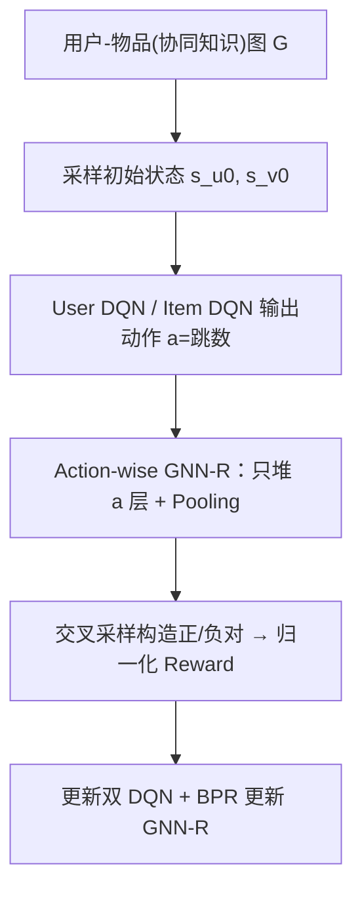
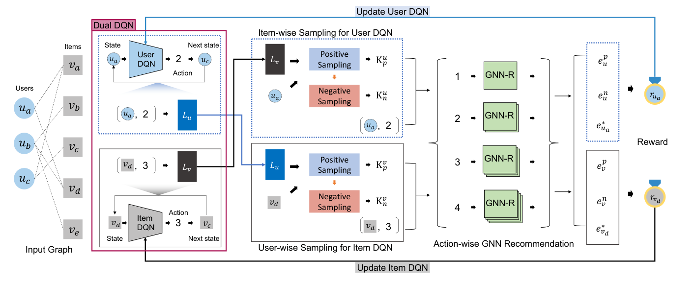

# Dual Policy Learning for Aggregation Optimization in Graph Neural Network-based Recommender Systems (基于双策略学习的图神经网络推荐聚合优化)

- **会议/期刊**: WWW 2023 (The Web Conference)
- **作者与机构**: Heesoo Jung, Hogun Park (成均馆大学)；Sangpil Kim (高丽大学)
- **推荐链路定位**: 召回（图 embedding 表征学习，可插拔于 LightGCN / KGAT 等 GNN-R 主干）
- **研究方向**: 图神经网络与知识图谱推荐 / 强化学习与动态探索推荐
- **论文原文**: [https://arxiv.org/abs/2302.10567v1](https://arxiv.org/abs/2302.10567v1)
- **开源代码**: [https://github.com/steve30572/DPAO](https://github.com/steve30572/DPAO)

## TL;DR (1分钟核心速览)

GNN 推荐模型普遍把"聚合层数 $L$"当成全局超参、且用户侧与物品侧共用同一深度，与用户/物品的异质性冲突。本文提出 DPAO：把每个节点的聚合跳数建模为 MDP 动作，用两个独立 DQN（用户策略、物品策略）在$\{1,2,3,4\}$ 跳中做决策，用交叉异构的近邻 hard-negative 打分差构造归一化 reward，并同步更新 GNN-R 与双 DQN。在 6 个真实数据集、全库 Full-Ranking 协议下，LightGCN 与 KGAT 分别被提升至 nDCG@20 最高 +23.3% 与 +63.7%，Recall@20 最高 +42.9%。

## Background & Motivation (背景与核心矛盾)

- **主流范式**: LightGCN 去掉非线性与特征变换、用对称归一化邻接做 $L$ 层均值聚合 + sum pooling；KGAT/KGIN 在协同知识图谱 CKG 上用 attention 区分关系/路径重要性，再堆叠固定层数，最后以 BPR 成对损失优化。
- **前人局限**: ① 层数 $L$ 是全局超参，被所有用户、所有物品共享，无法表达"某用户只需 1 跳直连协同信号、某物品需 3 跳才能连到同类消费者"的结构角色差异；② 现有 attention 类 KG-R 只调整**边权**而非**感受野深度**，深层噪声与过平滑无法按节点规避；③ 已有的聚合优化工作（如 Policy-GNN）面向节点分类、只做单侧单策略，无法处理推荐中用户/物品双边异构。
- **核心洞察 (Key Insight)**: 作者在 ML-1M 上遍历 LightGCN 用户侧/物品侧层数组合（图 1 热力图），发现同一用户与三个交互物品的最优组合分别是 $(1,1)$、$(4,4)$、$(3,1)$——最优点随物品而变，证明"层数应逐节点、逐侧决定"。

<figure class="paper-figure" markdown="span">
  ![图 1：LightGCN \[6\] 中不同聚合迭代次数在 MovieLens1M 数据集上的效果。横轴表示其用户侧 GNN 的聚合层数，纵轴表示物品侧 GNN 的聚合层数。颜色由暗到亮表示用户与物品的匹配分数，该分数由用户和物品表示的内积计算得到。](../../../../assets/papers/2302.10567v1/figure_1.png)<figcaption>图 1：LightGCN [6] 中不同聚合迭代次数在 MovieLens1M 数据集上的效果。横轴表示其用户侧 GNN 的聚合层数，纵轴表示物品侧 GNN 的聚合层数。颜色由暗到亮表示用户与物品的匹配分数，该分数由用户和物品表示的内积计算得到。</figcaption>
</figure>

- **本文切入点**: 把"聚合跳数"离散化为动作，用双 DQN 做逐节点的策略搜索，并让 reward 直接来自目标 GNN-R 的打分反馈，从而与任意 GNN-R 主干解耦、即插即用。

## Method (核心方法设计)

### 1. 整体框架 (Overall Architecture)

每轮训练先随机采样初始用户 $s^u_0$，并从其交互集$I(s^u_0)$中取初始物品$s^v_0$。双 DQN 分别输出动作$a^u_t,a^v_t$（即聚合跳数），GNN-R 仅堆叠对应层数并 pooling 得$\mathbf{e}^*_u,\mathbf{e}^*_v$；随后以 item-wise 采样为**用户**算 reward、以 user-wise 采样为**物品**算 reward（交叉异构），把$(s,a,r,s')$存入各自 memory buffer 更新双 DQN，同时用 tuple list 中的正负对以 BPR 更新 GNN-R。$\epsilon=1-z/Z$ 线性衰减探索，target net 每 `upd` 步同步。

<figure class="paper-figure" markdown="span">
  <figcaption>图 2：DPAO 整体流程示意图。图左侧为用户-物品二分输入图。随后展示用户 DQN（蓝色）和物品 DQN（灰色）的 MDP。我们对用户 DQN 执行按物品采样，对物品 DQN 执行按用户采样。经过动作级 GNN-R 后，得到最终嵌入。由嵌入获得的奖励值也用于更新我们的双 DQN。</figcaption>
</figure>

### 2. 关键设计拆解 (Key Designs)

1. **动作即跳数 + 感受野内状态转移**：若下一状态可任意跳转，reward 与动作语义脱钩。DPAO 令状态为用户/物品节点，动作为跳数 $a_t\in\mathcal{A}=\{1,\dots,4\}$，下一状态只在**该动作对应的$a_t$-跳子图的同类型节点**中均匀采样：$s_{t+1}\sim \mathrm{Uniform}(\mathcal{M}),\ \mathcal{M}=\{m\in\mathcal{G}^{a_t}_{s_t}\mid \mathrm{type}(m)=\mathrm{type}(s_t)\}$。这保证轨迹始终走在"被聚合到的邻居"上，使 reward 能真实反映该跳数的信息收益。
2. **交叉异构 + 跨动作归一化 Reward**：分子沿用 BPR 式打分差，分母对**所有候选动作**的打分差求和做尺度归一，衡量"该动作相对其他动作的边际收益"而非绝对分数：
$$r_t=\frac{\mathrm{Score}(\mathbf{e}^*_{s_t},\mathbf{e}^p_t)-\mathrm{Score}(\mathbf{e}^*_{s_t},\mathbf{e}^n_t)}{\sum_{c\in\mathcal{A}}\big[\mathrm{Score}(\mathrm{GNN}(s_t,c),\mathbf{e}^p_t)-\mathrm{Score}(\mathrm{GNN}(s_t,c),\mathbf{e}^n_t)\big]}$$
其中正负对取自**对方**的 tuple list（用户 reward 用 $L_v$，物品 reward 用$L_u$），因 tuple list 仅存历史$a$-跳子图内节点，负样本天然靠近目标节点 → 低成本 **hard negative**；同时消除了不同节点打分尺度不可比的问题。
3. **训练目标、warm-up 与推理开销**：总损失 $\mathcal{L}=\mathcal{L}_{BPR}+\mathcal{L}^u_{DQN}+\mathcal{L}^v_{DQN}$，其中$\mathcal{L}_{DQN}=\big(Q(s_t,a_t|\theta)-(r_t+\gamma\max_{a_{t+1}}Q(s_{t+1},a_{t+1}|\theta^{-}))\big)^2$，并额外做"以目标物品为中心、正/负用户为对比"的对称 BPR。reward 需等 tuple list 填充（warm-up$\beta$步）后才计算。子图可预索引，单步转移$O(\kappa|L|)$，整体$O(Z|E|)\approx O(|E|)$；concat pooling 需 padding 对齐维度。推理时仅取$\arg\max_a Q$、最多堆 4 层，无需负采样。

## Experimental Setup & Evaluation Protocol (实验设置与评估协议)

- **数据集与预处理**: 3 个非 KG 数据集 (Gowalla, MovieLens-1M, Amazon-Book) + 3 个 KG 数据集 (Last-FM, Amazon-Book, Yelp2018)；原始用户/物品/交互统计见原文附录 Table 5，KG 侧由物品实体与 KG 三元组拼成 CKG。

| 数据集 | 类型 | 主干 GNN-R | 场景说明 |
| :--- | :---: | :---: | :--- |
| Gowalla | 非 KG | LightGCN | 签到社交，极稀疏 |
| MovieLens-1M | 非 KG | LightGCN | 电影评分，稠密 |
| Amazon-Book | 非 KG / KG | LightGCN / KGAT | 图书电商，含 KG 侧信息 |
| Last-FM | KG | KGAT | 音乐 LBSN，KG 增强 |
| Yelp2018 | KG | KGAT | 本地生活 POI 评论 |

- **数据划分与防穿越**: 沿用各主干 (LightGCN/KGAT) 官方划分，训练集交互构成 $O^+$，评测时排除训练集已交互项。
- **排名评测协议**: **Full-Ranking 全库排序**（"ranking all items that a user did not interact with in the training dataset"），指标 nDCG@20、Recall@20，无采样负例偏置。
- **对比基线与超参**: 非 KG 侧对比 FM / NFM / BPR-MF / LINE / NGCF / DGCF / LightGCN；KG 侧对比 CKFG / KGAT / KGIN / CGKR / KGPolicy 等。最大动作空间 $|\mathcal{A}|=4$（在$[2,6]$上网格搜索所得），embedding 维度等沿用主干默认配置；论文未报告显著性检验$p$ 值。

## Key Experimental Results (实验关键数据)

### 1. 主实验对比 (Main Results)

**非 KG 主干（base = LightGCN，nDCG@20 / Recall@20）**

| Model | Gowalla | ML-1M | Amazon-Book |
| :--- | :---: | :---: | :---: |
| BPR-MF | 0.128 / 0.150 | 0.282 / 0.273 | 0.084 / 0.160 |
| NGCF | 0.225 / 0.154 | 0.267 / 0.266 | 0.097 / 0.189 |
| DGCF | 0.130 / 0.152 | 0.276 / 0.270 | 0.083 / 0.172 |
| LightGCN | 0.225 / 0.152 | 0.283 / 0.278 | 0.093 / 0.187 |
| **DPAO** | **0.229 / 0.157** | **0.349 / 0.278** | **0.114 / 0.189** |
| Improv. | +1.78% / +3.29% | +23.3% / 0% | +22.6% / +1.07% |

**KG 主干（base = KGAT，nDCG@20 / Recall@20）**

| Model | Last-FM | Amazon-Book | Yelp2018 |
| :--- | :---: | :---: | :---: |
| BPR-MF | 0.0618 / 0.0719 | 0.3126 / 0.4925 | 0.0324 / 0.0499 |
| KGAT | 0.0823 / 0.0948 | 0.2237 / 0.4011 | 0.0413 / 0.0653 |
| KGIN | 0.0842 / 0.0972 | 0.2205 / 0.3903 | **0.0451 / 0.0705** |
| CGKR | 0.0660 / 0.0750 | 0.3337 / 0.5186 | 0.0372 / 0.0579 |
| KGPolicy | 0.0828 / 0.0978 | 0.3316 / 0.5286 | 0.0384 / 0.0509 |
| **DPAO** | **0.0889 / 0.1072** | **0.3662 / 0.5735** | 0.0452 / 0.0700 |
| Improv. | +8.02% / +13.1% | +63.7% / +42.9% | +9.44% / +7.20% |

### 2. 消融实验 (Ablation Study)

| Variant | Amazon-Book (nDCG / R) | Last-FM (nDCG / R) | Gowalla (nDCG / R) | ML-1M (nDCG / R) |
| :--- | :---: | :---: | :---: | :---: |
| DPAO 全量 | **0.3662 / 0.5735** | **0.0889 / 0.1072** | **0.229 / 0.157** | **0.349 / 0.278** |
| w/o Dual（单 DQN 共享策略） | 0.3491 / 0.5503 | 0.0876 / 0.0975 | 0.228 / 0.155 | 0.335 / 0.263 |
| w/o Sampling（改随机负采样 RNS） | 0.3422 / 0.5148 | 0.0876 / 0.0975 | 0.226 / 0.155 | 0.341 / 0.257 |

### 3. 关键实验发现 (Key Findings)

1. **增益与候选池规模正相关**：稠密的 ML-1M 上 nDCG 相对 LightGCN 提升 23.3%，KG 侧 Amazon-Book 上 nDCG/Recall 分别 +63.7%/+42.9%；而极稀疏且 LightGCN 已接近饱和的 Gowalla 仅 +1.78%，说明 DPAO 的主要收益来自"更多可采样邻居 → 更充分的 hard negative 与动作区分度"。
2. **近邻采样比双策略更关键，但双策略在 KG 上不可替代**：换随机负采样后 Amazon-Book Recall 从 0.5735 掉到 0.5148（−10.2%），降幅大于单 DQN 的 0.5503（−4.0%）；而单 DQN 在 KG 数据集降幅明显大于非 KG 数据集，印证 KG 场景下用户与物品的聚合需求差异更强。
3. **学到的跳数分布本身可解释**：图 4 显示非 KG 数据集上 1 层被高频选中（直连协同信号已足够），KG 数据集则 2 层以上占比显著更高（需经 KG 多跳才能触及语义邻居），且用户侧与物品侧分布明显不同；图 5 的分桶实验进一步显示最稀疏用户组增益最大，说明自适应跳数实质是在抑制稀疏节点上的噪声传播与过平滑。

## Highlights & Limitations (亮点、对比与审稿批判)

- **与代表作对比 (vs. Prior Work)**: 相较 LightGCN（固定 $L$ + sum pooling，两侧同深），DPAO 把深度从全局超参变为逐节点策略；相较 KGAT/KGIN（用 attention 调边权、深度仍固定），DPAO 调的是感受野本身，可与 attention 正交叠加；相较面向节点分类的 Policy-GNN 与生成反事实边的 CGKR，本文首次在推荐双边图上引入**两个独立** DQN，并让 reward 直接由 GNN-R 打分反馈驱动。
- **可迁移亮点**: ① reward 分母"跨动作归一化"可广泛复用到层数搜索 / NAS / 路由选择等需要跨配置比较打分的场景；② 用 tuple list 局限候选域以获得**近邻 hard negative** 的技巧，可迁移到任意图对比学习负采样。
- **审稿级局限批判**: ① 每步需为 reward 计算多次 GNN 前向（对 $|\mathcal{A}|$与正负对均值池化），训练开销远高于"$O(|E|)$"的渐近描述，且 reward 需 warm-up、方差大（附录奖励曲线高波动）；② 动作空间被硬限制在$\{1,2,3,4\}$ 的小离散集，未验证更深层、连续跳数或与层间注意力联合搜索；③ 评估仅报 nDCG/Recall@20 且无显著性检验与方差报告，KG 侧仅以 KGAT 为唯一主干，泛化性证据偏薄。

## Rating (四维评分)

- **方法创新性 (Novelty)**: ⭐⭐⭐⭐ （首次将"聚合跳数"形式化为推荐双边图上的双 MDP，交叉异构 reward 与跨动作归一化设计有新意，但 RL+层级搜索的框架范式本身不算全新）
- **评估协议与实验扎实度 (Protocol & Experiments)**: ⭐⭐⭐⭐ （6 数据集、Full-Ranking 无偏排序、非 KG 与 KG 双主干、消融/稀疏分桶/动作分布多维分析齐备；不足是无显著性检验、动作空间偏小）
- **写作与数学规范度 (Clarity & Rigor)**: ⭐⭐⭐⭐ （MDP 四要素、reward 归一化、伪代码与复杂度分析交代清楚；数据集统计置于附录、部分改进率与正文表述存在微小不一致）
- **工业落地与复现价值 (Industrial & Practical Value)**: ⭐⭐⭐⭐ （代码开源，可作为插件套在既有 GNN 召回主干上；但双 DQN 训练成本与在线额外存储使其更适合离线训练、线上仅走 argmax 的部署形态）

