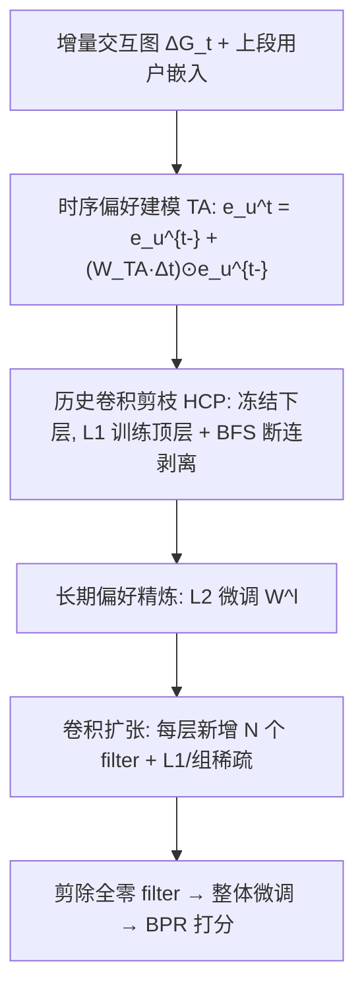
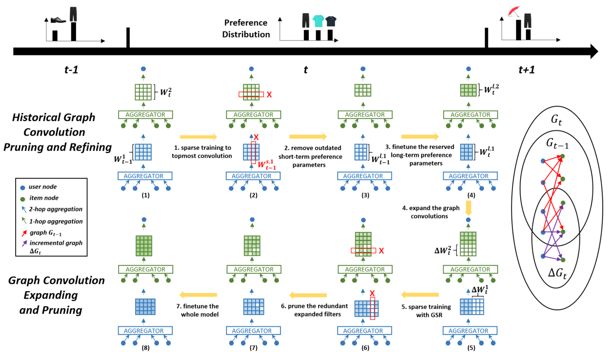

# Dynamically Expandable Graph Convolution for Streaming Recommendation (面向流式推荐的可动态扩展图卷积)

- **会议/期刊**: WWW 2023 (The Web Conference)
- **作者与机构**: Bowei He, Xu He, Yingxue Zhang, Ruiming Tang, Chen Ma（香港城市大学 & 华为诺亚方舟实验室）
- **推荐链路定位**: 召回（GCN 协同过滤表征学习）
- **研究方向**: 图神经网络与知识图谱推荐 / 序列与会话推荐
- **论文原文**: [https://arxiv.org/abs/2303.11700v1](https://arxiv.org/abs/2303.11700v1)
- **开源代码**: [https://github.com/BokwaiHo/DEGC](https://github.com/BokwaiHo/DEGC)

## TL;DR (1分钟核心速览)

流式推荐中，经验回放受数据合规与内存限制、知识蒸馏/权重正则又陷入 **over-stability**（无法跟上用户短期偏好漂移）。本文提出 DEGC，从**模型隔离**视角对图卷积滤波器做「剪枝→精炼→扩张→再剪枝」，只保留长短期偏好相关参数，并用 Kalman 滤波启发的时序注意力给出用户嵌入初始化。在 4 个工业数据集 × 3 个 GCN 主干上，Taobao2014 的 R@20 相对最优基线提升 87.5%~146%，且统计显著（$p\le 0.01$）。

## Background & Motivation (背景与核心矛盾)

- **主流范式**: 将交互流按时间切成等长段 $D_1,\dots,D_T$，用持续图学习（continual graph learning）在$\Delta G_t$ 上增量更新 GCN 参数，代表路线为经验回放（Uniform / Inverse / ContinualGNN）与知识蒸馏/权重正则（TWP / GraphSAIL / SGCT / LWC-KD）。
- **前人局限一**: 回放类方法必须持有完整历史数据，在数据治理趋严、缺失与恶意攻击频发的工业环境下不可行，且内存与耗时随流增长。
- **前人局限二**: 蒸馏/正则类方法 indiscriminately 继承上一段参数，把**已过期的短期偏好**一并冻结，导致 over-stability；论文图 4 显示 Netflix 上前 5 个月 NDCG@20 断崖式下跌，LWC-KD 甚至从 0.0482 掉到 0.0461。
- **核心洞察 (Key Insight)**: 模型参数可解耦为「长期偏好（性别/职业，跨段有效）」与「短期偏好（受情境驱动，仅当段有效）」两部分；**过时短期偏好是负迁移源**，而非需要保护的知识。
- **本文切入点**: 用模型隔离替代数据回放——把参数结构本身当作可增删的对象，只留长期偏好、新开滤波器抽取当期短期偏好。

## Method (核心方法设计)

### 1. 整体框架 (Overall Architecture)

每个时间段 $t$分四步走：先用时序注意力模块把上段用户嵌入外推为当前初始化（新用户用一跳邻居均值热启动）；再冻结第$1{:}K{-}1$层、只训练顶层$K$并加$L_1$稀疏，通过广度优先搜索找出与顶层断连的滤波器（判定为过时短期偏好）并整段剥离；随后以$L_2$微调保留的长期偏好参数；最后每层新增$N$ 个滤波器抽取当期短期偏好，用组稀疏正则压缩后剪掉全零滤波器，整体再微调一次。BPR 损失驱动，推理时与传统 LightGCN 完全同构，无额外在线开销。

<figure class="paper-figure" markdown="span">
  <figcaption>图2：动态可扩展图卷积概览。以 2 层图卷积为例。操作 1、2、3 对应第 4.2 节介绍的方法，操作 4、5、6、7 说明第 4.3 节提到的方法。</figcaption>
</figure>

### 2. 关键设计拆解 (Key Designs)

1. **时序用户偏好建模 (TPM) 作为嵌入初始化**：痛点是不连续活跃用户的嵌入在上段之后完全陈旧、新用户无嵌入。借鉴 Kalman 滤波的状态更新，把偏好漂移写成时间间隔的线性缩放：$\Delta\mathbf{e}_u^t=(\mathbf{W}_{TA}\Delta t)\odot\mathbf{e}_u^{t^-},\ \Delta t=t-t^-$，再累加得$\mathbf{e}_u^t=\mathbf{e}_u^{t^-}+\Delta\mathbf{e}_u^t$；新用户取一跳邻居均值$\mathbf{e}_u^t=\frac{1}{|\mathcal{N}_u^t|}\sum_{j\in\mathcal{N}_u^t}\mathbf{e}_j^t$。直觉：间隔越久漂移越大，$\Delta t$ 充当物理上的「遗忘时钟」。
2. **历史卷积剪枝与精炼 (HCP)**：痛点是不加区分地继承参数会保留过时短期偏好。做法是只放开顶层并施加强稀疏：$\min_{\mathbf{W}^K_t}\mathcal{L}_t(\mathbf{W}^K_t;\mathbf{W}^{1:K-1}_{t-1},\mathbf{e},\Delta G_t)+\lambda_1\|\mathbf{W}^K_t\|_1$。稀疏化后，与顶层$K$无连接的底层滤波器即为$\mathbf{W}^s_{t-1}$（过时短期偏好），BFS 一次性定位并删除；剩余$\mathbf{W}^l_{t-1}$用$\lambda_2\|\mathbf{W}^l_t\|_2$ 精炼。这同时完成了 GNN 结构搜索，且只微调子网络显著降低算力。
3. **卷积扩张与再剪枝 + 训练目标**：单靠长期偏好不足以刻画当期兴趣，故每层新增 $N$个滤波器$\Delta\mathbf{W}_t$并独立训练，$\min_{\Delta\mathbf{W}_t}\mathcal{L}_t+\lambda_1\|\Delta\mathbf{W}_t\|_1+\lambda_g\sum_g\|\Delta\mathbf{W}^g_t\|_2$（$g$为单个 filter 参数组），用$L_1$+组稀疏防止宽度爆炸，剪除全零 filter 后整体微调：$\mathcal{L}=\mathcal{L}_{\text{BPR}}+\lambda_1(\|\mathbf{W}^l_t\|_1+\|\Delta\mathbf{W}_t\|_1)+\lambda_2\|\mathbf{e}\|_2$。负采样沿用 BPR 均匀采样，无需回放缓存。

## Experimental Setup & Evaluation Protocol (实验设置与评估协议)

| 数据集 | 过滤阈值 | 时间跨度 | 场景说明 |
| :--- | :---: | :---: | :--- |
| Taobao2014 | $\ge 10$ | 30 天 | 阿里移动端用户-商品行为，含位置与时间戳 |
| Taobao2015 | $\ge 20$ | 首月 | 淘宝 + 支付宝线上行为流 |
| Netflix | $\ge 30$ | 前 24 月 | 电影评分（百万级、用户/物品高速增长） |
| Foursquare | $\ge 20$ | ~22 月 | LBS 签到，强稀疏与地理约束 |

- **数据划分**: 每个时间段内部按 **8:1:1 比例划分** train/valid/test，沿时间轴滚动，性能在全时间线上评测并取平均（5 次重复，报告均值）。
- **排名评测协议**: 指标为 Recall@20 与 NDCG@20；原文**未显式披露候选集为全库排序还是采样排序**，亦未给出评测负样本比例，这一点在复现时需谨慎。
- **对比基线与超参**: 9 个基线覆盖三类——Finetune、回放类（Uniform、Inverse、ContinualGNN）、蒸馏/正则类（TWP、GraphSAIL、SGCT、MGCT、LWC-KD）；主干替换为 NGCF / LightGCN / MGCCF 三种；显著性用 $t$-test，$p\le 0.01$。DEGC 与 Finetune、LWC-KD 组合以验证正交性。

## Key Experimental Results (实验关键数据)

### 1. 主实验对比 (Main Results, 主干 MGCCF)

| 方法 | Taobao14 R@20 | Taobao14 N@20 | Netflix R@20 | Netflix N@20 |
| :--- | :---: | :---: | :---: | :---: |
| Finetune | 0.0412 | 0.0052 | 0.3359 | 0.0580 |
| Uniform (回放) | 0.0308 | 0.0038 | 0.3298 | 0.0533 |
| ContinualGNN | 0.0311 | 0.0035 | 0.3089 | 0.0491 |
| TWP | 0.0398 | 0.0050 | 0.3428 | 0.0580 |
| GraphSAIL | 0.0395 | 0.0051 | 0.3470 | 0.0583 |
| LWC-KD | 0.0440 | 0.0059 | 0.2616 | 0.0482 |
| DEGC + LWC-KD | **0.1082** (↑146%) | **0.0142** (↑141%) | 0.2949 | 0.0520 |
| DEGC + Finetune | 0.0825 (↑87.5%) | 0.0106 (↑79.7%) | **0.3583** (↑3.26%) | **0.0612** (↑4.97%) |

（Foursquare 上 DEGC+Finetune 达 R@20 0.1324 / N@20 0.0153，相对 Finetune 提升 3.44%/6.25%；Taobao2015 上 DEGC+LWC-KD 达 0.4892，提升 8.42%。）

### 2. 消融实验 (Ablation Study)

| 变体（Taobao2014, MGCCF 主干） | R@20 相对完整模型 | 归因 |
| :--- | :---: | :--- |
| DEGC + Finetune（完整） | 100% | — |
| w/o HCP（不剪历史卷积） | ↓ 25.3% | 过时短期偏好造成负迁移 |
| DEGC + LWC-KD（完整） | 100% | — |
| w/o HCP | ↓ 28.4% | 保留历史知识越多，受害越重 |
| w/o TPM（无时序初始化） | ↓ 约 25.5%（完整模型 ↑34.3%） | 不连续/新用户冷启动受损 |
| w/o TPM（LWC-KD 版） | ↓ 约 19.9%（完整模型 ↑24.9%） | 同上 |

### 3. 关键实验发现 (Key Findings)

1. **回放类方法在流式场景是负收益**：Uniform / Inverse / ContinualGNN 在 Taobao2014 上（0.0308 / 0.0323 / 0.0311）全面劣于最简单的 Finetune（0.0412），证明重放旧数据等价于把已过期的短期偏好重新灌回模型。
2. **HCP 是最大贡献项且与蒸馏强度正相关**：去掉剪枝后 LWC-KD 版掉 28.4%、Finetune 版掉 25.3%，说明「保护历史知识越多 → over-stability 越严重」，直接量化了该病根的代价。
3. **主干无关性与失效边界**：换成 NGCF/LightGCN 后 Taobao2014 仍提升 107%~153%，但 Netflix 上 DEGC+LWC-KD（0.2949）低于 Finetune，作者归因为 LWC-KD 自身在该数据集已崩坏（0.2616），说明模型隔离并不能救回被蒸馏过度约束的底座。

## Highlights & Limitations (亮点、对比与审稿批判)

- **与代表作对比**: 相较 GraphSAIL / LWC-KD 等蒸馏路线，DEGC 不改损失约束而是**改参数结构**，从根本上避开 over-stability；相较 Uniform / ContinualGNN 等回放路线，它完全不触碰历史数据，天然契合隐私合规；相较 CV 中的 model isolation 方法（需逐任务搜索全架构），它用 BFS 定位断连滤波器，搜索成本降到线性。
- **可迁移亮点**: (1) 「顶层强 $L_1$稀疏 + BFS 回溯断连」是一种廉价的子网络结构探测手段，可用于任意深层 GNN 的增量剪枝；(2) 用$(\mathbf{W}\Delta t)\odot\mathbf{e}$ 做嵌入外推，可零成本移植到序列推荐的用户侧初始化。
- **审稿级局限批判**: (1) 每段固定新增 $N$个滤波器，虽剪枝但宽度仍单调增长，论文未给出参数量/训练时延随$T$ 的曲线，工业长跑可行性存疑；(2) 评测协议披露不完整（未说明全库排序与否、无冷启动分桶实验），且仅报告 R@20/N@20，缺少对极度稀疏用户的分层分析，削弱了「解决新用户与间歇活跃」这一核心动机的证据强度。

## Rating (四维评分)

- **方法创新性 (Novelty)**: ⭐⭐⭐⭐ （首次把 model isolation 引入流式 GCN 推荐，剪枝-精炼-扩张序列设计自洽，Kalman 式时间缩放虽简单但直觉清晰）
- **评估协议与实验扎实度 (Protocol & Experiments)**: ⭐⭐⭐⭐ （4 数据集 × 3 主干 × 9 基线的矩阵式验证 + $t$-test 显著性充分，但排序协议与冷启动分桶未披露）
- **写作与数学规范度 (Clarity & Rigor)**: ⭐⭐⭐⭐ （四步操作与算法伪码一一对应，公式简洁；缺复杂度分析与超参敏感性讨论）
- **工业落地与复现价值 (Industrial & Practical Value)**: ⭐⭐⭐⭐ （免回放、只微调子网络、开源代码齐全，落地门槛低；宽度增长与剪枝阈值工程调参是主要成本）

