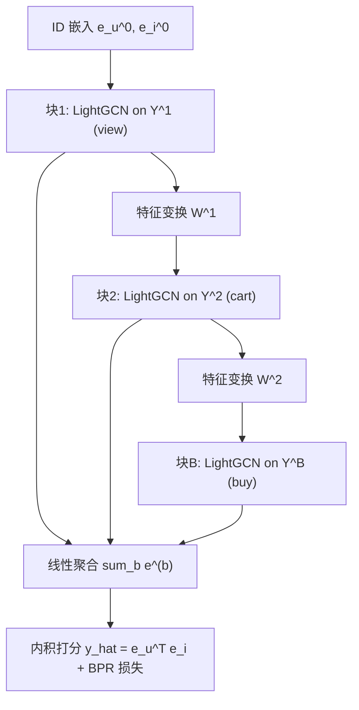
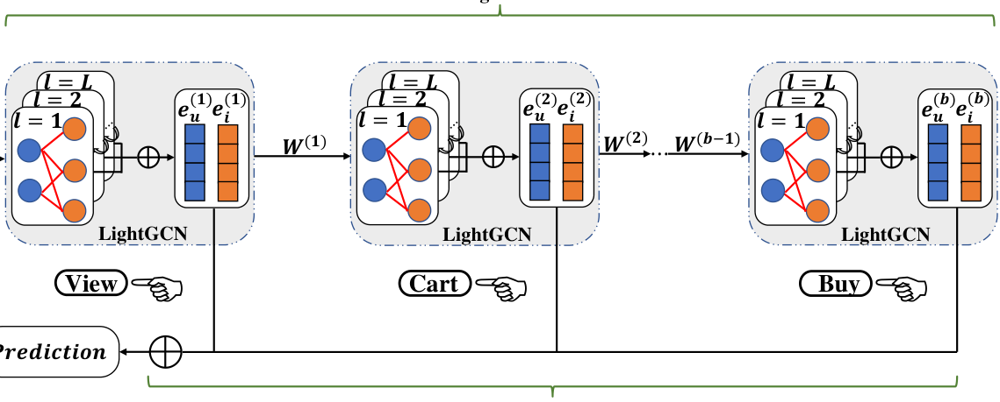

# Multi-Behavior Recommendation with Cascading Graph Convolution Networks (级联图卷积网络的多行为推荐)

- **会议/期刊**: WWW 2023
- **作者与机构**: Zhiyong Cheng、Sai Han、Fan Liu、Lei Zhu、Zan Gao、Yuxin Peng（齐鲁工业大学山东省人工智能研究院、新加坡国立大学、山东师范大学、北京大学、鹏城实验室）
- **推荐链路定位**: 召回（多行为协同过滤表征学习）
- **研究方向**: 图神经网络与知识图谱推荐 / 多任务学习与列表级重排
- **论文原文**: [论文原文链接](https://arxiv.org/abs/2303.15720v1)
- **开源代码**: [开源代码仓库链接](https://github.com/SS-00-SS/MBCGCN)

## TL;DR (1分钟核心速览)

针对多行为推荐中"行为链依赖（view→cart→buy）被隐式建模、辅助行为噪声污染目标表征"的痛点，本文提出 MB-CGCN：把每种行为对应一个 LightGCN 块串成级联链，前一块的行为专属嵌入经可学习特征变换矩阵 $W^b$ 蒸馏后作为后一块的输入嵌入，最后线性聚合所有行为嵌入做内积打分。模型抛弃多任务学习的辅助行为监督，仅用目标行为 BPR 损失驱动全链训练。在 Beibei/Tmall 上采用 Leave-One-Out + 全库排序协议，Recall@10 达 0.0579/0.1233，相对最强基线（MBGCN/CRGCN）提升 23.2%/44.2%，NDCG@10 提升 17.6%/54.2%。

## Background & Motivation (背景与核心矛盾)

- **主流范式**: 多行为推荐分两支——统一异构图上做 GCN 并学习行为贡献权重（MBGCN、GNMR、MBGMN），或用 DNN/Transformer 学习各行为嵌入后加权融合（DIPN、MATN、KHGT）；行为顺序仅 NMTR（传递预测分数）与 CRGCN（残差式嵌入细化）涉及。
- **前人局限**: ① 绝大多数模型把辅助行为视为平行信号，只在"聚合阶段"用注意力或贡献权重区分重要性，行为链的先后依赖从未进入**嵌入学习算子本身**；② CRGCN 虽级联，但用残差保留旧行为特征且依赖多任务学习，导致早层行为（click/view）的噪声被逐跳累积放大，因而被迫把辅助行为限制为单层 GCN，放弃高阶协同信号。
- **核心洞察 (Key Insight)**: 行为链中靠后的行为携带更强、更确定的偏好信号（cart 比 view 更可信），因此前一行为的表征应作为后一行为的"优质初始化"；但直接传递会丢失行为多样性并注入噪声，需要一个蒸馏算子而非残差通路。
- **本文切入点**: 用"特征变换 $W^b$ + 单目标监督"替代"残差 + 多任务"，既保留行为链的逐跳精炼能力，又允许每层行为都用高阶传播。

## Method (核心方法设计)

### 1. 整体框架 (Overall Architecture)

输入是 $B$种行为按业务顺序排列的二值交互矩阵$\{Y^1,\dots,Y^B\}$（$Y^B$为目标行为）。初始化共享用户/物品 ID 嵌入$e_u^0, e_i^0$作为第 1 个 GCN 块的输入；随后$B$个级联 LightGCN 块依次执行"块内$L$层邻域传播 + 层间求和读出$\to$特征变换$W^b$ $\to$下一块输入"。各块输出的行为专属嵌入$e_u^{(b)}$ 被线性聚合得到最终表征，内积即目标行为打分。训练端只有目标行为正负样本对参与 BPR 优化，形成"辅助行为提供表征、目标行为提供监督"的非对称闭环。

<figure class="paper-figure" markdown="span">
  <figcaption>图1：我们的MB-CGCN模型概览。</figcaption>
</figure>

### 2. 关键设计拆解 (Key Designs)

1. **级联式行为链传递（Cascading GCN Blocks）**：痛点是平行建模丢失"后者信号更强"的先验。核心算子把第 $b$块读出嵌入直接改写成第$b+1$块的初始嵌入：$e_u^{(b+1,0)}=W_u^b\,e_u^{(b)},\; e_i^{(b+1,0)}=W_i^b\,e_i^{(b)}$，其中$e_u^{(b)}=\sum_{l=0}^{L}e_u^{(b,l)}$。直觉上，用户侧与物品侧各自独立的变换向量让模型学习"哪些旧行为维度对下一行为有用"，等价于一次跨行为的软特征门控，从而避免残差直通带来的噪声累积。

2. **特征变换而非残差（Feature Transformation）**：若直接令 $e^{(b+1,0)}=e^{(b)}$（即消融中的 `w/o. ft`），等于用后一行为对旧嵌入做无过滤的重复精炼，既抹平行为差异又传播噪声。$W^b$以 Xavier 初始化，起到"蒸馏—保留"折中：既让后面行为继承前者的收敛状态，又允许丢弃 view 类弱信号中的误导分量。这一设计使每个辅助行为块得以安全使用$L>1$ 的高阶传播（Beibei 取 {3,4,3} 层，Tmall 取 {3,4,2} 层），而 CRGCN 只能单层。

3. **单目标监督与推理开销**：总损失仅对目标行为取 BPR：$\mathcal{L}=\sum_{(u,i,j)\in O}-\ln\sigma(\hat{y}_{ui}-\hat{y}_{uj})+\lambda\|\Theta\|_2$，负样本从目标行为未交互池均匀采样，$O=\{(u,i,j)\mid (u,i)\in R^+,\;(u,j)\in R^-\}$。与 NMTR/CRGCN 的多任务加权不同，全部行为块共享同一目标梯度，学到的表征天然朝向 buy 排序，无需调节多任务权重；推理时仅需一次全链前向 + 内积，与 LightGCN 同阶，$d=64$ 时线上可 ANN 化召回。

## Experimental Setup & Evaluation Protocol (实验设置与评估协议)

- **数据集与预处理**: 保留每个 (user, item, behavior) 最早一次交互去重，未做 `5-core` 过滤：

| 数据集 | #Users | #Items | #Buy | #Cart | #View | 特征/场景说明 |
| :--- | :---: | :---: | :---: | :---: | :---: | :--- |
| Beibei | 21,716 | 7,997 | 304,576 | 642,622 | 2,412,586 | 母婴电商，强制行为顺序 view>cart>buy |
| Tmall | 15,449 | 11,953 | 104,329 | 195,476 | 873,954 | 综合电商，顺序较松散 |

- **数据划分与防穿越 (Splitting Strategy)**: 采用 `Leave-One-Out`——每个用户最后 1 个 buy 交互作测试正样本，倒数第 2 个作验证集调参，其余进训练。
- **排名评测协议 (Ranking Protocol)**: 无偏 `Full-Ranking`：测试集 = 1 个正样本 + 该用户全部未交互物品，在全体物品上排序，指标 Recall@K 与 NDCG@K，$K\in\{10,20,50\}$。
- **对比基线与超参设置**: 单行为基线 MF-BPR、NeuMF、LightGCN；多行为基线 RGCN、GNMR、NMTR、MBGCN、CRGCN。统一 $d=64$、batch=1024、Adam，学习率在 {1e-2,1e-3,1e-4} 内搜索，GCN 层数在 {1,2,3,4} 内调优，早停；基线均用官方代码同等调参。

## Key Experimental Results (实验关键数据)

### 1. 主实验对比 (Main Results)

| 数据集 | 指标 | MF-BPR | LightGCN | NMTR | MBGCN | CRGCN | **MB-CGCN** | Improv. |
| :--- | :--- | :---: | :---: | :---: | :---: | :---: | :---: | :---: |
| Beibei | Recall@10 | 0.0191 | 0.0391 | 0.0429 | 0.0470 | 0.0459 | **0.0579** | +23.2% |
| Beibei | NDCG@10 | 0.0049 | 0.0209 | 0.0198 | 0.0259 | 0.0324 | **0.0381** | +17.6% |
| Beibei | Recall@20 | 0.0531 | 0.0717 | 0.0776 | 0.0792 | 0.0891 | **0.0972** | +9.1% |
| Beibei | NDCG@20 | 0.0239 | 0.0270 | 0.0296 | 0.0330 | 0.0348 | **0.0404** | +16.1% |
| Tmall | Recall@10 | 0.0076 | 0.0411 | 0.0282 | 0.0509 | 0.0855 | **0.1233** | +44.2% |
| Tmall | NDCG@10 | 0.0036 | 0.0240 | 0.0137 | 0.0294 | 0.0439 | **0.0677** | +54.2% |
| Tmall | Recall@20 | 0.0244 | 0.0546 | 0.0642 | 0.0691 | 0.1369 | **0.2007** | +46.6% |
| Tmall | Recall@50 | 0.0393 | 0.0874 | 0.1034 | 0.1117 | 0.2325 | **0.3322** | +42.9% |

### 2. 消融实验 (Ablation Study)

| 变体 (Beibei / Tmall, Recall@20 | NDCG@20) | Beibei Recall | Beibei NDCG | Tmall Recall | Tmall NDCG |
| :--- | :---: | :---: | :---: | :---: |
| w/o. ft（直接传递，无 $W^b$） | 0.0892 | 0.0382 | 0.1994 | 0.0825 |
| w. ft（完整） | **0.0972** | **0.0404** | **0.2007** | **0.0880** |
| w/o. agg（仅用最后一块） | 0.0556 | 0.0140 | 0.0698 | 0.0291 |
| w. concat（拼接替代求和） | 0.0758 | 0.0282 | 0.1648 | 0.0688 |
| w. agg（线性求和） | **0.0972** | **0.0404** | **0.2007** | **0.0880** |
| 1 层 / 2 层 / 3 层（全行为同层数） | 0.0942/0.0954/0.0961 | 0.0328/0.0359/0.0370 | 0.1923/0.1933/0.1967 | 0.0864/0.0867/0.0869 |

### 3. 关键实验发现 (Key Findings)

1. **级联传递是主增益来源，但必须"蒸馏"而非"直通"**：去掉特征变换后 Beibei NDCG@20 从 0.0404 掉到 0.0382（−5.4%）、Tmall 从 0.0880 掉到 0.0825（−6.3%），而性能的绝对主力来自行为链本身——Tmall 上 CRGCN(0.1369) 已是 MBGCN(0.0691) 的 2 倍。
2. **"最后一块直接用"是最差选择**：`w/o. agg` 在 Tmall 仅 0.0698/0.0291，约为完整模型的三分之一；即便换成拼接 0.1648 也不及线性求和 0.2007，说明特征变换会按行为分化解耦特征，必须把各行为表征加回聚合而非依赖末端精炼。
3. **行为顺序与层数是"信号质量"问题而非容量问题**：行为数从 buy→cart>buy→view>cart>buy 单调提升（Tmall 0.0546→0.1956→0.2007），但 O3(cart>view>buy) 反而劣于 O2(cart>buy)，因为 view 噪声被直接灌入目标行为块；同时层数 1→3 稳定增益（Beibei NDCG 0.0328→0.0370），证明 $W^b$ 确实解除了 CRGCN「辅助行为只能用单层」的枷锁。

## Highlights & Limitations (亮点、对比与审稿批判)

- **与代表作对比 (vs. Prior Work)**: 与 MBGCN/GNMR 的差别在于它们只在**聚合阶段**为行为赋权、嵌入学习仍是各行为平行进行；与 NMTR 的差别在于它级联的是**预测分数**而非表征；与 CRGCN 的差别在于用 $W^b$ 变换取代残差通路，且不做多任务学习，因而可用高阶传播并将全部梯度对准目标行为。
- **可迁移亮点**: ① "跨模态/跨域表征以可学习线性变换逐跳传递"可直接迁移到多场景（如曝光→点击→转化）级联精排；② 用单目标监督替代多任务加权能省去权重调参，对工业多目标系统是低成本的强基线。
- **审稿级局限批判**: ① 变换矩阵按用户/物品各一组向量（而非 $d\times d$ 矩阵），表达能力弱，且未讨论参数量随行为数线性增长的规模化问题；② 评估仅用 `Leave-One-Out` 单正样本 + 均匀负采样，未报告采样排序或时序切分下的稳健性，也未做冷启动/长尾分桶与线上 A/B，作者的 future work 亦承认此点。

## Rating (四维评分)

- **方法创新性 (Novelty)**: ⭐⭐⭐⭐ （"行为链上做特征蒸馏"的立意清晰且与残差式 CRGCN 形成可验证的对立假设，但算子本身仅为线性变换，理论/谱分析缺失）
- **评估协议与实验扎实度 (Protocol & Experiments)**: ⭐⭐⭐⭐ （两数据集 + Full-Ranking + 8 个 SOTA 基线 + 特征变换/聚合/行为数/顺序/层数五组消融相当完整，扣分在单正样本 LOO 与无显著性检验）
- **写作与数学规范度 (Clarity & Rigor)**: ⭐⭐⭐⭐ （公式简洁、与 CRGCN 的差异化讨论到位；$W_u^b$ 为向量而非矩阵的符号表述略含混，聚合权重未给任何理论依据）
- **工业落地与复现价值 (Industrial & Practical Value)**: ⭐⭐⭐⭐⭐ （结构极简、已开源、与 LightGCN 同阶推理开销，行为链顺序与业务漏斗天然对齐，工程可即插即用）

