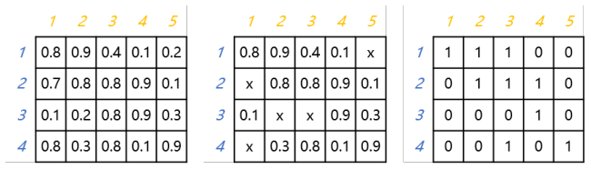
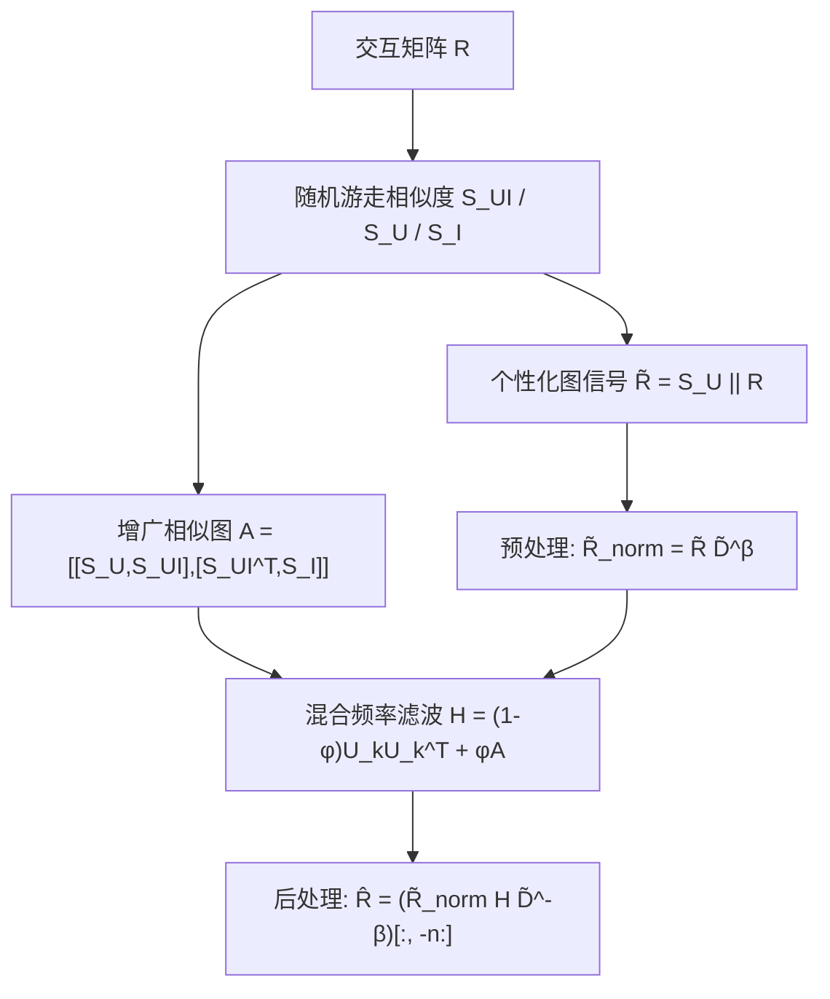
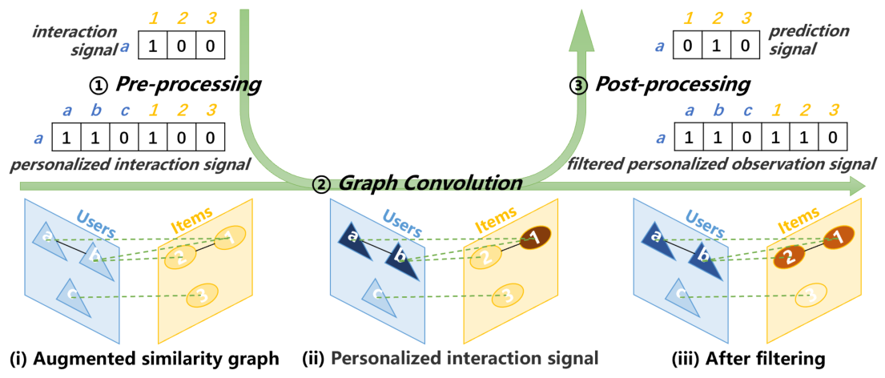
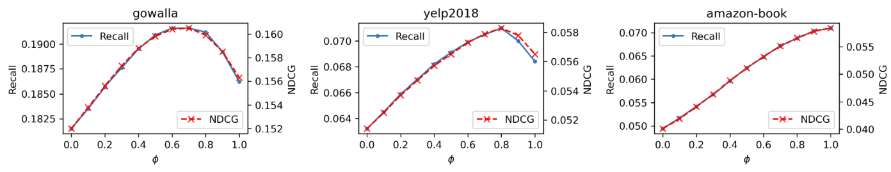

# Personalized Graph Signal Processing for Collaborative Filtering (面向协同过滤的个性化图信号处理)

- **会议/期刊**: WWW 2023 (The ACM Web Conference)
- **作者与机构**: Jiahao Liu, Tun Lu, Peng Zhang, Li Shang, Ning Gu (复旦大学) ；Dongsheng Li (微软亚洲研究院)；Hansu Gu
- **推荐链路定位**: 召回（非参数化 Top-N 召回打分）
- **研究方向**: 图神经网络与知识图谱推荐 / 协同过滤
- **论文原文**: [https://arxiv.org/abs/2302.02113v1](https://arxiv.org/abs/2302.02113v1)
- **开源代码**: 暂未开源

## TL;DR (1分钟核心速览)

现有基于图信号处理 (GSP) 的 CF 方法依赖两个隐含假设：用户偏好完全由交互历史刻画、且只需低频信号即可预测偏好。PGSP 指出稀疏交互不足表征用户，且高频分量（局部平滑但全局粗糙）恰恰承载个性化兴趣。为此本文提出**个性化图信号**（拼接用户相似度与交互行为，$m+n$维）、**增广相似图**（同时含 user-user / user-item / item-item 三种随机游走相似度）与**混合频率图滤波器**$H=(1-\phi)H_{ideal}+\phi A$，构成"预处理–图卷积–后处理"三段式免训练管线。在 Gowalla / Yelp2018 / Amazon-Book 随机 8:1:1 划分、Recall@20/NDCG@20 全库排序下，平均相对提升 NDCG 3.51%、Recall 3.70%（vs UltraGCN），且训练总耗时仅 8m42s，低于 LightGCN 单 epoch 的 69m40s。

## Background & Motivation (背景与核心矛盾)

- **主流范式**: GSP-based CF 先在 item 相似图上定义低通滤波器 $H=U\,\mathrm{diag}(h(\lambda))U^\top$，把用户的交互信号从空间域经 GFT 变换到谱域，滤除高频噪声后再逆变换回空间域得到预测信号（GF-CF 进一步证明邻域法、MF、GCN 都是不同频率响应的低通滤波特例）。
- **前人局限一（信号表达不足）**: 只把 $R$ 的一行当作图信号输入，稀疏场景下（Amazon-Book 密度仅 0.062%）这一 0/1 向量远不足以刻画真实偏好；同时相似图只有 item-item 边，用户节点信号无路可走。
- **前人局限二（高频信息被误杀）**: 曝光噪声与量化噪声（图 1）确实落在高频，但**用户独特的个性化偏好同样是"局部平滑、全局粗糙"的高频分量**，理想低通滤波器 $U_kU_k^\top$ 做全局平滑时把它一并抹掉，只剩大众化偏好。
- **核心洞察 (Key Insight)**: 真实偏好信号 = 全局平滑的通用偏好 + 局部平滑的个性化偏好；因此滤波器不应"一刀切低通"，而应按比例混合"全局平滑算子"与"局部平滑算子"。
- **本文切入点**: 用随机游走视角重建三种相似度、把用户相似度拼进信号与图中，再用混合频率滤波器按 $\phi$ 调和两种平滑。

<figure class="paper-figure" markdown="span">
  <figcaption>图1：考虑噪声时真实偏好矩阵与观测偏好矩阵之间的关系。</figcaption>
</figure>

## Method (核心方法设计)

### 1. 整体框架 (Overall Architecture)

PGSP 将增广相似图与个性化图信号送入混合频率滤波器，形成三段式免训练流程：**预处理**阶段用 $S_{UI}=D_U^{-1/2}RD_I^{-1/2}$及其乘积算出$S_U,S_I$，把$S_U$与$R$拼成$\tilde R=S_U\|R$并做热度惩罚归一化$\tilde R_{norm}=\tilde R\tilde D^{\beta}$；**图卷积**阶段用$H=(1-\phi)H_{ideal}+\phi A$对$\tilde R_{norm}$做一次谱域滤波；**后处理**阶段乘回$\tilde D^{-\beta}$并截取最后$n$列得到预测矩阵。全流程无任何可学习参数，无需反向传播，只需求一次$A$的最小$k$ 个特征向量。

<figure class="paper-figure" markdown="span">
  <figcaption>图4：提出的PGSP方法。个性化图信号在预处理步骤中构建，并输入到增强相似图中，从而促进用户的潜在兴趣。</figcaption>
</figure>

### 2. 关键设计拆解 (Key Designs)

1. **随机游走相似度与增广相似图（让用户信号有路可走）**: 前人用共现 $RR^\top$或 cosine，忽略路径长度与节点度对游走概率的影响。本文按 Node2Vec 的三要素（路径数、路径长度、节点度）定义$S_{UI}=D_U^{-1/2}RD_I^{-1/2}$、$S_U=S_{UI}S_{UI}^\top$、$S_I=S_{UI}^\top S_{UI}$，并拼成块矩阵
$A=\begin{bmatrix}S_U & S_{UI}\\ S_{UI}^\top & S_I\end{bmatrix}\in\mathbb{R}^{(m+n)\times(m+n)}$。
直觉：相似用户所交互的物品信号可经 user-user 边"放大"目标用户的潜在兴趣，且 $m+n$维信号天然需要$m+n$ 个节点的图承载。

2. **混合频率图滤波器（把高频救回来）**: 理想低通 $H_{ideal}=U_kU_k^\top$全局平滑但丢个性化；本文证明增广矩阵$A$本身是线性低通滤波器，频率响应$h(\lambda)=1-\lambda$（因$L=I-A$，$A u_i=(1-\lambda_i)u_i$），只做一跳邻域聚合，局部平滑却保留高频。二者按比例叠加：
$H=(1-\phi)H_{ideal}+\phi A$，$\phi$控制个性化高频权重。物理直觉：一跳扩散保住"细粒度局部结构"，$k$ 个低频基保住"全局共识"，稀疏数据下前者尤为关键。

3. **训练目标、负采样与推理开销**: 完全**免训练、免负采样**——损失函数退化为对 $A$的最小$k$个特征向量做截断特征分解（只需求小端特征对，成本远低于完整 EVD）。后处理的热度惩罚$\tilde D^{\beta}$（$\beta\le 0$）替代了 LightGCN 类方法的度数归一化传播，推理时只需一次矩阵乘法得到全库打分。

## Experimental Setup & Evaluation Protocol (实验设置与评估协议)

- **数据集与预处理**: 采用 LightGCN 发布的三个基准，未额外做 5-core 过滤（沿用原始版本），统计如下：

| 数据集 | #Users | #Items | #Interactions | 稀疏度/密度 | 特征/场景说明 |
| :--- | :---: | :---: | :---: | :---: | :--- |
| Gowalla | 29,858 | 40,981 | 1,027,370 | 0.084% | LBS 签到，中等稀疏 |
| Yelp2018 | 31,668 | 38,048 | 1,561,406 | 0.130% | 本地生活商户点评 |
| Amazon-Book | 52,643 | 91,599 | 2,984,108 | 0.062% | 图书电商，最稀疏 |

- **数据划分与防穿越 (Splitting Strategy)**: **比例划分**——每个用户随机取 80% 交互作训练、20% 作测试；再从训练集中随机抽 10% 作验证集调超参（注意：随机划分而非全局时间戳切分，存在轻度未来信息穿越风险）。
- **排名评测协议 (Ranking Protocol)**: **Full-Ranking（全库未交互物品排序）**，指标为 Recall@20 与 NDCG@20；无采样负例，训练亦无需负采样。
- **对比基线与超参设置**: 三类基线共 15+ 个——MF 类 (ENMF / MF-CCL / SimpleX)、GNN 类 (LR-GCCF / NIA-GCN / LightGCN / DGCF / NGAT4Rec / SGL-ED / UltraGCN)、GSP 类 (GF-CF)。基线结果直接引自原论文与 BARS 基准库以保证公平；超参为低频基维度 $k$、混合系数$\phi$与热度指数$\beta$，在验证集上网格搜索。

## Key Experimental Results (实验关键数据)

### 1. 主实验对比 (Main Results)

| 方法 | Gowalla R@20 | Gowalla N@20 | Yelp R@20 | Yelp N@20 | Amazon R@20 | Amazon N@20 |
| :--- | :---: | :---: | :---: | :---: | :---: | :---: |
| LightGCN | 0.1830 | 0.1554 | 0.0649 | 0.0530 | 0.0411 | 0.0315 |
| SGL-ED | - | - | 0.0675 | 0.0555 | 0.0478 | 0.0379 |
| MF-CCL | 0.1837 | 0.1493 | 0.0698 | 0.0572 | 0.0559 | 0.0447 |
| SimpleX | 0.1872 | 0.1557 | 0.0701 | 0.0575 | 0.0583 | 0.0468 |
| DGCF [16] | 0.1891 | 0.1602 | 0.0703 | 0.0575 | 0.0476 | 0.0369 |
| UltraGCN | 0.1862 | 0.1580 | 0.0683 | 0.0561 | 0.0681 | 0.0556 |
| GF-CF | 0.1849 | 0.1518 | 0.0697 | 0.0571 | 0.0710 | 0.0584 |
| **PGSP (ours)** | **0.1916** | **0.1605** | **0.0710** | **0.0583** | **0.0712** | **0.0587** |
| Improv. vs 最强基线 | +1.32% | +0.19% | +1.00% | +1.39% | +0.28% | +0.51% |

论文另报告相对各基线的平均提升：vs LightGCN Recall +28.95% / NDCG +32.89%，vs SimpleX +8.47% / +9.75%，vs UltraGCN +3.70% / +3.51%，vs GF-CF +1.83% / +2.61%。

### 2. 消融实验 (Ablation Study)

原文未给标准 `w/o` 组件表，其核心归因通过 $\phi$（高频权重）扫描与跨密度数据集实验完成，整理如下：

| 配置 | Amazon-Book (0.062%) | Gowala (0.084%) | Yelp2018 (0.130%) | ML-1M (4.845%) |
| :--- | :---: | :---: | :---: | :---: |
| $\phi=0$（仅理想低通，等价去高频） | 基线 | 基线 | 基线 | 基线 |
| 引入高频 ($\phi>0$) 相对提升 | **+81.25%** | +17.89% | +4.47% | +0.79% |
| 最优 $\phi$趋势 | 随$\phi$ 单调增 | 先增后降 | 先增后降 | 极敏感 |

训练开销（Gowalla，总训练时间）：

| 方法 | PGSP | ENMF | LightGCN | GF-CF |
| :--- | :---: | :---: | :---: | :---: |
| 运行时间 | 8m42s | 11m5s（单 epoch） | 69m40s（单 epoch） | 5m31s |
| 需多 epoch | ✗ | ✓ | ✓ | ✗ |

### 3. 关键实验发现 (Key Findings)

1. **高频信号的收益与数据稀疏度强正相关**：密度从 Amazon-Book 0.062% 升到 ML-1M 4.845%，高频带来的相对提升从 +81.25% 单调衰减至 +0.79%，定量印证了"交互越稀疏、越需局部个性化信号补位"的假设，也解释了 PGSP 在 Amazon-Book 上以 0.0712 反超强参数化模型 SimpleX 的 0.0583。
2. **非参数方法在稀疏场景性价比极高**：PGSP 全流程耗时 8m42s，不到 LightGCN 单 epoch (69m40s) 的 1/8，却取得 NDCG 全面最优；但相比纯 GSP 的 GF-CF (5m31s) 多花约 58% 时间，代价来自增广图构造与 $k$ 个特征向量求解。
3. **高频不可无限加**：Gowalla / Yelp2018 上 $\phi$增大时指标先升后降（图 5），说明过量$A$传播等价于把噪声重新注入；而最稀疏的 Amazon-Book 上曲线单调上升，暗示在极稀疏数据中最优$\phi$ 甚至可能接近 1，超参需按密度自适应。

<figure class="paper-figure" markdown="span">
  <figcaption>图5：高频信号在三个数据集上的有效性。𝑥 轴为 𝜙，其控制预测信号中高频（局部平滑但全局粗糙）信息的权重。可以看出，高频信号在三个数据集上均有助于提升准确率。</figcaption>
</figure>

## Highlights & Limitations (亮点、对比与审稿批判)

- **与代表作对比 (vs. Prior Work)**: 相较 **GF-CF**，本文不仅换滤波器，更把输入信号从 $R$扩到$S_U\|R$、把图从$S_I$扩到三块增广图，并首次实证高频分量有效（GF-CF 仅做滤波器分类学，未分析高频作用）；相较 **LightGCN / UltraGCN**，本文彻底放弃可学习嵌入与多层传播，用一次谱域闭式滤波替代$L$ 层消息传递，稀疏数据下泛化更好；相较 **SimpleX / MF-CCL** 等强负采样方法，免训练免负采样仍胜出。
- **可迁移亮点**: (1) "随机游走三要素"构造相似度 $D^{-1/2}RD^{-1/2}$可作为任意 GCN 推荐模型的图预处理替代邻接归一化；(2) "理想低通 + 线性低通按比例混合"的$\phi$ 门控可移植到 LightGCN 的层聚合权重，实现频率可控的传播。
- **审稿级局限批判**: (1) **评估协议偏弱**：采用每用户随机 8:1:1 划分而非全局时间戳切分或 Leave-One-Out，存在未来交互泄漏，且未报告显著性检验（$p$值）与方差，提升幅度（如 Gowalla NDCG 仅 +0.19%）在统计上可能不稳健；(2) **复杂度与工程约束**：需对$(m+n)\times(m+n)$增广图求$k$个最小特征向量，用户/物品规模上百万时截断 EVD 与稠密$S_U$存储成本不可忽视，且$\phi$、$k$、$\beta$ 三超参对密度敏感，线上需分场景调参。

## Rating (四维评分)

- **方法创新性 (Novelty)**: ⭐⭐⭐⭐ （从谱域视角重新解释"高频=个性化"，混合频率滤波器有 Theorem 1 的严格频率响应证明，思路清爽且有理论支撑）
- **评估协议与实验扎实度 (Protocol & Experiments)**: ⭐⭐⭐ （三数据集 + 15 个基线较充分，且有密度-收益的定量趋势实验，但随机划分易穿越、无显著性检验、缺标准组件消融表）
- **写作与数学规范度 (Clarity & Rigor)**: ⭐⭐⭐⭐ （GSP 预备知识与三段式管线推导清晰，$A$ 为线性低通的证明简洁；相似度与度数归一的符号略密集）
- **工业落地与复现价值 (Industrial & Practical Value)**: ⭐⭐⭐⭐ （免训练、无负采样、8 分钟级训练对冷启动快速上线极友好，但稠密相似图与 EVD 开销限制超大规模部署，且暂未开源）

