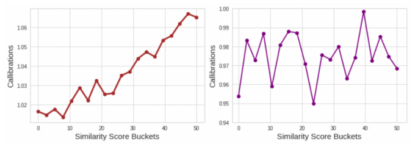
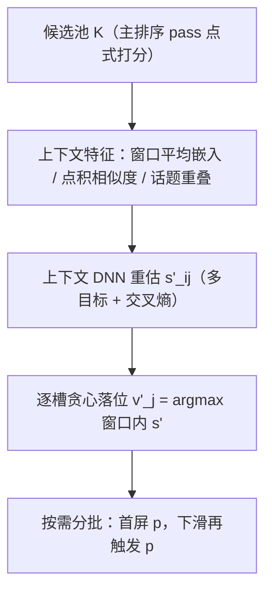
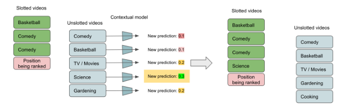

# CAViaR: Context Aware Video Recommendations (上下文感知的视频推荐)

- **会议/期刊**: WWW 2023 Companion (Industrial Track, 5 页短文)
- **作者与机构**: Khushhall Chandra Mahajan, Aditya Palnitkar, Ameya Raul, Brad Schumitsch (Meta Inc., Facebook Watch)
- **推荐链路定位**: 精排之后的轻量重排 (Contextual Pass)，主排序仍为点式 DNN
- **研究方向**: 多任务学习与列表级重排 / CTR 预估与特征交叉
- **论文原文**: [https://arxiv.org/abs/2304.08435v1](https://arxiv.org/abs/2304.08435v1)
- **开源代码**: 暂未开源

## TL;DR (1分钟核心速览)

Facebook Watch 的生产点式排序模型对每个视频独立打分，无法感知同一请求内已排在它上方的视频，导致列表内连续出现高度相似内容、且在高相似度槽位上系统性**过预测**（校准漂移 >4% 的样本占比达 40%）。CAViaR 不改任何主排序模型，只在精排后加一个"上下文通道"：构造 10 个廉价的窗口内相似度/话题重叠/平均嵌入特征，用同构 DNN 重估 $s'_{ij}$，并按"逐槽贪心 + 按需分批"重排。离线 NE 相对降低 0.85%–1.4%，线上 A/B 互动 +1.7%、DAU +1.5%（十亿级流量下的百万级 DAU 增量）。

## Background & Motivation (背景与核心矛盾)

- **主流范式**: 工业推荐仍以点式（point-wise）多目标 DNN 为主，对 $(u_i,v_j)$ 独立估概率并降序排列；多样性靠 MMR、相似度衰减、DPP、次模最大化等**启发式规则事后注入**。
- **前人局限**: ①启发式惩罚项与业务指标脱耦，需人工编码"相关性 vs 多样性"的硬 trade-off 系数，无法因人而异；②DPP 类方法需改造打分与索引基础设施，在超大流量栈中落地成本高。
- **核心洞察 (Key Insight)**: 作者用**模型校准**而非多样性指标切入——把校准值定义为 $\text{calibration}=\frac{\overline{\text{prediction}}}{\overline{\text{label}}}$（理想为 1），发现校准值随"当前视频与前 5 个视频的平均嵌入点积"单调上升（图 2 左）。即多样性缺失本质上是**特征缺失导致的校准偏差**，而不是一个独立优化目标。
- **本文切入点**: 把上下文当成特征喂给模型，让"去冗余"成为校准修正的副产品，用户与内容两端的多样性需求自动个性化。

<figure class="paper-figure" markdown="span">
  <figcaption>图2：来自主排序阶段的用户互动事件相对于多样性度量的校准（左），以及来自上下文模型的校准（右）</figcaption>
</figure>

## Method (核心方法设计)

### 1. 整体框架 (Overall Architecture)

两阶段串行：先由主排序 pass 产出 $K$个候选并按点式得分排好序；再进入上下文 pass，从第 1 个槽位开始，对当前槽位附近窗口$w$内候选重新打分（特征中注入"已落槽前缀视频"的统计量），取最高分者落槽，逐步向右推进得到最终$v'_j$。为控制延迟，只对首屏$p$个位置做重排，用户下滑时再以$p$个为一批触发后续迭代（$p \ll K$）。重排模型与主排序模型同构（同特征框架、同多目标、同交叉熵损失），可复用全部训练/serving 工具链。

<figure class="paper-figure" markdown="span">
  <figcaption>图1：在主排序阶段之后，我们按照最终排序顺序依次放置视频。</figcaption>
</figure>

### 2. 关键设计拆解 (Key Designs)

1. **上下文条件化打分（把列表状态写进样本）**：痛点是把 $s_{ij}=P(E(u_i,v_j)\mid F(u_i,v_j))$换成依赖前缀的形式却无处落地。本文直接以$s'_{ij}=P\big(E(u_i,v_j)\mid F'(u_i,v_j,v_{(j-1)},v_{(j-2)},\dots)\big)$ 为目标训练一个独立的上下文模型——训练时用**主排序产出的真实序列前缀**构造特征，使训练/推理分布一致，避免"用重排后序列训练、用主排序序列推理"的偏差。
2. **三类廉价上下文特征（关键在零新增基建）**：①窗口 $k$内视频预训练嵌入的均值；②当前视频与上方$k$ 个视频的嵌入点积（分别取单值与均值，作为相似度信号）；③自动打标的话题重叠度。全部复用栈内已有嵌入，无需新模型或新索引，这是它能"最小改动插入生产栈"的根本原因。
3. **逐槽贪心 + 按需重排（延迟工程）**：$v'_j=\arg\max_{x\in\{j,\dots,j+w\}} \lVert s'_{ux}\rVert$，在已落槽前缀条件下逐位取最大。开销从全列表$O(K\cdot n)$降为滚动批次的$O(p\cdot w)$，并借"用户只会看首屏$p$ 个"的行为先验把重排计算藏进滑动间隙。
4. **训练目标**: 多目标（每个正向互动事件一个头）+ 交叉熵；Adam，lr=0.005，batch=128，前 21 天数据训练后逐日增量再训练（单 pass）。无显式负采样（曝光级样本天然含负例），推理侧无需向量检索。

## Experimental Setup & Evaluation Protocol (实验设置与评估协议)

- **数据集与预处理**: 无公开数据集，全部为 Facebook App 生产流量日志（21 天 + 逐日增量），未报告用户/物品/交互规模与稀疏度：

| 数据源 | #Users | #Items | #Interactions | 特征/场景说明 |
| :--- | :---: | :---: | :---: | :--- |
| Facebook Watch 生产日志（21 天） | 未报告 | 十亿级视频库 | 未报告 | 用户/视频稀疏 ID 嵌入 + 10 个新增上下文特征 |
| 在线 A/B（真实流量） | 未报告 | 未报告 | 十亿级日互动 | Facebook Watch 视频 feed 实验组/对照组 |

- **数据划分与防穿越**: 采用**时间切分**（前 21 天训练 → 逐日增量），未说明是否做严格时间戳截断与特征回填，存在轻度穿越风险。
- **排名评测协议**: **非排序指标协议**——本文不报告 NDCG/HR/Recall，也不用 Full-Ranking 或 Sampled Ranking；离线只报告 **NE（预测对数损失/背景 CTR 熵，越低越好）** 与**校准曲线**，线上报告互动与 DAU 的 A/B 相对提升。
- **对比基线与超参**: 基线为不带上下文特征的同构生产点式模型（同一训练数据、同一多目标、同一损失），属于"控制变量式"自身消融；窗口 $w$、批大小$p$、嵌入维度$d$ 均未披露，也未报告显著性检验与置信区间。

## Key Experimental Results (实验关键数据)

### 1. 主实验对比 (Main Results)

| 评测对象 | 指标 | 点式基线 | CAViaR 上下文模型 | Improv. |
| :--- | :--- | :---: | :---: | :---: |
| 互动预测头 A（离线） | NE (↓) | 1.000 (归一) | — | **1.40%** |
| 互动预测头 B（离线） | NE (↓) | 1.000 (归一) | — | **1.20%** |
| 互动预测头 C（离线） | NE (↓) | 1.000 (归一) | — | **0.85%** |
| 相似度桶 >30 的子群（离线） | 校准偏差 >4% 样本占比 | ≈40% | 校准曲线趋于平坦 | 未量化 |
| 线上 A/B（真实流量） | Topline Engagement | 0 | — | **+1.7%** |
| 线上 A/B（真实流量） | DAU（正文称 daily activity） | 0 | — | **+1.5%~1.6%** |

> 说明：原文为工业短文，未给公开数据集上的 MMR / DPP / 次模最大化等多样性基线的数值对比，上表基线列以"同构无上下文特征模型"表示；三个离线头为不同互动目标，故 NE 增益不合并。

### 2. 消融实验 (Ablation Study)

原文仅报告"加入全部 10 个上下文特征"的联合效果，未给出逐组特征消融，下表按论文证据标注：

| 配置 | NE 相对增益 | 校准曲线 | 结论可读性 |
| :--- | :---: | :---: | :--- |
| w/o 上下文特征（点式基线） | 0 | 随相似度上升而过预测 | 基准 |
| + 仅窗口平均嵌入 | 未报告 | 未报告 | — |
| + 相似度（点积/均值）特征 | 未报告 | 未报告 | — |
| + 话题重叠度特征 | 未报告 | 未报告 | — |
| 全量 10 特征（完整 CAViaR） | **0.85%–1.40%** | 趋于平坦 | 主结论 |

### 3. 关键实验发现 (Key Findings)

1. **多样性缺口首先是校准缺陷而非排序缺陷**：相似度桶 >30 的样本中约有 40% 校准偏差超过 4%，而加入上下文特征后校准曲线在整个相似度区间上被拉平——这解释了为何只改损失输入即可同时提升相关性与多样性，无需 trade-off 超参。
2. **离线 NE 增益与线上增益同向且量级可观**：三个互动头 NE 相对降低 1.40%/1.20%/0.85%，对应线上互动 +1.7%；在十亿级日互动基线上，1.7% 互动与 1.5% DAU 的绝对增量即"数百万 DAU"，说明小比例 NE 改进在超大 DAU 产品上具有极高杠杆。
3. **线上指标随实验天数呈递增趋势**，作者据此推断用户满意度在累积（可能是序列上下文建模让模型学到"用户对该类重复内容的耐受度"这一隐变量），但该趋势也可能来自新奇效应或实验组逐步放量，原文未做排除。

## Highlights & Limitations (亮点、对比与审稿批判)

- **与代表作对比 (vs. Prior Work)**: 相比 MMR / 相似度衰减 / 次模最大化（Carbonell-Goldstein、Ziegler 等）依赖人工设定的相关-相似权重，本文把权衡交给模型学习；相比 YouTube 的 DPP 方案（需对打分与求解器做大改），本文只加一层同构 DNN 重排，几乎零基建改动；相比通用 listwise 重排（如 PRS/SetRank），本文不做全序列联合建模，而是**贪心逐槽条件化**，以精度换延迟。
- **可迁移亮点**: ①"用校准曲线诊断特征缺失"这一诊断范式，可直接迁移到位置偏差、流行度偏差等系统性偏差排查；②按需分批重排（首屏 $p$ + 滚动触发）是把任意重排模型搬上生产的通用延迟裁剪技巧。
- **审稿级局限批判**: ①**实验不可复现**：无公开数据集、无排序指标、无逐特征消融、无窗口/批大小/延迟毫秒数，NE 基线以"归一为 1"呈现使增益无法被外部校验；②**摘要与正文 DAU 数值不一致（1.5% vs 1.6%）且无显著性检验**；③贪心逐槽使用"自身重排后的前缀"作为条件，前缀误差会沿槽位累积，且训练用主排序序列、推理用重排序列，存在**训练-推理分布偏移**，长列表下可能放大位置偏差与自我强化回音室；④重排模型没有与主排序联合训练（作者列为 future work），线上延迟成本未量化。

## Rating (四维评分)

- **方法创新性 (Novelty)**: ⭐⭐⭐ （"多样性是校准问题"的视角转换新颖且实用，但模型结构本身是标准 DNN 加特征，算法贡献偏工程化）
- **评估协议与实验扎实度 (Protocol & Experiments)**: ⭐⭐ （仅有 NE 与校准曲线，无排序指标、无逐组消融、无公开数据与显著性检验，线上 A/B 是唯一强证据）
- **写作与数学规范度 (Clarity & Rigor)**: ⭐⭐⭐⭐ （5 页短文把动机—公式—算法—工程裁剪讲得极清楚，公式与符号定义干净，但缺复杂度与延迟的定量分析）
- **工业落地与复现价值 (Industrial & Practical Value)**: ⭐⭐⭐⭐ （最小侵入的 contextual pass + 按需分批重排，在任何点式大栈中都可低成本复制；但无开源代码，复现门槛高）

