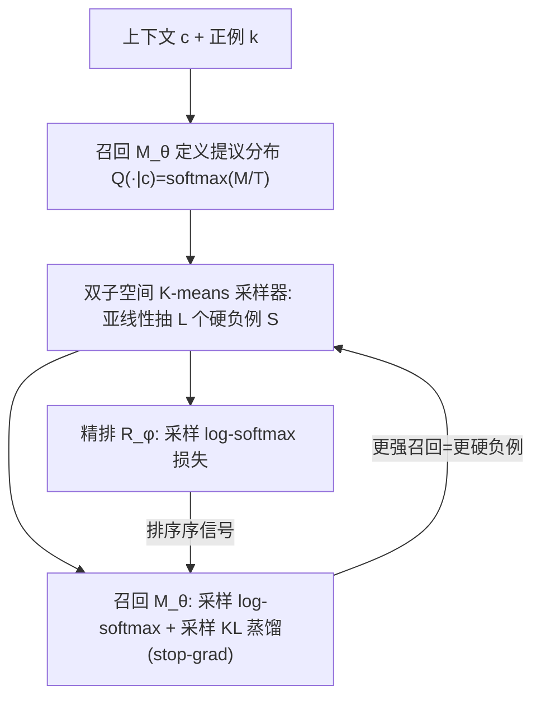
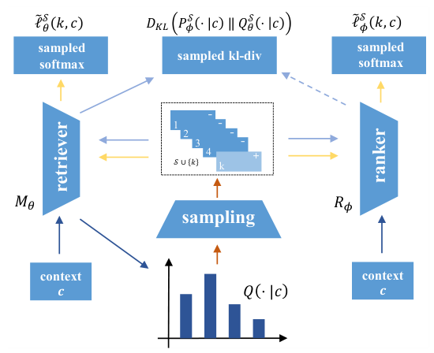

# Cooperative Retriever and Ranker in Deep Recommenders (深度推荐中协同的召回器与精排器)

- **会议/期刊**: WWW 2023 (The ACM Web Conference)
- **作者与机构**: Xu Huang, Defu Lian, Jin Chen, Zheng Liu, Xing Xie, Enhong Chen（USTC / UESTC / 微软亚洲研究院）
- **推荐链路定位**: 召回 + 精排的级联联合训练（coarse-to-fine）
- **研究方向**: 多任务学习与列表级重排 / 协同过滤与双塔召回
- **论文原文**: [https://arxiv.org/abs/2206.14649v2](https://arxiv.org/abs/2206.14649v2)
- **开源代码**: [https://github.com/AngusHuang17/CoRR_www](https://github.com/AngusHuang17/CoRR_www)

## TL;DR (1分钟核心速览)

两阶段推荐中召回（双塔内积）与精排（DeepFM/DIN）长期独立或简单串联训练，导致三个顽疾：精排只在随机“易负例”上训练、判别力早饱和；精排训练分布与召回推理输出分布在切换 top-k 截断时严重漂移；蒸馏只对齐绝对分数而忽略真正决定召回质量的**相对排序序**。CoRR 让二者互训：召回以带温度 $T$的 softmax 分布作为提议分布$Q$，用双子空间 K-means 做亚线性采样抽硬负例喂给精排；同时给出**渐近无偏的采样 KL 估计**把精排的排序序蒸馏回召回。在 Amazon/Gowalla/MovieLens/Taobao 四个数据集、通用与序列两类任务上，NDCG@10 相对最优基线提升 5.4%–18.1%。

## Background & Motivation (背景与核心矛盾)

- **主流范式**: 召回器用内积/余弦双塔 + ANN 索引做亚线性候选筛选；精排器用 DIN/DIEN/DeepFM 等重交叉网络对 top-100 精排。二者通常独立训练，或精排基于召回结果二次训练（RankFlow 用 top-k 采样互监督，ICC 做梯度级联）。
- **前人局限**: (1) 精排负例来自均匀随机或精确 top-k —— 前者过易、后者把“潜在正例”当负例，**假阴性**污染梯度且训练/推理物品分布不一致；(2) 蒸馏只约束绝对分数一致性（pointwise/回归），而召回真正需要的是**相对序一致**，导致召回几乎无法从精排获益（论文实测 RankFlow 中召回几乎不涨）。
- **核心洞察 (Key Insight)**: top-k 是“硬而偏”的采样，随机是“无偏而软”的采样，两者必须兼得；而只要采样点在**同一提议分布**下做重要性加权，log-softmax 与 KL 都能以 $O(L)$ 代价获得渐近无偏估计，从而把“全库 softmax”这一不可算目标变为可训练目标。
- **本文切入点**: 用召回模型自身定义的分布做提议分布，一套采样同时服务“精排抽硬负例”与“召回蒸馏”，形成互促闭环。

## Method (核心方法设计)

### 1. 整体框架 (Overall Architecture)

给定上下文 $c$与正例$k$，每一步先从召回定义的提议分布$Q(\cdot|c)$中抽$L$个候选$\mathcal{S}$；精排$R_\phi$在$\mathcal{S}\cup\{k\}$上计算采样 log-softmax 损失并更新（召回仅作采样器，梯度 stop）；召回$M_\theta$同时受两项监督：采样 log-softmax 的交互监督 + 与精排 softmax 预测对齐的采样 KL 蒸馏。随着训练推进，召回变强$\to$负例更硬$\to$精排判别力更强$\to$蒸馏信号更准$\to$ 召回排序序更对齐。

<figure class="paper-figure" markdown="span">
  <figcaption>图1：CoRR 的框架。上下文 𝑐 表示除物品外的所有信息。𝑄(·|𝑐) 表示给定上下文 𝑐 的提议分布。虚线表示停止梯度。3.1 概述</figcaption>
</figure>

### 2. 关键设计拆解 (Key Designs)

1. **自适应可扩展采样器（替代精确 top-k）**：直接对 $Q(i|c)=\exp(M_\theta(i,c)/T)/\sum_j\exp(M_\theta(j,c)/T)$采样需$O(|\mathcal{I}|)$。做法是把物品向量均分为两个子向量，各自 K-means 聚类，$E(i)\approx w^1_{k(i)}\oplus w^2_{k(i)}$；先按簇概率$P(k)\propto \psi_k\exp(\langle z_c^1,w_k^1\rangle)$采一簇，再条件采样第二子空间簇$P(k|k_1)\propto \omega_{k_1,k}\exp(\langle z_c^2,w_k^2\rangle)$，最后在交集$\Omega^1_{k_1}\cap\Omega^2_{k_2}$内均匀取物品。总复杂度$O(Kd+K^2+L)$，与物品数无关；$\omega_{k,k'}$查询无关可预计算。温度$T$连续调节“硬度—随机性”：$T\to\infty$退化为均匀采样，$T\to 0$ 退化为 argmax。
2. **渐近无偏的采样 KL 蒸馏（保序而非保分）**：全库 KL $D_{KL}(P_\phi\|P_\theta)$不可算。用同一提议分布的重要性权重定义$\tilde{R}_\phi(i,c)=R_\phi(i,c)-\log\tilde{Q}(i|c)$、$\tilde{M}_\theta(i,c)=M_\theta(i,c)-\log\tilde{Q}(i|c)$，在采样集上做 renormalize 得$P^\mathcal{S}_\phi,P^\mathcal{S}_\theta$，定理 3.1 证明$D_{KL}(P^\mathcal{S}_\phi\|P^\mathcal{S}_\theta)\xrightarrow{L\to\infty}D_{KL}(P_\phi\|P_\theta)$（概率 1）。特例$Q=P_\theta$时有推论：$D_{KL}\approx \log L-H(\mathrm{softmax}(\boldsymbol{\Delta}^c))$，其中$\Delta^c_i=R_\phi(i,c)-M_\theta(i,c)$—— 即**最小化 KL 等价于最大化“分差分布”的熵**，直觉上要求精排与召回在采样集上的相对次序尽量一致；$Q$ 为均匀时则退化为随机子集上的序匹配。
3. **训练目标、负采样与推理开销**：总损失 $\mathcal{L}=\tilde{\ell}^{\mathcal{S}}_\theta(k,c)+\lambda\,\hat{D}_{KL}(P^\mathcal{S}_\phi\|P^\mathcal{S}_\theta)+\tilde{\ell}^{\mathcal{S}}_\phi(k,c)$，其中采样 log-softmax 为$\tilde{\ell}^{\mathcal{S}}(k,c)=\log\frac{\exp(\cdot(k,c)-\log\tilde{Q}(k|c))}{\sum_{i\in\mathcal{S}\cup\{k\}}\exp(\cdot(i,c)-\log\tilde{Q}(i|c))}$（召回项把$R_\phi$换成$M_\theta$）。负采样为“分布内采样 + 重要性加权”，非均匀/批内负例；推理时召回走 FAISS/SCANN 取 top-100，精排重排，采样器只用于训练。

## Experimental Setup & Evaluation Protocol (实验设置与评估协议)

| 数据集 | #Users | #Items | #Interactions | 稀疏度/密度 | 特征/场景说明 |
| :--- | :---: | :---: | :---: | :---: | :--- |
| Amazon | 9,280 | 6,066 | 158,979 | 99.72% 稀疏 | 电子产品评论，通用推荐 |
| Gowalla | 29,859 | 40,989 | 1,027,464 | 99.92% 稀疏 | LBS 签到，时空行为 |
| MovieLens | 66,958 | 10,682 | 5,857,041 | 99.18% 稀疏 | 电影评分（取 10M 子集） |
| Taobao | 941,853 | 1,101,236 | 63,721,355 | 99.99% 稀疏 | 阿里工业点击行为 |

- **数据划分与防穿越**: 统一过滤交互数 $<10$的用户与物品（比常见 5-core 更严）。通用推荐按 **8:1:1 比例随机划分**；序列推荐用**前缀预测式划分**：训练集取$k=1,\dots,n-3$的全部前缀，验证集预测第$n-1$、测试集预测第$n$ 个物品，最大序列长度 20。
- **排名评测协议**: 无偏 **全库检索式** 评测 —— 召回对全物品打分取 top-100（无采样负例库），精排重排后统计 Recall@10 / NDCG@10 / MRR@10，不存在“1 正 + N 采样负”的快评口径。
- **对比基线与超参**: 通用推荐基线 BPR / NCF / LogisticMF / DSSM 及训练范式基线 Independent / ICC / RankFlow；序列推荐基线 GRU4Rec / BERT4Rec / Caser / SASRec。默认召回-精排组合 MF+DeepFM、SASRec+DIN，蒸馏权重 $\lambda$与温度$T$调优；显著性用$t$-test（$\triangle$表$p<0.05$，$\blacktriangle$表$p<0.001$）。

## Key Experimental Results (实验关键数据)

### 1. 主实验对比 (Main Results)

**通用推荐（NDCG@10，×10⁻²）**

| 方法 | Amazon | Gowalla | MovieLens | Taobao |
| :--- | :---: | :---: | :---: | :---: |
| BPR | 2.72 | 5.74 | 16.54 | 0.67 |
| NCF | 2.52 | 5.69 | 16.82 | 0.94 |
| DSSM | 2.52 | 4.32 | 13.88 | 0.83 |
| Independent (MF+DeepFM) | 2.68 | 6.17 | 17.49 | 1.04 |
| ICC | 2.74 | 6.18 | 17.96 | 1.12 |
| RankFlow | 2.82 | 6.34 | 18.73 | 1.24 |
| **CoRR** | **3.22** | **7.49** | **21.59** | **1.43** |
| Improv. vs best baseline | +14.2% | +18.1% | +15.3% | +15.3% |

**序列推荐（NDCG@10，×10⁻²）**

| 方法 | Amazon | Gowalla | MovieLens | Taobao |
| :--- | :---: | :---: | :---: | :---: |
| GRU4Rec | 2.61 | 4.75 | 7.78 | 0.42 |
| BERT4Rec | 2.81 | 7.74 | 7.52 | 0.61 |
| Caser | 2.46 | 4.67 | 8.55 | 0.30 |
| SASRec | 2.63 | 5.42 | 7.53 | 0.26 |
| Independent (SASRec+DIN) | 2.69 | 7.06 | 8.97 | 0.76 |
| ICC | 2.34 | 5.28 | 9.23 | 0.73 |
| RankFlow | 2.78 | 7.09 | 9.33 | 0.89 |
| **CoRR** | **3.07** | **8.31** | **9.83** | **1.01** |
| Improv. vs best baseline | +9.3% | +7.4% | +5.4% | +13.5% |

### 2. 消融实验 (Ablation Study)

| 数据集 | 指标 | w/o KL（召回） | w/ KL（召回） | w/o KL（CoRR） | w/ KL（CoRR） |
| :--- | :--- | :---: | :---: | :---: | :---: |
| Amazon | N@10 | 2.38 | 2.63 | 2.56 | **3.11** |
| Gowalla | N@10 | 6.65 | 7.88 | 6.97 | **8.38** |
| MovieLens | N@10 | 7.63 | 7.82 | 8.96 | **9.94** |
| 平均相对提升 | R@10 / N@10 / M@10 | — | +17.55% / +10.89% / +8.18% | — | — |

负采样器对比（图 2，相对 `rand` 基线的提升）：`toprand` 与 `top&rand` 均优于 `rand`，且 `top&rand > toprand`；本文采样器全部指标最优，Amazon/Gowalla 上相对 `rand` 提升约 20–30%。

### 3. 关键实验发现 (Key Findings)

1. **联合训练本身比“换更强单模”更值钱**：仅 Independent 的精排就把最优单召回提升 5.39%/5.16%/3.50%（R/N/M@10，通用任务），而 CoRR 相对 Independent 的 NDCG@10 平均提升达 **25.62%（通用）与 18.57%（序列）**，说明瓶颈在级联协同而非模型容量。
2. **蒸馏是主要增益来源而非负采样**：去掉 KL 后召回本身的 NDCG@10 在 MovieLens 仅 7.63、加回后 7.82，但级联整体从 8.96 跳到 9.94，说明精排的序信号经蒸馏放大到全库召回排序上；同时 CoRR 相对 RankFlow 仍 +15.72%/+11.62%（NDCG@10），佐证“保序蒸馏优于保分蒸馏”。
3. **采样偏差可被采样数治愈**：负例数从 10 增至 50 时指标单调上升（图 2 右列），与定理 3.1/采样 log-softmax 的渐近无偏性一致；模型无关性上，MF/DSSM/SASRec/Caser 配 DeepFM/DCN/DIN/BST 四组组合相对 Independent 均提升 15% 以上、相对 RankFlow 最高 +10%。

## Highlights & Limitations (亮点、对比与审稿批判)

- **与代表作对比**: vs. **Independent**（精排抽随机负例）—— CoRR 抽分布内硬负例并对齐序；vs. **RankFlow**（top-k 互监督 + 绝对分数/梯度级联）—— CoRR 用重要性加权消除 top-k 假阴性与分布漂移，且蒸馏目标是相对序而非绝对分；vs. **ICC**（梯度级联）—— CoRR 免去二阶梯度，精排与召回各自暴露于同一提议分布。
- **可迁移亮点**: (1) “用召回分布当提议分布 + 重要性加权”这一 trick 可直接套到任意全库 softmax 目标（如对比学习 InfoNCE 的降采样估计）；(2) 双子空间 K-means 采样器给出 $O(Kd+K^2+L)$ 的通用近似 softmax 采样原语，可替换 ANN 训练中的 hard-negative miner。
- **审稿级局限批判**: (1) 采样器依赖聚类残差，簇数 $K$与温度$T$ 需按数据集调参，论文仅给出敏感性曲线而未给自适应策略；(2) 每步需为召回与精排各做一次前向 + 一次分布采样，训练成本约为 Independent 的 2–3 倍，论文未报告训练 wall-clock 与显存开销；(3) 评测止于 top-100 精排的离线指标，缺少真实工业级在线 A/B 与延迟测量，Taobao 上的 Recall@10 仅 2.79（×10⁻²）也说明大规模场景仍难。

## Rating (四维评分)

- **方法创新性 (Novelty)**: ⭐⭐⭐⭐ （把“渐近无偏采样 KL/log-softmax + 双子空间采样器”组合成召回-精排互训闭环，理论有定理与推论支撑，但组件本身多为已知技术的巧妙重组）
- **评估协议与实验扎实度 (Protocol & Experiments)**: ⭐⭐⭐⭐ （四数据集 + 通用/序列双任务 + 全库排序口径 + 显著性检验 + 四组模型无关性验证，唯缺线上实验与训练开销）
- **写作与数学规范度 (Clarity & Rigor)**: ⭐⭐⭐⭐ （采样偏差分析、定理与两个特例推论链条清晰，但部分推导置于附录、主文对 $\lambda$与$T$ 的取值交代简略）
- **工业落地与复现价值 (Industrial & Practical Value)**: ⭐⭐⭐⭐ （模型无关、可直接插到现有召回-精排管线，代码开源；代价是训练成本上升与聚类索引需随召回模型迭代重建）

