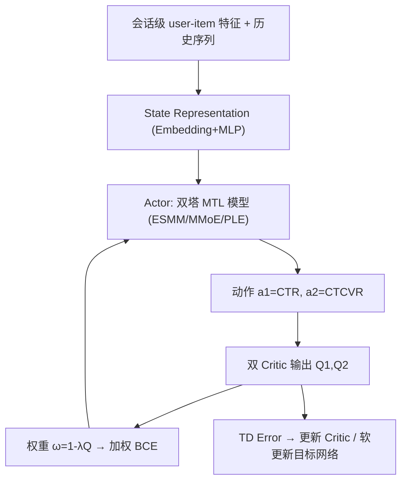
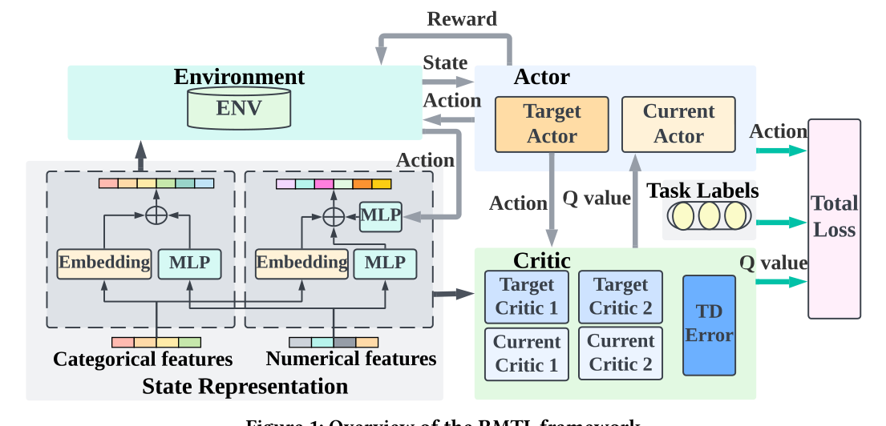

# Multi-Task Recommendations with Reinforcement Learning (强化学习增强的多任务推荐)

- **会议/期刊**: WWW 2023 (The Web Conference)
- **作者与机构**: Ziru Liu, Jiejie Tian, Xiangyu Zhao 等（香港城市大学）; Qingpeng Cai, Shuchang Liu, Dong Zheng, Peng Jiang（快手）; Kun Gai
- **推荐链路定位**: 精排（CTR/CTCVR 多目标预估）
- **研究方向**: 多任务学习与列表级重排 / 强化学习与动态探索推荐
- **论文原文**: [https://arxiv.org/abs/2302.03328v2](https://arxiv.org/abs/2302.03328v2)
- **开源代码**: [https://github.com/Applied-Machine-Learning-Lab/RMTL](https://github.com/Applied-Machine-Learning-Lab/RMTL)

## TL;DR (1分钟核心速览)

现有 MTL 推荐模型基于 item-wise 样本、以固定权重线性标量化多目标损失，既丢失了会话内时序依赖，也无法感知任务难度的动态变化。本文提出 RMTL：把会话级交互构造成 MDP，以现成 MTL 模型为 Actor、每任务一个 Critic 网络估计 Q 值，用 $\omega_{k,t}=1-\lambda Q(s_t,a_{k,t};\phi_k)$ 生成动态损失权重。在 RetailRocket 与 Kuairand-1K 上，CTR AUC 最高提升 0.0042（+0.57%），并可即插即用地增强 ESMM/MMoE/PLE。

## Background & Motivation (背景与核心矛盾)

- **主流范式**: ESMM / MMoE / PLE 一类模型在共享底层上分任务塔，损失为 $\sum_k \omega_k \mathrm{BCE}_k$，$\omega_k$为常数或仅随时间常数衰减（$\omega'_{k,t}=\omega'_{k,0}\gamma'^t$）。
- **前人局限**: ① 输入是 item-wise 采样而非 session-wise 序列，短时视频场景中点击/转化天然发生在会话内有强时序相关性，item-wise 建模丢弃了这种 session 模式；② 固定权重无法反映训练过程中任务难度的迁移变化，线性标量化难以保证全局最优收敛。
- **核心洞察 (Key Insight)**: 会话级多目标优化可等价改写为"最小化加权累计 BCE"，而 BCE 的负值恰可作 RL 的 reward，于是"权重分配"变成"策略评估"问题——用 Critic 估计的累计奖励反过来决定各任务损失权重。
- **本文切入点**: 不改动 MTL 网络结构，只在训练目标上做 RL 化改造，因此对几乎所有 MTL 骨干兼容。

## Method (核心方法设计)

### 1. 整体框架 (Overall Architecture)

数据按 `session id + timestamp` 重排为会话序列并放入 replay buffer。前向：State Representation Network（Embedding + MLP）编码 user-item 特征得 $s_t$；Actor（即被增强的 MTL 模型，双塔）输出确定性动作$(a_{1,t},a_{2,t})$作为 CTR/CTCVR 预测；Critic 共享底层 + 双塔输出各任务 Q 值，并据此给出损失权重，计算加权 BCE。反向：先按 TD error 更新 Critic，再用含动态权重的总损失更新 Actor，目标网络软更新（$\beta=0.2$）。Actor 先以 MTL 预训练参数初始化并冻结，待 Critic 收敛后再联合调优。

<figure class="paper-figure" markdown="span">
  <figcaption>图 1：RMTL 框架概览。</figcaption>
</figure>

### 2. 关键设计拆解 (Key Designs)

1. **会话级 MDP 构造（Session-wise MDP）**：痛点是以往 RL 推荐按"用户行为流"对齐，而多目标标签只在同一会话内可比；本文以 session 划分 transition，$s_t$为当前 user-item 特征，$P(s_{t+1}|s_t,a_t)=\mathbb{I}(s_{t+1}=s_{t+1}^{seq})$直接由数据顺序确定（概率为 1），$\gamma=0.95$。由此 Critic 评估的是"该会话剩余步的累计 BCE 收益"，权重更新天然具备 session 视角。
2. **奖励即负 BCE 的权重映射（Critic-weighted Loss）**：定义 $r_{k,t}=y_{k,t}\log a_{k,t}+(1-y_{k,t})\log(1-a_{k,t})$，则最大化累计 reward 与最小化会话级 BCE 等价。Critic 用$Q(s_t,a_{k,t};\phi_k)=r_{k,t}+\gamma Q(s_{t+1},a_{k,t+1};\phi_k)$ 估计累计收益，并以
$$\omega_{k,t}=1-\lambda\, Q(s_t,a_{k,t};\phi_k),\quad \lambda=0.7$$
反比映射为损失权重。直觉：$Q$越负（该任务当前预测越差、可提升空间越大），权重越大，从而把梯度预算向"欠拟合任务"倾斜；若改用常数权重或直接取$-Q$（NLC），则失去这一有界缩放，性能下降。
3. **训练目标、负采样与推理效率**：总损失 $\mathcal{L}(\theta_1,\theta_2)=\sum_{(s_t,\cdot)\in b}\sum_{k=1}^{2}\omega_{k,t}\,\mathrm{BCE}(\pi(s_t;\theta_k),y_{k,t})$；Critic 侧以$\delta=\frac{1}{2|b|}\sum\sum_k\big[TD_{k,t}-Q_{k,t}\big]$做梯度下降，目标网络$\tilde\theta_k=\beta\tilde\theta_k+(1-\beta)\theta_k$ 抑制发散。**无负采样设计**（逐样本二分类）；推理阶段仅保留 Actor，与原始 MTL 模型复杂度完全一致，RL 组件只在训练期存在。

## Experimental Setup & Evaluation Protocol (实验设置与评估协议)

- **数据集与预处理**（原文未报告精确规模统计，仅说明来源与双标签设置）：

| 数据集 | #Users | #Items | #Interactions | 稀疏度/密度 | 特征/场景说明 |
| :--- | :---: | :---: | :---: | :---: | :--- |
| RetailRocket | — | — | — | — | 电商行为序列，含 click / pay 双标签与 session id、时间戳 |
| Kuairand-1K | — | — | — | — | 快手短视频，click 与转化类双标签，短会话强时序 |

- **数据划分与防穿越 (Splitting Strategy)**: 按时间戳 $t$ 排序后 `6:2:2` 比例划分 train/valid/test（时序比例切分）。
- **排名评测协议 (Ranking Protocol)**: 非 Full-Ranking、非负采样排序，而是**逐样本二分类概率评估**：AUC、Logloss，另加会话平均损失 `s-Logloss`（近似线上 A/B 的更严指标）；显著性为双侧 t-test $p<0.05$，AUC/Logloss 变化 >0.001 视为显著。
- **对比基线与超参设置**: SingleTask、SharedBottom、ESMM、MMoE、PLE、D-PLE（DDPG+PLE，唯一 RL 基线）；embedding 维度 128，底层 MLP 128×512×256，塔层 256×128×64×1，专家数 8，dropout 0.2，Adam $lr=1e{-3}$，actor/critic 学习率均为 0.001，$\lambda=0.7$，$\beta=0.2$。

## Key Experimental Results (实验关键数据)

### 1. 主实验对比 (Main Results)

| 数据集 / 任务 | 指标 | SharedBottom | ESMM | MMoE | PLE | D-PLE | RMTL-ESMM | RMTL-MMoE | RMTL-PLE | Improv. |
| :--- | :--- | :---: | :---: | :---: | :---: | :---: | :---: | :---: | :---: | :---: |
| RetailRocket CTR | AUC↑ | 0.7287 | 0.7282 | 0.7309 | 0.7308 | 0.7308 | 0.7338* | **0.7350*** | 0.7339* | +0.57% |
| RetailRocket CTR | Logloss↓ | 0.2048 | 0.2031 | 0.2021 | 0.2056 | 0.2058 | 0.2024 | **0.1995** | 0.2013 | −1.3% |
| RetailRocket CTCVR | AUC↑ | 0.7304 | 0.7316 | 0.7347 | 0.7387 | 0.7386 | 0.7341 | 0.7396 | **0.7419*** | +0.43% |
| Kuairand CTR | AUC↑ | 0.7018 | 0.7009 | 0.7014 | 0.7026 | 0.7025 | 0.7031 | 0.7029 | **0.7053*** | +0.38% |
| Kuairand CTCVR | AUC↑ | 0.7310 | 0.7350 | 0.7324 | 0.7339 | 0.7339 | **0.7377*** | 0.7345 | 0.7367* | +0.37% |

`*` 表示相对最佳基线的显著提升；粗体为全表最优。

### 2. 消融实验 (Ablation Study)

| 变体 (RetailRocket, PLE 骨干) | CTR AUC↑ | CTR Logloss↓ | CTCVR AUC↑ | CTCVR Logloss↓ |
| :--- | :---: | :---: | :---: | :---: |
| CW（常数权重=1，无策略梯度） | 0.7308 | 0.2056 | 0.7387 | 0.0486 |
| WL（权重=标签×Q） | 0.7323 | 0.2218 | 0.7411 | 0.0485 |
| NLC（权重直接取 $-Q$） | 0.7325 | 0.2020 | 0.7418 | 0.0481 |
| **RMTL-PLE (本文)** | **0.7339** | **0.2013** | **0.7419** | **0.0480** |

### 3. 关键实验发现 (Key Findings)

1. **动态权重本身贡献最大、线性变换再增益**：CW→NLC 单靠引入 Critic 权重即在 CTR AUC 上 +0.0017、CTCVR +0.0031；再加入 $1-\lambda Q$ 线性有界映射再 +0.0014/+0.0001，说明"权重形式"比"是否用 RL"更关键。
2. **可迁移性成立**：用 ESMM/MMoE/PLE 三种骨干预训练的 Critic 交叉套用到其他 MTL 模型（图 4），AUC 全部上升、Logloss 全部下降，表明 Critic 学到的是**任务难度信号而非骨干特定偏置**，可作为通用插件。
3. **收益集中在高相关任务组合，会话级指标提升有限**：Kuairand CTCVR 上 ESMM 类（0.7377）反超 MMoE/PLE，说明点击-转化强相关时样本空间建模更优；而 `s-Logloss` 提升普遍 <0.001，作者归因于会话级指标更接近线上真实难度——这也暴露了收益量级偏小的问题。

## Highlights & Limitations (亮点、对比与审稿批判)

- **与代表作对比 (vs. Prior Work)**: 与 PLE/MMoE 的本质区别是不改表征结构、只改**损失权重生成机制**（PLE 用门控分配专家，RMTL 用 Q 值分配梯度）；与 D-PLE（DDPG 直接优化策略）的区别在于本文 Actor 仍是监督式 MTL 模型、RL 只作用于 loss 加权，训练更稳、且能复用预训练权重。
- **可迁移亮点**: ① "奖励=负 BCE ⇒ 权重=1−λQ"的有界缩放技巧可移植到任何多目标损失加权（含排序损失）；② 冻结预训练 Actor、待 Critic 收敛后再解冻的两阶段训练，是避免 RL 早期破坏表征的廉价手段。
- **审稿级局限批判**: ① **评估协议偏弱**——只报告逐样本 AUC/Logloss，没有做全库 Full-Ranking 或 Top-K（HR/NDCG），对推荐排序场景的说服力有限；② 权重方向基于"任务越难权重越大"，缺乏收敛性证明，且 $\lambda$、$\beta$、$\gamma$ 均未做敏感性分析，训练额外引入两套 Critic + 两套目标网络，工业训练开销明显上升（推理无增益）；③ 仅 2 个数据集、2 个任务（K=2），未验证 K>2 时是否 scale。

## Rating (四维评分)

- **方法创新性 (Novelty)**: ⭐⭐⭐⭐ （"负 BCE 即奖励"的等价改写把 MTL 权重分配转成策略评估，思路干净且与骨干解耦，但 RL+动态加权的组合在 CTR 领域已有近亲）
- **评估协议与实验扎实度 (Protocol & Experiments)**: ⭐⭐⭐ （仅逐样本 AUC/Logloss + s-Logloss，无 Full-Ranking/Top-K 与超参敏感性，数据集只有两个且无统计规模披露）
- **写作与数学规范度 (Clarity & Rigor)**: ⭐⭐⭐⭐ （MDP 五元组、TD 目标、软更新推导完整清晰；但式(1)(3)的等价性仅作陈述，权重有界性与收敛性未证明）
- **工业落地与复现价值 (Industrial & Practical Value)**: ⭐⭐⭐⭐ （代码开源且提供 7 个 MTL 基线的统一库，插件式改造几乎零推理成本，训练端额外开销需权衡）

