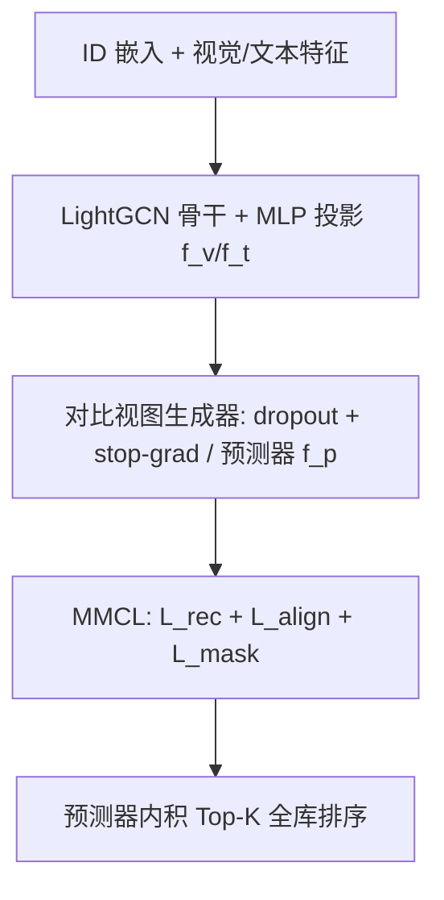
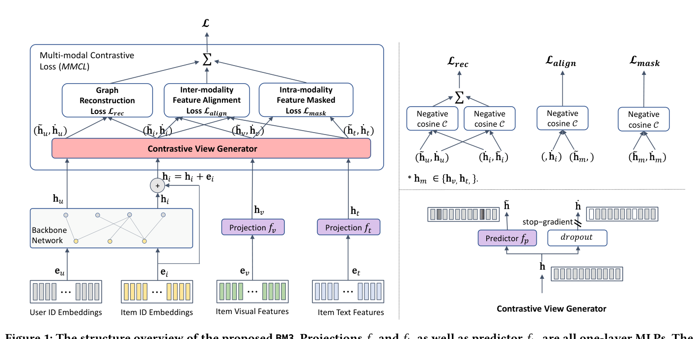

# Bootstrap Latent Representations for Multi-modal Recommendation (多模态推荐的自举潜在表征学习)

- **会议/期刊**: WWW 2023 (Proceedings of the ACM Web Conference 2023)
- **作者与机构**: Xin Zhou, Hongyu Zhou, Yong Liu, Zhiwei Zeng, Chunyan Miao (南洋理工大学 NTU)；Pengwei Wang, Yuan You, Feijun Jiang (阿里巴巴/蚂蚁集团)
- **推荐链路定位**: 召回 (Top-K 全库排序)
- **研究方向**: 多模态推荐 / 自监督对比学习与交互去噪
- **论文原文**: [https://arxiv.org/abs/2207.05969v3](https://arxiv.org/abs/2207.05969v3)
- **开源代码**: [https://github.com/enoche/BM3](https://github.com/enoche/BM3)

## TL;DR (1分钟核心速览)

现有多模态推荐（MMGCN/DualGNN/LATTICE）依赖辅助图（user-user、item-item）做 GCN 传播，构图与训练显存/时间开销随图规模爆炸；同时沿用 BPR 均匀负采样，既昂贵又引入假阴性噪声。BM3 提出**免负采样、免辅助图**的自监督框架：在编码器之后用简单的**隐层 dropout** 自举出对比视图，配合 stop-gradient + 预测器（SimSiam 式）避免坍缩，并设计多模态对比损失 MMCL 联合优化「交互图重构 + 跨模态对齐 + 模态内掩码」。在 Amazon Baby/Sports/Electronics 三个 5-core 数据集、**全库 Full-Ranking** 协议下，R@10 相对最优基线提升 3.68%/6.15%/20.39%，Sports 上每 epoch 训练时间 3.03s（LATTICE 10.71s）。

## Background & Motivation (背景与核心矛盾)

- **主流范式**: 以 LightGCN 为骨干，把图像的 4096 维视觉特征与文本句向量投影到 ID 隐空间；代表工作进一步在 user-user 共现图或 item-item 语义图上传播聚合（DualGNN、LATTICE、GRCN 图精炼）。
- **前人局限 ①（显存/时间）**: 辅助图构建与传播代价极高——LATTICE 在 Sports 上单 epoch 需 19.93GB 显存、10.71s；DualGNN 在 Electronics 上仅构建 user-user 关系图就要约 138GB 与 6 小时，且 LATTICE 在 Electronics 直接 OOM 无法训练。
- **前人局限 ②（负采样噪声）**: BPR 的均匀负采样在 LightGCN 中占每 epoch 超过 25% 训练时间，且被采样的"负样本"可能是真实正交互（假阴性），带来噪声监督。
- **核心洞察 (Key Insight)**: 自监督学习（BYOL/SimSiam/BUIR）证明只用正样本也能学到可比表征；关键的防坍缩手段是 **预测器 + stop-gradient**，而数据增广不必发生在图结构上——**发生在隐层表征上同样能构造有效对比视图**，且完全绕开辅助图。
- **本文切入点**: 把增广从"输入侧图扰动"下移到"编码后潜变量 dropout"，用一条统一的 MMCL 损失把多模态信号注入到**损失函数**而非图结构里，从而去掉负采样与辅助图两大开销。

## Method (核心方法设计)

### 1. 整体框架 (Overall Architecture)

输入三类信号：用户 ID 嵌入 $\mathbf{e}_u$、物品 ID 嵌入$\mathbf{e}_i$（经 LightGCN 骨干在 user-item 二部图上线性传播，物品侧加残差连接缓解过平滑），以及视觉/文本原始特征经单层 MLP 投影$f_v,f_t$得到与 ID 同维的模态表征。编码输出$\mathbf{h}_u,\mathbf{h}_i,\mathbf{h}_v,\mathbf{h}_t$后进入**对比视图生成器**：一路做隐层 dropout 得到目标视图并 stop-gradient，另一路经共享单层 MLP 预测器$f_p$得到在线视图。最后三项目标联合优化：交互图重构损失$\mathcal{L}_{rec}$、跨模态对齐损失$\mathcal{L}_{align}$、模态内掩码损失$\mathcal{L}_{mask}$。推理时直接用预测器输出做内积打分：$s(\mathbf{h}_u,\mathbf{h}_i)=\tilde{\mathbf{h}}_u\cdot\tilde{\mathbf{h}}_i^{\top}$。

<figure class="paper-figure" markdown="span">
  <figcaption>图1：所提出的 BM3 的结构概览。投影 𝑓𝑣 和 𝑓𝑡 以及预测器 𝑓𝑝 均为一层 MLP。预测器 𝑓𝑝 的参数在对比视图生成器（左下）中共享，用于 ID 嵌入和多模态潜在表示。</figcaption>
</figure>

### 2. 关键设计拆解 (Key Designs)

1. **潜在表征 dropout 取代图增广（Contrastive View Generator）**：痛点起因是图增广需第二张图/第二个编码器，显存翻倍且扰动不可控。BM3 直接把增广推迟到编码之后：$\dot{\mathbf{h}}=\mathbf{h}\odot\mathrm{Bernoulli}(p)$，在线路走$\tilde{\mathbf{h}}=\mathbf{h}\mathbf{W}_p+\mathbf{b}_p$。因为 dropout 只扰动同一表征的子维、语义漂移极小，目标视图与在线视图天然"同义"，无需动量目标网络即可稳定对比，参数量相比 BYOL/BUIR 减少约一半。
2. **免负样本的交互图重构（$\mathcal{L}_{rec}$）**：用对称负余弦相似度替代 BPR，把"正样本对的预测"作为唯一监督：
$\mathcal{L}_{rec}=\mathcal{C}\big(\tilde{\mathbf{h}}_u,sg(\dot{\mathbf{h}}_i)\big)+\mathcal{C}\big(sg(\dot{\mathbf{h}}_u),\tilde{\mathbf{h}}_i\big)$，其中$\mathcal{C}(\mathbf{x},\mathbf{y})=-\frac{\mathbf{x}^{\top}\mathbf{y}}{\|\mathbf{x}\|_2\|\mathbf{y}\|_2}$。
stop-gradient 阻断目标侧梯度，仅在在线侧回传，避免两侧同步收敛到常数解（坍缩）；直觉上模型在学习"用带噪视角去预测干净视角"，等价于一种无需负样本的 InfoNCE 上界松弛。
3. **跨模态对齐 + 模态内掩码（$\mathcal{L}_{align},\mathcal{L}_{mask}$）**：$\mathcal{L}_{align}=\mathcal{C}(\tilde{\mathbf{h}}_i^{m},sg(\dot{\mathbf{h}}_i))$把视觉/文本表征拉向其 ID 目标视图，实现"以 ID 为锚的模态注入"；$\mathcal{L}_{mask}=\mathcal{C}(\tilde{\mathbf{h}}_i^{m},sg(\dot{\mathbf{h}}_i^{m}))$对模态表征再掩码一次，迫使预测器从稀疏子维恢复完整语义。总损失$\mathcal{L}=\mathcal{L}_{rec}+\mathcal{L}_{align}+\mathcal{L}_{mask}+\lambda(\|\mathbf{h}_u\|_2^2+\|\mathbf{h}_i\|_2^2)$。**负采样策略：完全免负采样**；推理无额外开销（仅多一次 MLP 前向），复杂度$O(2L|\mathcal{E}|d/B+\sum_m|\mathcal{I}|d_md+(2+2|\mathcal{M}|)dB)$，与 LightGCN 同量级。

## Experimental Setup & Evaluation Protocol (实验设置与评估协议)

- **数据集与预处理**: Amazon Review 三个类目，**user 与 item 双向 5-core 过滤**；视觉特征为已发布 4096 维（CNN），文本为 title+description+category+brand 拼接后经 sentence-transformers 得 384 维。

| 数据集 | #Users | #Items | #Interactions | 稀疏度/密度 | 特征/场景说明 |
| :--- | :---: | :---: | :---: | :---: | :--- |
| Baby | 19,445 | 7,050 | 160,792 | 99.88% | 小规模，母婴类目 |
| Sports | 35,598 | 18,357 | 296,337 | 99.95% | 中等规模，户外运动 |
| Electronics | 192,403 | 63,001 | 1,689,188 | 99.99% | 大规模，消费电子 |

- **数据划分与防穿越 (Splitting Strategy)**: 沿用 DualGNN/LATTICE 设定，对**每个用户交互历史做 8:1:1 随机划分**（train/valid/test），采用早停（以验证集 R@20 为停止指标，patience=20，总 epoch 上限 1000）。
- **排名评测协议 (Ranking Protocol)**: **无偏 Full-Ranking（all-ranking）**——把用户未交互过的全部物品作为候选集排序，不使用负采样评估；指标 Recall@{10,20} 与 NDCG@{10,20}。
- **对比基线与超参设置**: 通用模型 BPR / LightGCN / BUIR（自监督），多模态模型 VBPR / MMGCN / GRCN / DualGNN / LATTICE。统一 $d=64$、Xavier 初始化、Adam（lr=0.001）；BM3 网格搜索 GCN 层数$\{1,2\}$、dropout$\{0.3,0.5\}$、$\lambda\in\{0.1,0.01\}$。所有模型集成在 MMRec 平台以保证公平。

## Key Experimental Results (实验关键数据)

### 1. 主实验对比 (Main Results)

| Dataset | Metric | LightGCN | BUIR | VBPR | GRCN | DualGNN | LATTICE | **BM3** | Improv. |
| :--- | :--- | :---: | :---: | :---: | :---: | :---: | :---: | :---: | :---: |
| Baby | R@10 | 0.0479 | 0.0506 | 0.0423 | 0.0532 | 0.0448 | 0.0544 | **0.0564** | +3.68% |
| Baby | R@20 | 0.0754 | 0.0788 | 0.0663 | 0.0824 | 0.0716 | 0.0848 | **0.0883** | +4.13% |
| Baby | N@20 | 0.0328 | 0.0342 | 0.0284 | 0.0358 | 0.0309 | 0.0369 | **0.0383** | +3.79% |
| Sports | R@10 | 0.0569 | 0.0467 | 0.0558 | 0.0559 | 0.0568 | 0.0618 | **0.0656** | +6.15% |
| Sports | R@20 | 0.0864 | 0.0733 | 0.0856 | 0.0877 | 0.0859 | 0.0947 | **0.0980** | +3.48% |
| Sports | N@20 | 0.0387 | 0.0329 | 0.0384 | 0.0389 | 0.0385 | 0.0422 | **0.0438** | +3.79% |
| Electronics | R@10 | 0.0363 | 0.0332 | 0.0293 | 0.0349 | 0.0363 | OOM | **0.0437** | +20.39% |
| Electronics | R@20 | 0.0540 | 0.0514 | 0.0458 | 0.0529 | 0.0541 | OOM | **0.0648** | +19.78% |
| Electronics | N@20 | 0.0250 | 0.0232 | 0.0202 | 0.0241 | 0.0248 | OOM | **0.0302** | +21.77% |

效率对比（Sports / Electronics）：BM3 显存 3.58GB / 8.28GB、每 epoch 3.03s / 73.31s；LATTICE 为 19.93GB / OOM、10.71s；MMGCN 为 3.91GB / 14.54GB、16.60s / 470.15s；DualGNN 为 12.60s / 341.02s。BM3 相对最优多模态基线**显存约减半、训练快 2–9×**。

### 2. 消融实验 (Ablation Study)

| Variant | Baby R@10 | Baby R@20 | Sports R@10 | Sports R@20 | Elec. R@10 | Elec. R@20 |
| :--- | :---: | :---: | :---: | :---: | :---: | :---: |
| BM3 w/o v&t (=w/o mm) | 0.0506 | 0.0793 | 0.0600 | 0.0927 | 0.0427 | 0.0633 |
| BM3 w/o t | 0.0518 | 0.0820 | 0.0641 | 0.0976 | 0.0423 | 0.0632 |
| BM3 w/o v | 0.0522 | 0.0828 | 0.0647 | 0.0968 | 0.0423 | 0.0633 |
| BM3 w/o inter | 0.0542 | 0.0842 | 0.0614 | 0.0941 | 0.0393 | 0.0593 |
| BM3 w/o intra | 0.0526 | 0.0830 | 0.0633 | 0.0947 | 0.0410 | 0.0619 |
| **BM3 (full)** | **0.0564** | **0.0883** | **0.0656** | **0.0980** | **0.0437** | **0.0648** |

### 3. 关键实验发现 (Key Findings)

1. **自监督本身即强基线，"无模态"也不弱**：BM3 w/o v&t（仅交互图 + 无负采样对比重构）在 Baby 上 R@10=0.0506，已超过 VBPR(0.0423)、DualGNN(0.0448) 甚至接近 LATTICE 之前的最佳多模态模型；说明显式 BPR 负采样并非必需，交互图重构 + 隐层扰动足以提供有效梯度。
2. **多模态收益与数据规模呈反向关系**：在 Baby/Sports 上加入双模态把 R@10 从 0.0506→0.0564（+11.5%）、0.0600→0.0656（+9.3%），但在 Electronics 上仅 0.0427→0.0437（+2.3%），且移除 $\mathcal{L}_{inter}$ 反而降到 0.0393——大规模图上的协同信号本身已足够强，粗粒度模态信号可能成为噪声，这是本文最诚实的经验结论。
3. **文本与视觉不等价、且需联合建模**：Baby 上 w/o v (0.0522) 略优于 w/o t (0.0518)，说明 4096 维视觉特征噪声更大；但单模态均逊于双模态，验证"以 ID 为锚 + 两路对齐"优于任一单路注入。

## Highlights & Limitations (亮点、对比与审稿批判)

- **与代表作对比 (vs. Prior Work)**: 相比 **BUIR**，BM3 去掉动量目标网络与图增广，参数量减半且性能一致更好（Sports R@20 0.0980 vs 0.0733）；相比 **LATTICE**，把多模态信息从"构图"搬到"损失"，避免 $O(|\mathcal{I}|^2d_m+|\mathcal{I}|^3)$ 的 item-item 相似度矩阵开销，并在 Electronics 上从 OOM 变为可训练；相比 **DualGNN**，完全不构造 user-user 共现图（省 138GB 预处理）。
- **可迁移亮点**: ① "编码后 dropout + 预测器 + stop-gradient"这套增广下移范式可直接迁移到序列推荐/CTR 的对比正则，零构造成本；② 用 ID 嵌入作锚、模态表征作被对齐侧的单向对齐，天然规避了模态缺失场景的表征坍塌。
- **审稿级局限批判**: ① 大规模 Electronics 上模态与对齐损失增益近乎为零甚至负向，缺少对"何时该启用模态分支"的定量判据或自适应门控；② 目标视图依赖 dropout 随机性，论文仅给出 dropout=0.2 以上的稳定性曲线，未讨论方差敏感度与多次采样平均的收益；③ 未与基于 Uniform/Hard Negative 的最新去噪负采样方法正面比较，免负采样在稀疏度 99.99% 的极端长尾物品上是否弱于精调负采样尚不清楚。

## Rating (四维评分)

- **方法创新性 (Novelty)**: ⭐⭐⭐⭐ （把 BYOL/SimSiam 的增广位置下移到隐层，用一条 MMCL 统一图重构与跨/模态内对齐，思路简洁但非全新机制）
- **评估协议与实验扎实度 (Protocol & Experiments)**: ⭐⭐⭐⭐⭐ （三尺度数据集、全库 Full-Ranking、8 个基线 + 效率表 + 特征/损失双消融 + 超参热力图，含 OOM 与 138GB 预处理等真实成本披露）
- **写作与数学规范度 (Clarity & Rigor)**: ⭐⭐⭐⭐ （公式紧凑、复杂度列成 MMGCN/GRCN/DualGNN/LATTICE 对照表，但部分符号如 $\dot{\mathbf{h}}/\tilde{\mathbf{h}}$排版易混，$f_p$ 参数共享范围描述略含糊）
- **工业落地与复现价值 (Industrial & Practical Value)**: ⭐⭐⭐⭐⭐ （代码开源并集成 MMRec，免负采样 + 免辅助图使训练 2–9× 加速、显存减半，对大规模电商多模态召回可直接落地）

