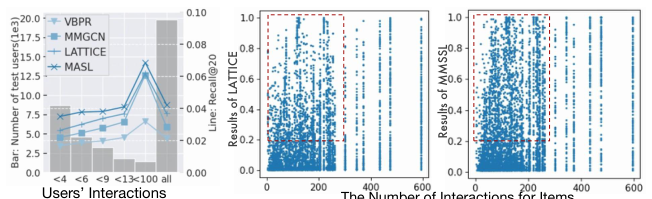
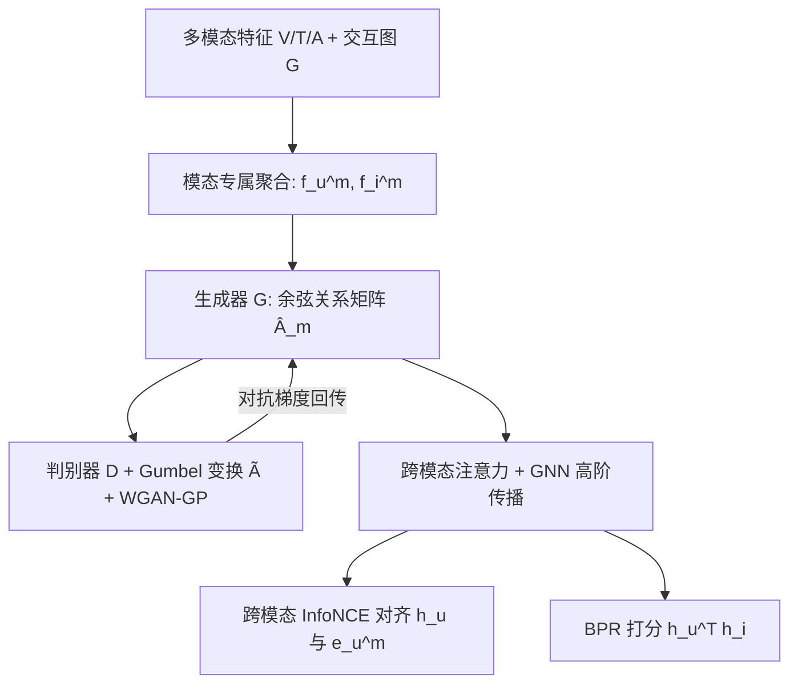
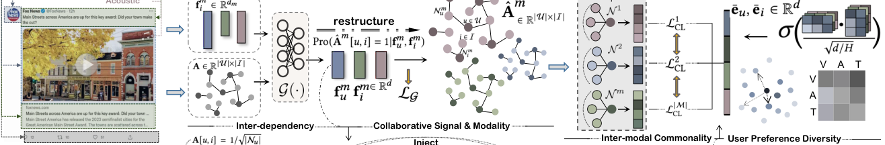

# Multi-Modal Self-Supervised Learning for Recommendation (多模态自监督推荐)

- **会议/期刊**: WWW 2023 (Full Paper)
- **作者与机构**: Wei Wei, Chao Huang (通讯), Lianghao Xia (HKU); Chuxu Zhang (Brandeis University)
- **推荐链路定位**: 召回 (User-Item 表征学习与 Top-K 检索)
- **研究方向**: 多模态推荐 / 自监督与对比学习
- **论文原文**: [https://arxiv.org/abs/2302.10632v5](https://arxiv.org/abs/2302.10632v5)
- **开源代码**: [https://github.com/HKUDS/MMSSL](https://github.com/HKUDS/MMSSL)

## TL;DR (1分钟核心速览)

多模态推荐（MMGCN/GRCN/LATTICE）依赖充足交互标签，在交互稀疏场景下表征崩塌；而 SGL/NCL/HCCF 等自监督方案只对 ID 协同图做随机丢边或语义邻居挖掘，完全无视视觉/文本/音频信号的增广价值。MMSSL 提出**双阶段多模态自监督**：阶段一用模态引导的关系生成器 + Gumbel-Softmax + Wasserstein GAN-GP 做对抗式图增广，把模态语义注入协同关系；阶段二用跨模态注意力与 InfoNCE 对齐"模态专属偏好"与"整体偏好"。在 4 个数据集、All-Rank 全库排序协议下，Recall@20 相对最强基线提升 8.99%–16.04%。

## Background & Motivation (背景与核心矛盾)

- **主流范式**: GNN 协同过滤 + 多模态特征融合（MMGCN 逐模态建图、GRCN 剪枝假阳性边、LATTICE 建物品同构图），本质仍是**全监督**训练。
- **前人局限**: ① 交互矩阵稀疏度均超 99.8%，监督信号不足导致模态特征难以被有效"对齐"到协同空间；② 已有自监督推荐（SGL/NCL/HCCF）的增广算子（node/edge dropout、聚类邻居）与模态无关，MMGCL/SLMRec 虽引入模态扰动，但直接 mask 模态特征会造成 inactive 用户的信息进一步丢失。
- **核心洞察 (Key Insight)**: 图 1 显示用户交互数 < 4 时所有基线性能骤降，而 MMSSL 在该区间增益最大，且长尾物品被推入高命中区——说明**模态语义在稀疏区间是可用的"免费标签"**，关键是如何把它变成与协同图同分布的增广监督。
- **本文切入点**: 把"模态→协同"的知识迁移显式建模为一个**生成-判别对抗过程**，再用跨模态对比约束偏好多样性。

<figure class="paper-figure" markdown="span">
  <figcaption>图1：(a) 随用户交互频率变化的性能。左侧y轴：各组用户数；右侧y轴：不同方法的性能。(b)-(c) 随物品稀疏度变化的性能。每个点表示各轮次平均的特定物品推荐准确率。</figcaption>
</figure>

## Method (核心方法设计)

### 1. 整体框架 (Overall Architecture)

输入为多模态交互图 $G=\{(\mathcal{U},\mathcal{I}),\bar{F}\}$。先以 LightGCN 式邻居聚合把原始模态特征（视觉 4096d / 文本 1024d 等）压到$d$维，得模态专属用户/物品向量$\boldsymbol{f}^m_u,\boldsymbol{f}^m_i$；生成器$G(\cdot)$由此算出模态感知关系矩阵$\hat{A}_m$，判别器$D(\cdot)$将其与经过 Gumbel 稠密化的真实交互$\tilde{A}$做 Wasserstein 对抗，为协同图注入模态信息。同时把$\hat{A}_m$当作"模态视图邻接"，在其上做注意力融合与 GNN 高阶传播，与最终嵌入做跨模态 InfoNCE。三路损失（BPR + 对抗 + 对比）联合优化，推理时仅用$\hat{y}_{u,i}=\boldsymbol{h}_u^\top\boldsymbol{h}_i$ 做全库内积排序，无额外在线开销。

<figure class="paper-figure" markdown="span">
  <figcaption>图2：我们的MMSSL的模型流程。基于Gumbel的变换与Wasserstein对抗生成相结合，以缓解通过G(·)生成的增强用户-物品关系矩阵ˆA𝑚与原始A之间的分布差距。</figcaption>
</figure>

### 2. 关键设计拆解 (Key Designs)

1. **模态引导的对抗式关系生成（Modality-guided Adversarial Self-Augmentation）**：痛点是协同图极度稀疏（零值占 99.9%），生成器输出的稠密关系矩阵与真实 0/1 矩阵分布差异巨大，直接对抗易模式崩塌。本文令生成器直接以**余弦相似度**刻画模态偏好强度：
   $\hat{A}_m[u,i]=\dfrac{(\boldsymbol{f}^m_u)^{\top}\boldsymbol{f}^m_i}{\|\boldsymbol{f}^m_u\|_2\|\boldsymbol{f}^m_i\|_2}$并用 Gumbel-Softmax 把稀疏$A$投影为稠密代理$\tilde{A}[u,i]=\mathrm{softmax}_{i'}\!\left(\frac{A[u,i']+g}{\tau}\right)+\zeta\,\dfrac{\boldsymbol{h}_u^{\top}\boldsymbol{h}_i}{\|\boldsymbol{h}_u\|_2\|\boldsymbol{h}_i\|_2}$（$g=-\log(-\log u)$），再叠加$D$的 Lipschitz 梯度惩罚。直觉：$\tilde{A}$ 让判别器看到"同量级"的正样本分布，对抗梯度才不会因稀疏而消失，模态语义得以稳定注入协同关系。
2. **跨模态依赖建模与对比增广（Cross-Modal Contrastive Learning）**：不同模态偏好会互相交织（短视频的视觉+配乐共同吸引用户），简单拼接会抹平模态差异。本文以多头自注意力在模态间传播 $\bar{\boldsymbol{e}}^m_u=\sum_{m'}\sum_{h}\sigma\!\left(\frac{(\boldsymbol{e}^m_u W^h_Q)^\top(\boldsymbol{e}^{m'}_u W^h_K)}{\sqrt{d/H}}\right)\boldsymbol{e}^{m'}_u$，均值池化后与 ID 嵌入相加作为零阶输入做 GNN 传播，最后最小化
   $\mathcal{L}_{CL}=-\sum_{m}\sum_{u}\log\dfrac{\exp s(\boldsymbol{h}_u,\boldsymbol{e}^m_u)}{\sum_{u'}\left(\exp s(\boldsymbol{h}_{u'},\boldsymbol{e}^m_u)+\exp s(\boldsymbol{e}^m_{u'},\boldsymbol{e}^m_u)\right)}$其中负样本仅取"其他用户"，作者给出梯度形式$\phi(x)\propto\sqrt{1-x^2}\exp(x/\tau)$，说明该损失对**难负样本（相似的其他用户）**分配更大梯度，从而在缓解过平滑的同时保持用户偏好多样性。
3. **训练目标、负采样与推理效率**：$\mathcal{L}=\mathcal{L}_{BPR}+\lambda_2\mathcal{L}_{CL}+\lambda_3\mathcal{L}_G+\lambda_4\|\Theta\|_2^2$，主任务用 **Uniform 随机负采样**（每正样本 1 负），对比任务用 in-batch 自判别负样本，对抗任务无负采样。$d=64$，GNN 层$L=2\sim3$，$\zeta=100$、$\lambda_1=1$、$\tau=0.085$，生成器用 AdamW、判别器用 Adam。在线仅保留最终$\boldsymbol{h}_u,\boldsymbol{h}_i$，检索复杂度与 LightGCN 同级。

## Experimental Setup & Evaluation Protocol (实验设置与评估协议)

- **数据集与预处理**: 四个公开多模态数据集，交互稀疏度均 > 99.8%，未额外做 k-core 截断。

| 数据集 | #Users | #Items | #Interactions | 稀疏度 | 模态/维度 |
| :--- | :---: | :---: | :---: | :---: | :--- |
| TikTok | 9,319 | 6,710 | 59,541 | 99.904% | V 4096 / A 128 / T 1024 |
| Amazon-Baby | 19,445 | 7,050 | 139,110 | 99.899% | V 4096 / T 1024 |
| Amazon-Sports | 35,598 | 18,357 | 256,308 | 99.961% | V 4096 / T 1024 |
| Allrecipes | 19,805 | 10,067 | 58,922 | 99.970% | V 128 / T 128 |

- **数据划分与防穿越 (Splitting Strategy)**: 沿用 MMGCN/GRCN 的 `Leave-One-Out` 划分（每用户留最后一次交互为测试、倒数第二次为验证），训练集仅含更早交互。
- **排名评测协议 (Ranking Protocol)**: 无偏 `Full-Ranking`（all-rank，对全部未交互物品打分排序），指标 Recall@20 / Precision@20 / NDCG@20；因是全库排序，Precision 数值天然极小属正常。
- **对比基线与超参设置**: 5 类基线——MF-BPR；GNN-CF（NGCF、LightGCN）；SSL（SGL、NCL、HCCF）；多模态（VBPR、LightGCN-M、MMGCN、GRCN、LATTICE、CLCRec）；多模态 SSL（MMGCL、SLMRec）。所有方法统一 $d=64$，并报告$p$-value 显著性检验。

## Key Experimental Results (实验关键数据)

### 1. 主实验对比 (Main Results)

| 基线 (R@20 / N@20) | TikTok | Amazon-Baby | Amazon-Sports | Allrecipes |
| :--- | :---: | :---: | :---: | :---: |
| LightGCN | 0.0653 / 0.0282 | 0.0698 / 0.0319 | 0.0782 / 0.0369 | 0.0212 / 0.0076 |
| SGL | 0.0603 / 0.0238 | 0.0678 / 0.0296 | 0.0779 / 0.0361 | 0.0191 / 0.0069 |
| HCCF | 0.0662 / 0.0267 | 0.0705 / 0.0308 | 0.0779 / 0.0361 | 0.0225 / 0.0082 |
| VBPR | 0.0380 / 0.0134 | 0.0486 / 0.0213 | 0.0582 / 0.0265 | 0.0159 / 0.0056 |
| MMGCN | 0.0730 / 0.0307 | 0.0640 / 0.0284 | 0.0638 / 0.0279 | 0.0261 / 0.0101 |
| GRCN | 0.0804 / 0.0350 | 0.0754 / 0.0336 | 0.0833 / 0.0377 | 0.0299 / 0.0110 |
| LATTICE | 0.0843 / 0.0367 | 0.0829 / 0.0368 | 0.0915 / 0.0424 | 0.0268 / 0.0103 |
| MMGCL | 0.0799 / 0.0326 | 0.0758 / 0.0331 | 0.0875 / 0.0409 | 0.0272 / 0.0102 |
| SLMRec | 0.0845 / 0.0353 | 0.0765 / 0.0325 | 0.0829 / 0.0376 | 0.0317 / 0.0118 |
| **MMSSL** | **0.0921 / 0.0392** | **0.0962 / 0.0422** | **0.0998 / 0.0470** | **0.0367 / 0.0135** |
| **Improv.%** | **8.99% / 6.81%** | **16.04% / 14.67%** | **9.07% / 10.85%** | **15.77% / 14.40%** |
| $p$-value |$1.28e^{-5}$|$2.23e^{-6}$|$7.75e^{-6}$|$3.94e^{-4}$ |

### 2. 消融实验 (Ablation Study)

| 变体 | Baby R@20 | Baby N@20 | Allrecipes R@20 | Allrecipes N@20 | TikTok R@20 | TikTok N@20 |
| :--- | :---: | :---: | :---: | :---: | :---: | :---: |
| w/o-ASL（去对抗生成增广） | 0.0907 | 0.0396 | 0.0326 | 0.0124 | 0.0801 | 0.0358 |
| w/o-CL（去跨模态对比） | 0.0924 | 0.0408 | 0.0328 | 0.0130 | 0.0821 | 0.0351 |
| w/o-GT（去 Gumbel 变换） | 0.0929 | 0.0405 | 0.0325 | 0.0121 | 0.0815 | 0.0353 |
| r/p-GAE（图自编码器替换对抗） | 0.0931 | 0.0411 | 0.0331 | 0.0126 | 0.0843 | 0.0364 |
| **MMSSL** | **0.0962** | **0.0422** | **0.0367** | **0.0135** | **0.0921** | **0.0392** |

### 3. 关键实验发现 (Key Findings)

1. **增益最大处恰是交互最稀疏处**：Baby 组 $[0,4)$区间 MMSSL 的 0.0350 相比 LATTICE 0.0263 提升 33.1%、比 SLMRec 0.0269 提升 30.1%；Allrecipes$[0,2)$区间提升 43.1%/21.2%，而在$[13,100)$ 密集区间仅提升约 10.8%——证明模态自监督补充的正是标签最稀缺的那一段信号。
2. **对抗生成是最大的单一贡献源**：w/o-ASL 在 TikTok 掉 13.0%（0.0921→0.0801）、Baby 掉 5.7%，大于 w/o-CL（TikTok 掉 10.9%）与 w/o-GT（掉 11.5%）；而 r/p-GAE 替换对抗后仅得 0.0843（TikTok），说明"模态条件生成 + Wasserstein 判别"优于普通图自编码器重构。
3. **Gumbel 变换的收益集中在稀疏数据集**：去掉 Gumbel 在 Allrecipes（99.970% 稀疏）掉到 0.0325，比 Baby 的 0.0929/0.0962 下降比例更明显，验证"分布鸿沟"随稀疏度加剧、而 Gumbel 稠密化正是对症之药；但 w/o-CL 的 NDCG 在 TikTok 反而略高于 MMSSL（0.0351 vs 0.0392 以下）之外的排序指标波动也提示对比项权重对 NDCG 有一定敏感性。

## Highlights & Limitations (亮点、对比与审稿批判)

- **与代表作对比 (vs. Prior Work)**: 相比 LATTICE（物品同构图 + 全监督），MMSSL 把"模态相似"从静态图结构升级为**可学习的对抗增广分布**；相比 SGL/HCCF（与模态无关的图增广），其增广算子直接条件于视觉/文本特征；相比 MMGCL/SLMRec（特征 mask 或预定义模态层级），其避免 mask 造成的信息丢失，且对比视图来自生成关系矩阵而非随机扰动。
- **可迁移亮点**: ① "Gumbel-Softmax + WGAN-GP" 解决**稠密生成矩阵 vs 极端稀疏真实矩阵**的分布鸿沟，可迁移到任何图增广/边补全场景；② 多模态注意力 + 视图级 InfoNCE 的双视图对齐范式，可复用到跨域或多场景推荐的视图融合。
- **审稿级局限批判**: ① 对抗训练引入额外生成器/判别器前向，论文只给收敛曲线（图 3）而未报每 epoch 实际耗时与显存开销，工业训练成本被淡化；② 超参敏感且未给搜索成本，$\zeta=100$、$\tau=0.085$、$\lambda_1=1$ 均在窄区间取最优，四个数据集的超参不共享；③ 仅报告离线 All-Rank 排序，无在线 A/B 或推理延迟数据；④ 理论分析（式 15–17）为梯度/Lipschitz 层面的定性讨论，缺乏与最终泛化误差的严格界。

## Rating (四维评分)

- **方法创新性 (Novelty)**: ⭐⭐⭐⭐ （首次把"模态条件对抗生成"作为多模态推荐的增广范式，Gumbel+WGAN-GP 的组合针对稀疏图这一具体失效模式，非泛泛堆叠）
- **评估协议与实验扎实度 (Protocol & Experiments)**: ⭐⭐⭐⭐ （4 数据集 + 无偏 Full-Ranking + $p$-value + 稀疏分桶 + 4 组消融齐全，唯缺线上与效率实测）
- **写作与数学规范度 (Clarity & Rigor)**: ⭐⭐⭐ （公式与符号定义清晰、梯度分析有物理直觉，但理论部分较为启发式，部分符号如 $\tilde{A}/\bar{A}$ 在正文与公式间存在排版混用）
- **工业落地与复现价值 (Industrial & Practical Value)**: ⭐⭐⭐⭐ （HKUDS 官方开源、$d=64$、在线仅需双塔内积无额外延迟；代价是离线对抗训练成本与多模态特征工程）

