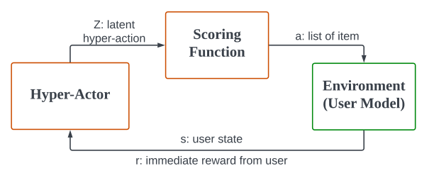
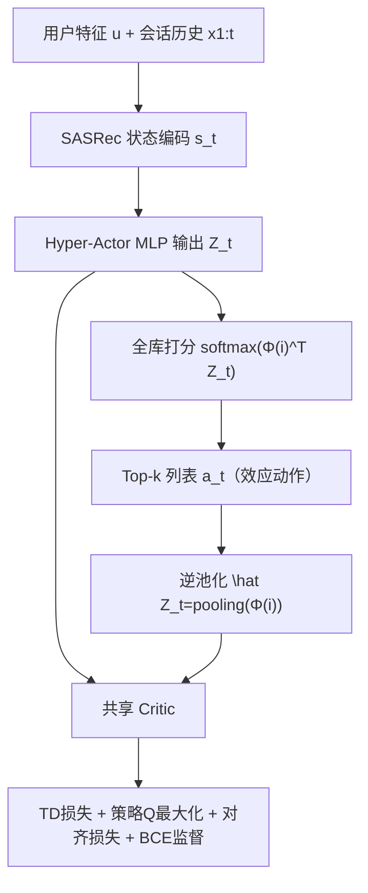
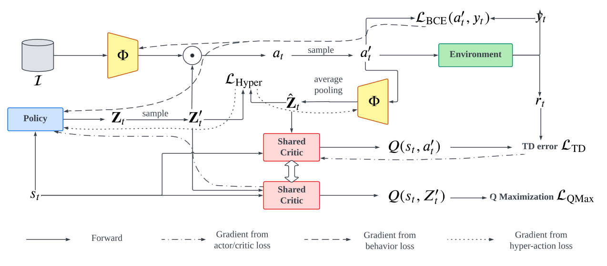

# Exploration and Regularization of the Latent Action Space in Recommendation (推荐中潜在动作空间的探索与正则化)

- **会议/期刊**: Proceedings of the ACM Web Conference 2023 (WWW '23)
- **作者与机构**: Shuchang Liu, Qingpeng Cai, Bowen Sun 等；快手、北京大学、香港城市大学、罗格斯大学等
- **推荐链路定位**: 重排/列表推荐；会话级端到端策略学习
- **研究方向**: 强化学习与动态探索推荐 / 序列与会话推荐
- **论文原文**: [https://arxiv.org/abs/2302.03431v2](https://arxiv.org/abs/2302.03431v2)
- **开源代码**: [RL4RS 环境/数据仓库](https://github.com/fuxiAIlab/RL4RS)（模型代码未在正文明确）

## TL;DR (1分钟核心速览)

针对 RL 推荐中“列表动作空间为 $\mathcal{I}^k$且候选池动态增长”导致策略难学习、探索低效的问题，本文提出 Hyper-Actor Critic (HAC)：策略先输出连续潜在超动作$\boldsymbol{Z}_t$，再由打分函数生成 top-$k$ 效应动作列表；actor 在超动作空间探索，critic 在真实列表空间评估，并用逆池化对齐两空间、BCE 监督稳定训练。在 RL4RS、ML1M、KuaiRand 的模拟在线环境（时间戳 80/20 划分、交互深度≤20）上，Total Reward 相比最佳基线提升约 5.86%、1.26%、2.74%。

## Background & Motivation (背景与核心矛盾)

- **主流范式**: 将用户会话建成 MDP，用 A2C/DDPG/TD3 等 actor-critic 方法优化累计奖励；状态编码常采用 SASRec 等序列模型。
- **前人局限**: 动作空间是固定长度列表 $\mathcal{A}=\mathcal{I}^k$，组合爆炸且候选池动态变化；A2C 直接在效应动作上探索，方差大、样本效率低；DDPG 在 latent 动作上学习，但潜在向量与真实列表之间没有一致性保证，PG-RA 又主要对齐效应动作而非 actor 使用的超动作。
- **核心洞察 (Key Insight)**: 用户与物品可共享同一 kernel 嵌入空间，列表生成可视为“超动作 $\to$ 打分排序”的确定性映射；真正的瓶颈不是动作维度，而是两个动作空间的分布不一致与探索噪声尺度。
- **本文切入点**: 用超动作做 actor 端到端学习与探索，用效应动作训练 critic 保证评估准确，再以逆池化和监督项做正则化。

<figure class="paper-figure" markdown="span">
  <figcaption>图1：含潜在超动作的MDP形式化</figcaption>
</figure>

## Method (核心方法设计)

### 1. 整体框架 (Overall Architecture)

输入用户静态特征 $\boldsymbol{u}$与会话历史$\boldsymbol{x}_{1:t}$，SASRec 状态编码器得到$\boldsymbol{s}_t$；Hyper-Actor MLP 输出潜在超动作$\boldsymbol{Z}_t\sim\mathcal{N}(\boldsymbol{Z}_t,\sigma_Z^2)$。打分函数对全库物品计算$\Phi(i)^{\top}\boldsymbol{Z}_t$，经 softmax 后 top-$k$选择效应动作列表$\boldsymbol{a}_t$。训练时共享 critic 同时评估$Q(\boldsymbol{s}_t,\boldsymbol{Z}_t)$与$Q(\boldsymbol{s}_t,\boldsymbol{a}_t)$，逆池化模块从列表重建$\hat{\boldsymbol{Z}}_t$，并联合 TD 损失、策略 Q 最大化、超动作对齐和 BCE 监督。推理时一次超动作前向 + 全库打分 + top-$k$，无额外序列解码。

<figure class="paper-figure" markdown="span">
  <figcaption>图2：Hyper-Actor Critic (HAC)学习框架。⊙表示从I中选择条目的评分函数，</figcaption>
</figure>

### 2. 关键设计拆解 (Key Designs)

1. **潜在超动作分解与共享 Critic**：解决列表动作组合爆炸与评估不准。策略写成 $\pi(\boldsymbol{a}_t|\boldsymbol{s}_t)=\int P(\boldsymbol{a}_t|\boldsymbol{Z}_t)P(\boldsymbol{Z}_t|\boldsymbol{s}_t)\,\mathrm{d}\boldsymbol{Z}_t$，打分$score(i|\boldsymbol{Z}_t)=\Phi(i)^{\top}\boldsymbol{Z}_t$；critic 用$Q(\boldsymbol{s}_t,\boldsymbol{Z}_t)=g(\boldsymbol{s}_t,\boldsymbol{Z}_t)$评估超动作，用$Q(\boldsymbol{s}_t,\boldsymbol{a}_t)=g(\boldsymbol{s}_t,\hat{\boldsymbol{Z}}_t)$ 评估真实列表。直觉：actor 在低维连续空间探索，critic 在用户实际反馈的列表空间校准价值。

2. **逆池化对齐与 kernel 映射**：解决两动作空间不一致导致的 mode collapse 与推理偏差。定义 $\hat{\boldsymbol{Z}}_t=pooling(\Phi(i)\mid i\in\boldsymbol{a}_t)$，并用$\mathcal{L}_{Hyper}=\mathbb{E}\|\boldsymbol{Z}_t-\hat{\boldsymbol{Z}}_t\|^2$ 约束超动作落在候选物品 kernel 空间的有效区域。物理直觉：让“生成列表”和“为列表编码”互为逆映射，使 actor 梯度能通过共享 critic 可靠回传。

3. **监督稳定、负采样与推理开销**：RL 奖励是列表级聚合信号，单物品反馈更细粒度。加入 $\mathcal{L}_{BCE}=\sum_{i\in\boldsymbol{a}_t}[y_{t,i}\log P(i|\boldsymbol{Z}_t)+(1-y_{t,i})\log(1-P(i|\boldsymbol{Z}_t))]$；总目标$\mathcal{L}=\mathcal{L}_{TD}+\mathcal{L}_{QMax}+\lambda_h\mathcal{L}_{Hyper}+\lambda_s\mathcal{L}_{BCE}$，其中$\mathcal{L}_{QMax}=\mathbb{E}[Q(\boldsymbol{s}_t,\boldsymbol{Z}_t)]$实际以最小化其负值实现。训练使用 replay buffer，BCE 使用曝光反馈，不做额外负采样；推理为$O(Nd)$全库打分 + top-$k$，大候选池需 ANN 近似但原文未验证。

## Experimental Setup & Evaluation Protocol (实验设置与评估协议)

- **数据集与预处理**: 统一为（用户特征、历史、曝光物品、反馈、时间戳）序列；未采用 5-core 过滤，保留原始会话记录。

| 数据集 | #Users | #Items | #Interactions | 稀疏度/密度 | 特征/场景说明 |
| :--- | :---: | :---: | :---: | :---: | :--- |
| RL4RS | - | 283 | 781,367 | 未报告 | BigData Cup 2021 会话数据；列表 $k=9$ |
| MovieLens-1M | 6,400 | 3,706 | 1,000,208 | 未报告 | 电影评分；列表 $k=10$ |
| KuaiRand-1K | 986 | 11,643 | 969,831 | 未报告 | 短视频序列推荐；列表 $k=10$ |

- **数据划分与防穿越**: 按记录时间戳前 80% 训练、后 20% 评估；训练环境用训练集预训练，评估环境用全量数据预训练，策略只在训练环境交互、在独立评估环境测试，避免直接穿越。
- **排名评测协议**: 非传统 Full-Ranking/Sampled Ranking。采用模拟在线用户响应器做 session 级策略评估，报告 Total Reward、Depth 与 Reward Variance；奖励为物品级奖励均值，$\gamma=0.9$，交互深度≤20。
- **对比基线与超参设置**: 基线含 Offline SL、Online SL、A2C、DDPG、TD3、PG-RA；backbone 为 SASRec，列表长度 $k=9/10/10$，训练约 50k 迭代，网格搜索超参；原文未报告显著性检验。

## Key Experimental Results (实验关键数据)

### 1. 主实验对比 (Main Results)

| 模型 | RL4RS TR | RL4RS Depth | ML1M TR | ML1M Depth | KuaiRand TR | KuaiRand Depth |
| :--- | ---: | ---: | ---: | ---: | ---: | ---: |
| Offline SL | 6.721 | 8.163 | 18.559 | 18.717 | 14.394 | 14.982 |
| Online SL | 9.502 | 10.571 | 18.629 | 18.780 | 13.456 | 14.147 |
| A2C | 7.789 | 9.140 | 16.158 | 16.556 | 12.460 | 13.250 |
| DDPG | 8.337 | 9.588 | 17.205 | 17.508 | 11.394 | 12.313 |
| TD3 | 8.553 | 9.791 | 17.545 | 17.814 | 11.777 | 12.664 |
| PG-RA | 8.561 | 9.728 | 18.466 | 18.633 | 10.859 | 11.814 |
| **HAC (本文)** | **10.059** | **11.102** | **18.863** | **18.988** | **14.789** | **15.335** |
| Improv.% vs best baseline | +5.86% | +5.02% | +1.26% | +1.11% | +2.74% | +2.36% |

### 2. 消融实验 (Ablation Study)

原文图 8 仅给出 ML1M 上的趋势，方差未给具体数值；下表汇总可读数值与方向性结论。

| 变体 | ML1M Total Reward | Reward Variance | 结论 |
| :--- | ---: | :---: | :--- |
| DDPG（≈ w/o 对齐 + w/o BCE） | 17.205 | 较高 | 仅用超动作学 critic，评估偏差大 |
| HAC w/o $\mathcal{L}_{BCE}$ | ≈17.2 | 较高 | 去掉监督后与 DDPG 接近，长期收益不足 |
| HAC w/o $\mathcal{L}_{Hyper}$ | <18.863 | 较高 | 去掉对齐后一致性与稳定性下降 |
| **HAC** | **18.863** | **最低** | 对齐 + 监督协同最优 |

### 3. 关键实验发现 (Key Findings)

1. **大动作空间收益更明显但绝对提升有限**：RL4RS 上 HAC 较 Online SL 提升 5.86% TR、5.02% Depth；ML1M/KuaiRand 相对最佳基线仅提升 1.26%/2.74%，说明 latent 分解能缓解但未完全消除列表组合爆炸。
2. **A2C 与 DDPG 呈互补失效模式**：ML1M 上 A2C(16.158) 明显弱于 SL，而 KuaiRand 最大动作空间中 A2C(12.460) 反超 DDPG(11.394)，证明“直接在效应动作探索”和“纯超动作学习”各有偏置；HAC 通过共享 critic 与对齐同时修正两者。
3. **对齐与监督缺一不可，探索空间选择关键**：消融显示去掉 $\mathcal{L}_{BCE}$或$\mathcal{L}_{Hyper}$均降低 TR 并增大 reward variance；$\lambda_h=0.1$优于$0$和$1$，且超动作高斯噪声存在中间最优方差，effect-action 的 categorical 探索反而次优。

## Highlights & Limitations (亮点、对比与审稿批判)

- **与代表作对比 (vs. Prior Work)**: 相比 DDPG，HAC 将 critic 训练放在真实效应动作空间，避免 latent 评估失真；相比 PG-RA，本文对齐 actor 使用的超动作而非仅对齐效应动作；相比 Online SL，保留长期累计奖励优化。
- **可迁移亮点**: “共享 critic + 逆池化对齐”可迁移到生成式列表推荐、组合动作 RL 与多任务重排；用 BCE 监督作为 RL 辅助损失可显著稳定稀疏奖励训练。
- **审稿级局限批判**: 评估依赖离线数据训练的用户响应模拟器，真实线上动态性与策略偏移未验证；未报告显著性检验，消融仅有趋势图而缺少完整数值与方差；$\sigma_Z$、$\lambda_h$敏感，且全库打分$O(Nd)$ 对百万级候选池的在线延迟仍需 ANN/负采样工程化验证。

## Rating (四维评分)

- **方法创新性 (Novelty)**: ⭐⭐⭐⭐ （将列表 RL 动作分解为超动作/效应动作，并用逆池化对齐，机制清晰且有物理直觉）
- **评估协议与实验扎实度 (Protocol & Experiments)**: ⭐⭐⭐ （三数据集与多种 RL/SL 基线较完整，但依赖模拟器、无显著性检验、消融数值不足）
- **写作与数学规范度 (Clarity & Rigor)**: ⭐⭐⭐⭐ （MDP、损失与算法流程定义清楚，公式简洁；对多对一映射的理论保证仍偏弱）
- **工业落地与复现价值 (Industrial & Practical Value)**: ⭐⭐⭐ （开源 RL4RS 环境有复现价值，真实工业部署的全库打分与探索方差调参仍需额外验证）

