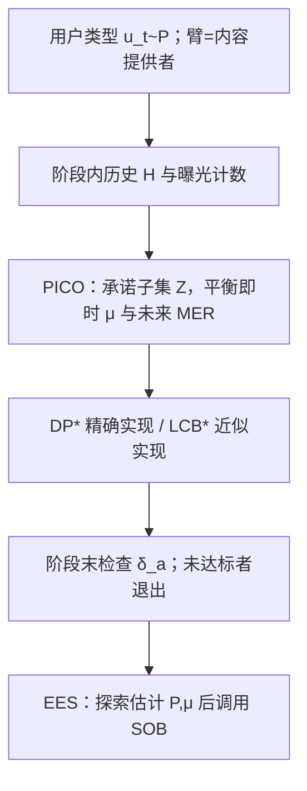

# Learning with Exposure Constraints in Recommendation Systems (推荐系统中带曝光约束的学习)

- **会议/期刊**: The Web Conference 2023 (WWW 2023)
- **作者与机构**: Omer Ben-Porat, Rotem Torkan；Technion - Israel Institute of Technology
- **推荐链路定位**: 召回/曝光分配策略（平台级供给约束与长期福利）
- **研究方向**: 强化学习与动态探索推荐 / 去偏公平、可信隐私与工业架构
- **论文原文**: [https://arxiv.org/abs/2302.01377v2](https://arxiv.org/abs/2302.01377v2)
- **开源代码**: 暂未开源

## TL;DR (1分钟核心速览)

本文解决推荐平台中内容提供者需在固定周期获得最低曝光、否则永久离场的多主体长期福利问题。作者将其形式化为分阶段上下文多臂老虎机：每轮观测用户类型并选一个提供者，阶段末未达阈值 $\delta_a$者退出。核心结论是“必须选择性补贴”：盲目补贴与拒绝补贴均致$\Omega(T)$regret；提出 EES 元算法结合 DP*/LCB*，在 OPT 全知基准下达到$\tilde O(T^{2/3})$regret，并证明$\Omega(T^{2/3})$ 下界。

## Background & Motivation (背景与核心矛盾)

- **主流范式**: 用上下文老虎机学习用户—内容匹配，在探索与利用间平衡；近期工作开始关注内容提供者激励与平台长期生态。
- **前人局限**: Mladenov 等假设完全信息，忽略用户—内容不确定性；标准 UCB/贪心算法不考虑提供者流失，而“为所有提供者保底曝光”又会牺牲用户福利。
- **核心洞察 (Key Insight)**: 最优策略并非短视贪心：当某提供者对长期福利关键时，应主动牺牲短期收益进行“补贴”；但只需承诺一个关键提供者子集，不必维持全部。
- **本文切入点**: 在分阶段上下文老虎机中加入硬曝光约束，先求全知随机优化基准 PICO，再设计未知分布下的低 regret 学习算法与下界。

## Method (核心方法设计)

### 1. 整体框架 (Overall Architecture)

模型含提供者臂集 $\mathcal K$、用户类型集$\mathcal U$、总轮数$T$与阶段长度$\tau$。每轮用户类型$u_t\sim P$，系统选臂$a_t$获效用$\mu_{u_t,a_t}$；每$\tau$轮为阶段，臂$a$若阶段内曝光少于$\delta_a$则永久退出。奖励为$\mathbb E[\sum_t\mu_{u_t,a_t}\mathbb I[a_t\in\mathcal K_t]]$。全知最优 OPT 需在“补贴关键臂”与“短期效用”间规划；PICO 将策略限制为阶段独立且承诺子集$Z$，再以 DP*/LCB* 实现或近似；未知分布时 EES 先探索估计$P,\mu$，再调用随机优化黑盒。

### 2. 关键设计拆解 (Key Designs)

1. **曝光约束与 PICO 承诺子集**：痛点是不确定性下提供者会因偶发低曝光退出；本文把可行性写成 $\forall j,\sum_{t=(j-1)\tau+1}^{j\tau}\mathbb I[a_t=a]\ge\delta_a$，并证明只考虑阶段独立、承诺于某子集$Z$的策略即可：$\mathbb E[\tilde r_{\mathrm{PICO}}]\ge\mathbb E[\tilde r_{\mathrm{OPT}}]-k\tau$。直觉是：固定关键子集可把跨阶段耦合压缩为单阶段规划，仅损失边界阶段的最多$k\tau$。

2. **DP* 的 MER 递推**：对承诺子集 $Z$，$MER(H,Z)$表示当前阶段历史$H$下剩余最大期望奖励。递推为$MER(H,Z)=\mathbb E_{u\sim P}[\max_{a\in Z}\{\mu_{u,a}+MER(H\cup\{a\},Z)\}]$，终止时若某$a\in Z$未达$\delta_a$则返回$-\infty$；再取$Z^\star=\arg\max_{Z\subseteq\mathcal K}MER(\varnothing,Z)$。它精确实现 PICO，复杂度$O(T+\tau k)$，但子集枚举对$k$ 指数级，且该指数级在 NP-hard 意义下难以避免。

3. **LCB* 与 EES 的训练/推理**：LCB* 用集中不等式构造用户到达下界 $\underline c_u=P_u\tau-\sqrt{\tau\log\tau}$，并加入效用为 0 的“松弛用户”吸收偏差，再用匈牙利算法求离线匹配；复杂度$O(T+\tau^3)$，但比 PICO 多损失$\tilde O(T/\sqrt\tau)$。学习阶段 EES 先以$\max(\delta_a,\gamma\tau)$为每臂探索量跑$\lceil T^{2/3}/(\gamma\tau)\rceil$个阶段，估计$\hat P,\hat\mu$后调用 SOB。无负采样/BPR；在线每轮仅一次选臂，主要开销在子集搜索与匹配预计算。总 regret 为$\tilde O((\sqrt{\gamma}n^2+1/\gamma)T^{2/3})+err(SOB)$，DP* 时$err=0$。

## Experimental Setup & Evaluation Protocol (实验设置与评估协议)

- **数据集与预处理**: 本文为理论工作，无真实数据集或经验实验；评估实例由 $(n,k,\tau,\delta,\mu,P)$参数化，假设$n,k$为常数、$P_u$有界远离 0、$\sum_a\max(\delta_a,\gamma\tau)\le\tau$、$\tau=O(T^{2/3})$。

| 评估对象 | 设置 |
| :--- | :--- |
| 数据/实例 | 无真实数据；理论随机实例，臂=提供者，用户类型离散 |
| 划分方式 | 不适用；按 $T/\tau$ 个固定阶段切分，阶段末检查曝光 |
| 评估指标 | 期望累积 regret $R_A=\mathbb E[\tilde r_{\mathrm{OPT}}]-\mathbb E[r_A]$，并报告运行时 |
| 对照基准 | OPT 全知、PICO、贪心/UCB、盲目补贴、DP*、LCB*、EES(DP*)、EES(LCB*) |
| 超参范围 | $\gamma\in(0,1/k]$，$\delta$公开，$\tau=O(T^{2/3})$；无 embedding 维度 |

- **数据划分与防穿越 (Splitting Strategy)**: 非监督学习划分；理论分析按阶段进行，每阶段重新开始历史，OPT 作为全知基准。
- **排名评测协议 (Ranking Protocol)**: 不适用 Full-Ranking/采样排序；采用 bandit regret 协议，奖励为 $[0,1]$ 内用户效用。
- **对比基线与超参设置**: 以 OPT 为 regret 基准；PICO 为可计算近似基准；DP*/LCB* 为已知 $P,\mu$的随机优化器；EES 为未知$P,\mu$ 的学习器。

## Key Experimental Results (实验关键数据)

### 1. 主实验对比 (Main Results)

| 方法/基准 | 信息假设 | 运行时 | 理论保证 |
| :--- | :--- | :---: | :--- |
| OPT | 全知 $P,\mu$ | — | 定义上最优 |
| PICO | 全知，阶段独立+承诺子集 | 枚举 $2^k$|$\mathbb E[\tilde r]\ge\mathbb E[\tilde r_{\mathrm{OPT}}]-k\tau$ |
| 贪心/UCB（无补贴） | 未知 | $O(T)$| 某些实例$\Omega(T)$ |
| 盲目补贴所有臂 | 未知 | $O(T)$| 某些实例$\Omega(T)$ |
| DP* | 已知 $P,\mu$|$O(T+\tau k)$| 精确 PICO，$err=0$ |
| LCB* | 已知 $P,\mu$|$O(T+\tau^3)$| 近似 PICO，多损失$\tilde O(T/\sqrt\tau)$ |
| **EES(DP*)** | 未知 | $O(T+\tau k)$|$\tilde O(T^{2/3}+\tau)$ |
| **EES(LCB*)** | 未知 | $O(T+\tau^3)$|$\tilde O(T^{2/3}+T/\sqrt\tau+\tau)$ |
| **下界（任意算法）** | 未知，$\tau=O(T^{2/3})$| — |$\Omega(T^{2/3})$ |

### 2. 消融实验 (Ablation Study)

| 移除/松弛条件 | 性能或结论变化 |
| :--- | :--- |
| 去掉补贴（纯贪心/UCB） | 存在实例 $\Omega(T)$ regret |
| 盲目满足所有 $\delta_a$| 存在实例$\Omega(T)$ regret |
| 未知曝光阈值 $\delta$| 任意算法$\Omega(T)$，阈值公开是必要假设 |
| $\sum_a\delta_a\ge\tau+\min_a\delta_a$| 下界升至线性$\Omega(T)$ |
| $\sum_a\delta_a>\tau$但未达上一条 | 下界为$\Omega(T\sqrt{k/\tau})$ |
| 用 LCB* 替代 DP* | 额外 $\tilde O(T/\sqrt\tau)$；$\tau=T^{1/3}$时退化为$\tilde O(T^{5/6})$ |
| 长阶段 $\tau=\omega(T^{2/3})$| PICO 近似损失至少$\Omega(\tau)$，需 L-LCB 类非阶段独立策略 |
| 穷举 $Z^\star$| 规划任务 NP-hard，$\Omega(2^k)$ 不可避免 |

### 3. 关键实验发现 (Key Findings)

- **在 $\tau=\Theta(T^{2/3})$时 EES(DP*) 达到$\tilde O(T^{2/3})$，与$\Omega(T^{2/3})$ 下界仅差对数因子，说明该 regret 阶在本文模型内已最优。**
- **DP* 与 LCB* 是精度—效率权衡：DP* 运行时 $O(T+\tau k)$且无近似误差；LCB* 降到$O(T+\tau^3)$，但多付$T/\sqrt\tau$，当$\tau$较小（如$T^{1/3}$）时 LCB* regret 升至$\tilde O(T^{5/6})$，应优先 DP*。**
- **补贴不是“越公平越好”：无补贴和盲目补贴均为 $\Omega(T)$；只有对关键臂选择性补贴才保住长期福利。未知$\delta$也直接导致$\Omega(T)$，说明曝光阈值信息与选择性补贴是低 regret 的双必要条件。**

## Highlights & Limitations (亮点、对比与审稿批判)

- **与代表作对比 (vs. Prior Work)**: 相比 Mladenov 等的完全信息约束匹配，本文显式处理 $P,\mu$ 不确定性；相比 Patil 等“必须满足所有臂曝光”的公平 bandit，本文只维持对长期福利关键的臂，允许不必要提供者退出；相比 Braverman/Feng 的战略臂 bandit，本文奖励不可被臂操纵，约束来自提供者经济生存。
- **可迁移亮点**: “承诺子集+阶段独立”把长期约束近似为单阶段规划；用松弛用户吸收集中不等式偏差，可迁移到带最低配额/公平约束的在线分配。
- **审稿级局限批判**: 阈值 $\delta$公开是强假设，论文亦证明未知时线性 regret；精确算法对$k$指数级，大规模平台需接受近似基准；纯理论无真实/合成经验验证，且长阶段$\tau=\omega(T^{2/3})$仅给出 L-LCB 与$\Omega(T/\sqrt\tau)$，上下界仍存间隙。

## Rating (四维评分)

- **方法创新性 (Novelty)**: ⭐⭐⭐⭐ （首次在不确定性下联合内容提供者曝光约束与用户福利，并给出匹配下界；但仍是较 stylized 的 bandit 模型）
- **评估协议与实验扎实度 (Protocol & Experiments)**: ⭐⭐⭐ （理论 regret/runtime 与多参数 regime 分析扎实，但无真实数据或合成实验验证）
- **写作与数学规范度 (Clarity & Rigor)**: ⭐⭐⭐⭐⭐ （PICO 近似、MER 递推、匹配构造与下界证明完整，符号与定理组织清晰）
- **工业落地与复现价值 (Industrial & Practical Value)**: ⭐⭐⭐ （曝光补贴洞察可迁移，但阈值公开、硬约束与指数级子集搜索使直接部署需工程近似）

