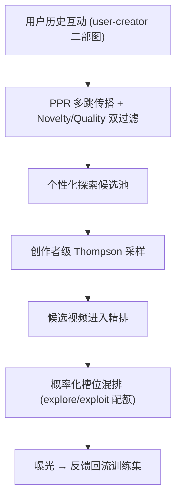
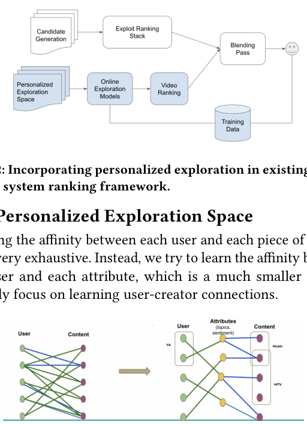
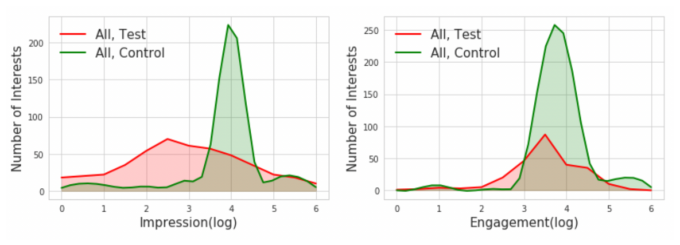

# PIE: Personalized Interest Exploration for Large-Scale Recommender Systems (大规模推荐系统中的个性化兴趣探索)

- **会议/期刊**: WWW 2023 (Companion，工业系统短文)
- **作者与机构**: Khushhall Chandra Mahajan, Amey Porobo Dharwadker, Romil Shah, Simeng Qu, Gaurav Bang, Brad Schumitsch (Meta Inc.)
- **推荐链路定位**: 重排 / 混排（blending pass），不改造召回与精排模型本身
- **研究方向**: 强化学习与动态探索推荐 / 去偏、公平与工业架构
- **论文原文**: [https://arxiv.org/abs/2304.06844v1](https://arxiv.org/abs/2304.06844v1)
- **开源代码**: 暂未开源

## TL;DR (1分钟核心速览)

精排模型只见过"被曝光过"的标签，陷入流行度自我强化与兴趣局部最优，而纯探索又必然带来短期互动下跌。PIE 用「用户→创作者」的降维探索空间（PPR 多跳随机游走挖掘新创作者）+ 创作者级 Thompson 采样 + 概率化槽位混排（探索曝光控制在约 6%），并在现有排序栈上以最小改动落地。Facebook Watch 四周线上 A/B 显示 SCC +3.50%、Novel SCC +0.85%、长短期互动与留存不显著下降，纯曝光探索的互动代价仅 −0.53%。

## Background & Motivation (背景与核心矛盾)

- **主流范式**: 工业两级（召回+精排）点式排序系统，以历史互动为唯一监督信号，最大化即时观看时长等 engagement。
- **前人局限**: ① 训练标签由系统自己产生的曝光生成，形成反馈闭环，热门内容与已有偏好被不断放大；② 用户兴趣随热点漂移，但系统无"主动采集未知兴趣"的机制，无法跳出局部最优（图1）。
- **核心洞察 (Key Insight)**: 探索的收益不应以短期观看时长衡量——探索必然带来机会成本，真正的价值是"用户与创作者之间新建的强连接"（SCC），它与未来长期 engagement 强相关（图5）。
- **本文切入点**: 不做全量用户-内容探索（代价过高），而探索粒度降到"用户-创作者"这一小属性集，把探索问题拆成"空间构造 + 在线决策 + 混排配额"三段式工程解。

## Method (核心方法设计)

### 1. 整体框架 (Overall Architecture)

PIE 挂在已部署排序栈的 blending 阶段（图2 蓝线）：离线用互动二部图构建用户-创作者亲和，为每个用户产出一个"新创作者候选池"；线上对候选池做创作者级 Thompson 采样，选出创作者后再取其视频进入精排；最后概率化混排层按目标配额（约 6% 曝光）把探索视频插入用户 session，采集到的探索反馈回流训练集打破闭环。训练与推理几乎零改造：精排模型结构与特征不变，额外开销仅为一次离线图传播与每用户 $O(|\mathcal{C}_u|)$ 的 Beta 采样。

<figure class="paper-figure" markdown="span">
  <figcaption>图2：在现有推荐系统排序框架中融入个性化探索。</figcaption>
</figure>

### 2. 关键设计拆解 (Key Designs)

1. **用户-属性-内容降维的 PPR 探索空间**：全量 user-content 探索不可行，改为先学 user-creator 亲和。在 user↔creator 双向二部图上跑带重启的随机游走 $\boldsymbol{\pi}= \alpha \mathbf{P}\boldsymbol{\pi} + (1-\alpha)\mathbf{e}_u$，先得到 creator-creator 相似度$s(c,c')$，再用用户历史创作者加权聚合，得到与已交互创作者多跳相连但用户未见过的新创作者：
$\mathcal{C}_u^{\text{exp}}=\text{TopK}_{c\notin\mathcal{C}_u^{\text{hist}}}\Big(\sum_{c'\in\mathcal{C}_u^{\text{hist}}} w_{u,c'}\, s(c,c')\Big)$。
相比 CF 内积，PPR 走多跳路径、对低曝光创作者友好，因此天然具备"探索性"而非"复读"；Novelty 过滤剔除已交互创作者，Quality 过滤剔除 Watchbait 与历史探索低互动创作者，保证探索预算不被噪声吃掉。
2. **创作者级 Thompson 采样**：若直接用精排分数，探索视频必被压低（不确定性大）。把"该给用户试哪个新创作者"建模为 Bernoulli bandit：以"从该创作者互动的视频数"为成功、其余为失败，更新 $\alpha_c,\beta_c$，每轮采样$\theta_c\sim\text{Beta}(\alpha_c,\beta_c)$，取$c^\star=\arg\max_c \theta_c$。Beta 后验方差天然随尝试次数收缩，实现"先广撒网、后收敛"；在 creator 粒度而非 item 粒度做 bandit，使反馈信号更稠密、收敛更快（图4 显示采样分布随时间的迁移）。
3. **探索配额混排与训练目标**：为对抗点式排序器对不确定内容的系统性降权，采用概率化 blending：当 session 内探索占比 $n_{\text{exp}}/n_{\text{total}}<\rho$（$\rho\approx 6\%$）时按概率插入探索槽位，强制达到目标组成，同时不打乱 exploit 内容的相对次序。系统无新增损失函数，价值完全由"探索数据回流进训练集"体现——即把探索当作一种主动的数据采集策略而非即时收益优化器。

## Experimental Setup & Evaluation Protocol (实验设置与评估协议)

- **数据集与实验分组**: 无公开离线数据集，评估完全在 Facebook Watch（月活 >12.5 亿）线上完成，采用 4 组用户正交切分（是否看探索内容 × 训练是否用探索数据），探索曝光由 blending 控制在约 6%：

| 分组 | 探索内容 | 训练模型 | 语义 |
| :--- | :---: | :---: | :--- |
| Group 1 | 否 | Model A（无探索数据） | 生产对照 |
| Group 2 | 是 | Model A | 严格探索价值（纯曝光代价） |
| Group 3 | 否 | Model B（混入探索数据） | 系统探索价值（仅数据回流） |
| Group 4 | 是 | Model B | 用户探索价值（完整闭环） |

- **数据划分与防穿越**: 线上 A/B 随机分流（用户级），训练侧 Model A 剔除探索数据、Model B 混入同规模非探索随机样本以对齐训练集大小，避免数据量混淆因果；测试持续四周。
- **排名评测协议**: 非离线 Full-Ranking 或 Sampled Ranking，而是线上指标对比：SCC（$M$天内与同一创作者$\ge N$次互动）、SCC DAU、Novel SCC（$P$天内无互动的全新连接）、以及 engagement/留存 win 指标；$N,M,P$ 因合规未公开。显著性以线上实验统计显著性判断。
- **对比基线**: 无算法级基线（未对比 LinUCB/Contextual Bandit/流行度探索），对比对象是"生产系统 + 分组消融"。

## Key Experimental Results (实验关键数据)

### 1. 主实验对比 (Main Results)

（相对生产系统，四周 A/B，表2）

| 对比 | SCC | SCC DAU | Novel SCC | Engagement |
| :--- | :---: | :---: | :---: | :---: |
| **Group 4 vs 1（完整 PIE）** | **+3.50%** | **+0.26%** | **+0.85%** | Neutral |
| Group 3 vs 1（仅数据回流） | Neutral | Neutral | Neutral | **+0.28%** |
| Group 2 vs 1（仅曝光探索） | +0.55% | Neutral | +0.11% | **−0.53%** |

### 2. 消融实验 (Ablation Study)

| 配置 | 探索空间 | Bandit 采样 | 混排配额 | 探索数据回流 | SCC | Engagement |
| :--- | :---: | :---: | :---: | :---: | :---: | :---: |
| Group 1（生产） | ✗ | ✗ | ✗ | ✗ | 基线 | 基线 |
| w/o 反馈回流 (G2) | ✓ | ✓ | ✓ | ✗ | +0.55% | −0.53% |
| w/o 探索曝光 (G3) | ✓ | ✓ | ✗ | ✓ | Neutral | +0.28% |
| Full PIE (G4) | ✓ | ✓ | ✓ | ✓ | **+3.50%** | Neutral |

### 3. 关键实验发现 (Key Findings)

1. **增益主要来自闭环而非曝光**：仅曝光探索（G2）只拿到 +0.55% SCC 且互动 −0.53%；而曝光+回流（G4）达到 +3.50% SCC，说明 PPR 空间 + bandit 的真正价值是"把新兴趣写进训练分布"，单点探索本身贡献不足 1/6。
2. **探索数据回流可独立带来正收益**：G3 在不增加任何探索曝光的前提下 engagement +0.28% 且 SCC 不降，证明打破反馈闭环能让精排模型自身变好，是"零打扰"的增益路径。
3. **兴趣分布被显著拉平**：图7 中探索组各子话题曝光 log 值集中约 4，对照组方差明显更大；互动分布同步均衡化，说明探索在个体层面缓解了流行度偏置而非简单增加噪声。

<figure class="paper-figure" markdown="span">
  <figcaption>图7：兴趣分布：曝光（左）与互动（右）。</figcaption>
</figure>

## Highlights & Limitations (亮点、对比与审稿批判)

- **与代表作对比 (vs. Prior Work)**: 相较传统 Bandit 推荐（LinUCB/Contextual Bandit 直接在 item 粒度做 E&E），PIE 把动作空间降到 creator 属性层，样本效率高、可与任意精排器解耦；相较纯去偏/重排方法（如校准式重排），它承认短期机会成本，改用"新建连接"这一长期指标自证价值；相较 SGL/对比学习类数据增广，它是真实主动采数而非伪样本构造。
- **可迁移亮点**: ① "用户→小基数属性→内容"的探索降维范式，可直接换成 topic/类目/作者/店铺；② 用分组设计（曝光与否 × 训练用否）分离"曝光代价"与"数据回流收益"，是探索类系统极佳的因果拆解模板。
- **审稿级局限批判**: ① 缺算法级对照与超参敏感性分析，$\rho\approx6\%$、$N/M/P$ 阈值均未公开，无法判断 SCC 增益对配额设置的鲁棒性；② 全篇无离线可复现实验与代码，SCC 与长期 engagement 的关系仅以图5 定性呈现，缺少因果/相关强度的定量论证；③ 未与 Contextual Bandit、动态位置概率混排等更强方案对比，方法新颖度偏工程组合。

## Rating (四维评分)

- **方法创新性 (Novelty)**: ⭐⭐⭐ （PPR + Thompson 采样 + 概率混排均为成熟组件的巧妙组合，创新在"创作者粒度探索"的问题重构，而非新算子或理论分析）
- **评估协议与实验扎实度 (Protocol & Experiments)**: ⭐⭐⭐⭐ （四周十亿级线上 A/B + 四分组正交设计有效分离曝光代价与数据回流收益，但缺少离线基准、算法基线与阈值敏感性检验）
- **写作与数学规范度 (Clarity & Rigor)**: ⭐⭐⭐ （三段式结构清晰、工程导向明确，但公式与形式化定义极少，关键指标参数因合规隐去，难以复现阈值设置）
- **工业落地与复现价值 (Industrial & Practical Value)**: ⭐⭐⭐⭐⭐ （仅改动 blending pass 即可接入现有排序栈，月活十亿级生产验证；分组实验设计对任何做探索的工业团队都有直接参考价值）

