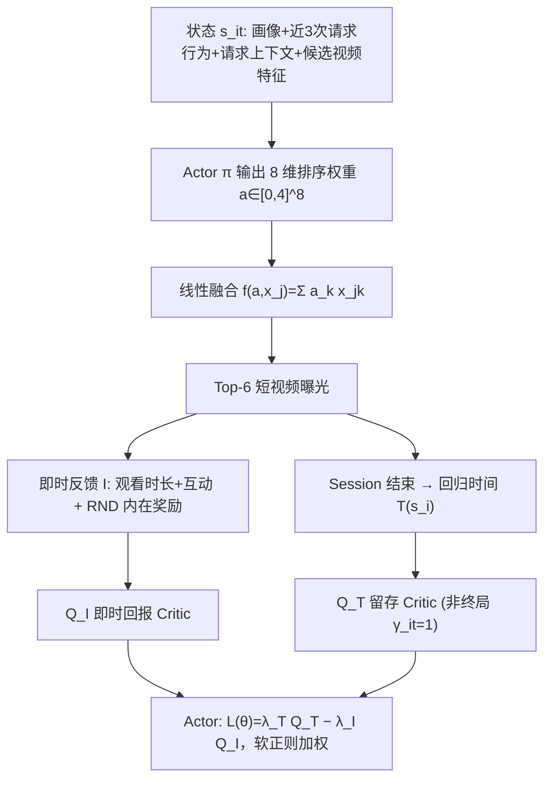
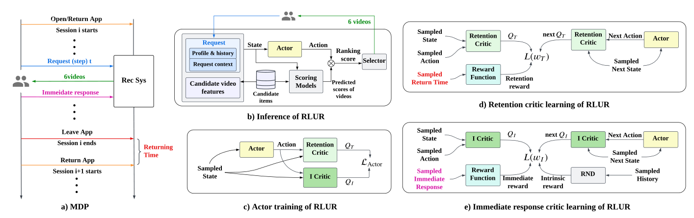
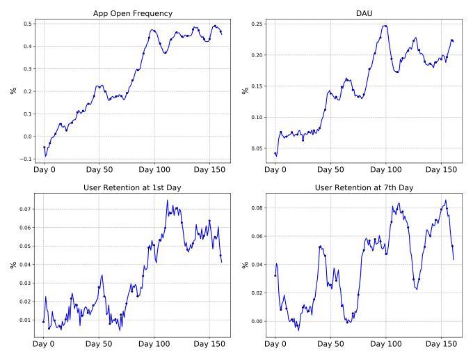

# Reinforcing User Retention in a Billion Scale Short Video Recommender System (十亿级短视频推荐系统中的用户留存强化)

- **会议/期刊**: WWW 2023 (Industry Track)
- **作者与机构**: Qingpeng Cai, Shuchang Liu, Xueliang Wang, Tianyou Zuo, Wentao Xie, Bin Yang, Dong Zheng, Peng Jiang, Kun Gai（快手科技）
- **推荐链路定位**: 精排（排序权重融合层）→ 端到端长期目标优化
- **研究方向**: 强化学习与动态探索推荐 / 多任务学习与列表级重排
- **论文原文**: [https://arxiv.org/abs/2302.01724v3](https://arxiv.org/abs/2302.01724v3)
- **开源代码**: 暂未开源

## TL;DR (1分钟核心速览)

留存是多次交互后才兑现的长期反馈，难以按 item 分解，点式/列表式模型无法直接优化。本文把短视频推荐建模为无限视界 request-based MDP：动作为对 8 个打分模型的排序权重，奖励为 session 间的「回归间隔」，目标是**最小化累积回归时间**（等价于提升打开频次与留存）。针对留存固有的**不确定性、活跃度偏差、长延迟**三大障碍，RLUR 分别给出回报归一化、双分组策略与软行为正则。离线 KuaiRand 模拟器上留存 0.618（TD3 为 0.592），线上长期 A/B 中 DAU +0.2%、次日留存 +0.053%。

## Background & Motivation (背景与核心矛盾)

- **主流范式**: 工业短视频系统用 point-wise（观看时长/点赞等即时反馈逐项预估）或 list-wise（考虑位置与列表组合效应）模型做多目标融合排序。
- **前人局限**: ①留存奖励发生在用户离开 App 数小时后，与中间每一次请求的 item 之间没有可靠的信用分配路径（作者类比围棋的稀疏终局奖励）；②即使用 RL，也不存在可用的即时留存信号，样本效率极低。
- **核心洞察 (Key Insight)**: 留存 $\approx$回访频率，而回访频率可被量化为「上一 session 最后一次请求 → 下一 session 第一次请求」的时间间隔$T(s_i)$；把这串间隔当成累积代价，就把不可分解的留存变成了**可定义在 session 粒度的 MDP 回报**。
- **本文切入点**: 以返回间隔为奖励、排序权重为动作，用 off-policy Actor-Critic 直接在留存信号上学习，并用三项工程化技巧解决留存奖励的统计缺陷。

## Method (核心方法设计)

### 1. 整体框架 (Overall Architecture)

用户打开 App 即开启一个 session，每次请求时把「用户画像 + 近 3 次请求的行为序列 + 请求上下文 + 候选视频特征」组成状态 $s_{it}$送入 Actor，Actor 输出 8 维连续排序权重$\boldsymbol{a}_{it}\in[0,4]^8$；融合层用$f(\boldsymbol{a}_{it},\boldsymbol{x}_j)=\sum_{k=1}^{n}a_{it,k}x_{jk}$对各打分模型（watchtime、shortview、longview、like、follow、forward、comment、主页进入）加权，取 Top-6 下发。用户产生即时反馈后再请求，session 结束时回传一次回归时间奖励。训练侧并行维护留存 Critic$Q_T$与即时回报 Critic$Q_I$（含 RND 内在奖励），Actor 按二者加权差更新。

<figure class="paper-figure" markdown="span">
  <figcaption>图1：无限视界下基于请求的MDP与RLUR框架</figcaption>
</figure>

### 2. 关键设计拆解 (Key Designs)

**① 留存 Critic 与非终局折扣（把跨 session 回报接上）**：若在整个 session 内统一用 $\gamma<1$，则第$k$个 session 的回归时间会被$\gamma^{k}$衰减到近乎为零，多 session 长期价值消失。本文令非终局样本$\gamma_{it}=1$、仅终局跳转用$\gamma$：$\mathcal{L}(w_T)=\sum_{(s_{it},a_{it})\in D}\big(Q_T(s_{it},a_{it}|w_T)-\big(r(s_{it},a_{it})+\gamma_{it}Q_T(s_{it+1},\pi(s_{it+1}|\theta)|w_T)\big)\big)^2$，即「折扣只作用于 session 边界」而非请求步，从而保住跨 session 的信用传播。

**② 不确定性归一化（用可预测部分除掉社会噪声）**：真实回归时间被节假日、社会事件污染，方差极大。先按经验分布取 $\beta=60\%$分位$T_\beta$，训一个 session 级分类器$T'(x)$预测「回归时间短于$T_\beta$」的概率；由 Markov 不等式得$\mathbb{E}[T(x)]\ge(1-T'(x))T_\beta$，据此把原始奖励变为相对量：$r(s_{it},a_{it})=\mathrm{clip}\big\{\tfrac{T(s_i)}{(1-T'(x))T_\beta},\,0,\,\alpha\big\}$（$\alpha=3$）。直觉上「超出模型预期的回归延迟」才被重罚，不可控噪声被约掉。

**③ 活跃度分组去偏 + 软行为正则（稳住长延迟训练）**：高活跃用户天然回归快且习惯不同，单一 Critic 会被其主导；故按活跃度切两组分别学 $\pi(\cdot|\theta_{high}),\pi(\cdot|\theta_{low})$，损失$\mathcal{L}(\theta)=\lambda_T Q_T-\lambda_I Q_I$（$\lambda_T=\lambda_I=1.0$）——注意符号相反，因$Q_T$是要最小化的代价。长延迟带来的分布漂移用硬 BC 正则要么失效要么压死样本效率，本文改为乘性软权重$\exp(\max\{\lambda(\log p(a_{it}|s_{it})-\log p_b(a_{it}|s_{it})),0\})\cdot\mathcal{L}(\theta)$，$\lambda=1.5$：偏离行为策略越大的样本权重越小，实现「稳定优先、但不一刀切」。

**训练与推理开销**：off-policy，DDPG 风格确定性 Actor + 双 Critic；即时回报侧用 RND（$\|E(u_{it}|w_e)-E(u_{it}|w_e^*)\|_2^2$）做内在探索奖励，与留存信号解耦以避免干扰。推理仅需一次 Actor 前向 + 线性加权，8 维动作、Top-6 输出，线上开销与常规多目标融合层同一量级；无负采样环节（RL 设定）。

## Experimental Setup & Evaluation Protocol (实验设置与评估协议)

- **数据集与预处理**: 公开短视频数据集 KuaiRand（含多 session 交互日志），作者在其上构建**三段式模拟器**——即时反馈模块、离开模块、回归模块（$K=10$ 天回归概率）。论文未公开用户/物品规模与过滤细节。

| 数据集 | #Users | #Items | #Interactions | 稀疏度/密度 | 特征/场景说明 |
| :--- | :---: | :---: | :---: | :---: | :--- |
| KuaiRand（离线） | 论文未披露 | 论文未披露 | 多 session 日志 | 未披露 | 无偏曝光日志，用作模拟器底座 |
| 快手线上 | 十亿级 DAU 平台 | — | 长期 A/B | — | 随机分桶，CEM 为 base 桶 |

- **数据划分与防穿越 (Splitting Strategy)**: 离线按**模拟 episode 滚动**评估，取收敛后最后 50 个 episode 的均值，无 leave-one-out / 比例划分；线上为**长期随机分桶 A/B**（同用户随机入桶，非时间切分）。
- **排名评测协议 (Ranking Protocol)**: **不使用 HR/NDCG/全库排序或采样排序**，而是系统级指标——离线为平均回归时间（↓）与次日留存（↑）；线上为 App 打开频次、DAU、1 日/7 日留存。原因是优化目标是长期留存而非单次点击命中。
- **对比基线与超参设置**: 基线为黑盒参数搜索 CEM（业界排序权重调参常用）与 SOTA RL 方法 TD3；$\gamma=0.95$、$\alpha=3$、$\beta=60\%$、$\lambda=1.5$，动作维度 8；显著性以平台阈值（留存 0.01%、DAU 0.1% 即显著）判定，未报告$p$ 值。

## Key Experimental Results (实验关键数据)

### 1. 主实验对比 (Main Results)

**离线（KuaiRand 模拟器，末 50 episode 均值）**

| 方法 | 类型 | Returning Time ↓ | 1-Day Retention ↑ |
| :--- | :--- | :---: | :---: |
| CEM | 黑盒参数搜索 | 2.036 | 0.587 |
| TD3 | Off-policy RL | 2.009 | 0.592 |
| RLUR (naive, $\gamma=0$) | 仅留存 Critic，无未来 | 2.001 | 0.596 |
| RLUR (naive, $\gamma=0.9$) | 仅留存 Critic，有未来 | 1.961 | 0.601 |
| **RLUR (full)** | 完整框架 | **1.892** | **0.618** |
| Improv. vs TD3 | — | **−5.8%** | **+4.4%** |

**线上（快手长期 A/B，训练 80–100 天后收敛）**

| 指标 | RLUR vs CEM 相对提升 |
| :--- | :---: |
| App 打开频次 | **+0.450%** |
| DAU | **+0.200%** |
| 1 日留存 | **+0.053%** |
| 7 日留存 | **+0.063%** |

<figure class="paper-figure" markdown="span">
  <figcaption>图2：每日线上性能差距</figcaption>
</figure>

### 2. 消融实验 (Ablation Study)

| 配置 | Returning Time ↓ | 1-Day Retention ↑ | 说明 |
| :--- | :---: | :---: | :--- |
| w/o 未来 session（naive, $\gamma=0$） | 2.001 | 0.596 | 退化为单 session 优化 |
| w/o 三项技巧（naive, $\gamma=0.9$） | 1.961 | 0.601 | 已有跨 session，但仍缺归一化/分组/软正则 |
| w/o 归一化 / w/o 分组策略 / w/o 软正则 | 论文未单列 | 论文未单列 | **未做逐项剥离子实验** |
| full RLUR | **1.892** | **0.618** | — |

### 3. 关键实验发现 (Key Findings)

1. **跨 session 折扣是最大单项增益**：从 naive($\gamma=0$) 到 naive($\gamma=0.9$)，回归时间 2.001→1.961、留存 0.596→0.601，说明「折扣只加在 session 边界」这一改动本身就带来了约 2% 的回归时间下降，验证了长期价值传播的必要性。
2. **三项技巧合计带来 3.5% 回归时间下降**：naive($\gamma=0.9$) 到 full 从 1.961→1.892、留存 0.601→0.618（+2.8%），是离线最大的增益段，但论文未拆分各自贡献，只能确认组合有效。
3. **线上收益存在明显「延迟兑现」**：前 80 天 DAU/留存的相对提升缓慢爬升，第 80–100 天陡增后收敛（打开频次 +0.450%、DAU +0.2%），说明策略在长延迟回报下需要足够久才能完成价值回传与策略定型，也解释了为何线下短期 A/B 难以判定 RL 收益。

## Highlights & Limitations (亮点、对比与审稿批判)

- **与代表作对比 (vs. Prior Work)**: 与 CEM 这类黑盒排序权重搜索相比，RLUR 学的是**状态相关的连续动作策略**而非全局静态权重，因而能对用户活跃度/上下文自适应；与 TD3 等通用 RL 相比，它把奖励工程（归一化）、偏差控制（分组）与稳定性（软正则）都做进了算法本体，而 TD3 在长延迟下训练不稳（论文因此未将其上线）。
- **可迁移亮点**: ①「折扣只加在 session 终局」的折扣重定义，可直接迁移到任何跨 session 的长期价值（LTV、次留/七留）建模；②用分类器 + Markov 不等式构造 $(1-T')T_\beta$ 下界来做奖励归一化，是把「不可控外部噪声」转成相对奖励的廉价手段，可用于任何噪声大的业务指标优化。
- **审稿级局限批判**: ①**消融不完整**：归一化、分组策略、软正则三项核心技巧只有组合 vs. 组合的对比，没有逐项剥离，无法判断各自贡献甚至是否存在冗余；②**评估协议弱**：离线依赖自建模拟器（离开/回归模块本身是学习出来的），存在"自证"风险，且无 HR/NDCG 之类的标准排序协议、无显著性检验（$p$值），线上提升量级（DAU +0.2%）虽在工业上显著但学术可比性弱；③策略按活跃度做**硬分组**，分组阈值与边界用户处理未讨论，超参（$\beta$、$\alpha$、$\lambda$）敏感性也未给出。

## Rating (四维评分)

- **方法创新性 (Novelty)**: ⭐⭐⭐⭐ （把不可分解的留存重构为 session 间回归间隔的无限视界 MDP，并用非终局折扣 + Markov 不等式奖励归一化给出可落地的奖励工程，思路新颖且直击痛点，但底层仍是 DDPG 框架的工程化改造）
- **评估协议与实验扎实度 (Protocol & Experiments)**: ⭐⭐ （线上长期 A/B 极有说服力，但离线依赖自建模拟器、缺少逐项消融与显著性检验，且无标准排序指标，学术可复现性偏弱）
- **写作与数学规范度 (Clarity & Rigor)**: ⭐⭐⭐ （MDP 定义、损失与奖励公式清晰，但部分推导（如 Eq.(1) 与目标等价性）明确以"篇幅不足"省略，软正则的理论依据主要靠直觉而非证明）
- **工业落地与复现价值 (Industrial & Practical Value)**: ⭐⭐⭐⭐⭐ （已在快手十亿级 DAU 全量上线并持续带来 DAU/留存提升，推理仅一次 Actor 前向，工程价值极高；但无开源代码，复现需自建模拟器与打分模型群）

