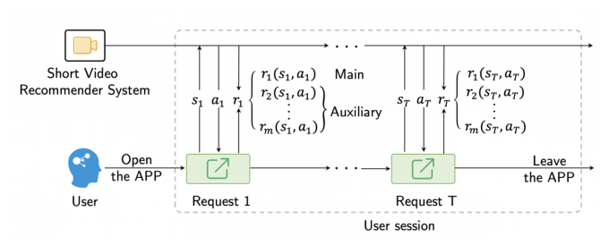
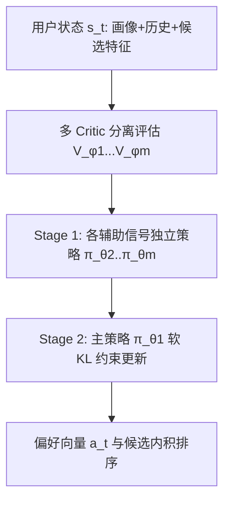
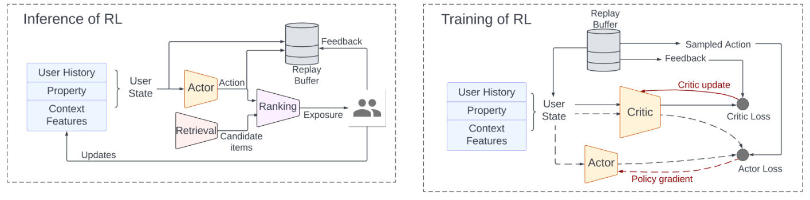

# Two-Stage Constrained Actor-Critic for Short Video Recommendation (短视频推荐的两阶段约束 Actor-Critic)

- **会议/期刊**: WWW 2023 (The ACM Web Conference)
- **作者与机构**: Qingpeng Cai, Zhenghai Xue, Chi Zhang, Ruohan Zhan (HKUST), Peng Jiang, Kun Gai 等 — 快手科技
- **推荐链路定位**: 精排（生产系统候选排序器，用户到来时对候选视频打分取 Top-1）
- **研究方向**: 强化学习与动态探索推荐 / 多任务学习与多目标优化
- **论文原文**: [https://arxiv.org/abs/2302.01680v3](https://arxiv.org/abs/2302.01680v3)
- **开源代码**: [https://github.com/AIDefender/TSCAC](https://github.com/AIDefender/TSCAC)

## TL;DR (1分钟核心速览)

短视频平台既要最大化用户长期累计观看时长（WatchTime，主目标），又要保证点赞/分享/关注等交互（辅助目标）不被牺牲，这是一个**多约束** CMDP。作者指出传统拉格朗日法（RCPO）在此失效：单一 Value 模型无法同时评估稠密与稀疏奖励、多维乘子搜索代价过高。TSCAC 用「多 Critic 分离评估 + 两阶段 Actor」破局：先为每个辅助信号各学一个策略，再让主策略在 KL 软约束下靠近它们，并给出闭式最优解。KuaiRand 上 NCIS 评测 WatchTime 13.14（较 BC +2.23%），线上 A/B 相对 LTR 提升 +0.379% WatchTime 与 +3.376% Share。

## Background & Motivation (背景与核心矛盾)

- **主流范式**: 用 RL 优化长期累计奖励（WatchTime），或用加权求和 / Pareto 多目标优化把多个反馈合成单一标量奖励后交给监督式 LTR 或 AC 训练。
- **前人局限**: (1) 加权求和需人工指定权重，业务上难以量化偏好；(2) Pareto 解只保证"不被全面支配"，并不优先保障主目标——实验中 Pareto 的 WatchTime 反而比 BC 低 7.4%；(3) 标准约束 RL（RCPO）把 $r=r_0+\sum_i\lambda_i r_i$ 塞进单个 Value 模型，而 WatchTime 每次曝光都有、Like 仅 1.61%、Hate 仅 0.048%，稀疏信号被稠密信号淹没，且不同反馈本应拥有不同折扣因子，单 Value 模型的 TD 误差结构无法容纳。
- **核心洞察 (Key Insight)**: 多约束下对拉格朗日乘子做网格搜索的代价随约束维度爆炸（RL 训练本就慢）；但若把"满足约束"改写为"策略不要离已经优化好该辅助目标的策略太远"，则约束变成**策略空间上的 KL 正则**，可解析求解、免去乘子调参。
- **本文切入点**: 主目标单独优化 + 辅助目标作为"软锚点策略"，用乘积形式的闭式解把两者融合进一次策略更新。

<figure class="paper-figure" markdown="span">
  <figcaption>图 2：短视频推荐的 MDP。</figcaption>
</figure>

## Method (核心方法设计)

### 1. 整体框架 (Overall Architecture)

会话被建模为 CMDP $(\mathcal{S},\mathcal{A},P,R,C,\rho_0,\Gamma)$：状态$s_t$为用户画像、最近 20 条观看历史与候选视频特征的拼接（离线 1044 维）；动作为被推荐的视频；奖励为向量$r(s_t,a_t)=(r_1,\dots,r_m)$，各维拥有独立折扣因子$\Gamma=(\gamma_1,\dots,\gamma_m)$。优化目标为$\max_\pi \mathbb{E}_{\rho_\pi}[V^\pi_1(s)]\ \text{s.t.}\ \mathbb{E}_{\rho_\pi}[V^\pi_i(s)]\ge C_i,\ i=2,\dots,m$。训练分两阶段：Stage 1 对每个辅助信号$i$各训一对 actor/critic$(\pi_{\theta_i},V_{\phi_i})$；Stage 2 只训主 actor$\pi_{\theta_1}$，其更新目标中乘入各辅助策略的概率项作为软约束。线上推理时 actor 输出用户偏好向量$a_t$，与候选视频 embedding 做内积排序取 Top-1，实现"连续动作 → 离散推荐"的桥接。

<figure class="paper-figure" markdown="span">
  <figcaption>图 4：生产系统中 RL 的工作流程。</figcaption>
</figure>

### 2. 关键设计拆解 (Key Designs)

1. **多 Critic 分离评估 (Multi-Critic Policy Estimation)**：针对稠密/稀疏奖励量级悬殊导致联合 Value 模型偏差的问题，为每类反馈单独学 $V_{\phi_i}$，各自使用专属$\gamma_i$：$\phi_i^{(k+1)}\leftarrow\arg\min_\phi \mathbb{E}_{\pi_{\theta_i}^{(k)}}[(r_i+\gamma_i V_{\phi_i}^{(k)}(s')-V_\phi(s))^2]$。与联合模型$V_{joint}$相比，分离评估$V_{w}+V_i$ 与蒙特卡洛回报的相关性在 WatchTime 上高 0.19%、交互上高 0.14%（平台内 0.1% 已显著），因为稀疏信号不再被稠密项在平方误差中稀释。

2. **两阶段软约束 Actor (Two-Stage Actor Learning)**：把多约束问题改写为 $\max_\pi \mathbb{E}_\pi[A_1^{(k)}]\ \text{s.t.}\ D_{KL}(\pi\|\pi_{\theta_i})\le\epsilon_i$，其拉格朗日闭式解为

$$\pi^*(a|s)\propto\prod_{i=2}^{m}\big(\pi_{\theta_i}(a|s)\big)^{\frac{\lambda_i}{\sum_j\lambda_j}}\exp\!\Big(\frac{A_1^{(k)}}{\sum_j\lambda_j}\Big)$$

即以辅助策略的**几何加权平均**作为先验，再用主目标优势做指数倾斜（tilt）。据此最小化 $D_{KL}(\pi^*\|\pi_\theta)$得到可执行的策略梯度（式 7）：辅助策略概率以重要性权重形式出现在损失里，$\lambda_i\to 0$时约束消失退化为普通 AC。相比网格搜索乘子，该形式只需一组共享$\lambda$即可部署，且天然支持$m>2$ 的多约束。

3. **离线纠偏与确定性扩展**：离线数据由行为策略 $\pi_\beta$采集，采用一阶近似的重要性比$\pi_{\theta_i}^{(k)}(a|s)/\pi_\beta(a|s)$替代逐步连乘的轨迹比$\prod_{t'=1}^{t}\pi_\theta/\pi_\beta$，以可控偏差换取方差稳定；对连续动作（线上偏好向量）给出确定性版本$\max_\theta \prod_{i=2}^m h(\pi_{\theta_i}(s),\pi_{\theta_1}(s))^{\lambda_i}\cdot Q_{\phi_1}(s,\pi_\theta(s))$，其中$h$ 为动作接近度核（如高斯核）。推理零额外开销：仅前向一次 actor + 内积检索。

## Experimental Setup & Evaluation Protocol (实验设置与评估协议)

- **数据集与预处理**（KuaiRand，工业级无偏日志）：

| 数据集 | #Users | #Items | #Interactions | 稀疏度/密度 | 特征/场景说明 |
| :--- | :---: | :---: | :---: | :---: | :--- |
| KuaiRand | 26,858 | 10,221,515 | 68,148,288 | click 37.70% / like 1.61% / comment 0.24% / hate 0.048% | 短视频曝光日志，含 WatchTime 与多类交互；同一用户日志拼接为轨迹，取最高频 150 个视频为候选 |

- **数据划分与防穿越 (Splitting Strategy)**: 按用户会话组织轨迹（episode = 一次 App 使用全过程），离线使用固定日志数据集做 off-policy 评估，不做随机比例切分；线上采用**用户随机分桶**（bucket 级 A/B），模型训练数日后固定参数测试一整天。
- **排名评测协议 (Ranking Protocol)**: 离线采用 **NCIS（Normalised Capped Importance Sampling）** 全轨迹加权估计 $N(\pi)=\frac{\sum_{s,a\in D}w(s,a)r(s,a)}{\sum_{s,a\in D}w(s,a)}$，$w=\min\{c,\pi(a|s)/\pi_\beta(a|s)\}$ 截断以控方差；这是 off-policy 策略价值估计而非 Top-K 排序指标，Hate 为越低越优。线上直接对比人均 WatchTime 与 Share/Download/Comment 总量。
- **对比基线与超参设置**: BC、Wide&Deep、DeepFM（监督式，样本权重为多反馈加权和）、RCPO（单 Critic 拉格朗日）、RCPO-Multi-Critic、Pareto（Chen et al. 2021）。离线 $\gamma=0.99$，主目标为 WatchTime，其余为约束；线上$\gamma=0.95$，Gaussian 策略；显著性以平台 0.1% WatchTime / 1% 交互为阈值。

## Key Experimental Results (实验关键数据)

### 1. 主实验对比 (Main Results)

| 算法 | Click↑ | Like↑(e-2) | Comment↑(e-3) | Hate↓(e-4) | WatchTime↑ |
| :--- | :---: | :---: | :---: | :---: | :---: |
| BC | 0.5338 | 1.231 | 3.225 | 2.304 | 12.85 |
| Wide&Deep | 0.5544 | 1.244 | 3.344 | 2.011 | 12.84 (−0.08%) |
| DeepFM | 0.5549 | 1.388 | 3.310 | 2.112 | 12.92 (+0.53%) |
| RCPO | 0.5510 | 1.386 | 3.628 | 2.951 | 13.07 (+1.70%) |
| RCPO-Multi-Critic | 0.5519 | 1.367 | 3.413 | 2.108 | 13.00 (+1.14%) |
| Pareto | 0.5438 | 1.171 | 3.393 | **0.9915** | 11.90 (−7.40%) |
| **TSCAC** | **0.5570** | **1.462** | **3.728** | 1.870 | **13.14 (+2.23%)** |
| Improv. vs BC | +4.35% | +18.80% | +15.60% | −18.83% | +2.23% |

线上 A/B（相对 LTR 基线，训练后固定测试一天）：

| 算法 | WatchTime | Share | Download | Comment |
| :--- | :---: | :---: | :---: | :---: |
| RCPO | +0.309% | −0.707% | +0.153% | −1.313% |
| Interaction-AC (仅 Stage 1) | +0.117% | **+5.008%** | **+1.952%** | −0.101% |
| **TSCAC** | **+0.379%** | +3.376% | +1.733% | −0.619% |

### 2. 消融实验 (Ablation Study)

| 变体 / 因素 | 关键观测 | 结论 |
| :--- | :--- | :--- |
| 联合 Value $V_{joint}$vs 分离$V_w+V_i$ | 相关性分别差 0.19% / 0.14% | 分离评估必要 |
| RCPO（单 Critic 拉格朗日） | Hate 2.951（最差），Like 1.386 | 稀疏信号被稠密项淹没 |
| RCPO-Multi-Critic | Hate 降至 2.108，WatchTime 13.00 | 多 Critic 修好了稀疏评估，但乘子仍需搜索 |
| TSCAC | WatchTime 13.14 / Like 1.462 / Comment 3.728 | 两阶段 Actor 进一步提升 |
| $\lambda$扫描$\{10^{-1},\dots,10^{-5}\}$|$\lambda\uparrow$则 WatchTime$\downarrow$；$\lambda=10^{-4}$ 交互最佳 | 约束强度呈倒 U 型，过强约束损伤学习 |

### 3. 关键实验发现 (Key Findings)

1. **多 Critic 是稀疏信号可见性的前提**：RCPO→RCPO-Multi-Critic 使 Hate 指标从 2.951 降到 2.108、WatchTime 从 13.07 微降至 13.00，说明分离评估让稀疏约束"可被感知"，代价是主目标少量让步；TSCAC 在此之上同时把 WatchTime 拉回 13.14、Like 提到 1.462，证明两阶段 Actor 能在不牺牲主目标的前提下补回辅助指标。
2. **Pareto 解不等于业务解**：Pareto 在 Hate 上取得最优 0.9915（−56.96%），但 WatchTime 仅 11.90（−7.40%），直接验证了"Pareto 最优可能完全不优先主目标"的论断，也解释了为何工业界需要"主目标优先 + 约束"而非纯多目标。
3. **线上存在明确的主-辅权衡，且软约束可调**：Interaction-AC 把 Share 提升到 +5.008% 但 WatchTime 仅 +0.117%；TSCAC 通过 KL 软锚点收束，取得 +0.379% WatchTime（超 RCPO 的 +0.309%）与 +3.376% Share 的更优折中。所有 RL 方法的 Comment 一致下降（TSCAC −0.619%），源于 WatchTime 与评论的天然负相关，而非模型缺陷。

## Highlights & Limitations (亮点、对比与审稿批判)

- **与代表作对比 (vs. Prior Work)**: 与 RCPO（Tessler et al. 2018）的本质区别在于**约束的表达方式**——RCPO 在奖励层面做线性加权并搜索乘子，TSCAC 在策略分布层面做几何加权（乘积形式），后者对稀疏约束不敏感且免多维网格搜索；与 Pareto/CHEN et al. 2021 的区别在于显式区分主/辅目标而非追求不被支配；与 Nair et al. 2020 的离线行为策略正则相比，本文的锚点不是行为策略而是"各自优化到位的辅助策略"，约束更强也更有业务含义。
- **可迁移亮点**: (1) 用"辅助策略概率作为先验乘子"实现多目标融合，可套用到任何多目标排序（时长/转化/GMV）而无需调权重；(2) 稠密与稀疏奖励必须分 Critic、分折扣因子评估的经验，可直接迁移到延迟反馈 CVR 与互动率联合建模。
- **审稿级局限批判**: (1) 线上所有约束共用同一 $\lambda$，消融显示$\lambda$在$10^{-4}$附近呈倒 U 型且$10^{-1}$与$10^{-5}$两端明显退化，实际部署仍依赖离线扫描，缺少自适应乘子机制；(2) 离线评测建立在单一$\pi_\beta$日志上，NCIS 截断常数$c$ 未报告敏感性，且候选被裁到 150 个高频视频，10M 量级物品库的长尾行为未被评估，离线收益与线上收益量级（2.23% vs 0.379%）差异也提示仿真环境偏乐观。

## Rating (四维评分)

- **方法创新性 (Novelty)**: ⭐⭐⭐⭐ （把多约束 CMDP 转成"辅助策略几何加权 + 优势指数倾斜"的闭式解，形式简洁且有理论支撑，但对 KL 约束的可行性/约束满足保证仅停留在软约束层面）
- **评估协议与实验扎实度 (Protocol & Experiments)**: ⭐⭐⭐⭐ （KuaiRand 无偏日志 + NCIS off-policy 评估 + 真实分桶线上 A/B + 多日曲线，工业验证罕见地完整；扣分在候选裁剪与截断常数未做敏感性分析）
- **写作与数学规范度 (Clarity & Rigor)**: ⭐⭐⭐⭐ （CMDP 定义、定理 1 与离线一阶近似推导清晰，离线/在线/确定性三套更新规则对齐良好；附录外置证明与伪代码略影响可读性）
- **工业落地与复现价值 (Industrial & Practical Value)**: ⭐⭐⭐⭐⭐ （已全量上线快手生产系统，代码开源，推理仅一次 actor 前向 + 内积，连续偏好向量动作设计对工程极友好）

