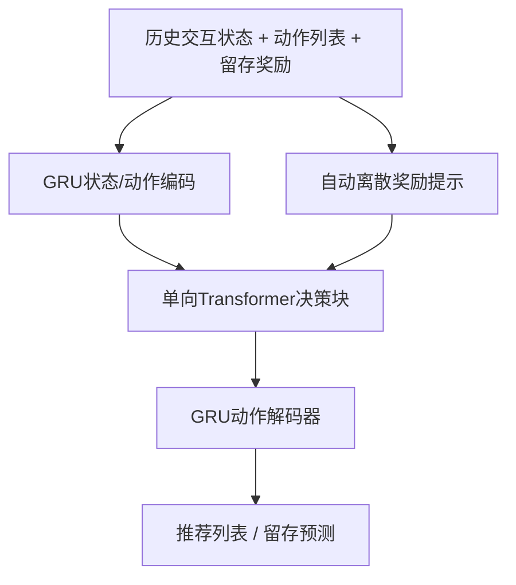
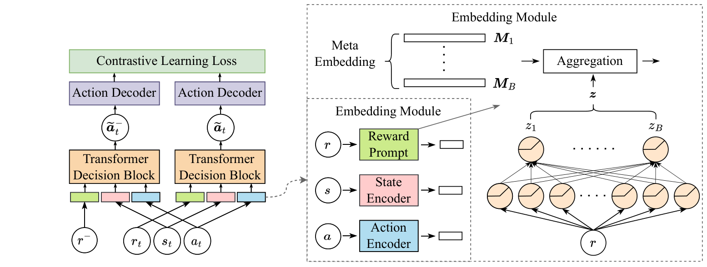

# User Retention-oriented Recommendation with Decision Transformer (面向用户留存的决策Transformer推荐)

- **会议/期刊**: WWW 2023
- **作者与机构**: Kesen Zhao, Lixin Zou, Xiangyu Zhao, Maolin Wang, Dawei Yin；City University of Hong Kong、Wuhan University、Baidu Inc.
- **推荐链路定位**: 序列推荐策略 / 端到端列表生成
- **研究方向**: 强化学习与动态探索推荐 / 序列与会话推荐
- **论文原文**: [arXiv](https://arxiv.org/abs/2303.06347v1)
- **开源代码**: [GitHub](https://github.com/kesenzhao/DT4Rec.git)

## TL;DR (1分钟核心速览)

针对在线RL试错伤害用户体验、离线RL存在Q值不稳与反事实评估高方差的问题，本文提出DT4Rec：把留存优化建模为以return-to-go、状态和动作为条件的自回归生成，并用自动离散奖励提示保留奖励偏序、加权对比学习对齐训练/推理、MB-URS/SB-URS稳定评估留存。IQiYi与ML-1m上，DT4Rec相对LIRD将MB-URS提升7.46%/1.19%，SB-URS提升13.68%/6.39%，IUR提升至26.0%/43.6%，NRC降至1.4%/3.6%。

## Background & Motivation (背景与核心矛盾)

- **主流范式**: 序列推荐优化点击/下一物品，离线RL（TopK、LIRD）通过重要性权重或actor-critic估计长期留存回报。
- **前人局限**: 值函数在推荐巨大动作空间中难以估计，policy gradient的重要性权重方差无界；DT直接回归标量奖励会丢失奖励的序数关系，且推理只输入最大奖励，训练中的小奖励样本知识被浪费。
- **核心洞察 (Key Insight)**: 留存奖励是有序数值信号；离线RL可转化为条件生成，避开自举与Q估计；小奖励动作可作为负对照，帮助模型远离低留存区域。
- **本文切入点**: DT4Rec = Decision Transformer + 自动离散奖励提示 + 加权对比监督策略 + 两类稳定留存指标。

## Method (核心方法设计)

### 1. 整体框架 (Overall Architecture)

输入用户历史交互状态与动作列表，奖励为未来$K$步登录留存$e_t=\sum_{k=1}^{K}\mathbb{I}[\mathrm{log\text{-}in}_{t+k}]$，并转为return-to-go$\hat{r}_t=\sum_{t'=t}^{T}e_{t'}$。状态与动作经GRU编码，奖励经自动离散提示生成嵌入；单向Transformer决策块融合$[\hat{\boldsymbol{r}}_1,\boldsymbol{s}_1,\boldsymbol{a}_1,\ldots,\hat{\boldsymbol{r}}_t,\boldsymbol{s}_t]$，再由GRU解码器以bos/eos逐项生成推荐列表。训练用交叉熵与加权对比损失；推理时条件于最大return-to-go自回归解码。

<figure class="paper-figure" markdown="span">
  <figcaption>图 1：DT4Rec 框架概览。负样本与正样本具有相同的状态和动作，但奖励被替换为不同值。正负样本共享相同的模型参数。</figcaption>
</figure>

### 2. 关键设计拆解 (Key Designs)

1. **自动离散奖励提示 (Auto-Discretized Reward Prompt)**：痛点是将标量奖励直接映射为嵌入会破坏“相似奖励应相近”的偏序。本文将奖励转为$B$个可学习元嵌入的权重：$\boldsymbol{z}=\phi(\boldsymbol{W}\sigma(\boldsymbol{w}\hat{r})+\alpha\sigma(\boldsymbol{w}\hat{r}))$，$\tilde{\boldsymbol{r}}=\sum_{b=1}^{B}\boldsymbol{z}_b\boldsymbol{M}_b$。平滑网络使相近$\hat{r}$共享相近提示，保留奖励序数信息；原文设$B=10,\alpha=0.1$。
2. **加权对比监督策略学习 (Weighted Contrastive Policy Learning)**：DT推理只用最大奖励，训练中的小奖励样本与推理分布不一致。本文构造同状态、同动作但不同奖励的负样本，损失为$\mathcal{L}_{CL}=-\sum_{\tilde{\boldsymbol{V}}^-\in\Upsilon}\kappa(\tilde{\boldsymbol{V}}^-)f_s(\tilde{\boldsymbol{V}},\tilde{\boldsymbol{V}}^-)$，权重$\kappa$与负样本奖励成反比，使预测序列远离低留存动作，从而利用小奖励知识。
3. **训练目标、负采样与推理效率**：总损失$\mathcal{L}=\mathcal{L}_{CE}+\beta\mathcal{L}_{CL}$；不使用物品负采样，对比负样本由奖励扰动构造。动作编码/解码用GRU处理动态长度列表，最大长度$N=20$，决策块为2层、8头、$d=128$单向Transformer。推理以最大return-to-go为提示逐步解码，复杂度主要来自$O(T^2d)$自注意力。

## Experimental Setup & Evaluation Protocol (实验设置与评估协议)

- **数据集与预处理**:

| 数据集 | #Users | #Items | #Interactions | 稀疏度/密度 | 特征/场景说明 |
| :--- | :---: | :---: | :---: | :---: | :--- |
| IQiYi | 3,000,000 | 4,000,000 | 71,046,026 | 5.8e-6 | 视频观看/评论等，保留≥20条交互用户，不区分交互类型；周留存$K=7$ |
| ML-1m | 6,014 | 3,417 | 1,000,000 | 4.84% | 电影评分，按月计算留存 |

- **数据划分与防穿越 (Splitting Strategy)**: 原文未明确Leave-One-Out、比例划分或全局时间戳切分细节；按序列到序列监督训练，预测下一段交互列表。MB-URS在独立30%验证集上训练奖励预测器，避免用训练集直接评估。
- **排名评测协议 (Ranking Protocol)**: 非Full-Ranking全库排序，也未报告采样负例比例；预测准确率用BLEU/ROUGE/NDCG/HR衡量生成列表与真值匹配。留存用MB-URS、SB-URS、IUR、NRC，其中$\mathrm{SB\text{-}URS}=\sum_{k=0}^{K}s_k\cdot(g_k-\frac{K}{2})\cdot N_k$，$s_k$为第$k$类奖励样本的BLEU-1相似度。
- **对比基线与超参设置**: 对比BERT4Rec、SASRec、LIRD、TopK、DT4Rec-R；DT4Rec设$B=10$、$N=20$、轨迹长度$T\in\{10,20,30,40,50\}$、2层Transformer、8头、$d=128$、AdamW、学习率0.01；显著性用双侧$t$检验$p<0.05$。

## Key Experimental Results (实验关键数据)

### 1. 主实验对比 (Main Results)

| 数据集 | 模型 | BLEU↑ | ROUGE↑ | NDCG↑ | HR↑ |
| :--- | :--- | :---: | :---: | :---: | :---: |
| IQiYi | BERT4Rec | 0.7964 | 0.7693 | 0.7384 | 0.7673 |
| IQiYi | SASRec | 0.8009 | 0.7906 | 0.7827 | 0.7815 |
| IQiYi | **DT4Rec** | **0.8249** | **0.8172** | **0.8139** | **0.8044** |
| ML-1m | BERT4Rec | 0.3817 | 0.3806 | 0.5286 | 0.2769 |
| ML-1m | SASRec | 0.4052 | 0.3983 | 0.5409 | 0.3123 |
| ML-1m | **DT4Rec** | **0.4331** | **0.4185** | **0.5679** | **0.3342** |

相对最强基线SASRec：IQiYi BLEU +3.00%、NDCG +3.99%；ML-1m BLEU +6.89%、NDCG +4.99%。

| 数据集 | 模型 | MB-URS↑ | SB-URS↑ | IUR↑ | NRC↓ |
| :--- | :--- | :---: | :---: | :---: | :---: |
| IQiYi | DT4Rec-R | 5.16 | 52131 | 7.5% | 2.6% |
| IQiYi | TopK | 5.41 | 61045 | 12.7% | 2.0% |
| IQiYi | LIRD | 5.63 | 63572 | 17.3% | 1.9% |
| IQiYi | **DT4Rec** | **6.05** | **72270** | **26.0%** | **1.4%** |
| ML-1m | DT4Rec-R | 5.42 | 13050 | 31.2% | 9.7% |
| ML-1m | TopK | 5.71 | 13964 | 38.3% | 6.9% |
| ML-1m | LIRD | 5.86 | 14627 | 41.9% | 4.8% |
| ML-1m | **DT4Rec** | **5.93** | **15562** | **43.6%** | **3.6%** |

相对LIRD：IQiYi MB-URS +7.46%、SB-URS +13.68%、IUR +50.3%相对、NRC降26.3%；ML-1m MB-URS +1.19%、SB-URS +6.39%、IUR +4.06%、NRC降25.0%。

### 2. 消融实验 (Ablation Study)

| IQiYi变体 | SB-URS↑ | MB-URS↑ | IUR↑ |
| :--- | :---: | :---: | :---: |
| DT4Rec | 72270 | 6.05 | 26.0% |
| w/o contrastive | 65175 (-9.82%) | 5.68 (-6.11%) | 18.3% (-29.6%) |
| w/o weight | 69316 (-4.09%) | 5.79 (-4.30%) | 20.6% (-20.8%) |
| w/o auto-dis | 70953 (-1.82%) | 5.96 (-1.49%) | 24.2% (-6.9%) |

### 3. 关键实验发现 (Key Findings)

- 主实验中DT4Rec在IQiYi把IUR从17.3%推到26.0%、NRC从1.9%降到1.4%，说明条件生成策略确实把列表推向高留存区域，而非只拟合点击。
- 消融显示移除对比学习后IUR跌29.6%、SB-URS跌9.82%，移除奖励权重后IUR跌20.8%；对比学习是缓解训练/推理OOD的最大贡献项，奖励提示则提供较小的稳定增益。
- 图4显示MB-URS/SB-URS在5个测试子集上的方差低于RiB；图5显示仅保留10%高奖励样本时DT4Rec仍优于TopK，表明其并非简单行为克隆，但ML-1m的MB-URS仅提升1.19%，留存信号较弱时收益有限。

## Highlights & Limitations (亮点、对比与审稿批判)

- **与代表作对比 (vs. Prior Work)**: TopK用重要性权重做离线策略学习，但反事实权重方差大；LIRD用actor-critic做列表推荐，却在巨大动作空间中难估Q值；SASRec/BERT4Rec优化下一物品匹配而非留存。DT4Rec以return-to-go条件生成替代自举与Q估计，并把小奖励样本转为负对照。
- **可迁移亮点**: 自动离散奖励提示可用于任何“数值条件生成”任务；同状态/动作、不同奖励的加权对比负样本构造，可直接迁移到多目标重排与长期价值建模。
- **审稿级局限批判**: 评估并非标准全库排序或采样排序，缺少统一切分与负采样协议，难以与常规序列推荐直接横比；MB-URS依赖额外奖励预测器，离线指标仍可能与在线留存偏离，且未报告线上A/B与推理延迟。

## Rating (四维评分)

- **方法创新性 (Novelty)**: ⭐⭐⭐⭐ （首次将Decision Transformer用于留存推荐，奖励提示与加权对比设计有明确增量）
- **评估协议与实验扎实度 (Protocol & Experiments)**: ⭐⭐⭐ （双数据集、显著性检验和消融较完整，但缺少标准排序协议与在线验证）
- **写作与数学规范度 (Clarity & Rigor)**: ⭐⭐⭐⭐ （核心公式与模块清晰，奖励偏序论证偏直觉，部分数据划分细节缺失）
- **工业落地与复现价值 (Industrial & Practical Value)**: ⭐⭐⭐ （代码开源、无需Q估计，但离线指标依赖奖励模型，线上部署仍需延迟与A/B验证）

