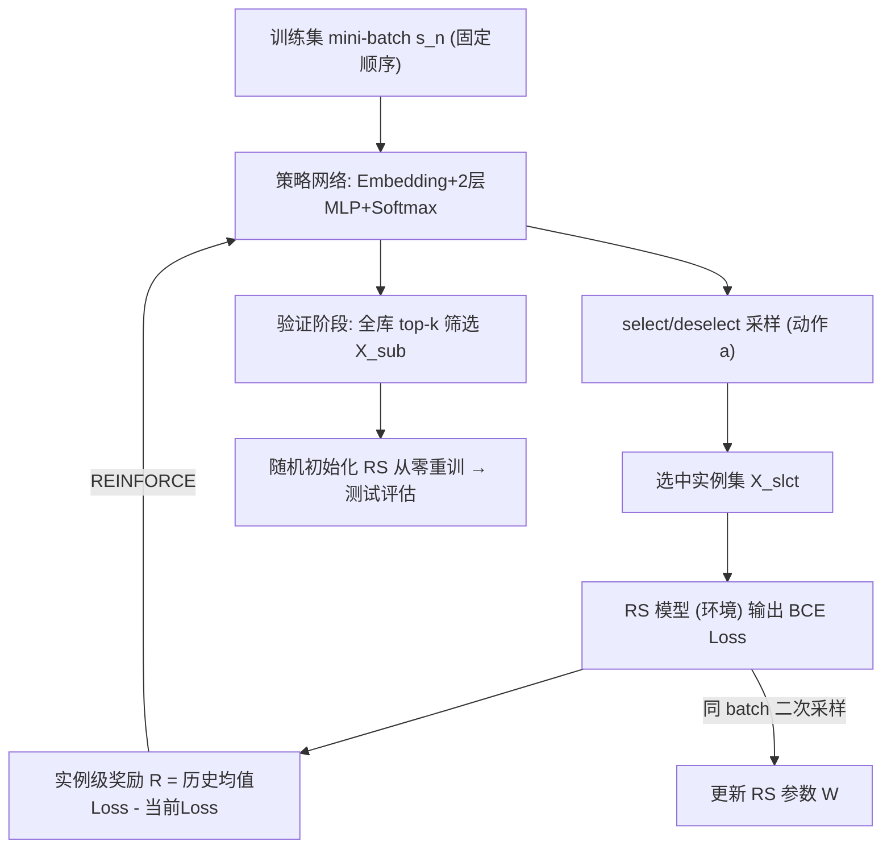
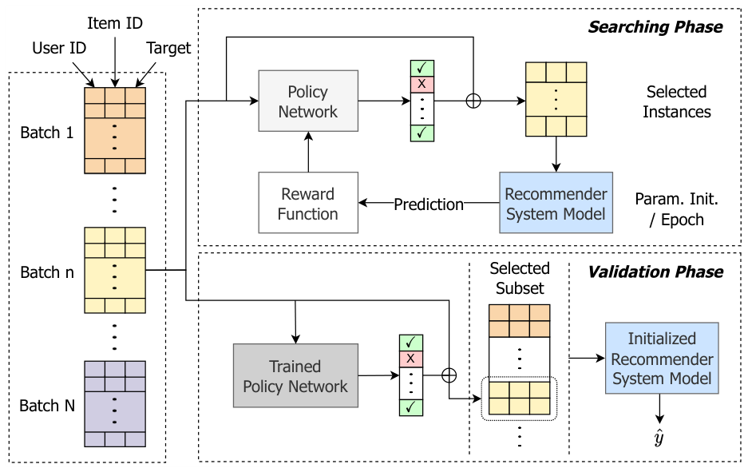

# AutoDenoise: Automatic Data Instance Denoising for Recommendations (基于深度强化学习的推荐数据实例自动去噪)

- **会议/期刊**: WWW 2023 (The ACM Web Conference)
- **作者与机构**: Weilin Lin, Xiangyu Zhao(通讯), Yejing Wang, Yuanshao Zhu, Wanyu Wang — 香港城市大学 (CityU HK) / 南方科技大学
- **推荐链路定位**: 精排（CTR 预估模型的训练数据预处理，可前置于任意骨干）
- **研究方向**: 自监督对比学习与交互去噪 / 强化学习与动态探索推荐
- **论文原文**: [https://arxiv.org/abs/2303.06611v1](https://arxiv.org/abs/2303.06611v1)
- **开源代码**: [https://github.com/chongminggao/KuaiRec](https://github.com/chongminggao/KuaiRec)（仅提供 KuaiRec 数据，框架代码暂未开源）

## TL;DR (1分钟核心速览)

推荐系统的原始交互日志中混有大量"好奇点击/误点"噪声，与真实兴趣几乎不可区分，而已有的**选择类**去噪依赖固定采样分布（数据分布漂移时选择偏置严重）、**重加权类**去噪与具体模型强耦合（不可迁移）。本文提出 AutoDenoise：将"每条实例去留"建模为 DRL 动作，用两层 MLP 策略网络对 mini-batch 内每个实例输出 `select/deselect` 概率，奖励定义为该实例**当前 loss 相对过去 C 轮平均 loss 的下降量**，并用"搜索阶段（交替优化策略与 RS 模型）+ 验证阶段（top-k 全局筛选后从零重训）"两阶段算法保证策略真正收敛。在 MovieLens1M / KuaiRec-Small / Netflix 上，DeepFM 的 AUC 由 0.8048 提升至 0.8097（+0.61%），Netflix 上由 0.6604 提升至 0.6683（+1.20%），且去噪子集可跨骨干迁移。

## Background & Motivation (背景与核心矛盾)

- **主流范式**: CTR 预估模型直接在所有历史实例上做二分类训练；去噪研究分为**选择类**（训练选择网络丢弃噪声实例，如 Drop3、BDIS、LSBo/LSSm）与**重加权类**（按 loss 大小动态降权，如 T-CE/R-CE）。
- **前人局限 1**: 选择类方法依赖固定采样分布与 k-NN/局部集等静态规则，在线数据分布剧烈漂移时**选择偏置被放大**（分布越动态，偏得越厉害）。
- **前人局限 2**: 重加权类方法嵌入模型的训练过程本身，换模型或换任务即需重新调参，**缺乏可迁移性**；且 T-CE/R-CE 高度依赖负采样策略，在 KuaiRec 这类密度 99.62% 的数据上几乎采不到有效未观测负例。
- **核心洞察 (Key Insight)**: 噪声实例与干净实例的特征分布"几乎同构"，因此判定标准不能是静态特征规则，而应是**该实例对当前模型预测误差的边际贡献变化**——同一实例跨轮次的 loss 下降量，恰好是一个天然、与分布无关的实例级信号。
- **本文切入点**: 用策略网络在 mini-batch 粒度上自适应学习"去留"，把去噪与预测模型**解耦成两个可分别优化的对象**，从而同时获得鲁棒性与迁移性。

## Method (核心方法设计)

### 1. 整体框架 (Overall Architecture)

框架交替运行两个阶段。**搜索阶段**：把一个 mini-batch 的所有实例作为一个状态 $s_n$，策略网络对其逐实例打分并采样 `select/deselect` 动作，被选中的实例喂给 RS 模型（即 DRL 环境）算 BCE loss；用该实例跨轮 loss 对比得到奖励，REINFORCE 更新策略参数$\Theta$，随后再对**同一 batch** 重新采样一次动作来更新 RS 参数$W$（一个 batch 用两次，避免策略与环境的更新互相污染）。**验证阶段**：用训练好的策略对全训练集分 batch 推断，每 batch 取 `select` 概率 top-$k$组装干净子集$\boldsymbol{X}_{sub}$，再以随机初始化从零训练 RS 模型至收敛，用其测试集表现作为"去噪能力"的度量。整体每轮验证都需重训一次，只有测试最优的$(\Theta^*, \boldsymbol{X}_{sub})$ 被保留。

<figure class="paper-figure" markdown="span">
  <figcaption>图1：所提出框架的概述。</figcaption>
</figure>

### 2. 关键设计拆解 (Key Designs)

1. **实例级 DRL 策略网络（select/deselect 动作空间）**：痛点是静态选择规则在动态分布下失效。给定实例 $\boldsymbol{X}_{nm}$，先做特征域 embedding 拼接过 MLP，再 Softmax 出二维动作概率：
$\boldsymbol{E}_{nm}=\mathbf{A}\boldsymbol{X}_{nm},\quad \boldsymbol{h}_l=\sigma(\boldsymbol{W}_l\boldsymbol{h}_{l-1}+\boldsymbol{b}_l),\quad \boldsymbol{p}_{nm}=\mathrm{Softmax}(\boldsymbol{W}_L\boldsymbol{h}_{L-1}+\boldsymbol{b}_L)$动作从$\boldsymbol{p}_{nm}$采样。之所以有效：策略输出依赖**当前 batch 的上下文与模型状态**而非数据集先验，因而分布漂移时判定准则随之自适应；且策略仅 2 层 MLP、$d=16$，几乎不增加推理负担。

2. **跨轮次 loss 差分奖励（Instance-level Reward）**：痛点是小 batch 间 loss 量纲/难度差异极大，绝对 loss 不能当奖励。作者维护损失矩阵 $\boldsymbol{LMat}\in\mathbb{R}^{C\times MN}$，把奖励定义为该实例过去$C$ 轮平均 loss 与当前 loss 之差：
$R_{mn}=\frac{1}{C}\sum_{c=1}^{C}L^{c}_{mn}-L_{mn}$
$R_{mn}>0$表示该实例本轮被"选得更好"。为公平比较，**每个 epoch 开始都重置 RS 参数**，使各轮 loss 处于同一初始化基准上；同时对历史项取$C$ 轮平均以抵消动作采样的随机性。直觉上这等价于"该实例是否让模型变得更确定"，噪声实例的 loss 会长期不降甚至上升。

3. **两阶段训练目标、采样与开销**：搜索阶段目标与更新为
$\max_{\Theta}J(\Theta)=\mathbb{E}_{a\sim\Theta(a|s)}[R(a|s)],\quad \Theta\leftarrow\Theta+\beta\nabla_{\Theta}J(\Theta)$采用 REINFORCE + 蒙特卡洛（采样数$T=1$以省算力）；RS 侧用标准 BCE 与 SGD/Adam 更新$W$。前置$C$轮 **warm-up** 只训 RS 以填满$\boldsymbol{LMat}$。**无负采样**（直接用观测实例的 0/1 标签），因此高密度数据同样适用；但训练开销显著——验证阶段每个搜索 epoch 都要从零重训一次 RS 模型。

## Experimental Setup & Evaluation Protocol (实验设置与评估协议)

- **数据集与预处理**:

| 数据集 | #Users | #Items | #Interactions | 稀疏度/密度 | 特征/场景说明 |
| :--- | :---: | :---: | :---: | :---: | :--- |
| MovieLens1M | 6,040 | 3,706 | 1,000,209 | 密度 4.47% | 电影评分隐式化，中等密度 |
| KuaiRec-Small | 7,176 | 10,728 | 12,530,806 | 密度 99.62% | 快手短视频，近乎稠密、含天然噪声 |
| Netflix | 480,189 | 17,770 | ~1.0×10⁸ | 密度 0.02% | 极稀疏，压力测试迁移性 |

- **数据划分与防穿越**: 随机 **比例划分 80%/10%/10%**（train/valid/test），非时间切分、非 Leave-One-Out；去噪子集仅从训练集内筛选，测试集全程不参与策略训练，避免穿越。
- **排名评测协议**: 本质为 CTR 二分类而非排序，采用 **AUC ↑ 与 Logloss ↓**；AUC 在 0.001 量级的差异即视为显著，并以双侧 t 检验 $p<0.05$ 标注 `*`。
- **对比基线与超参**: 骨干涵盖 FM / Wide&Deep / DCN / IPNN / DeepFM；去噪基线含选择类 Drop3、BDIS、LSBo、LSSm 与重加权类 T-CE、R-CE。策略网络 embedding 与两层隐层维度 $d=16$，Dropout 0.2，BN + ReLU；warm-up$C^{*}=4$，选择比例$\epsilon^{*}=98\%$（即每 batch 保留 top-98%），搜索与验证各 50 个 epoch。

## Key Experimental Results (实验关键数据)

### 1. 主实验对比 (Main Results)

**(a) 骨干模型插入 AutoDenoise 前后（AUC，w/o → w）**

| Backbone | MovieLens1M | KuaiRec-Small | Netflix | Improv.(ML1M / Netflix) |
| :--- | :---: | :---: | :---: | :---: |
| FM | 0.8080 → 0.8095* | 0.8654 → 0.8657 | 0.6523 → 0.6541* | +0.19% / +0.28% |
| Wide & Deep | 0.7957 → **0.8022*** | 0.8641 → 0.8642 | 0.6575 → 0.6620* | +0.82% / +0.68% |
| DCN | 0.8092 → 0.8115* | 0.8641 → 0.8649 | 0.6711 → 0.6761* | +0.28% / +0.75% |
| IPNN | 0.8023 → 0.8063* | 0.8630 → 0.8635 | 0.6682 → 0.6734* | +0.50% / +0.78% |
| DeepFM | 0.8048 → **0.8097*** | 0.8653 → 0.8659 | 0.6604 → **0.6683*** | +0.61% / +1.20% |

**(b) 与去噪/实例选择基线对比（骨干固定 DeepFM）**

| Method | ML1M AUC↑ | ML1M Logloss↓ | KuaiRec AUC↑ | KuaiRec Logloss↓ | Netflix AUC↑ | Netflix Logloss↓ |
| :--- | :---: | :---: | :---: | :---: | :---: | :---: |
| w/o (原始噪声数据) | 0.8048 | 0.5306 | 0.8653 | 0.4184 | 0.6604 | 0.8926 |
| Drop3 | 0.7701 | 0.5776 | 0.8485 | 0.4472 | 0.6444 | 1.3277 |
| BDIS | 0.6995 | 0.7996 | 0.8018 | 0.6694 | 0.5726 | 1.1192 |
| LSBo | 0.7659 | 0.5851 | 0.8439 | 0.4501 | 0.6355 | 1.4491 |
| LSSm | 0.7752 | 0.5841 | 0.8566 | 0.4931 | 0.6471 | 1.0330 |
| T-CE | 0.7814 | 1.7886 | 0.8140 | 1.7509 | 0.6785 | 2.5780 |
| R-CE | 0.7817 | 1.8263 | 0.8189 | 1.8955 | **0.6832** | 2.5801 |
| **AutoDenoise** | **0.8097*** | **0.5225*** | **0.8659*** | **0.4172*** | 0.6683 | **0.8800*** |

**(c) 迁移性测试**：以 DeepFM 选出的干净子集直接训练其它骨干，FM/W&D/DCN/IPNN 在三个数据集上 AUC 与 Logloss 全面不劣于（多数显著优于）原始数据训练，例如 DCN 在 Netflix 上 0.6711 → 0.6762*，W&D 在 ML1M 上 0.7957 → 0.8001*。

### 2. 消融实验 (Ablation Study)

| 变体 | 选择策略 | MovieLens1M 表现（图 3） | 结论 |
| :--- | :--- | :--- | :--- |
| Normal (w/o) | 不去噪 | 基线（DeepFM 0.8048） | — |
| AutoDenoise-v | 验证阶段沿用**逐实例**选择 | 五个骨干均低于 AD；**IPNN 甚至低于 Normal（<0.8023）** | 缺少 batch 内全局对比 |
| AutoDenoise | 验证阶段 **top-k** 选择 | 五个骨干均最优（DeepFM 0.8097） | 全局约束更稳 |

### 3. 关键实验发现 (Key Findings)

1. **稀疏度决定收益上界**：KuaiRec-Small 密度 99.62%，AUC 仅从 0.8653 涨到 0.8659（+0.07%），而 Netflix 密度 0.02% 时 DeepFM 提升 +1.20%、W&D +0.68%——干净实例在稠密数据中本就占主导，噪声对用户画像的边际污染在稀疏场景才被放大，说明去噪的价值随稀疏度单调增长。
2. **选择类基线普遍"越去越差"**：Drop3/BDIS/LSBo/LSSm 在 ML1M 上把 AUC 从 0.8048 压到 0.6995–0.7752，本质是压缩式选择丢弃了过多有效样本；而 T-CE/R-CE 虽在极稀疏 Netflix 上 AUC 达 0.6785/0.6832，Logloss 却爆炸到 2.58（概率严重失准），暴露其对负采样策略的强依赖。AutoDenoise 是唯一在三数据集上**同时**拿到最优 Logloss 的方法。
3. **top-k 全局约束是消融中的关键胜负手**：去掉后（AD-v）IPNN 反而跌破不去噪基线，说明逐实例的"局部视角"会把弱选中实例当成新噪声；而选择比例 $\epsilon$的敏感性呈倒 U 形——$\epsilon<95\%$丢信息、$\epsilon\to99\%$保留噪声，最优$\epsilon^{*}=98\%$、warm-up$C^{*}=4$（$C$过小则奖励方差大，$C$ 过大则历史均值过度平滑、当前 loss 主导导致奖励不稳）。

## Highlights & Limitations (亮点、对比与审稿批判)

- **与代表作对比 (vs. Prior Work)**: 相较 Drop3/LSBo 等基于 k-NN 与局部集的**静态规则**，AutoDenoise 的判定准则是随模型状态与 batch 上下文变化的动态策略；相较 T-CE/R-CE 把降权嵌入训练过程的**模型耦合**设计，本文把去噪产物固化为一个可复用的数据子集 $\boldsymbol{X}_{sub}$，从而获得表 3 验证的跨骨干迁移性；相较同为选择类的 BDIS，DRL 形式的序列决策避免了单步贪心带来的选择偏置累积。
- **可迁移亮点**: (i) "跨轮次 loss 差分 + epoch 级参数重置"是一个与模型无关的实例价值度量，可直接移植到序列推荐、多模态推荐的样本清洗；(ii) 用 top-k 对策略输出施加 batch 级全局约束，可推广到任意 soft-selection 模块，抑制弱选中样本的隐性噪声。
- **审稿级局限批判**: (i) **开销不可忽视**——验证阶段每个搜索 epoch 都需从零重训一次 RS 模型（共 50 轮搜索/验证），加之 warm-up 与同 batch 二次前向，论文未给出总 GPU 时长的量化对比，与"comparable computational cost"的宣称存在张力；(ii) **收益幅度与鲁棒性有限**——绝对 AUC 提升多在 0.2%–1.2% 量级，KuaiRec 上几乎不显著，且 Netflix AUC 反被 R-CE 超越（0.6683 vs 0.6832），作者仅以 Logloss 更优解释，缺少对 AUC/Logloss 分歧的深入分析；(iii) 仅在 CTR 式二分类骨干上验证，未涉及序列/图推荐，且策略网络与 RS 模型深度耦合于"每 epoch 重置"这一非标准训练范式，复现门槛较高。

## Rating (四维评分)

- **方法创新性 (Novelty)**: ⭐⭐⭐⭐ （首次把 CTR 实例级去噪形式化为 DRL 序列决策，跨轮 loss 差分奖励 + 两阶段搜索/验证组合在思路上新颖，但策略网络本体仅是浅层 MLP，理论支撑偏经验）
- **评估协议与实验扎实度 (Protocol & Experiments)**: ⭐⭐⭐⭐ （三档密度数据集 + 5 骨干 + 6 去噪基线 + 迁移性 + 显著性检验较完整，但缺少时间切分验证与训练开销报告，Netflix 上 AUC 被基线反超未充分讨论）
- **写作与数学规范度 (Clarity & Rigor)**: ⭐⭐⭐⭐ （奖励函数与两阶段伪代码（Alg.1–3）交待清楚，图中选择流程直观；但验证阶段"每 epoch 重训"的算力复杂度分析缺失，部分符号如 $\epsilon$与$K/M$ 混用）
- **工业落地与复现价值 (Industrial & Practical Value)**: ⭐⭐⭐ （产物是"可直接复用的一次性干净子集"，对频繁换模型的工业场景有价值且策略网络推理极轻；但 50 轮全量重训的离线成本高，且框架代码未开源，落地需自行复现两阶段流程）

