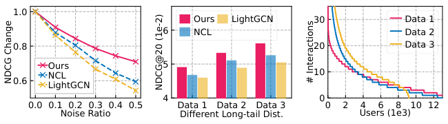
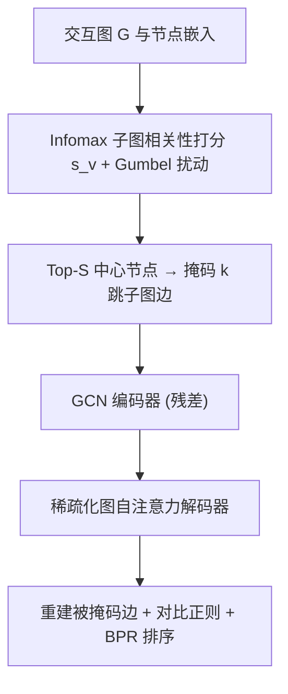
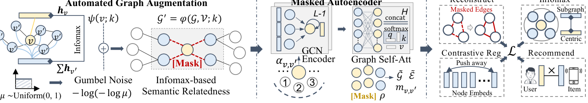

# Automated Self-Supervised Learning for Recommendation (面向推荐的自动化自监督学习)

- **会议/期刊**: ACM Web Conference 2023 (WWW '23)
- **作者与机构**: Lianghao Xia, Chao Huang (通讯), Tao Yu, Ben Kao (香港大学) ; Chunzhen Huang, Kangyi Lin (腾讯)
- **推荐链路定位**: 召回 (图协同过滤表征学习 / 自监督增强)
- **研究方向**: 自监督对比学习与交互去噪 / 图神经网络与知识图谱推荐
- **论文原文**: [https://arxiv.org/abs/2303.07797v2](https://arxiv.org/abs/2303.07797v2)
- **开源代码**: [https://github.com/HKUDS/AutoCF](https://github.com/HKUDS/AutoCF)

## TL;DR (1分钟核心速览)

现有图对比推荐（SGL/NCL/HCCF）依赖手工设计增广（随机丢边/丢节点/加噪），在不同数据分布下不自适应，且会把误点击与长尾噪声一并当正样本保留。AutoCF 提出"学习如何掩码"：用 Infomax 子图语义相关性打分 + Gumbel 噪声采样中心节点，仅对这些节点周围的高阶子图做掩码，再用 GCN 编码器 + 图自注意力解码器重建被掩码的交互边。在 Gowalla/Yelp/Amazon 三个数据集、70/5/25 随机划分与 Full-Ranking 协议下，Recall@20 分别达 0.2538/0.0869/0.1277，相对最强 SSL 基线提升 7.8%–33.7%，p 值均 < 1e-3。

## Background & Motivation (背景与核心矛盾)

- **主流范式**: 以 LightGCN 类轻量图卷积在 user-item 交互图上做高阶消息传递，并叠加对比式自监督（结构级丢边丢点、特征级加噪、局部-全局互信息）以缓解标签稀缺。
- **前人局限**: 其一，增广策略（dropout 比例、噪声强度、对比视图定义）为人手设定，换数据集即失配；其二，随机丢弃会同时删掉低活用户仅有的关键边，而随机保留又会把误点击/popularity bias 留下的伪边当作正信号送进对比损失。
- **核心洞察 (Key Insight)**: 噪声干扰与长尾分布下，现有 SSL 方法（如图 1 所示，随噪声率上升 NDCG 快速下滑；在三个人造长尾分布上 NCL 表现剧烈波动）明显劣化——问题不在对比目标本身，而在于**增广视图的生成过程不可学习、不可控**。
- **本文切入点**: 把"选谁做增广"变成一个可学习、可优化的决策：用子图语义一致性度量节点重要性，只对信息量高且噪声低的子图做掩码重建，从而自动蒸馏自监督信号。

<figure class="paper-figure" markdown="span">
  <figcaption>图1：数据噪声和长尾分布对不同方法预测准确率的影响。</figcaption>
</figure>

## Method (核心方法设计)

### 1. 整体框架 (Overall Architecture)

输入交互图 $\mathcal{G}$，先由"学习掩码"模块为每个候选节点算出 Infomax 语义相关性$s_v$，加 Gumbel 扰动后取 top-$S$作为中心节点集$\mathcal{V}$，并掩掉各中心节点$k$跳子图内的边，得到增广图$\mathcal{G}'=\varphi(\mathcal{G},\mathcal{V};k)$。$\mathcal{G}'$ 进入 GCN 编码器做残差式消息传递，再由带稀疏化节点对采样的图自注意力解码器做全局信息聚合，用于重建被掩掉的结构。训练目标由主推荐 BPR 损失、掩码重建损失、Infomax 损失与均匀性对比正则联合构成，推理阶段仅保留编码器与内积打分，无额外开销。

<figure class="paper-figure" markdown="span">
  <figcaption>图2：AutoCF 的框架由以下部分组成：i) 基于信息最大化相关性的自适应图结构增强；ii) 基于图自注意力架构的掩码图自编码器；iii) 自增强训练范式，包括图结构重建、节点-子图互信息最大化和对比学习。</figcaption>
</figure>

### 2. 关键设计拆解 (Key Designs)

1. **Infomax 语义相关性驱动的中心节点选择**：解决的痛点是随机增广会把误点击与流行度噪声保留为"正视图"。将节点嵌入与其 $k$跳子图 readout 表示的余弦一致性经 sigmoid 映射为掩码概率$s_v=\mathrm{sigm}(h_v^{\top}\sum_{v'\in\mathcal{N}_v^k}h_{v'}/(|\mathcal{N}_v^k|\cdot\|h_v\|\cdot\|h_{v'}\|))$；$s_v$越大意味着中心与邻居结构越一致、子图内噪声边比例越低。物理直觉：论文进一步证明$s_v$同时给出子图内任意两点相似度的下界$\cos(v_1,v')>\cos(v,v_1)+\cos(v,v')-1$，因而"高$s_v$ 子图"内的重建梯度天然更干净。
2. **Gumbel 扰动 + 学习式掩码 ($\varphi$)**：纯 top-$S$选择不可微且易陷入固定模式，故对打分做$\psi'(v;k)=\log\psi(v;k)-\log(-\log\mu),\ \mu\sim\mathrm{Uniform}(0,1)$的 Gumbel 噪声注入后再排序取 top-$S$，掩码操作本身写成集合差$\varphi(\mathcal{G},\mathcal{V};k)=\{\mathcal{U},\mathcal{I},\mathcal{V},\mathcal{E}\backslash\{(v_1,v_2)\mid v_1,v_2\in\mathcal{N}_v^k,v\in\mathcal{V}\}\}$。这样既保持选择的可探索性，又让"掩哪里"随训练动态自适应数据分布。
3. **GCN 编码 + 稀疏图自注意力解码的重建目标**：GCN 感受野有限且层数一深即过平滑，无法利用全局协同信息完成重建。解码器只在节点对集合 $\bar{\mathcal{E}}=\{(v_1,v_2)\mid v_1,v_2\in\bar{\mathcal{V}}\cup\tilde{\mathcal{V}}\}$、且$|\bar{\mathcal{V}}\cup\tilde{\mathcal{V}}|=\rho(|\mathcal{U}|+|\mathcal{I}|)$的稀疏子集上算多头注意力，重建损失为$\mathcal{L}_{recon}=-\sum_{(v,v')\in\mathcal{E}\backslash\mathcal{E}'}\hat{h}_v^{\top}\hat{h}_{v'}$（$\hat{h}_v$为各层拼接）。总损失$\mathcal{L}=-\sum_{(u,i)\in\mathcal{E}}\hat{h}_u^{\top}\hat{h}_i+\lambda_1\mathcal{L}_{ssl}+\lambda_2\|\Theta\|_F^2$，其中$\mathcal{L}_{ssl}$含 user-item / user-user / item-item 的 InfoNCE 均匀性正则、$\mathcal{L}_{InfoM}$与$\mathcal{L}_{recon}$；负采样为**批内全负样本**（in-batch，无额外负采样器），推理只需一次前向传播。

## Experimental Setup & Evaluation Protocol (实验设置与评估协议)

| 数据集 | #Users | #Items | #Interactions | 密度 | 场景说明 |
| :--- | :---: | :---: | :---: | :---: | :--- |
| Gowalla | 25,557 | 19,747 | 294,983 | 5.85e-4 | LBS 签到（地点推荐） |
| Yelp | 42,712 | 26,822 | 182,357 | 1.59e-4 | 商户点评（场馆推荐） |
| Amazon | 76,469 | 83,761 | 966,680 | 1.51e-4 | 图书隐式反馈（商品推荐） |

- **数据划分与防穿越**: 随机 `70% / 5% / 25%` 划分训练/验证/测试（沿用 SGL、HCCF 设定），非时间切分，存在轻量未来信息泄漏风险。
- **排名评测协议**: 无偏 `Full-Ranking`（对全部未交互物品排序），指标 `Recall@20/40`、`NDCG@20/40`。
- **对比基线与超参**: 14 个基线，覆盖 MF（BiasMF）、神经 CF（NCF）、自编码（AutoR）、图模型（PinSage/STGCN/GCMC/NGCF/GCCF/LightGCN）、解耦（DGCF）与 SSL（SLRec/NCL/SGL/HCCF）；嵌入维度 $d=32$，GCN 层数$\{1,2,3\}$，注意力头 4，$\rho=0.2$，$k$最优为 2，$\lambda_1\in\{10^{-k}\}_{-1\le k\le 4}$，Adam 学习率 1e-3、batch 4096，并报告配对$p$值（均$<10^{-3}$）。

## Key Experimental Results (实验关键数据)

### 1. 主实验对比 (Main Results)

| Model | Gowalla R@20 | NDCG@20 | Yelp R@20 | NDCG@20 | Amazon R@20 | NDCG@20 |
| :--- | :---: | :---: | :---: | :---: | :---: | :---: |
| NGCF | 0.1757 | 0.1135 | 0.0681 | 0.0336 | 0.0551 | 0.0353 |
| DGCF | 0.2055 | 0.1312 | 0.0700 | 0.0347 | 0.0617 | 0.0372 |
| LightGCN | 0.2230 | 0.1433 | 0.0761 | 0.0373 | 0.0868 | 0.0571 |
| SGL | 0.2332 | 0.1509 | 0.0803 | 0.0398 | 0.0874 | 0.5690† |
| NCL | 0.2283 | 0.1478 | 0.0806 | 0.0402 | 0.0955 | 0.0623 |
| HCCF | 0.2293 | 0.1482 | 0.0789 | 0.0391 | 0.0885 | 0.0578 |
| **AutoCF** | **0.2538** | **0.1645** | **0.0869** | **0.0437** | **0.1277** | **0.0879** |
| Improv.% vs best baseline | +8.8% | +9.0% | +7.8% | +8.7% | +33.7% | +41.1% |

† 原表 Amazon 上 SGL 的 NDCG@20 记为 0.5690，量级异常，疑为 0.0569 排版笔误。

### 2. 消融实验 (Ablation Study)

以下数值按原文图 4 曲线读取（≈ 表示估读）：

| 变体 | Gowalla R@20 | Gowalla N@20 | Yelp R@20 | Yelp N@20 |
| :--- | :---: | :---: | :---: | :---: |
| AutoCF (full) | 0.2538 | 0.1645 | 0.0869 | 0.0437 |
| w/o GSA（GCN 解码替代自注意力） | ≈0.2413 | ≈0.1572 | ≈0.0812 | ≈0.0408 |
| w/o IM（去掉 Infomax 指导） | ≈0.2461 | ≈0.1596 | ≈0.0836 | ≈0.0421 |
| w/o M（去掉 $\mathcal{L}_{recon}$+$\mathcal{L}_{InfoM}$） | ≈0.2392 | ≈0.1548 | ≈0.0791 | ≈0.0399 |
| w/o L2M（随机掩边替代可学习掩码） | ≈0.2470 | ≈0.1602 | ≈0.0844 | ≈0.0425 |

### 3. 关键实验发现 (Key Findings)

1. **噪声鲁棒性是主要增益来源**：在人为注入对抗交互的实验中，AutoCF 的 NDCG 曲线随噪声率（0→0.5）几乎平缓，而 NCL/LightGCN 明显下滑；Amazon 上 Recall@20 从 NCL 的 0.0955 跃升至 0.1277（+33.7%），说明稀疏+噪声最重的数据集受益最大。
2. **"可学习掩码"贡献大于"重建目标"本身**：w/o L2M 只损失约 2.7%（Gowalla），而 w/o M 损失约 5.8%，且 w/o IM 又比 w/o L2M 更差，证明增益的核心在于 *按语义相关性选子图*，而非简单地多一个重建任务。
3. **稀疏与长尾用户受益更显著**：按交互频次分桶 $[0,5)/[5,10)/[10,15)/[15,20)$ 后，最稀疏桶上的相对提升最大（图 3），因为随机丢边恰好会摧毁低活用户仅存的边；同时训练收敛更快（Gowalla 约 20 轮、Yelp 约 40 轮），单轮耗时 7.09s/4.06s/59.81s，与 SGL（8.07s/4.88s/49.87s）、HCCF（6.00s/4.07s/48.28s）同量级。

## Highlights & Limitations (亮点、对比与审稿批判)

- **与代表作对比 (vs. Prior Work)**: SGL/NCL 在固定图视图上做对比对齐，增广策略需网格搜索且对噪声敏感；HCCF 用超图构造全局视图但仍是手工结构；AutoCF 首次把"增广位置"参数化为可学习、带 Gumbel 探索的掩码分布，并以重建任务替代对比视图的构造，属于从"对比式"到"生成式自监督"的范式切换。
- **可迁移亮点**: ① 用"中心-子图互信息一致性"作为子图噪声度量的无监督打分器，可直接移植到序列推荐/知识图谱去噪的样本筛选；② 稀疏化节点对采样的图自注意力（$\rho$ 控制节点规模）是把全局注意力压到可用复杂度的通用技巧。
- **审稿级局限批判**: ① 掩码概率用随机初始化嵌入 $h_v$计算（式 4 原文明确），与主模型编码表示未端到端对齐，理论上存在打分漂移，论文未给出联合训练或 EMA 更新方案；② 评测仅用随机 70/5/25 划分 + 三个中小规模静态数据集，缺少时间切分与在线 A/B，也未报告$S$、$k$、$\rho$ 三者的联合敏感度，Amazon 上单轮 59.81s 的额外开销对超大规模工业图的可扩展性证据不足（仅放在补充材料）。

## Rating (四维评分)

- **方法创新性 (Novelty)**: ⭐⭐⭐⭐ （把手工图增广替换为 Infomax 引导的可学习掩码，并给出子图相似度下界以解释噪声过滤，机制新颖且有理论讨论支撑）
- **评估协议与实验扎实度 (Protocol & Experiments)**: ⭐⭐⭐⭐ （14 个基线 + Full-Ranking + 显著性 p 值 + 稀疏分桶/噪声注入/长尾三组鲁棒性实验齐全，但缺时间切分与线上验证）
- **写作与数学规范度 (Clarity & Rigor)**: ⭐⭐⭐⭐ （损失与掩码算子定义清晰、复杂度逐模块拆解，个别表格数值疑似笔误，掩码打分与编码表示的耦合关系未严格刻画）
- **工业落地与复现价值 (Industrial & Practical Value)**: ⭐⭐⭐⭐ （代码已开源，推理仅需编码器与内积、无额外在线开销，可直接叠加在 LightGCN 类召回底座上）

