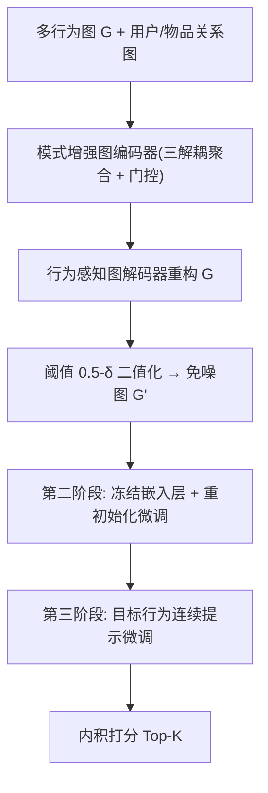
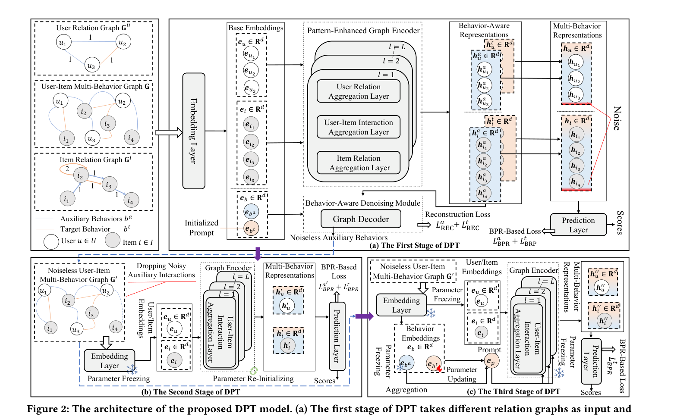

# Denoising and Prompt-Tuning for Multi-Behavior Recommendation (多行为推荐中的去噪与提示微调)

- **会议/期刊**: The Web Conference 2023 (WWW '23)
- **作者与机构**: Chi Zhang, Rui Chen, Qilong Han (哈尔滨工程大学)；Xiangyu Zhao (香港城市大学)；Li Li (University of Delaware)
- **推荐链路定位**: 召回（用户-物品表征学习与 Top-K 排序）
- **研究方向**: 自监督对比学习与交互去噪 / 图神经网络推荐
- **论文原文**: [论文原文链接](https://arxiv.org/abs/2302.05862v1)
- **开源代码**: [开源代码链接](https://github.com/zc-97/DPT)

## TL;DR (1分钟核心速览)

多行为推荐中，海量辅助行为（点击、收藏、加购）既混入误触噪声、又与目标行为（购买）存在语义鸿沟。DPT 提出三阶段范式：第一阶段用模式增强图编码器学表征、驱动行为感知图解码器以"重构难度"**无监督**定位噪声并丢弃辅助边；第二阶段冻结嵌入层、重初始化并只微调 $2Ld^2$参数；第三阶段用仅$d$ 维的连续提示对齐目标行为语义。在 IJCAI/Tmall 的 Leave-One-Out + HR/NDCG@10 协议下，HR 相对最强基线分别提升 2.62% 与 1.58%。

## Background & Motivation (背景与核心矛盾)

- **主流范式**: 以 LightGCN/GCN 建模 user-item 多行为图，或叠加注意力（MATN）、元学习与对比学习（CML）、知识图谱（KHGT）来区分行为类型。
- **前人局限**: ①辅助行为含大量误触噪声，数据中辅助/目标行为规模差距越大，噪声被放大得越严重，且**缺少噪声标签**；②大量点击到不了购买，学到的知识会被"挤压"进辅助行为语义空间，形成语义鸿沟，直接迁移反而误导目标推荐。
- **核心洞察 (Key Insight)**: 若表征足够信息量地参数化了图结构，则与局部-全局结构一致的正常交互应易于重构、异常交互难以重构——**重构损失本身即可作为噪声判别信号**，无需人工标注。
- **本文切入点**: 把"去噪"变成图上的一次重构自监督任务，再用"轻量微调 + 提示"把去噪后的知识低代价地迁移到目标行为。

## Method (核心方法设计)

### 1. 整体框架 (Overall Architecture)

输入是用户-物品多行为图 $\mathcal{G}=\{\mathcal{G}_a,\mathcal{G}_t\}$以及两类由数据驱动构造的关系图（用户共交互图$\mathcal{G}_U$、有向物品转移图$\mathcal{G}_I$）。第一阶段在嵌入层之上堆叠"用户关系/物品关系/用户-物品交互"三个解耦聚合层并门控融合，输出行为感知表征$\boldsymbol{h}^*_u,\boldsymbol{h}^*_i$；图解码器据此重构图，高于阈值判为噪声，输出免噪图$\mathcal{G}'$。第二阶段冻结嵌入层、重初始化 FFN 并仅在$\mathcal{G}'$ 上做轻量微调。第三阶段冻住前两阶段参数，只在目标行为图的每层加连续提示微调。训练用 BPR 排序损失 + 重构 BCE 联合优化，推理为内积 Top-K。

<figure class="paper-figure" markdown="span">
  <figcaption>图2：所提出DPT模型的架构。(a) DPT的第一阶段将不同的关系图作为输入，并为后续阶段输出无噪声图G′；(b) DPT的第二阶段重新初始化部分已学习参数，以进一步减弱噪声影响；(c) DPT的第三阶段使用连续提示来弥合行为语义差距。</figcaption>
</figure>

### 2. 关键设计拆解 (Key Designs)

1. **模式增强图编码器（用关系图补足无标签情境下的结构先验）**：仅靠交互图难以在早期训练中可靠判噪，作者以 Jaccard 共交互权重建无向用户图、以时序转移比 $\text{Cnt}(i\overset{*}{\to}j)/[\text{Cnt}(i\overset{*}{\to}j)+\text{Cnt}(j\overset{*}{\to}i)]$建有向物品图，并对物品的入/出邻居做二维注意力$\alpha^*_{IN},\alpha^*_{OUT}$，再用卷积算子保留维度级信息；最后门控融合：$\boldsymbol{e}^{(l+1)}_{u^*}=\boldsymbol{e}^{(l)}_{u^*}+\frac{1-\beta^*_u}{\beta^*_u}\boldsymbol{e}^{U,(l)}_{u^*}$。直觉是"同类用户/前后件商品"提供了无法从稀疏目标行为中学到的协同结构。
2. **行为感知去噪模块（把缺失的噪声标签变成重构难度）**：解码器输出参数化图 $\boldsymbol{h}_{G^*}=\sigma(\boldsymbol{H}^*_U\boldsymbol{e}_{b^*}^{\top}\boldsymbol{e}_{b^*}\boldsymbol{H}^{*\top}_I)$，与真实交互做逐元素二分类：$\mathcal{L}^*_{REC}=-\frac{1}{|\mathcal{U}||\mathcal{I}|}\sum_{u,i}\big[\mathcal{G}^*_{ui}\log \boldsymbol{h}_{G^*,ui}+(1-\mathcal{G}^*_{ui})\log(1-\boldsymbol{h}_{G^*,ui})\big]$。同时重构目标行为图，用更可靠的购买信号锚定表征，避免"把真实偏好当噪声误删"；二值化用$0.5-\delta$阈值（$\delta=0.2$），$\delta$ 控制去噪激进度。
3. **三阶段轻量学习与目标函数**：总损失 $\mathcal{L}=\mathcal{L}_{BPR}+\lambda\mathcal{L}_{REC}$，第二阶段损失$\mathcal{L}'_{BPR}=-\log\sigma(\text{sim}(\boldsymbol{h}'_u,\boldsymbol{h}'_{i^*})-\text{sim}(\boldsymbol{h}'_u,\boldsymbol{h}'_{j^*}))$，第三阶段提示逐层相加$\boldsymbol{e}^{(l)}_{u^t}=\boldsymbol{e}_p+\sum_{i\in N_{u^t}}\boldsymbol{e}^{(l)}_i$，$\boldsymbol{e}_p$由辅助/目标行为嵌入聚合初始化而非随机初始化。参数量$|\Theta_1|=(|\mathcal{U}|+|\mathcal{I}|)d+4L(d^2+1)\gg|\Theta_2|=2Ld^2\gg|\Theta_3|=d$，负采样为标准 BPR 随机负采样（无难负样本挖掘），故去噪与迁移的在线开销可忽略。

## Experimental Setup & Evaluation Protocol (实验设置与评估协议)

- **数据集与预处理**（四类行为：click / favorite / cart / purchase，purchase 为目标行为；过滤 purchase 交互少于 3 条的用户）：

| 数据集 | #Users | #Items | #Interactions | 稀疏度/密度 | 特征/场景说明 |
| :--- | :---: | :---: | :---: | :---: | :--- |
| IJCAI-Contest | 17,435 | 35,920 | 799,368 | 0.128% | B2C 零售，IJCAI15 竞赛数据 |
| Tmall | 31,882 | 31,232 | 1,451,219 | 0.146% | 天猫电商，辅助行为占比极高 |

- **数据划分与防穿越 (Splitting Strategy)**: `Leave-One-Out`——保留每个用户在 purchase 下的最后一次交互作为测试正样本。
- **排名评测协议 (Ranking Protocol)**: 沿用 MBGCN/CML 系的单正样本 + 负采样打分协议（原文未显式报告全库候选规模，属该文评估透明度的一处短板），指标 HR@10、NDCG@10。
- **对比基线与超参设置**: 单行为基线 BPR/PinSage/NGCF/LightGCN/SGL，多行为基线 NMTR/MATN/MBGCN/EHCF/KHGT/CML，另加轻量去噪基线 ADT、NoisyTune；$d=16$(IJCAI)、$32$(Tmall)，$L=3$，batch$=8192$，AdamW + CLR（$1e{-3}\to5e{-3}$），dropout$0.8$，$\delta=0.2$，双侧$t$-test$p<0.05$。

## Key Experimental Results (实验关键数据)

### 1. 主实验对比 (Main Results)

| 模型 | IJCAI HR@10 | IJCAI N@10 | Tmall HR@10 | Tmall N@10 |
| :--- | :---: | :---: | :---: | :---: |
| LightGCN | 0.257 | 0.122 | 0.342 | 0.205 |
| SGL | 0.249 | 0.123 | 0.350 | 0.210 |
| MBGCN | 0.304 | 0.160 | 0.381 | 0.213 |
| KHGT | 0.317 | 0.182 | 0.391 | 0.232 |
| EHCF | 0.409 | 0.237 | 0.433 | 0.260 |
| CML | 0.477 | 0.283 | 0.543 | 0.327 |
| ADT (去噪) | 0.475 | **0.286** | 0.542 | 0.324 |
| NoisyTune | 0.473 | 0.275 | 0.545 | 0.325 |
| **DPT (本文)** | **0.490** | **0.294** | **0.554** | **0.330** |
| **Improv.%** | **+2.62%** | **+2.65%** | **+1.58%** | **+0.92%** |

### 2. 消融实验 (Ablation Study)

| 配置 | IJCAI HR@10 | IJCAI N@10 | Tmall HR@10 | Tmall N@10 |
| :--- | :---: | :---: | :---: | :---: |
| w/o click（移除点击边） | 0.351 | 0.206 | — | — |
| w/o favorite | 0.423 | 0.237 | — | — |
| w/o add-to-cart | 0.481 | 0.285 | — | — |
| DPT-shallow（仅首层提示） | 0.472 | 0.274 | 0.536 | 0.316 |
| DPT-projection（投影式提示） | 0.489 | 0.291 | 0.548 | 0.329 |
| DPT-add（完整三阶段） | **0.490** | **0.294** | **0.554** | **0.330** |

### 3. 关键实验发现 (Key Findings)

1. **三阶段逐级增益且越后越省**: DPT-1 < DPT-2 < DPT-3 单调提升，且 DPT-2/DPT-3 每 epoch 比 DPT-1 快 **6×/12×**，说明"一次昂贵预训练 + 两次极轻量迁移"的性价比设计成立；第一阶段属离线预训练，不需频繁执行。
2. **噪声多但不可丢**: 移除 click 使 IJCAI HR 从 0.490 崩至 0.351（降 28%），移除 favorite 仅至 0.423、移除 cart 至 0.481——辅助行为越"脏"却信息量越大，印证"去噪而非丢弃"的动机，也解释为何 ADT 式剪枝收益有限（HR 0.475 < 0.490）。
3. **去噪激进度被有效控制**: Tmall 上仅丢弃 1.7% 点击（18,859）、0.1% 收藏（38）、0.3% 加购（352），却带来稳定增益；案例中用户 58 的未来购买件 2130 打分随三阶段 1.42→1.56→1.86 单调上升，被剔除的 4 条交互皆属误触点。

## Highlights & Limitations (亮点、对比与审稿批判)

- **与代表作对比 (vs. Prior Work)**: 相较 KHGT/EHCF 依赖知识图谱等外部先验，DPT 只用共交互/时序图作弱先验；相较 CML 的元学习 + 对比学习"软加权"行为权重，DPT 直接在**边级别**硬删除噪声，粒度更细；相较 ADT/NoisyTune 的剪枝或参数扰动，DPT 多了"语义鸿沟"这一显式处理目标。
- **可迁移亮点**: ①"重构损失 = 噪声分数"的无标签去噪范式可搬到序列去噪、假阳性隐反馈过滤；②冻结嵌入层 + 重初始化 + 提示的三段式轻调，可复用为大规模 GNN 推荐的增量训练模板。
- **审稿级局限批判**: ①Tmall 上 NDCG 仅提升 0.92%，增益偏薄且未见全库 Full-Ranking 协议与置信区间，统计说服力有限；②$\delta$与$0.5$阈值属经验设定，第一阶段需$O(|\mathcal{U}||\mathcal{I}|)$ 图重构，冷启动/大规模工业场景的重训成本与超参敏感性未做充分压测。

## Rating (四维评分)

- **方法创新性 (Novelty)**: ⭐⭐⭐⭐ （以重构难度替代噪声标签，并把去噪—迁移拆成三阶段，思路清晰有新意，但单点算子多为既有模块重组）
- **评估协议与实验扎实度 (Protocol & Experiments)**: ⭐⭐⭐ （两个数据集 + 13 个基线加消融较完整，但仅 Leave-One-Out 单正样本协议、未报全库排序与方差）
- **写作与数学规范度 (Clarity & Rigor)**: ⭐⭐⭐⭐ （三阶段与三聚合层符号体系一致、复杂度分析到位，个别公式符号重复定义略有混淆）
- **工业落地与复现价值 (Industrial & Practical Value)**: ⭐⭐⭐⭐ （代码开源，第二阶段 6×、第三阶段 12× 加速使增量上线可行，第一阶段离线预训练成本可控）

