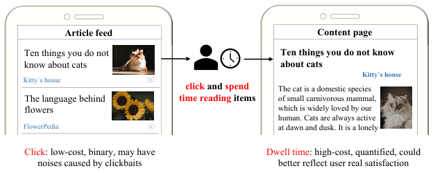
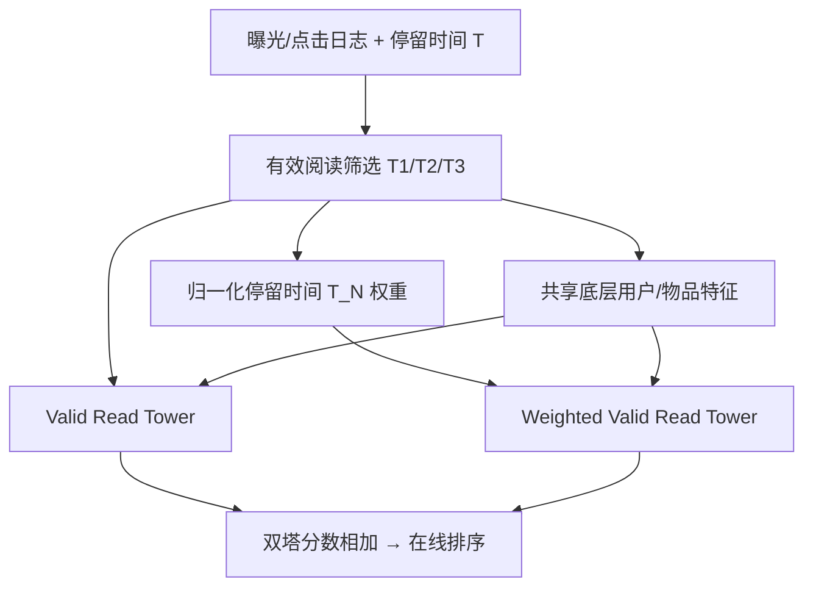
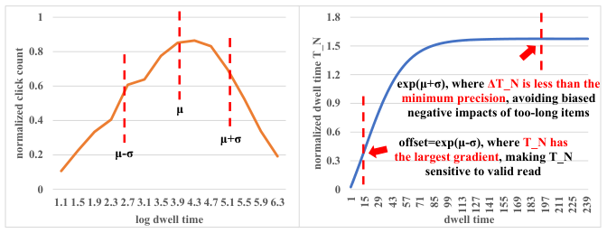

# Reweighting Clicks with Dwell Time in Recommendation (以停留时间重加权点击信号的推荐模型)

- **会议/期刊**: WWW 2023 Companion (5 页短文)
- **作者与机构**: Ruobing Xie*, Lin Ma*, Shaoliang Zhang, Feng Xia, Leyu Lin（腾讯微信，*共同一作，谢若冰为通讯）
- **推荐链路定位**: 精排（训练目标层改造，模型无关）
- **研究方向**: 自监督对比学习与交互去噪 / 多任务学习与列表级重排
- **论文原文**: [论文原文链接](https://arxiv.org/abs/2209.09000v2)
- **开源代码**: 暂未开源

## TL;DR (1分钟核心速览)

隐式点击被等权当作正样本训练，会同时放大标题党与"标题-正文不匹配"造成的假阳性，也无法刻画同一用户在不同物品上的偏好强度。本文提出**点击重加权框架**：先用停留时间分布定义"有效阅读 (valid read)"过滤低质点击（兼顾轻用户与短物品），再用归一化 Sigmoid 停留时间函数 $T_N$ 作为样本权重，与常规有效阅读塔构成双塔多任务学习。在微信看一看 29.7M 用户、751M 样本上，离线有效阅读预测 AUC 由 0.7810 提升至 0.7968（RelaImpr +5.62%），线上 7 天 A/B 全量用户 CTR +2.577%、人均点击数 +4.139%。

## Background & Motivation (背景与核心矛盾)

- **主流范式**: 以二值点击为正样本、曝光未点击为负样本训练 CTR 精排模型；少量工作把停留时间 (DT) 作为额外回归标签（CTR+logDT 多任务）。
- **前人局限**: ① 等权点击无法区分"点进去 3 秒跳出"与"读满 3 分钟"，点击诱饵被当成正样本污染表征；② CTR+logDT 直接把原始/对数 DT 当标签回归，会过度奖励长内容与重度用户，长尾轻用户、短视频/短图文被系统性压制。
- **核心洞察 (Key Insight)**: 同一停留时长增量在不同区间带来的满足度增量并不相等（$1\text{s}\to15\text{s}$远大于$601\text{s}\to615\text{s}$）；信息增益随阅读时长呈边际递减。由此提出 (A1) 相同 DT 对任意用户/物品代表等价的"宝贵时间成本"、(A2) 存在最小有效阅读时长、(A3) 超过一定时长后信息增益趋于饱和。
- **本文切入点**: 把 DT 从"额外预测目标"改造为"点击样本的监督权重"——先筛选、再加权，全流程模型无关（model-agnostic）。

<figure class="paper-figure" markdown="span">
  <figcaption>图1：停留时间作为点击的自然权重。</figcaption>
</figure>

## Method (核心方法设计)

### 1. 整体框架 (Overall Architecture)

输入为曝光日志中的 $(u, d_i, T)$三元组。首先用停留时间的对数分布$(\mu,\sigma)$标定主流区间$[\exp(\mu-\sigma),\exp(\mu+\sigma)]\approx[15\text{s},200\text{s}]$，据此按三类规则筛出"有效阅读"正样本与"无效点击"负样本；同时把每条正负样本的原始 DT 通过归一化 Sigmoid 映射为权重$T_N\in[0,T_{max}]$。共享底层之上挂两个 3 层 MLP 塔：Valid Read 塔做二分类、Weighted Valid Read 塔做加权二分类，联合训练；在线服务时直接把两塔打分相加用于排序，无额外推理延迟开销。

### 2. 关键设计拆解 (Key Designs)

1. **有效阅读三路筛选 (Valid Read Selection)**：痛点是用单一秒级阈值会误杀轻用户（惯于扫读）与短物品（新闻/短视频天然时长短）。规则为：T1 停留时间 $T > x_l=\exp(\mu-\sigma)$（系统内约 15s，覆盖 89.9% 有效阅读）；T2 近一周点击数少于 7 的轻用户点击全部保留（2.9%）；T3$T$超过该物品历史停留时长分布的$P_{10}$（7.2%），且全局硬性剔除$T<5\text{s}$ 的噪声。直觉：绝对时间成本保证公平（A1），相对分位让短物品不被低估，硬阈值兜住 A2 的"最小信息量"。

2. **归一化停留时间函数 (Normalized Dwell Time)**：痛点是对数 DT 曲线缺乏形状控制。本文用 Sigmoid 赋形：
$$T_N=\frac{A}{1+\exp\left(-\frac{T-\text{offset}}{\tau}\right)}-B$$
其中 offset 决定梯度最大点，取 $\text{offset}=\exp(\mu-\sigma)=15$使曲线在有效/无效分界处最陡（特征 C1：快速区分有效阅读）；$\tau=20$使$x_h=\exp(\mu+\sigma)\approx200\text{s}$之后的$T_N$增量小于$10^{-5}$的最小精度（特征 C2：封顶超长内容奖励，防止跷跷板效应伤及长尾）；$A=2.319,\;B=0.744$把权重线性缩放到$[0,T_{max}]$ 与线上现有 DT 模块对齐。

3. **训练目标、负采样与推理效率**：Valid Read 塔损失 $\mathcal{L}_v$对有效阅读正集$S_p$与"无效点击+未点击"负集$S_n$ 做标准交叉熵；加权塔损失
$$\mathcal{L}_w=\sum_{(u,d_j)\in S_n}T^{N}_{u,d_j}\log(1-P'_{u,d_j})-\sum_{(u,d_i)\in S_p}T^{N}_{u,d_i}\log P'_{u,d_i}$$
总损失 $\mathcal{L}=\mathcal{L}_v+\mathcal{L}_w$。负采样沿用线上曝光未点击日志（自然分布，无需构造难负样本）；作者实测 MMoE / PLE 等复杂 MTL 结构收益不显著（DT 与点击高度相关），故保留共享底层 MLP 以控工程复杂度。

<figure class="paper-figure" markdown="span">
  <figcaption>图2：我们系统中对数停留时间的趋势（左）以及我们提出的归一化停留时间的趋势（右）。</figcaption>
</figure>

## Experimental Setup & Evaluation Protocol (实验设置与评估协议)

- **数据集与预处理**: 微信看一看文章推荐真实日志，按隐私要求脱敏；未做 5-core 过滤（直接用线上曝光/点击全量行为）：

| 数据集 | #Users | #Items | #Interactions | 稀疏度 | 特征/场景说明 |
| :--- | :---: | :---: | :---: | :---: | :--- |
| 离线全量 | 29.7M | 5.3M | 751M（含 104M 点击、89.6M 有效阅读） | ≈0.00048% | 图文资讯流；用户/物品离散特征，DT 由客户端上报 |

- **数据划分与防穿越**: 按 `全局时间戳切分`，训练 571M / 测试 180M 实例，测试期严格晚于训练期。
- **排名评测协议**: 离线未采用显式负采样排序，直接在真实曝光候选上评估"有效阅读预测"的 AUC 与 RelaImpr（相对单 CTR 的提升比，$p<0.01$配对 t 检验，各模型标准差$\le\pm0.0003$）；线上为 7 天 A/B（约 500 万用户）的四项业务指标。
- **对比基线与超参设置**: 无外部公开基线，全部为同特征、同网络结构的内部消融变体（Single CTR / CTR+logDT / VR+logDT / VR+NDT），Embedding 与 MLP 维度未在短文中给出；$x_l=15,\tau=20,A=2.319,B=0.744$ 经网格搜索确定。

## Key Experimental Results (实验关键数据)

### 1. 主实验对比 (Main Results)

离线（任务 = 有效阅读预测）：

| 模型 | 训练目标 | AUC | RelaImpr |
| :--- | :--- | :---: | :---: |
| Single CTR | 点击二分类 | 0.7810 | 0.00% |
| CTR+logDT | 点击 + 对数 DT 回归（经典做法） | 0.7849 | 1.39% |
| VR+logDT | 有效阅读 + 对数 DT 回归 | 0.7932 | 4.34% |
| **VR+NDT (本文)** | 有效阅读 + 归一化 DT 加权 | **0.7968** | **+5.62%** |

线上 A/B（7 天，相对基线）：

| 实验组 | CTR | ACN（人均点击） | DT（停留时长） | AIN（人均曝光） |
| :--- | :---: | :---: | :---: | :---: |
| +valid read | +1.910% | +2.478% | −1.698% | +0.558% |
| **+valid read + NDT** | **+2.577%** | **+4.139%** | −3.554% | **+1.545%** |

### 2. 消融实验 (Ablation Study)

| 变体 | 有效阅读筛选 | NDT 重加权 | AUC | vs 完整模型 |
| :--- | :---: | :---: | :---: | :---: |
| w/o DT（纯 CTR） | ✗ | ✗ | 0.7810 | −0.0158 |
| w/o valid read（CTR+logDT） | ✗ | 部分（logDT） | 0.7849 | −0.0119 |
| w/o NDT（VR+logDT） | ✓ | ✗ | 0.7932 | −0.0036 |
| Full（VR+NDT） | ✓ | ✓ | **0.7968** | — |
| Full + MMoE/PLE 结构 | ✓ | ✓ | ≈0.7968 | 无显著变化 |

### 3. 关键实验发现 (Key Findings)

- **两个组件均不可替代，且加权项增益独立**：仅引入有效阅读筛选就把 AUC 从 0.7849 拉到 0.7932（RelaImpr +2.95pp），再叠加 NDT 权重又贡献 +1.28pp 至 0.7968；说明"筛样本"与"调权重"解决的是两类不同噪声（假阳性点击 vs 偏好强度失配），而非同一问题的两种写法。
- **线下最优化目标可以"反向"换取线上更优 CTR**：Single CTR 在离线 CTR 任务上 AUC 最高，但线上 CTR 反而被点击重加权模型反超 +2.577%，且人均点击数 +4.139%、人均曝光 +1.545%，验证了"优先推荐可有效阅读的高质内容 → 用户更愿使用 → 点击自然增长"的长效链路。
- **停留时长下降 3.554% 是设计使然而非失败**：在线 DT 迁移显示，多数用户层级的短时行为分位持续上移（如 level3 的 P10 +17.85%、level1 的 P10 +5.94%），而 P70–P90 长时阅读分位普遍下降 −5%~−13%，分布整体向"有效但不沉浸"压缩，与 C1/C2 的设计意图吻合。

## Highlights & Limitations (亮点、对比与审稿批判)

- **与代表作对比 (vs. Prior Work)**: 相较 CTR+logDT 一类多目标工作（DT 仅作额外回归标签，长内容/重度用户主导训练），本文把 DT 下沉为样本权重并显式封顶长尾奖励；相较 Zheng et al. 的 watch-time gain（只用物品内相对时长，丢失绝对时间语义），本文同时保留绝对阈值 $x_l$与相对分位$P_{10}$ 两路信息，兼顾跨物品可比性与短物品公平性。
- **可迁移亮点**: ① "分布标定 + 双阈值（$\mu\pm\sigma$）"的样本筛选范式可平移到任何带连续反馈的隐式场景（播放完成度、滚动深度、加购时长）；② 用 Sigmoid 在"分界点最陡 + 饱和点封顶"两约束反解参数的思路，可直接复用于构造任何有界权重函数。
- **审稿级局限批判**: ① 评估缺外部公开数据集与外部 SOTA 基线，全部对比都是自家变体，且离线只报 AUC 不报 NDCG/Recall，无法判断排序头部收益；② 阈值 $x_l,\tau,A,B$强依赖本系统 DT 分布（$\approx15$s/$200$s），跨业务迁移需重标定，论文未给出敏感性曲线；③ 4 个月线上验证仅汇报短期 7 天指标，缺少留存/LTV 等长期证据，且 DT 明确下降是否伤害深度内容消费未被讨论。

## Rating (四维评分)

- **方法创新性 (Novelty)**: ⭐⭐⭐ （"有效阅读 + 归一化权重"概念简洁且有 A1–A3 的行为学论证，但本质是对交叉熵样本重加权，缺少理论收敛性分析）
- **评估协议与实验扎实度 (Protocol & Experiments)**: ⭐⭐⭐ （线上 500 万用户 7 天 A/B 颇具说服力，但离线仅内部消融、无公开数据集与外部基线，指标单一）
- **写作与数学规范度 (Clarity & Rigor)**: ⭐⭐⭐⭐ （5 页短文把动机、三假设、两约束与公式一一对应，参数取值有反解依据；但特征维度、训练细节与复杂度未交代）
- **工业落地与复现价值 (Industrial & Practical Value)**: ⭐⭐⭐⭐⭐ （模型无关、零额外推理开销、已上线 4 个月服务数百万用户，是隐式反馈去噪极少见的全链路工业验证）

