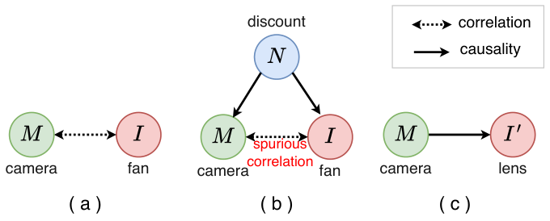
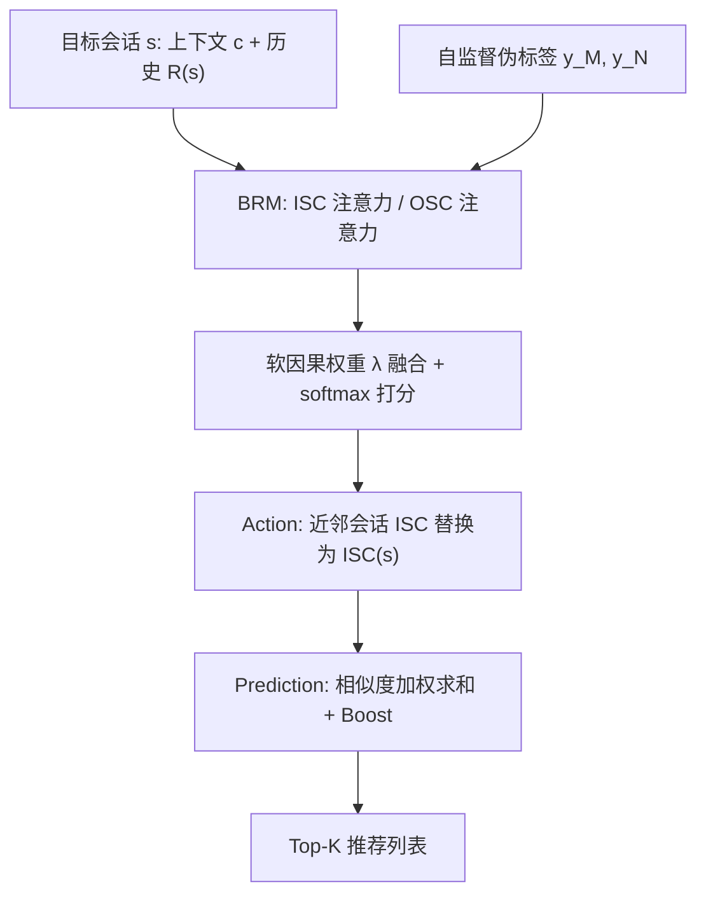
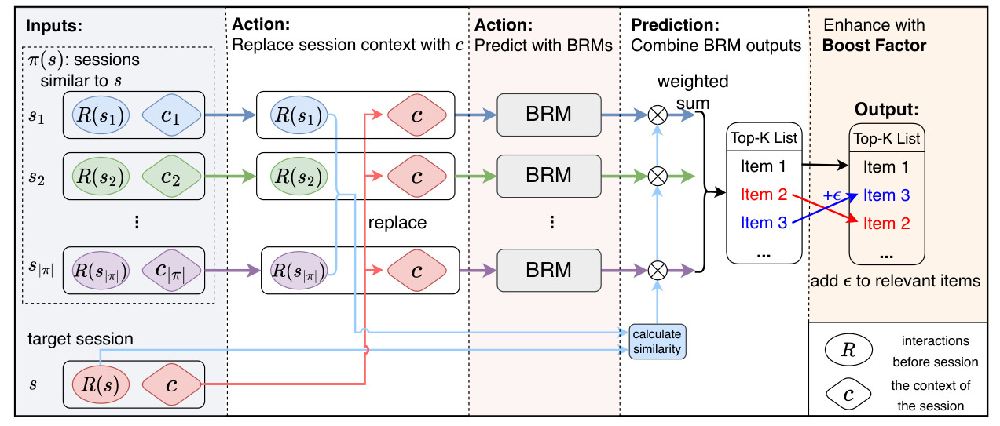

# A Counterfactual Collaborative Session-based Recommender System (反事实协同会话推荐系统)

- **会议/期刊**: WWW 2023 (ACM Web Conference)
- **作者与机构**: Wenzhuo Song, Minghao Yin (东北师范大学), Shoujin Wang (UTS), Yan Wang (Macquarie University), Kunpeng Liu (Portland State), Xueyan Liu (吉林大学)
- **推荐链路定位**: 排序（会话内 next-item 打分）
- **研究方向**: 序列与会话推荐 / 去偏与因果推荐
- **论文原文**: [论文原文链接](https://arxiv.org/abs/2301.13364v3)
- **开源代码**: [开源代码仓库链接](https://github.com/wzsong17/COCO-SBRS)

## TL;DR (1分钟核心速览)

现有会话推荐（SBRS）默认“下一物品只由当前会话上下文决定”，但折扣、长期偏好等**会话外因素（OSCs）**实为混杂因子，使模型学到“相机—风扇”式伪相关。本文把 OSCs 显式建模为因果图中的混杂变量，先用自监督伪标签预训练基模型 BRM 解耦 ISC/OSC 两类原因，再用反事实操作（把近邻会话的 ISC 替换为目标会话 ISC）做会话级协同推理。在 Last.fm/Delicious/Reddit 的 5 折全库排序协议下，Recall@20 相对最优基线提升 21.8%/19.3%/12.2%。

## Background & Motivation (背景与核心矛盾)

- **主流范式**: GRU4Rec/STAMP/SR-GNN 类模型只从会话上下文 (ISC) 抽取共现与序列模式；HGRU/II-RNN/INSERT 额外引入用户跨会话偏好 (OSC)，但都当作特征拼接，而非因果结构中的变量。
- **前人局限**: ①同一会话内相邻物品的共现既可能是因果（相机→镜头），也可能是共享混杂因子导致的伪相关（同时打折的相机与风扇），监督学习无法区分；②在稀疏数据下，“找相似会话”经常找到偏好完全不同的用户，协同过滤式 SBRS 反而放大噪声。
- **核心洞察 (Key Insight)**: 若把 OSCs 视为混杂变量 $N$、会话上下文视为处理变量$M$、下一物品为结果$v$，则观测数据中的$M$–$v$关联是$M\to v$与$M\leftarrow N\to v$的混合，必须显式干预$M$ 才能估计真实因果效应。
- **本文切入点**: 用“伪标签自监督预训练 + 反事实替换 ISC”的框架，把真实原因识别转化为可训练的二分类问题。

<figure class="paper-figure" markdown="span">
  <figcaption>图1：(a) 现有 SBRSs 基于相机和风扇之间基于共现的相关性进行推荐。(b) 然而，相机和风扇之间的相关性是虚假的，因为购买风扇并非由于购买了相机。相反，相机和风扇的共同购买依赖于它们同时打折这一事实。(c) 实际上，SBRS 数据中物品之间存在因果关系。例如，用户购买镜头是因为他/她购买了相机。</figcaption>
</figure>

## Method (核心方法设计)

### 1. 整体框架 (Overall Architecture)

COCO-SBRS 分三步闭环：**Abduction** 阶段以生成式决策过程为蓝本构建基推荐模型 BRM——用户静态偏好 $e_u$与最近 10 次交互经注意力得到 OSC 表征$\mathbf{h}_N$，会话上下文经自注意力得到 ISC 表征$\mathbf{h}_M$，再由一个可学习的软权重$\lambda$融合后 softmax 打分；训练时除交叉熵外附加伪标签 BCE 损失，迫使$\lambda$与“该物品来自历史还是来自上下文”对齐。**Action** 阶段给定目标会话$s$，检索 OSC 相近的会话$s'$，把 BRM 输入中的$\text{ISC}(s')$反事实替换为$\text{ISC}(s)$，模拟“相似偏好的用户$u'$处在我的会话情境下会买什么”。**Prediction** 阶段对$|\pi|$ 个近邻会话的反事实输出按相似度加权求和，并叠加 boost 因子得到最终排序。

<figure class="paper-figure" markdown="span">
  <figcaption>图2：COCO-SBRS 的行动与预测步骤。在溯因步骤中，BRMs 使用训练集中的会话进行预训练，该步骤未在图中展示。</figcaption>
</figure>

### 2. 关键设计拆解 (Key Designs)

1. **因果解耦的软权重与自监督伪标签**：真实原因在数据中是不可观测量，纯端到端学习无法辨识。作者用 $\lambda=\sigma(\mathbf{W}^{\top}[\mathbf{h}_M\Vert\mathbf{h}_N\Vert e_v]+b)$、$\mathbf{h}(s)=\lambda\mathbf{h}_N+(1-\lambda)\mathbf{h}_M$显式建模“该次选择由哪类原因引起”，并给出伪标签$\mathbb{I}[v\in V_u]$、$\mathbb{I}[v\in c]$：“下一物品若在用户历史中出现过则归因 OSC，若在会话上下文中出现过则归因 ISC”，损失$\ell_2=\text{BCE}(\lambda,y_N)+\text{BCE}(1-\lambda,y_M)$。直觉是$\lambda$ 得以收敛到“重复购买/上下文延续”两种语义上，从而抹平单纯共现带来的伪相关。
2. **反事实会话协同 (Action + Prediction)**：为避开稀疏数据下“相似会话不存在”的困境，先用 Jaccard 相似度 $\text{sim}(s,s')=\frac{|R(s)\cap R(s')|}{|R(s)\cup R(s')|}$只对齐 OSC（近期交互集合），再对 BRM 施加干预，计算$p(v\mid M=\text{ISC}(s),N=\text{OSC}(s'))$，把“会话级协同过滤”搬到了反事实层：近邻用户的偏好保留，情境被替换成目标会话。
3. **训练目标与推理开销**：总损失 $\ell=\ell_1+\beta\ell_2$，$\ell_1$为 batch 内全物品 softmax 交叉熵（免额外负采样，in-batch 即隐式负样本）；推理时每个目标会话需前向$|\pi|=10$次 BRM 再加权平均，并加$\epsilon\cdot\mathbb{I}[v\in R(s)\cup c]$ 的 boost 强化近期物品，代价约为单模型的 10 倍。

## Experimental Setup & Evaluation Protocol (实验设置与评估协议)

- **数据集与预处理**: 过滤交互数 <10 的冷门用户与物品；间隔 <6h 的连续交互划入同一会话，否则切分；剔除单物品会话与长度 >20 的会话。

| 数据集 | #Users | #Items | #Interactions | #Sessions | 特征/场景说明 |
| :--- | :---: | :---: | :---: | :---: | :--- |
| Last.fm | 1,101 | 711 | 38,367 | 5,915 | 音乐收听日志，平均会话 6.49 |
| Delicious | 1,752 | 5,047 | 249,919 | 45,772 | 社交书签打标记录，平均会话 5.46 |
| Reddit | 19,878 | 13,742 | 2,874,671 | 1,122,150 | 子版块访问，平均会话仅 2.56 |

- **数据划分与防穿越 (Splitting Strategy)**: 会话级 `5-fold 交叉验证`，每折保证训练集覆盖全部用户与物品；测试集中随机一半划为验证集用于早停（监控 R@20）。
- **排名评测协议 (Ranking Protocol)**: 无偏 `Full-Ranking`——对测试会话按前缀逐位置切分，模型对全库物品打分并排序取 top-K，无负采样。
- **对比基线与超参设置**: 10 个基线，分为仅 ISC（SKNN、GRU4Rec、STAMP、CSRM、SR-GNN）与 ISC+OSC（HGRU、II-RNN、SASRec、BERT4Rec、INSERT）两类；$\beta=1$、$|\pi|=10$、学习率 0.01、最多 50 epoch、Xavier 初始化；采用$p<0.05$ 显著性检验。

## Key Experimental Results (实验关键数据)

### 1. 主实验对比 (Main Results)

| 模型 | Last.fm R@5 | Last.fm N@5 | Last.fm R@20 | Last.fm N@20 | Delicious R@5 | Delicious N@5 | Delicious R@20 | Delicious N@20 | Reddit R@5 | Reddit N@5 | Reddit R@20 | Reddit N@20 |
| :--- | :---: | :---: | :---: | :---: | :---: | :---: | :---: | :---: | :---: | :---: | :---: | :---: |
| SKNN | 0.235 | 0.116 | 0.536 | 0.202 | 0.111 | 0.055 | 0.293 | 0.107 | 0.202 | 0.107 | 0.383 | 0.159 |
| GRU4Rec | 0.331 | 0.238 | 0.542 | 0.298 | 0.234 | 0.172 | 0.390 | 0.216 | 0.225 | 0.163 | 0.397 | 0.212 |
| SR-GNN | 0.265 | 0.186 | 0.477 | 0.246 | 0.205 | 0.149 | 0.354 | 0.191 | 0.251 | 0.186 | 0.422 | 0.235 |
| HGRU | 0.340 | 0.242 | 0.576 | 0.309 | 0.218 | 0.160 | 0.377 | 0.205 | 0.337 | 0.257 | 0.518 | 0.309 |
| II-RNN | 0.359 | 0.259 | 0.586 | 0.323 | 0.257 | 0.189 | 0.424 | 0.236 | 0.365 | 0.277 | 0.560 | 0.333 |
| SASRec | 0.346 | 0.206 | 0.651 | 0.201 | 0.193 | 0.130 | 0.385 | 0.184 | 0.310 | 0.209 | 0.537 | 0.274 |
| BERT4Rec | 0.304 | 0.182 | 0.622 | 0.273 | 0.207 | 0.101 | 0.369 | 0.186 | 0.409 | 0.271 | 0.623 | 0.338 |
| INSERT | 0.364 | 0.258 | 0.589 | 0.323 | 0.264 | 0.196 | 0.436 | 0.245 | 0.391 | **0.301** | 0.561 | **0.350** |
| **COCO-SBRS** | **0.504** | **0.289** | **0.793** | **0.374** | **0.359** | **0.215** | **0.520** | **0.263** | **0.412** | 0.248 | **0.699** | 0.331 |
| Improv.% | +38.5% | +11.6% | +21.8% | +15.8% | +36.0% | +9.7% | +19.3% | +7.3% | +0.7% | −17.6% | +12.2% | −5.4% |

### 2. 消融实验 (Ablation Study)

| 变体 | Last.fm R@5 | Last.fm R@20 | Last.fm N@20 | Delicious R@5 | Delicious R@20 | Delicious N@20 |
| :--- | :---: | :---: | :---: | :---: | :---: | :---: |
| BRM（仅基模型） | 0.325 | 0.643 | 0.292 | 0.214 | 0.397 | 0.190 |
| COCO w/o BF ($\epsilon=0$) | 0.444 | 0.727 | 0.335 | 0.271 | 0.458 | 0.223 |
| COCO w/o SSL | 0.412 | 0.756 | 0.346 | 0.273 | 0.463 | 0.225 |
| **COCO-SBRS 完整版** | **0.504** | **0.793** | **0.374** | **0.359** | **0.520** | **0.263** |

### 3. 关键实验发现 (Key Findings)

1. **反事实框架是增益主引擎**：去掉全部反事实推理、仅保留 BRM 时，Last.fm R@5 从 0.504 掉到 0.325（−35.5%），Delicious R@5 从 0.359 掉到 0.214（−40.4%），说明“在深度模型里直接拼两类原因”无法替代显式干预，因果解耦必须配合反事实采样。
2. **自监督伪标签与 boost 互补而非冗余**：w/o SSL 在 Last.fm 上 R@20 达 0.756（接近完整版 0.793）但 R@5 仅 0.412，即伪标签主要改善头部精度（top-5 提升 22.3%）；w/o BF 则 R@20 掉到 0.727，说明 boost 负责召回长尾中的重复购买物品。
3. **长会话/密集重复场景下优势收窄**：Reddit 上 R@5 仅 +0.7%、N@5 −17.6%，原因是 Reddit 会话平均仅 2.56 个物品且重复访问极多，BIBO/重复项模式本身已高度可学，反事实加权引入的方差反而伤害 NDCG。

## Highlights & Limitations (亮点、对比与审稿批判)

- **与代表作对比 (vs. Prior Work)**: 相比 CSRM/SKNN 只用上下文算会话相似度，本文的相似度只对齐 OSC（近期交互），并用 BRM 作“模拟器”生成数据集中不存在的反事实会话；相比 INSERT 依赖元学习从训练集找相似会话，本文绕开了“相似会话必须存在”的硬约束；相比 MACR 等流行度去偏工作，本文首次把 OSCs 明确指认为会话推荐中的混杂因子。
- **可迁移亮点**: ①“伪标签定义原因权重 + BCE 辅助损失”这一套解耦手法可直接迁到多兴趣召回与多任务归因；②把协同过滤从“相似度加权已有观测”改为“用生成模型模拟近邻用户在目标情境下的选择”，可复用于冷启动与跨域场景。
- **审稿级局限批判**: ①推理需 $|\pi|=10$次前向并保留全库 softmax，线上延迟约为单模型的 10 倍，论文未给出任何时延/QPS 分析；②伪标签假设$\lambda\in\{0,1\}$过于刚性——若物品同时出现在历史与上下文中则两类标签冲突，且 boost 系数$\epsilon$ 缺乏敏感性实验与调参指导；③会话切分阈值 6 小时为数据集特定经验值，未验证其对因果归因结论的稳健性。

## Rating (四维评分)

- **方法创新性 (Novelty)**: ⭐⭐⭐⭐ （首次把 OSC 形式化为会话推荐混杂因子，并以反事实干预 + 伪标签自监督给出可训练解法，因果图论证清晰）
- **评估协议与实验扎实度 (Protocol & Experiments)**: ⭐⭐⭐⭐ （三域数据集、5 折交叉、全库排序、10 个基线且做 $p<0.05$检验；但 Reddit 上 NDCG 下降未做深入解释，boost 与$|\pi|$ 缺敏感性分析）
- **写作与数学规范度 (Clarity & Rigor)**: ⭐⭐⭐⭐ （生成过程→BRM→Action→Prediction 链条完整、公式符号一致；$\lambda$ 与 pseudo-label 的等价性论证略偏启发式）
- **工业落地与复现价值 (Industrial & Practical Value)**: ⭐⭐⭐ （代码已开源、BRM 结构轻量易部署，但 10 倍前向开销与全库 softmax 需要在工程上做近邻预筛与蒸馏才可上线）

