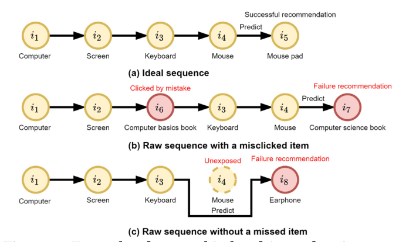
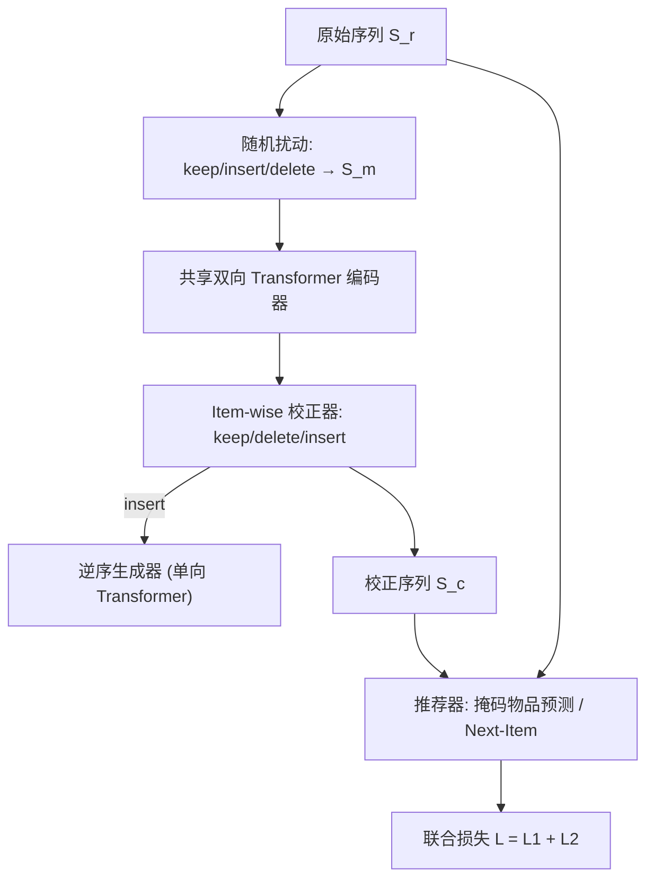
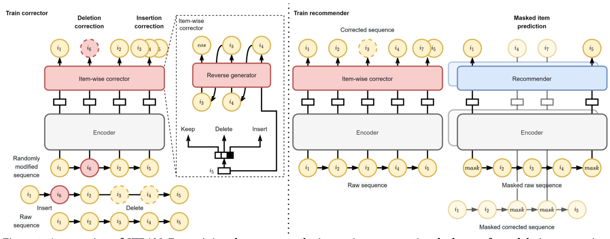

# A Self-Correcting Sequential Recommender (自校正序列推荐器)

- **会议/期刊**: WWW 2023 (ACM Web Conference, Austin)
- **作者与机构**: Yujie Lin, Chenyang Wang, Zhumin Chen, Zhaochun Ren, Xin Xin, Pengjie Ren 等（山东大学；腾讯微信 Qiang Yan；阿姆斯特丹大学 Maarten de Rijke）
- **推荐链路定位**: 召回（Next-Item 全库打分）
- **研究方向**: 序列与会话推荐 / 自监督对比学习与交互去噪
- **论文原文**: [arxiv.org/abs/2303.02297v2](https://arxiv.org/abs/2303.02297v2)
- **开源代码**: [github.com/TempSDU/STEAM](https://github.com/TempSDU/STEAM)

## TL;DR (1分钟核心速览)

真实交互序列同时存在**误点击（多出来的噪声）**与**漏曝光（缺掉的真实兴趣）**两类缺陷，而现有序列推荐（含 FMLP-Rec 类去噪模型）只在原始序列上"隐式"降噪、从不召回被系统曝光偏差吞掉的物品。STEAM 先让一个 item-wise 校正器对每位物品自适应选择 `keep/delete/insert`，用"随机插入→学会删"与"随机删除→学会补"两个自监督任务免标注训练，再与共享编码器的 BERT4Rec 式推荐器联合优化。在 Beauty/Sports/Yelp 的 `5-core + Leave-One-Out + 99 负采样`协议下，HR@5 相对最强基线 DuoRec 提升 3.96%/5.88%/5.01%。

## Background & Motivation (背景与核心矛盾)

- **主流范式**: 从 MC → GRU4Rec/SASRec/BERT4Rec → SRGNN，以及 CL4SRec/DuoRec 用裁剪/掩码/重排/ dropout 构造自监督信号，均默认"序列中的每个物品都反映偏好"。
- **前人局限**: (i) 去噪序列模型（FMLP-Rec 的 FFT 滤波、对比式去噪）只做**加权/过滤**，不显式改写序列，误点击物品仍进入编码；(ii) 它们完全无法处理**漏点物品**——因曝光偏差用户从未见到相关物品，缺项无从"降噪"得到（图 1 的 $i_4$ 鼠标垫缺失导致推荐耳机的例子）。
- **核心洞察 (Key Insight)**: 序列缺陷是**位置级、混合型**的，正确做法不是给样本降权，而是对每个位置输出一个离散编辑动作并真的改序列；且"改坏了再改回来"天然提供免标注监督信号。
- **本文切入点**: 让"校正"成为推荐的前置模块，用随机扰动-还原的自监督任务训练校正器，并与推荐器共享编码器联合学习。

<figure class="paper-figure" markdown="span">
  <figcaption>图 1：两类不完美物品序列的示例。子图 (a) 是不含任何缺陷的理想物品序列。子图 (b) 是包含误点击物品（即 𝑖6）的不完美物品序列。子图 (c) 是缺少漏点物品（即 𝑖4）的不完美序列。</figcaption>
</figure>

## Method (核心方法设计)

### 1. 整体框架 (Overall Architecture)

输入原始序列 $S_r$，训练时先按概率$p_k=0.4/p_i=0.1/p_d=0.5$对每个物品做 keep/insert/delete 得到被污染序列$S_m$及其真值操作序列$O$；共享的双向 Transformer 编码器（1 层、$d=64$）编码$S_m$，item-wise 校正器对每个位置预测操作，`delete` 直接删、`insert` 触发**逆序生成器**逐项生成待插入片段，得到校正序列$S_c$；推荐器在$S_r$与$S_c$ 上做掩码物品预测，二者损失联合反传。推理时在原始或校正序列末尾追加 `[mask]`，用同一 softmax 头输出下一个物品分布。

<figure class="paper-figure" markdown="span">
  <figcaption>图 2：STEAM 概览。为训练校正器，要求逐物品校正器对物品执行删除校正和插入校正，以恢复被随机修改的原始物品序列。原始物品序列及其校正版本均用于通过掩码物品预测任务训练推荐器。最后，STEAM 通过来自校正器和推荐器的联合损失进行优化。</figcaption>
</figure>

### 2. 关键设计拆解 (Key Designs)

1. **Item-wise 三算子校正器（把去噪变成"编辑"）**：痛点是用例混合、位置不定，无法整段增删。做法是对每个位置独立分类，允许同一序列上多位置多类型操作：
$P(\hat{o}_t|S_m)=\mathrm{softmax}(\mathbf{W}\mathbf{h}_t),\quad \hat{o}_t\in\{\text{keep},\text{delete},\text{insert}\}$。
`replace` 被有意排除，因为可由 delete+insert 组合等价实现，减小动作空间；物理直觉是"保留"是默认高概率动作，模型只在证据强烈时改动序列。

2. **逆序生成器 + 两个自监督纠错任务（免标注的关键）**：漏点物品缺席，若正向生成无法对齐位置。作者让插入片段以**逆序**方式生成于锚点物品之前：以锚点表示 $\mathbf{h}_t$为起点构造$\mathbf{H}^0_c=[\mathbf{h}_t+\mathbf{p}_1,\mathbf{e}_1+\mathbf{p}_2,\dots]$，经单向 Transformer 后
$P(\hat{i}_n|S^{<i_t}_{1:n-1},S_m)=\mathrm{softmax}(\mathbf{E}^{\top}\mathbf{h}_n)$，
训练时可一次并行监督全部插入位置，测试时贪心生成至 `[eos]`。删除任务（随机插入→学会删）与插入任务（随机删除→学会补）自动生成 $O$与真值插入片段$S^{<i}$，即
$\mathcal{L}_1=-\big[\sum_{t=1}^{|S_m|}\log P(\hat{o}_t=o_t|S_m)+\sum_{i\in I_{ins}}\sum_{n}\log P(\hat{i}_n=i_n|S^{<i}_{1:n-1},S_m)\big]$。

3. **训练目标、负采样与推理效率**：推荐器损失为原始与校正序列上掩码预测的负对数似然之和 $\mathcal{L}_2=-\big[\log P(\tilde{I}_r|\tilde{S}_r)+\log P(\tilde{I}_c|\tilde{S}_c)\big]$，整体$\mathcal{L}=\mathcal{L}_1+\mathcal{L}_2$，**无需额外负采样**（全库 softmax，与 BERT4Rec 一致，故推理开销与 BERT4Rec 同量级，仅多一次校正器前向与至多 5 步贪心插入）；掩码率$p_m=0.5$，最大原始长度 50、校正后 60、连续插入上限 5。

## Experimental Setup & Evaluation Protocol (实验设置与评估协议)

- **数据集与预处理**: 均按 `5-core` 过滤，按时间排序构造序列。

| 数据集 | #Users | #Items | #Interactions | 稀疏度/密度 | 特征/场景说明 |
| :--- | :---: | :---: | :---: | :---: | :--- |
| Beauty (Amazon) | 22,362 | 12,101 | 194,682 | 99.93% | 美妆评论，平均长度 8.7 |
| Sports (Amazon) | 35,597 | 18,357 | 294,483 | 99.95% | 运动户外，平均长度 8.3 |
| Yelp | 22,844 | 16,552 | 236,999 | 99.94% | 本地商户，取 2019 全年交易，平均长度 10.4 |

- **数据划分与防穿越**: `Leave-One-Out`（最后 1 个测试、倒数第 2 个验证、其余训练），按时间排序，严格防穿越。
- **排名评测协议**: `Sampled Ranking`，1 正 + 99 随机负（用户未交互物品）；指标 HR@5/10、MRR@5/10。另构造 **Simulated Test Set**（对测试序列除真值外每项 $p=0.8$保留、$0.1$插入、$0.1$ 删除，连续插入 <5）检验鲁棒性。
- **对比基线与超参设置**: 三类基线——vanilla（GRU4Rec、SASRec、BERT4Rec、SRGNN）、SSL（CL4SRec、DuoRec）、去噪（FMLP-Rec），外加仅用掩码任务单独训练的 `Recommender` 变体；$e=64$、Transformer 头数 1、$L_e=L_c=L_r=1$、dropout 0.5、Adam lr 0.001、batch 256、300 epoch；显著性用双侧配对 t 检验$p<0.05$。

## Key Experimental Results (实验关键数据)

### 1. 主实验对比 (Main Results)

| Model | Beauty HR@5 | HR@10 | MRR@10 | Sports HR@5 | HR@10 | MRR@10 | Yelp HR@5 | HR@10 | MRR@10 |
| :--- | :---: | :---: | :---: | :---: | :---: | :---: | :---: | :---: | :---: |
| GRU4Rec | 32.95 | 42.59 | 22.90 | 30.58 | 42.85 | 19.97 | 55.40 | 76.57 | 35.05 |
| SASRec | 36.58 | 45.57 | 26.62 | 34.51 | 46.20 | 23.46 | 58.24 | 77.96 | 37.72 |
| BERT4Rec | 36.67 | 47.28 | 24.79 | 35.16 | 47.91 | 23.24 | 61.18 | 79.72 | 40.13 |
| SRGNN | 37.33 | 47.65 | 26.52 | 35.92 | 48.32 | 24.08 | 59.86 | 78.96 | 39.30 |
| CL4SRec | 39.29 | 48.75 | 28.84 | 37.91 | 49.83 | 26.11 | 62.15 | 80.16 | 41.70 |
| DuoRec | 40.95 | 50.78 | **30.15** | 39.80 | 51.93 | 27.58 | 64.01 | 82.63 | 43.34 |
| FMLP-Rec | 39.69 | 48.72 | 29.20 | 37.67 | 49.32 | 26.21 | 61.85 | 80.76 | 40.92 |
| Recommender (w/o corrector) | 35.73 | 46.47 | 24.27 | 35.02 | 47.78 | 23.03 | 61.41 | 80.57 | 40.22 |
| **STEAM** | **42.57** | **52.89** | 30.14 | **42.14** | **55.16** | **28.61** | **67.22** | **84.49** | **45.77** |
| **Improv.% (vs 最强基线)** | +3.96% | +4.15% | −0.03% | +5.88% | +6.22% | +3.73% | +5.01% | +2.25% | +5.61% |

### 2. 消融与校正行为分析 (Ablation / Analysis)

原文逐任务消融置于附录 A/B（此处不可见），正文提供的等价分析如下：

| 设置 | Beauty MRR@10 | Sports MRR@10 | Yelp MRR@10 | 说明 |
| :--- | :---: | :---: | :---: | :--- |
| Overall-R（原始序列打分） | 29.68 | 28.48 | 45.75 | 仍全面超所有基线 |
| Overall-C（校正序列打分） | 30.14 | 28.61 | 45.77 | 全序列增益被"未改动"样本稀释 |
| Changed-R / Changed-C | 28.40 / 29.94 | 23.23 / 23.76 | 36.80 / 37.73 | 被改动组增益显著放大 |
| w/o corrector (=BERT4Rec 等价) | 24.79 | 23.24 | 40.13 | 掉点 5.35/5.37/5.64 |
| Simulated 测试集 STEAM HR@10 | 52.21 | 54.82 | 84.05 | 相对真实集扰动仅 −1.02/−0.40/−0.52% |

### 3. 关键实验发现 (Key Findings)

1. **校正器贡献远超"微调序列"本身**：即使只在原始序列上打分（Overall-R），STEAM 仍以 Beauty HR@5 42.21 超过 DuoRec 的 40.95，说明共享编码器下纠错任务带来的物品表示与转移关系迁移是主要增益源；单训练掩码任务的 Recommender 与 BERT4Rec 几乎持平（36.67 vs 35.73），佐证增益确实来自联合学习。
2. **增益集中在"该改的序列"上**：真实测试集仅 29.91%/23.82%/2.17% 序列被改动，因此 Overall-C 与 Overall-R 差距小；但在 Changed 子集上 Beauty MRR@10 从 28.40 升到 29.94（+1.54），Yelp MRR@5 +1.09，证明"改对了"才有效——且操作统计中 keep 占 88.6%/95.7%/99.6%，模型学会了保守编辑。
3. **鲁棒性优于纯去噪模型**：模拟加噪后 FMLP-Rec 在 Yelp 上扰动最小（MRR@10 −0.88% vs STEAM −1.22%），但它在真实集上落后 STEAM 4.85 个 MRR@10 点，属于"牺牲效果换稳定"；STEAM 在 Beauty 的 MRR@5/MRR@10 扰动甚至为 **正**（+0.64%/+0.44%），说明它连真实集内生的缺陷也一并修掉了，是效果-鲁棒更优的折中。

## Highlights & Limitations (亮点、对比与审稿批判)

- **与代表作对比 (vs. Prior Work)**: 相比 FMLP-Rec 的频域软滤波（只压制噪声、不可插入），STEAM 做**离散、可解释、可插入**的硬编辑；相比 DuoRec 的 dropout 式序列级对比增广（不改变序列语义），STEAM 的增广是"污染-还原"式的**有监督纠错信号**；相比 BERT4Rec 的纯掩码预训练，STEAM 把掩码损失同时施加在原始与校正序列上，把纠错结果纳入推荐目标。
- **可迁移亮点**: (i) "随机扰动→还原"是给任意序列模块加免标注监督的通用套路，可迁移到会话推荐与会话级数据清洗；(ii) 逆序生成器把插入监督变成可并行的一次前向，避免自回归逐项解码的训练开销，可用于序列补全/查询改写。
- **审稿级局限批判**: (i) 同一位置不能同时 delete 与 insert（无 replace 之外的组合编辑，也不能多次迭代校正），且只能"在选定物品之前"插入，对乱序/长距离缺项表达力受限；(ii) 增益高度依赖数据本身的缺陷比例——Yelp 仅 2.17% 序列被改动，校正收益近乎可忽略，而评测仍用 `99 负采样`，未报告 Full-Ranking 与用户分桶（长/短序列）结果，易高估绝对值；此外校正器与推荐器层数皆为 1（$L_e=L_c=L_r=1$）的轻量配置下结论是否随容量扩展保持，未做验证。

## Rating (四维评分)

- **方法创新性 (Novelty)**: ⭐⭐⭐⭐ （把"序列去噪"重定义为位置级离散编辑 + 逆序生成插入，插入召回这一被忽视缺陷的建模具有明确新意，但整体仍是 Transformer + 自监督的工程化组合，缺乏理论刻画）
- **评估协议与实验扎实度 (Protocol & Experiments)**: ⭐⭐⭐⭐ （三域数据集、真实+模拟双测试集、扰动度量与校正操作统计分析到位，显著性检验齐全；扣分在仅 99 负采样、无 Full-Ranking 与逐任务消融置于附录）
- **写作与数学规范度 (Clarity & Rigor)**: ⭐⭐⭐⭐ （校正概率、逆序生成与联合损失三式定义清晰、符号自洽，训练/推理流程分述明确；$L_1$ 的记号排版略显冗长）
- **工业落地与复现价值 (Industrial & Practical Value)**: ⭐⭐⭐⭐ （代码已开源、仅需一次额外校正前向与 ≤5 步贪心插入，可直接前置挂在现有序列召回模型前；但贪心插入的在线延迟与扰动后序列长度膨胀需工程上界约束）

