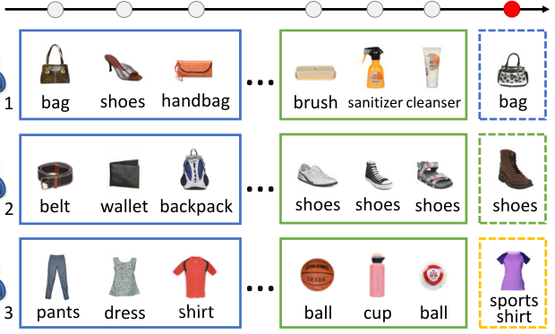
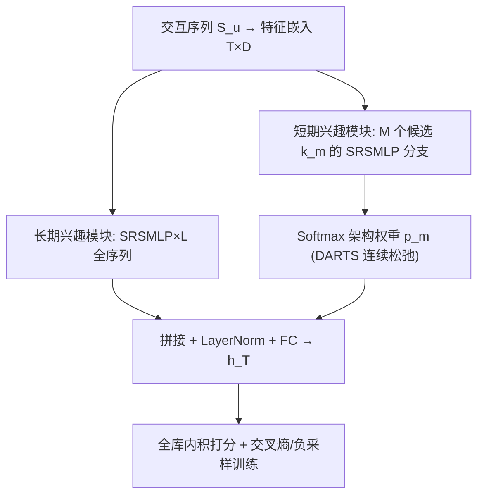
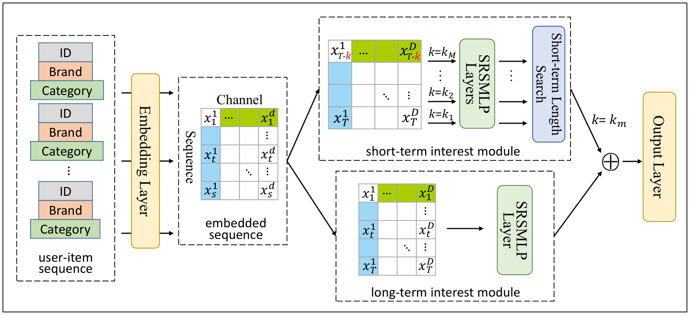

# AutoMLP: Automated MLP for Sequential Recommendations (自动化 MLP 序列推荐)

- **会议/期刊**: WWW 2023
- **作者与机构**: Muyang Li, Zijian Zhang, Xiangyu Zhao 等（香港城市大学、悉尼大学、网易伏羲、字节 AI Lab）
- **推荐链路定位**: 召回/排序打分（Next-Item 打分，非生成式）
- **研究方向**: 序列与会话推荐
- **论文原文**: [https://arxiv.org/abs/2303.06337v1](https://arxiv.org/abs/2303.06337v1)
- **开源代码**: 暂未开源

## TL;DR (1分钟核心速览)

现有序列推荐要么用 RNN（长序列梯度退化）、要么用 Transformer（$O(T^2)$复杂度且需位置编码），且短期兴趣窗口长度普遍靠人工设定或穷举。AutoMLP 用纯 MLP 的 Sequence-Mixer/Channel-Mixer 分别编码全序列与最近$k$项，再用 DARTS 连续松弛把离散的$k$ 变成可梯度优化的架构权重，两阶段（搜索+重训）训练。在 Leave-One-Out + 100 负采样排序协议下，Beauty 上 MRR@10/NDCG@10 相对最强基线提升 8.5%/7.1%，参数量仅 16.8M。

## Background & Motivation (背景与核心矛盾)

- **主流范式**: GRU4Rec/FDSA 类 RNN 抓近期依赖，SASRec/BERT4Rec 类自注意力抓长程依赖；长短期兴趣通常拆成两个模型或两段序列分别建模。
- **前人局限**: ① RNN 在长序列上梯度退化，Transformer 对输入顺序不敏感、强依赖位置嵌入且复杂度与 $T$二次相关；② 短期窗口$k$被写死为"最近 N 条"或"固定时间窗"，而最优$k$ 随任务/场景变化，穷举搜索代价随候选数线性爆炸。
- **核心洞察 (Key Insight)**: 用户 1 的目标物只与长期兴趣相关、用户 2 只与短期相关、用户 3 两者共同作用（图 1），说明长短兴趣必须解耦建模；而 $k$ 与性能的关系非单调，无法用解析式确定，只能"搜"——但可以把它变成可微的连续变量来搜。
- **本文切入点**: 用 MLP-Mixer 式的 token-mixing/channel-mixing 替代注意力以获得线性复杂度，同时把 $k$ 的选择交给可微架构搜索。

<figure class="paper-figure" markdown="span">
  <figcaption>图1：用户长/短期兴趣的示例。用户1和2的目标物品分别与其长期和短期兴趣相关，用户3同时受两者影响。</figcaption>
</figure>

## Method (核心方法设计)

### 1. 整体框架 (Overall Architecture)

输入为长度 $T$的物品 ID + 类别/品牌特征，经查表与全连接融合成$T\times D$嵌入表。长期兴趣模块吃完整序列，短期兴趣模块并行维护$M$个候选长度$k_m$的 SRSMLP 分支，各分支输出按可学习架构权重$p_m$加权；两分支在$T$时刻的隐向量拼接后经 FC 融合为$\boldsymbol{h}_T$，与全库物品嵌入做内积+softmax 输出下一物品。训练分搜索阶段（用验证集更新架构权重$\boldsymbol{A}$、训练集更新网络权重$\boldsymbol{W}$）与重训阶段（只保留$\arg\max_m \alpha_m$ 的单一长度重训）。

<figure class="paper-figure" markdown="span">
  <figcaption>图2：AutoMLP的框架概览。</figcaption>
</figure>

### 2. 关键设计拆解 (Key Designs)

1. **SRSMLP 层（Sequence-Mixer + Channel-Mixer）**：注意力要对所有 token 两两交互，代价 $O(T^2)$。此处改为在转置后的$D\times T$表示上沿序列维做一层 MLP，使每个维度独立聚合全序列信息：$\hat{\boldsymbol{x}}_d=\boldsymbol{x}_d+\boldsymbol{W}_2 g_l(\boldsymbol{W}_1\mathrm{LayerNorm}(\boldsymbol{x}_d))$，$\boldsymbol{W}_1\in\mathbb{R}^{R_s\times T}$、$\boldsymbol{W}_2\in\mathbb{R}^{T\times R_s}$；Channel-Mixer 则在$T\times D$上沿通道维做同构映射（$R_c$隐宽）。直觉：序列混合显式携带"位置即输入坐标"的顺序信息，无需位置嵌入；两轴交替使跨物品与跨语义维度信息互通，总复杂度$O(T+D+k)$ 线性。

2. **短期长度可微搜索（Session Length Search）**：$k$离散且非单调，穷举不可行。为每个候选$k_m$建一条 SRSMLP 分支并赋架构权重$\alpha_m$，用 softmax 松弛：$p_m=\exp(\alpha_m)/\sum_{j=1}^{M}\exp(\alpha_j)$，使$k$的选择融入前向计算图可反传。上层变量与下层变量高度耦合，故采用双层优化$\min_{\boldsymbol{A}}\mathcal{L}_{val}(\boldsymbol{W}^*(\boldsymbol{A}),\boldsymbol{A})$，并用一步近似$\boldsymbol{W}^*(\boldsymbol{A})\approx\boldsymbol{W}-\xi\nabla_{\boldsymbol{W}}\mathcal{L}_{train}(\boldsymbol{W},\boldsymbol{A})$ 避免内层完全收敛的开销。

3. **训练目标、负采样与推理开销**：损失为带负采样的交叉熵

$$\mathcal{L}=-\sum_{S_u\in S}\sum_{t\in[1,T]}\Big[\log\sigma(r_{i_t,t})+\sum_{j\notin S_u}\log\big(1-\sigma(r_{i_j,t})\big)\Big]$$

   负样本按均匀采样构造（评测端则按流行度采 100 个）。推理为 $\boldsymbol{h}_T$ 与全库物品嵌入内积取 top-N，无自回归解码；因只有 MLP，Beauty 上可训练参数 16.8M（GRU4Rec+ 34.1M、FPMC 100M），显存与训练时长均最低。

## Experimental Setup & Evaluation Protocol (实验设置与评估协议)

- **数据集与预处理**: 过滤交互数 <10 的用户（近似 10-core），保证长序列可建模。

| 数据集 | #Users | #Items | #Interactions | 稀疏度/密度 | 特征/场景说明 |
| :--- | :---: | :---: | :---: | :---: | :--- |
| MovieLens-1M | 6,040 | 3,952 | 1,000,209 | 4.19% | 电影评分，含类别特征，物品空间小且稠密 |
| Amazon Beauty | 1,210,271（原文 Table 1 数值，疑为笔误，常用约 2.2 万） | 249,274 | 2,023,070 | 极稀疏 | 美妆评论，含类别/品牌，物品空间巨大 |

- **数据划分与防穿越 (Splitting Strategy)**: `Leave-One-Out`——每用户最后一条为测试、倒数第二条为验证、其余全部训练。
- **排名评测协议 (Ranking Protocol)**: `Sampled Ranking`，每条 ground-truth 搭配 100 个按流行度采样的负样本，指标 HR@10 / NDCG@10 / MRR@10（未做 Full-Ranking）。
- **对比基线与超参设置**: 基线覆盖 MC(FPMC)、RNN(GRU4Rec)、Transformer(BERT4Rec)、CNN/长短期(NextItNet)、特征级(GRU4Rec+、FDSA)，全部在 RecBole 统一复现；Adam，学习率 $1e^{-3}$，$\beta_1=0.9,\beta_2=0.999$，早停 10 epoch，显存上限 32GB；层数$L=8$、嵌入维$D=64$为最优；显著性用双侧 t 检验$p<0.05$。

## Key Experimental Results (实验关键数据)

### 1. 主实验对比 (Main Results)

| 方法 | ML MRR@10 | ML NDCG@10 | ML HR@10 | Beauty MRR@10 | Beauty NDCG@10 | Beauty HR@10 | Param |
| :--- | :---: | :---: | :---: | :---: | :---: | :---: | :---: |
| FPMC | 0.2453 | 0.3088 | 0.5156 | 0.0991 | 0.1251 | 0.2098 | 100M |
| GRU4Rec | 0.3893 | 0.4553 | 0.6666 | 0.1162 | 0.1435 | 0.2324 | 33.5M |
| BERT4Rec | 0.3535 | 0.4289 | 0.6695 | 0.0907 | 0.1198 | 0.2154 | 17M |
| NextItNet | 0.2085 | 0.2642 | 0.4455 | 0.1087 | 0.1393 | 0.2385 | 16.8M |
| GRU4Rec+ | 0.3736 | 0.4412 | 0.6578 | 0.1325 | 0.1638 | 0.2657 | 34.1M |
| FDSA | 0.3725 | 0.4409 | 0.6594 | 0.1305 | 0.1595 | 0.2536 | 34.3M |
| **AutoMLP** | **0.3912** | **0.4593** | **0.6767** | **0.1438** | **0.1754** | **0.2779** | **16.8M** |
| Improv.% vs 最强基线 | +0.49% | +0.88% | +1.08% | +8.53% | +7.08% | +4.59% | −50.7% |

### 2. 消融实验 (Ablation Study)

| 变体 (Beauty) | MRR@10 | NDCG@10 | HR@10 |
| :--- | :---: | :---: | :---: |
| w/o Sequence Mixer | 0.1132 | 0.1315 | 0.2169 |
| w/o Channel Mixer | 0.1408 | 0.1720 | 0.2700 |
| **AutoMLP (full)** | **0.1438** | **0.1754** | **0.2779** |

### 3. 关键实验发现 (Key Findings)

1. **序列混合是不可替代的一阶项**：去掉 Sequence-Mixer 后 Beauty MRR@10 从 0.1438 崩至 0.1132（−21.3%），而去掉 Channel-Mixer 仅降至 0.1408（−2.1%）。说明"跨物品顺序依赖"承载主要信号，通道混合只是对隐语义维度的二次精修。
2. **增益与物品空间稀疏度强相关**：MovieLens（3,952 物品）上相对最强基线仅 +0.5%~+1.1%，而 Beauty（249k 物品）上 MRR@10 提升 8.5%。小物品集上 RNN/Transformer 已接近饱和，MLP 的低参数量（16.8M，约为 GRU4Rec+ 一半）在大物品空间里抑制过拟合的收益才被放大。
3. **自动化搜索替代穷举是效率关键**：候选长度数从 5 增至 20 时，AutoMLP 的搜索+训练时间增量明显小于穷举版 AutoMLP-s（图 6）；超参上 $L=8$最优、$L=12$过拟合，$D<64$ 表示能力不足，说明纯 MLP 的容量需靠层数/维度精细平衡。

## Highlights & Limitations (亮点、对比与审稿批判)

- **与代表作对比 (vs. Prior Work)**: 相比 BERT4Rec/FDSA，本文把 $O(T^2)$自注意力换成$O(T)$ 的双轴 MLP，且无需位置嵌入；相比 NextItNet 等长短期 CNN/RNN 模型，本文首次把"短期窗口长度"本身作为可学习架构变量而非超参，避免了逐值穷举。
- **可迁移亮点**: ① Sequence/Channel 交替混合可直接作为长序列 CTR/召回的低成本编码器替换注意力；② 用 softmax 松弛 + 一步双层近似来搜索"回看窗口/感受野大小"，可迁移到多场景窗口、序列增强截断长度等选择问题。
- **审稿级局限批判**: ① 评测仅在两个公开小数据集上，摘要与结论宣称的工业私有数据实验未给出任何数字与协议；仅用 100 负采样的 Sampled Ranking 且只报 @10，缺乏 Full-Ranking 与更长列表验证，BETR4Rec 在 32GB 限制下被"空间高效"设置削弱的调参可能低估了基线；② 搜索阶段需并行 $M$条 SRSMLP 分支前向、再加一轮完整重训，工程链路比单模型复杂，且论文未报告架构权重$\alpha$ 的收敛分布，DARTS 类方法已知的搜索坍塌/不稳定风险未被讨论；③ 长短期两分支对同一序列重复编码，存在冗余计算。

## Rating (四维评分)

- **方法创新性 (Novelty)**: ⭐⭐⭐ （MLP-Mixer 迁移 + DARTS 搜索窗口长度的组合较为务实，但两部件均为既有技术嫁接，缺乏新的理论刻画）
- **评估协议与实验扎实度 (Protocol & Experiments)**: ⭐⭐⭐ （Leave-One-Out 划分规范、基线覆盖全，但仅 2 个数据集、Sampled Ranking 与基线调参受限削弱说服力）
- **写作与数学规范度 (Clarity & Rigor)**: ⭐⭐⭐⭐ （SRSMLP、softmax 松弛与双层优化公式交代清楚，复杂度分析简洁到位；仅 Table 1 用户数疑似笔误）
- **工业落地与复现价值 (Industrial & Practical Value)**: ⭐⭐⭐⭐ （参数量减半、线性复杂度、训练显存最低，易于线上替换；但搜索阶段多分支开销与未开源代码降低复现便利性）

