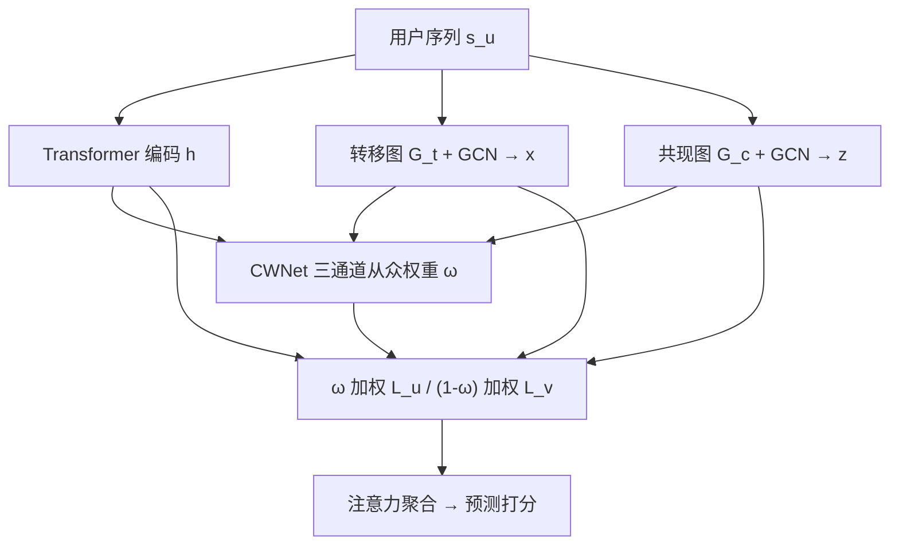
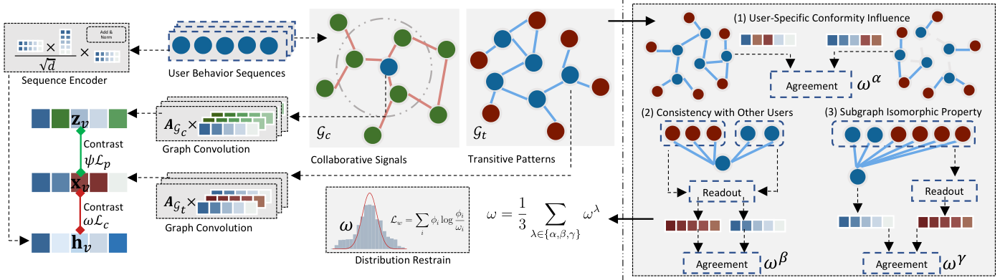

# Debiased Contrastive Learning for Sequential Recommendation (去偏对比学习序列推荐)

- **会议/期刊**: WWW 2023 (ACM Web Conference)
- **作者与机构**: Yuhao Yang, Chao Huang*, Lianghao Xia (香港大学); Chunzhen Huang, Da Luo, Kangyi Lin (腾讯微信)
- **推荐链路定位**: 召回 (Next-Item Prediction)
- **研究方向**: 序列与会话推荐 / 自监督对比学习与交互去噪 / 去偏与可信推荐
- **论文原文**: [https://arxiv.org/abs/2303.11780v1](https://arxiv.org/abs/2303.11780v1)
- **开源代码**: [https://github.com/HKUDS/DCRec](https://github.com/HKUDS/DCRec)

## TL;DR (1分钟核心速览)

现有序列推荐对比学习（CL4SRec / DuoRec / ICLRec）把所有序列都当"正对"，忽视交互背后可能只是"从众追热门"而非真实兴趣，导致增广信号被流行度偏差污染。DCRec 用一个三通道从众权重网络 $\omega(u,v)$把交互级从众度从真实兴趣中解耦，再用$\omega$与$1-\omega$ 自适应地缩放跨视图 InfoNCE 的正负样本梯度。在 4 个实采数据集、Leave-One-Out 全库排序协议下，DCRec 的 HR@1 较次优基线相对提升 5.57%–10.29%。

## Background & Motivation (背景与核心矛盾)

- **主流范式**: 以 SASRec/BERT4Rec 的 Transformer 编码器为核心，叠加序列扰动（crop/mask/reorder）或跨视图对齐的自监督对比学习来缓解稀疏与短序列问题。
- **前人局限**: 其一，DuoRec 等把共享同一条热门物品的两条用户序列直接当成正对，无法区分"真感兴趣"与"因为大家都在看所以我也看"；其二，Gallery 中 U860（硬核篮球迷）与 U14463（泛热门流行控）因都订阅 `nba` 被强行拉近，增广信号本身就带偏。
- **核心洞察 (Key Insight)**: 从众度是**交互级 (interaction-level)**、因人因物而异的一个连续量；只要把它估计出来当作对比损失的样本权重，就能让"纯兴趣驱动"的样本主导梯度、"从众驱动"的样本被削弱。
- **本文切入点**: 用图结构扰动与邻居一致性等三种语义通道量化 $\omega(u,v)$，并约束其服从正态分布，从而在序列视图与协同视图的两个对比方向上同时实现自适应去偏。

## Method (核心方法设计)

### 1. 整体框架 (Overall Architecture)

DCRec 并行构建两条图：由相邻交互边构成的物品转移图 $\mathcal{G}_t$、由共现矩阵$\mathbf{A}_{\mathcal{G}_c}=\mathbf{R}^{\top}\mathbf{R}$经 top-$k$截断的共现图$\mathcal{G}_c$；分别用去激活的轻量 GCN 得到转移嵌入$\mathbf{x}_v$与协同嵌入$\mathbf{z}_v$。Transformer 序列编码器同时给出序列嵌入$\mathbf{h}_v$。三路嵌入送入多通道从众权重网络 CWNet 估计交互级从众度$\omega(u,v)$，再用$\omega$加权用户维度对比$\mathcal{L}_u$（$\mathbf{h}_v$vs$\mathbf{x}_v$）、用$\psi=1-\omega$加权物品维度对比$\mathcal{L}_v$（$\mathbf{x}_v$vs$\mathbf{z}_v$），推理时三路嵌入经注意力聚合为$\mathbf{p}_v$ 打分。

<figure class="paper-figure" markdown="span">
  <figcaption>图 2：DCRec 的整体框架。构建 G𝑐 和 G𝑡 以编码来自多样化视图的序列（左部分）。此外，我们从 G𝑡 的丰富结构中生成合理的交互级从众权重 𝜔（右部分）。这些权重被约束在正态分布中，并使跨视图对比学习具有自适应性和从众感知能力。</figcaption>
</figure>

### 2. 关键设计拆解 (Key Designs)

1. **多通道从众权重网络 (CWNet)**：单一通道无法判定"跟随他人"的程度，故从三个语义视角度量 $\omega$：①用户特异性影响$\omega_\alpha=\cos(\mathbf{x}_v,\mathbf{x}'_v)$——删去该用户在$\mathcal{G}_t$的全部边后重编码，相似度越高说明该用户对图结构贡献越小、越可能是在跟随大众；②与他人行为一致性$\omega_\beta=\cos(\mathbf{x}^N_v,\mathbf{x}^O_v)$，内邻居（序列内）与跨用户外邻居的模式比对；③子图同构性$\omega_\gamma=\cos(\mathbf{x}_v,\mathbf{x}^O_v)$。三者平均后经 sigmoid、min-max 归一化并按$\mu_c$缩放：$\omega=\mu_c\cdot\frac{\omega^{(1)}-\omega^{(1)}_{\min}}{\omega^{(1)}_{\max}-\omega^{(1)}_{\min}}$。物理直觉是"越依赖外部结构、越与大众同构的交互越不可能是纯兴趣"。

2. **从众感知的双视图对比增广**：传统 CL 中每个样本的梯度贡献恒定（图 3 上半的固定曲线），模型无法区分兴趣样本与从众样本。DCRec 直接把 $\omega$ 乘到 InfoNCE 上：

$$\mathcal{L}_u=-\sum_{u\in\mathcal{U}}\sum_{v\in\mathcal{S}_u}\omega(u,v)\log\frac{\exp(\cos(\mathbf{h}_v,\mathbf{x}_v)/\tau)}{\sum_{v'\in\mathcal{V}}\exp(\cos(\mathbf{h}_v,\mathbf{x}_{v'})/\tau)}$$

$$\mathcal{L}_v=-\sum_{u\in\mathcal{U}}\sum_{v\in\mathcal{S}_u}\psi(u,v)\log\frac{\exp(\cos(\mathbf{x}_v,\mathbf{z}_v)/\tau)}{\sum_{v'\in\mathcal{V}}\exp(\cos(\mathbf{x}_v,\mathbf{z}_{v'})/\tau)}$$

桥接直觉：$\omega\cdot f_1(p)$与$\omega\cdot f_2(n)$不再是一条曲线，而是在$(0,f_1(p))$、$(0,f_2(n))$内铺开的"分布带"（图 3 下半），样本梯度获得差异化语义。为使权重可比且稳定，再用 KL 散度把$\omega$的分布拉向均值$\mu_c$、方差$\sigma$的正态分布：$\mathcal{L}_w=\sum_i\phi_i\log(\phi_i/\omega_i)$。

3. **训练目标、负采样与复杂度**：总损失 $\mathcal{L}=\mathcal{L}_{rec}+\lambda_1(\mathcal{L}_u+\mathcal{L}_v)+\lambda_2\mathcal{L}_w$，其中$\mathcal{L}_{rec}$为标准交叉熵，**负样本为 batch 内全库近似（in-batch negatives）**，无需额外 hard negative 挖掘。推理时三路嵌入经注意力$\mathbf{p}_v=\sum_{\mathbf{e}}f(\mathbf{e})\mathbf{e}$聚合，用户向量取序列末位隐状态。整体复杂度$O((|\mathcal{V}|+1)d^2)$，与主流 GNN 序列推荐同量级，且 Transformer 与 GNN 可并行提速。

## Experimental Setup & Evaluation Protocol (实验设置与评估协议)

- **数据集与预处理**:

| 数据集 | #Users | #Items | #Interactions | 稀疏度/密度 | 特征/场景说明 |
| :--- | :---: | :---: | :---: | :---: | :--- |
| Reddit | 14,487 | 15,417 | 28,972 | 1e-4 | 子版块订阅序列，平均长度 20.95 |
| Beauty | 56,849 | 41,533 | 113,696 | 5e-5 | Amazon 美妆评论，平均长度 3.67 |
| Sports | 85,227 | 56,975 | 170,452 | 4e-5 | Amazon 运动户外，平均长度 3.70 |
| Movielens-20M | 96,727 | 10,155 | 193,452 | 2e-4 | 电影评分，平均长度 18.20 |

- **数据划分与防穿越**: `Leave-One-Out`——末位交互作测试、倒数第二位作验证，其余作训练；序列按用户最大长度 padding（非 5-core 过滤，保留高频用户全行为）。
- **排名评测协议**: `Full-Ranking`（对全库未交互物品打分排序，非采样），指标 HR@{1,5,10} 与 NDCG@{5,10}，显著性与次优基线在 $p<0.01$ 下做配对检验。
- **对比基线与超参**: 覆盖 CNN/RNN/Attention（Caser、GRU4Rec、SASRec、BERT4Rec）、图序列（SR-GNN、GCSAN、SURGE）与自监督（S3-Rec、CL4SRec、DuoRec、ICLRec）三大类；嵌入维度 $d=64$，Transformer 与 GNN 均为 2 层，$\mu_c\in[0.3,0.7]$、$\sigma=0.1$、$\lambda_1\in[5\text{e-}4,1\text{e-}2]$、$\lambda_2\in[1\text{e-}3,1]$，基于 RecBole 实现。

## Key Experimental Results (实验关键数据)

### 1. 主实验对比 (Main Results)

| 模型 | Reddit HR@1 | Reddit NDCG@10 | Beauty HR@1 | Beauty NDCG@10 | Sports HR@1 | Sports NDCG@10 | ML-20M HR@1 | ML-20M NDCG@10 |
| :--- | :---: | :---: | :---: | :---: | :---: | :---: | :---: | :---: |
| SASRec | 0.0989 | 0.2049 | 0.0831 | 0.1387 | 0.0525 | 0.1105 | 0.0979 | 0.2445 |
| BERT4Rec | 0.1058 | 0.2225 | 0.0924 | 0.1746 | 0.0643 | 0.1565 | 0.0653 | 0.2159 |
| SR-GNN | 0.1741 | 0.3273 | 0.0812 | 0.1536 | 0.0281 | 0.0789 | 0.1208 | 0.2777 |
| SURGE | 0.1782 | 0.3238 | 0.0753 | 0.1565 | 0.0561 | 0.1577 | 0.1274 | 0.2877 |
| CL4SRec | 0.1742 | 0.3170 | 0.1218 | 0.2012 | 0.0811 | 0.1731 | 0.1207 | 0.2853 |
| DuoRec | 0.1747 | 0.3191 | 0.1265 | 0.2046 | 0.0865 | 0.1764 | OOM | OOM |
| ICLRec | 0.0532 | 0.0909 | 0.1001 | 0.1732 | 0.0633 | 0.1406 | 0.0360 | 0.1315 |
| **DCRec** | **0.1883** | **0.3358** | **0.1359** | **0.2186** | **0.0954** | **0.1899** | **0.1345** | **0.3051** |
| Improv.% | +7.78% | +2.60% | +7.43% | +6.84% | +10.29% | +7.65% | +5.57% | +6.05% |

> 注：Reddit 上 SR-GNN 的 HR@5/HR@10 略高于 DCRec（-2.18%/-1.44%），其余全部指标 DCRec 均为最优或 $p<0.01$ 显著。

### 2. 消融实验 (Ablation Study)

| 变体 | Reddit HR@1 | Reddit HR@5 | Beauty HR@1 | Beauty HR@5 | Sports HR@1 | Sports HR@5 |
| :--- | :---: | :---: | :---: | :---: | :---: | :---: |
| **DCRec (Full)** | **0.188** | **0.390** | **0.136** | **0.251** | **0.095** | **0.221** |
| w/o T-CL ($\mathbf{h}$↔$\mathbf{x}$) | 0.178 | 0.374 | 0.122 | 0.224 | 0.083 | 0.195 |
| w/o C-CL ($\mathbf{x}$↔$\mathbf{z}$) | 0.182 | 0.387 | 0.132 | 0.245 | 0.083 | 0.202 |
| w/o CL（去掉全部对比） | 0.169 | 0.369 | 0.120 | 0.221 | 0.084 | 0.196 |
| w/o Adaptive-CL（保留 CL 但 $\omega\equiv1$） | 0.174 | 0.366 | 0.121 | 0.225 | 0.082 | 0.192 |

### 3. 关键实验发现 (Key Findings)

- **加权对比比"加不加对比"更关键**：在 Beauty 上 `w/o Adaptive-CL`（0.121）反而低于 `w/o CL`（0.120 几乎持平），说明未去偏的对比学习会把从众噪声反向注入；而完整 DCRec 达 0.136，绝对增益来自 $\omega$ 对样本的差异化缩放，而非简单增加一个辅助任务。
- **收益主要来自长尾/稀疏物品**：按物品频次分 5 组后，DCRec 在第 1–4 组（稀疏组）相对 HR@1 均领先基线 20%–100%，第 5 组（最热门）优势收窄；这正与"削弱流行度偏差"的动机一致——模型把注意力从热门转移到了真兴趣物品。
- **跨视图转移图对比（T-CL）贡献最大**：去掉 T-CL 在 Reddit/Beauty/Sports 分别掉 0.010/0.014/0.012（HR@1），远大于去掉 C-CL 的 0.006/0.004/0.012；说明序列内转移模式与全局转移图的对齐是主增益来源，共现图主要起补充作用。冷启动用户子集（<20 交互）上 DCRec 亦稳定领先 SR-GNN/DuoRec，证实协同视图对短序列的补强价值。

## Highlights & Limitations (亮点、对比与审稿批判)

- **与代表作对比 (vs. Prior Work)**: 相比 CL4SRec 的"序列随机扰动 + 均匀正对"，DCRec 不扰动序列而扰动**图结构**（删边）来定义正对；相比 DuoRec 的"序列级正对鲁棒化"，DCRec 把正对强度从二值变成连续 $\omega$；相比 ICLRec 的意图聚类，DCRec 显式建模"从众 vs 兴趣"这一对语义，且可从 Movielens 案例中给出 0.68 与 0.25 这样可解释的交互级分数。
- **可迁移亮点**: ①"删掉某用户全部边再重编码、比余弦相似度"的低成本用户敏感度探针，可直接用于任意图增强推荐；②把样本权重约束为正态分布的 KL 正则 $\mathcal{L}_w$，避免权重坍缩到 0/1 两端，是可复用的稳定化技巧。
- **审稿级局限批判**: ①CWNet 需对每个用户重新跑一次图编码以计算 $\omega_\alpha$，训练期开销随用户数线性放大，论文未给出实际训练 wall-clock 对比；②正态先验的$\mu_c$与$\sigma$ 完全靠网格搜索，缺乏对真实从众分布形状的验证（真实分布可能重尾）；③Reddit 上 HR@5/@10 未超越 SR-GNN，且 SR-GNN 在 Sports 上异常低（0.0281）提示基线复现可能存在配置差异，削弱了部分结论的外部效度。

## Rating (四维评分)

- **方法创新性 (Novelty)**: ⭐⭐⭐⭐ （首次把流行度从众显式建模为交互级连续权重并注入对比损失，配梯度 $f_1/f_2$ 分布带分析给出理论解释）
- **评估协议与实验扎实度 (Protocol & Experiments)**: ⭐⭐⭐⭐ （4 数据集 LOO 全库排序 + $p<0.01$ 显著性 + 冷启动/稀疏分桶，但个别基线复现偏弱、超参敏感性分析被挪至附录）
- **写作与数学规范度 (Clarity & Rigor)**: ⭐⭐⭐⭐ （三通道定义与 KL 正则表述清楚，梯度推导完整；$\omega_\beta$与$\omega_\gamma$ 的符号差异解释略显仓促）
- **工业落地与复现价值 (Industrial & Practical Value)**: ⭐⭐⭐⭐ （代码已开源、基于 RecBole、复杂度与 GNN 序列模型同阶可并行；但逐用户重编码的 $\omega_\alpha$ 在千万级用户场景需近似化改造）

