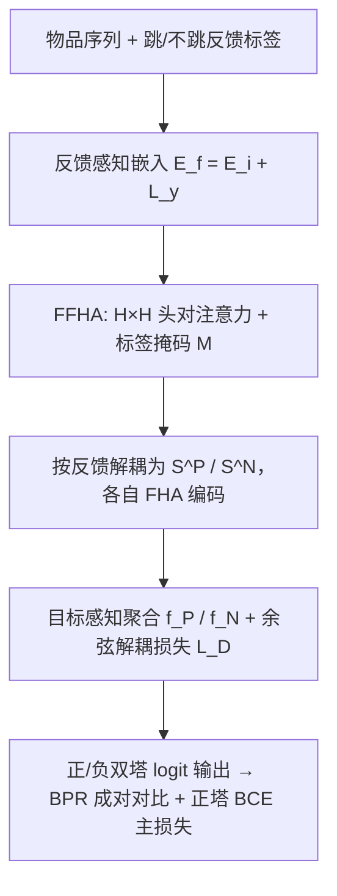
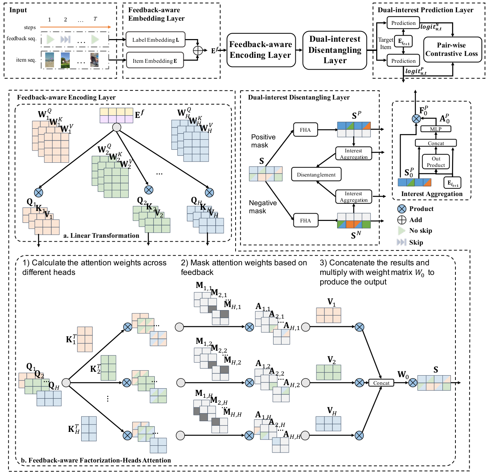

# Dual-interest Factorization-heads Attention for Sequential Recommendation (双兴趣因子化多头注意力序列推荐)

- **会议/期刊**: WWW 2023
- **作者与机构**: Guanyu Lin, Chen Gao, Yu Zheng, Depeng Jin, Yong Li 等（清华大学电子工程系 / 清华国际研究生院 / 快手科技）
- **推荐链路定位**: 召回（视频 feed 流序列召回与排序打分）
- **研究方向**: 序列与会话推荐 / 自监督对比学习与交互去噪
- **论文原文**: [https://arxiv.org/abs/2302.03965v3](https://arxiv.org/abs/2302.03965v3)
- **开源代码**: [https://github.com/tsinghua-fib-lab/WWW2023-DFAR](https://github.com/tsinghua-fib-lab/WWW2023-DFAR)

## TL;DR (1分钟核心速览)

视频 feed 场景中用户是被动接收内容，只产生"划走(skip, 负反馈)/不划走(no-skip, 正反馈)"，而主流点击式序列推荐只把正样本喂进模型、负样本仅作采样目标，完全丢失了正负反馈之间的转移模式。DFAR 提出反馈感知因子化多头注意力（FFHA），把 $H$个头拆成正/负两组并显式建模$H\times H$ 头对交互、用标签掩码过滤非法头对；再用双兴趣解耦层 + 正负双塔 BPR 成对对比损失把两种兴趣分开。在工业 Micro-video 与 Amazon 上，AUC 相对最优基线提升 2.83% / 0.76%，GAUC 提升 2.19% / 0.54%。

## Background & Motivation (背景与核心矛盾)

- **主流范式**: SASRec/GRU4REC/DIEN 等点击式序列推荐，仅输入用户点击过的正样本序列，用 Transformer/RNN 捕获时序转移，负样本只在训练目标端被采样。
- **前人局限**: (i) FeedRec/DFN 虽引入了 skip、dislike 等辅助反馈，但只是用一个**共享 vanilla Transformer** 混着编码，多头注意力的各头彼此独立、不跨反馈共享信息；(ii) 传统 pooling 聚合在正负混杂序列上会失效，把"厌恶"信号平均进用户兴趣。
- **核心洞察 (Key Insight)**: 相似物品的注意力权重应随反馈而**反向变化**——重度篮球迷再被推篮球视频会划走（应排斥），轻度用户看到篮球视频会停留（应吸引）。因此"物品-物品转移"本身必须被反馈标签条件化。
- **本文切入点**: 让注意力头的**交互本身**携带反馈先验（掩码式硬注意力），并在兴趣层用双塔 + 对比损失显式分离正负兴趣。

## Method (核心方法设计)

### 1. 整体框架 (Overall Architecture)

输入为物品 ID 序列与对应二值反馈序列，先做反馈感知嵌入（物品嵌入 + 标签嵌入 $L\in\mathbb{R}^{2\times D}$逐位相加），再由 FFHA 编码得到混合反馈的序列表征$\mathbf{S}$；随后按反馈标签把$\mathbf{S}$掩码解耦为纯正序列$\mathbf{S}^P$与纯负序列$\mathbf{S}^N$，各自过一遍 FHA 强化单反馈转移；接着用"目标物品 + 假设标签嵌入"计算目标感知注意力分数并聚合出$\mathbf{f}^P,\mathbf{f}^N$，施加余弦解耦损失；最后正/负双塔各自输出 logit，用 BPR 成对对比约束两塔的相对大小。推理时**只走正塔**，几乎零额外开销。

<figure class="paper-figure" markdown="span">
  <figcaption>图2：DFAR 示意图。(𝑖) 反馈感知编码层连接在反馈感知嵌入层之后，其中每个历史物品根据对应反馈注入一个标签嵌入；该层由线性变换和反馈感知分解头注意力组成。在线性变换中，输入嵌入被转换为查询、键和值矩阵。在反馈感知分解头注意力中，不同物品之间的转移关系被分解到不同头中，这些头根据正反馈或负反馈进行掩码。</figcaption>
</figure>

### 2. 关键设计拆解 (Key Designs)

1. **反馈感知因子化头注意力 (FFHA)**：vanilla MHA 的 $A_h=\mathrm{softmax}(Q_hK_h^{\top}/\sqrt{d})$只在同头内配对，无法表达"正反馈头 → 负反馈头"这类跨反馈转移；talking-heads 虽跨头但用两个额外矩阵乘做**隐式**混合，缺先验且开销$O(m h_k h)$。FFHA 改为直接算$H\times H$头对 logits，并用标签掩码$M_{h_1,h_2}$ 只保留与两个物品反馈一致的头对：
$A^{\text{FFHA}}_{h_1,h_2}=\mathrm{softmax}\!\left(M_{h_1,h_2}\odot \frac{Q_{h_1}K_{h_2}^{\top}}{\sqrt{d}}\right)$，其中$M_{h_1,h_2,i,j}=1$当且仅当$h_1$落在物品$i$反馈对应的头区间、$h_2$落在物品$j$反馈对应的头区间。前$H/2$头定义为负头、后$H/2$为正头。这样用$H$个头表达$H^2$种关系，参数量比 THA 少约$\sqrt{H}$倍，额外计算仅为 reshape/tile 的$O(1)$ 级操作。
2. **双兴趣解耦与聚合**：先按反馈掩码得到 $\mathbf{S}^P=\mathbf{S}\odot y$、$\mathbf{S}^N=\mathbf{S}\odot(1-y)$并各自再过 FHA；聚合时把目标物品分别与正/负标签嵌入相加，经 MLP 得注意力分数$A^P=\mathrm{MLP}((E_{i_{t+1}}+L_1)\Vert \mathbf{S}^P)$（$A^N$同理用$L_0$），softmax 加权求和得$\mathbf{f}^P,\mathbf{f}^N$，再用余弦相似度**排斥**两者：$\mathcal{L}_D=\frac{\mathbf{f}^P\cdot\mathbf{f}^N}{\|\mathbf{f}^P\|\,\|\mathbf{f}^N\|}$。
3. **双塔预测、成对对比与训练目标**：两塔分别拼接混合表征、单反馈表征、聚合表征与"目标+假设标签"嵌入，输出 $\text{logit}^P_{u,t}$、$\text{logit}^N_{u,t}$。核心是让**正确假设的塔更高**：$\mathcal{L}_{BPR}=-\log\sigma(\text{logit}^P_{u,t}-\text{logit}^N_{u,t})$（$y_{u,t}=1$时），负样本时对称取反。主损失只在正塔上做 BCE，负塔完全由对比损失自监督驱动；总目标$\mathcal{L}_J=\mathcal{L}+\lambda_{BPR}\mathcal{L}_{BPR}+\lambda_D\mathcal{L}_D+\lambda\|\Theta\|$。负塔仅在训练期存在，推理只算正塔；序列内所有历史物品（含 skip）都作为输入而非采样负例，因此无需额外负采样器。

## Experimental Setup & Evaluation Protocol (实验设置与评估协议)

- **数据集与预处理**:

| 数据集 | #Users | #Items | #Interactions | 稀疏度/密度 | 特征/场景说明 |
| :--- | :---: | :---: | :---: | :---: | :--- |
| Micro-video (工业) | 37,497 | 129,092 | 6,413,396 正 + 5,448,693 负 | 316.35 条/用户 | 快手类短视频 feed 流，2021-09-11~09-22，skip=负、no-skip=正 |
| Amazon (Toys) | 6,919 | 28,695 | 99,753 正 + 20,581 负 | 17.39 条/用户 | 电商评论，rating≥3 视为正、≤2 视为负（沿用 DenoisingRec） |

- **数据划分与防穿越 (Splitting Strategy)**: 均按**全局时间戳切分**。Micro-video：最后一天 12:00 前为验证、之后为测试，最后一天之前全部为训练；Amazon：最后一天为测试、倒数第二天为验证、其余为训练。
- **排名评测协议 (Ranking Protocol)**: 采用 AUC / GAUC（点对分类，正负各一采样）+ MRR@10 / NDCG@10。注意这是**采样负例协议而非 Full-Ranking 全库排序**，且 Amazon 的"负例"来自显式低分而非未交互物品，与真实曝光分布存在偏差。
- **对比基线与超参设置**: 基线含 DIN、Caser、GRU4REC、DIEN、SASRec、THA4Rec（本文首次将 talking-heads 用于推荐）、DFN、FeedRec 共 8 个。所有模型嵌入维度 $D=32$，Adam，学习率 1e-4，batch 20（Micro-video）/200（Amazon），early stop 2；$\lambda_{BPR},\lambda_D$在$\{10^{-4},10^{-3},10^{-2},10^{-1}\}$搜索，最终 Amazon 取$10^{-3}$、Micro-video 取$10^{-2}$。

## Key Experimental Results (实验关键数据)

### 1. 主实验对比 (Main Results)

| 模型 | Micro AUC | Micro MRR | Micro NDCG | Micro GAUC | Amazon AUC | Amazon MRR | Amazon NDCG | Amazon GAUC |
| :--- | :---: | :---: | :---: | :---: | :---: | :---: | :---: | :---: |
| DIN | 0.7345 | 0.5876 | 0.6876 | 0.7703 | 0.6595 | 0.4344 | 0.5669 | 0.6618 |
| Caser | 0.8113 | 0.6138 | 0.7079 | 0.8211 | 0.7192 | 0.4846 | 0.6073 | 0.7245 |
| GRU4REC | 0.7983 | 0.5927 | 0.6916 | 0.8041 | 0.7278 | 0.4901 | 0.6114 | 0.7266 |
| DIEN | 0.7446 | 0.5861 | 0.6861 | 0.7753 | 0.6688 | 0.4547 | 0.5832 | 0.6859 |
| SASRec | 0.8053 | 0.6046 | 0.7009 | 0.8120 | 0.6903 | 0.4604 | 0.5883 | 0.7029 |
| THA4Rec | 0.8104 | 0.6080 | 0.7035 | 0.8138 | 0.7069 | 0.4599 | 0.5879 | 0.7021 |
| DFN | 0.8342 | 0.6321 | 0.7222 | 0.8362 | 0.6998 | 0.4743 | 0.5990 | 0.7120 |
| FeedRec | 0.8119 | 0.6095 | 0.7047 | 0.8180 | 0.7037 | 0.4675 | 0.5938 | 0.7079 |
| **DFAR (Ours)** | **0.8578** | **0.6568** | **0.7410** | **0.8545** | **0.7333** | **0.4980** | **0.6175** | **0.7305** |
| **Improv.** | +2.83% | +3.91% | +2.60% | +2.19% | +0.76% | +1.61% | +1.00% | +0.54% |

### 2. 消融实验 (Ablation Study)

| 设置 | Micro AUC | Micro MRR | Micro GAUC | Amazon AUC | Amazon MRR | Amazon GAUC |
| :--- | :---: | :---: | :---: | :---: | :---: | :---: |
| w/o FHA（退回 vanilla MHA） | 0.8360 | 0.6198 | 0.8319 | 0.7133 | 0.4782 | 0.7054 |
| w/o MO（去掉标签掩码） | 0.8473 | 0.6378 | 0.8428 | 0.7141 | 0.4883 | 0.7137 |
| w/o IDL（去解耦损失 $\mathcal{L}_D$） | 0.8475 | 0.6377 | 0.8436 | 0.7284 | 0.4855 | 0.7128 |
| w/o IBL（去成对 BPR） | 0.8364 | 0.6324 | 0.8283 | 0.7137 | 0.4839 | 0.7047 |
| **DFAR 完整** | **0.8578** | **0.6568** | **0.8545** | **0.7333** | **0.4980** | **0.7305** |

### 3. 关键实验发现 (Key Findings)

1. **负反馈密度决定收益幅度**：Micro-video 负/正比高达 0.85，DFAR 的 GAUC 增益 2.19%；Amazon 负例稀疏且来自显式低分，增益仅 0.54%——说明 FFHA 的收益主要来自"正负交错"序列，而非单纯模型容量。
2. **成对对比 > 表征解耦**：去掉 IBL 后 Micro GAUC 从 0.8545 跌到 0.8283（-3.1%，全消融中最大跌幅），而去掉 IDL 仅跌 1.3%；BPR 提供的自监督信号比余弦排斥更直接有效。同时 w/o FHA 与 w/o MO 均显著下降，证明"因子化"与"掩码先验"缺一不可（无掩码的 FHA 在 Amazon 甚至退化到与 MHA 同级）。
3. **注意力可视化揭示场景差异**：Amazon 上"负→负"头对权重 0.4104 远高于"正→负"的 0.1301，即一次差评会强拖累后续行为（金钱成本高）；Micro-video 上"负→正"权重反而最高（0.7100），划走成本低、用户很快恢复。此外在 5 个序列长度分桶中 DFAR 全程领先，超长序列（>300）仍保持 0.8382 AUC，鲁棒性优于 SASRec/FeedRec。

## Highlights & Limitations (亮点、对比与审稿批判)

- **与代表作对比 (vs. Prior Work)**: 相比 SASRec 的纯正样本自注意力，DFAR 让"头"本身承载反馈语义；相比 FeedRec/DFN 用共享 Transformer + 后处理净化，本文在**注意力算子内部**就完成了正负反馈的因子化，且参数量与计算量更低（$O(1)$ 级 reshape，对比 THA 省掉两次矩阵乘）；相比 THA4Rec 的隐式头混合，掩码式显式交互避免了头职责混淆与过拟合。
- **可迁移亮点**: (i) "头对 logits + 标签掩码"是一种极轻量的多行为条件化注意力，可直接迁移到 click/cart/buy 多行为序列或跨场景多任务；(ii) 用"目标 + 假设标签嵌入"构造双塔并只部署正塔，是零推理开销的兴趣解耦范式。
- **审稿级局限批判**: (i) 评估仅用 AUC/GAUC 与采样负例的 MRR@10，缺少 Full-Ranking 全库排序，Amazon 的负例定义（rating≤2）也非真实曝光，可能高估收益；(ii) 头分区固定为前后各半、要求 $H$为偶数，且反馈只支持二值，无法处理"弱正反馈"（如短观看时长）与多头不均衡分配；(iii) 仅离线实验，工业数据集未给出线上 A/B，$D=32$ 的小嵌入也限制了与大规模工业模型的公平对比。

## Rating (四维评分)

- **方法创新性 (Novelty)**: ⭐⭐⭐⭐ （把多头注意力的"头"当作反馈因子、用标签掩码做硬注意力，机制简洁且带明确物理直觉，但本质仍是注意力掩码的变体）
- **评估协议与实验扎实度 (Protocol & Experiments)**: ⭐⭐⭐ （两个数据集 + 8 个基线 + 完整消融与可视化较扎实，但缺 Full-Ranking 无偏排序、无显著性检验与线上验证）
- **写作与数学规范度 (Clarity & Rigor)**: ⭐⭐⭐⭐ （FFHA 公式、掩码定义与复杂度对比清晰，附录给出三种注意力的伪代码；掩码索引符号略繁琐）
- **工业落地与复现价值 (Industrial & Practical Value)**: ⭐⭐⭐⭐ （代码已开源，负塔仅训练期存在、推理零额外开销，天然适配视频 feed 流召回；但需业务方提供可靠的 skip 标签）

