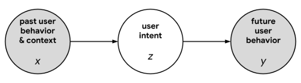
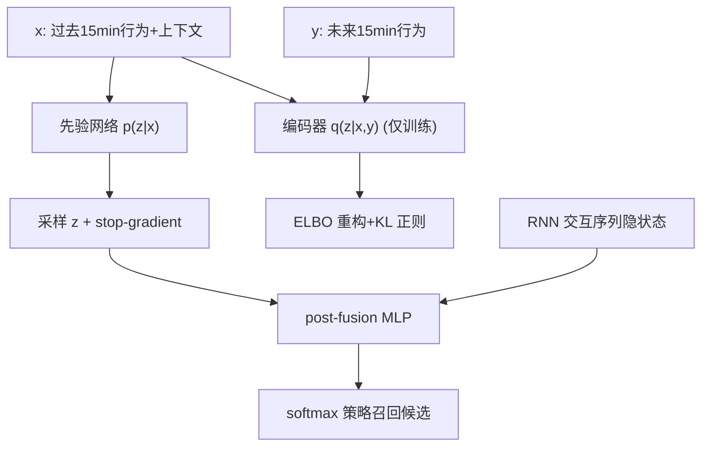
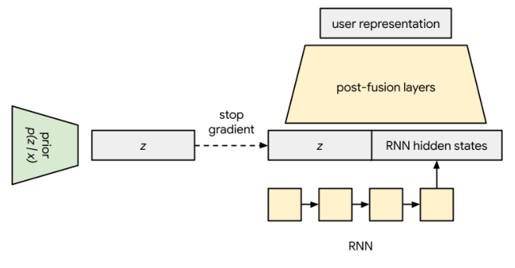

# Latent User Intent Modeling for Sequential Recommenders (面向序列推荐的潜在用户意图建模)

- **会议/期刊**: WWW '23 Companion（Industry Track，5 页短文）
- **作者与机构**: Bo Chang, Alexandros Karatzoglou, Yuyan Wang, Can Xu, Ed H. Chi, Minmin Chen（Google）
- **推荐链路定位**: 召回（候选检索阶段的用户表征增强），下游接独立精排
- **研究方向**: 序列与会话推荐 / 强化学习与长期留存
- **论文原文**: [arXiv:2211.09832v2](https://arxiv.org/abs/2211.09832v2)
- **开源代码**: 暂未开源

## TL;DR (1分钟核心速览)

主流序列推荐只吃 item 级交互序列，缺少「用户此刻为何而来」的高层意图。本文把意图 $z$形式化为潜变量，用条件 VAE（先验$p(z|x)$、解码器$p(y|z)$、编码器$q(z|x,y)$）从行为与上下文信号中**无监督**推断，再只取先验采样的$\boldsymbol{z}$以 stop-gradient 拼入 REINFORCE 序列召回器的用户表征。论文未用离线基准，而以三周大规模线上 A/B（十亿级用户、百万级物品）验证：整体满意度$+0.07\%$、主题多样性$+0.10\%$，95% CI 均不含 0，并已上线两周以上。

## Background & Motivation (背景与核心矛盾)

- **主流范式**: 序列推荐用 RNN / CNN / 自注意力对 item 交互序列建模，直接预测下一物品或用 REINFORCE 优化长期满意度。
- **前人局限**: 其一，显式意图定义（导航 / 信息 / 交易型）依赖专家穷举，而自然推荐场景中意图是多面且下意识的，无法枚举；其二，纯 item 级建模只刻画 topical interest，无法表达「探索新内容 / 续上上一条会话 / 仅放背景音乐」这类跨会话、决定长期体验的意图状态。
- **核心洞察 (Key Insight)**: 假定过去行为与上下文 $x$到未来行为$y$的联系被意图$z$**完全中介**，即$x \perp y \mid z$；则$z$是二者的信息瓶颈，可由$(x,y)$ 共现用变分推断无监督学出，完全绕开意图标注。
- **本文切入点**: 把意图模块做成**与主模型解耦的独立模块**，训练靠 ELBO、服务时只走先验网络，主推荐器结构不动，代价仅为一次 MLP 前向。

<figure class="paper-figure" markdown="span">
  <figcaption>图1：概率图模型。过去用户行为和上下文𝑥到未来用户行为𝑦的联系由用户意图𝑧中介。注意𝑥和𝑦是观测变量，而𝑧是潜在变量。</figcaption>
</figure>

## Method (核心方法设计)

### 1. 整体框架 (Overall Architecture)

输入侧 $x$是过去 15 分钟点击 / 搜索数与时间、设备等上下文，$y$是未来 15 分钟同类行为（替代「下一物品」作为重构目标）。潜意图模块由三个 MLP 参数化的对角高斯组成：先验$p(z|x)=\mathcal{N}(\boldsymbol{\mu}_\psi,\boldsymbol{\Sigma}_\psi)$、编码器$q(z|x,y)$、解码器$p(y|z)$，用 ELBO 独立训练；训练与服务阶段均从先验采样$\boldsymbol{z}$，经 stop-gradient 后与主模型 RNN 末隐状态拼接，过 post-fusion MLP 得到意图增强的用户表征，再与原物品表征做 softmax 策略打分，召回数百候选后交由独立精排。两个损失通过$\lambda$ 加权联合优化，实现「意图模块负责理解、推荐模块负责决策」的职责分离。

<figure class="paper-figure" markdown="span">
  <figcaption>图3：将潜在意图模块融入序列推荐模型的整体架构。仅使用先验网络，并应用停止梯度以进一步解耦二者。</figcaption>
</figure>

### 2. 关键设计拆解 (Key Designs)

1. **与 PGM 一致的条件 VAE 目标**：原版 CVAE 解码器吃 $x$会破坏$x\perp y\mid z$，故本文改为$p(y|z)$，让$z$ 成为唯一信息通路与低维瓶颈：
$$\mathcal{L}_{\text{ELBO}}=\mathbb{E}_{q(z|x,y)}\left[\log p(y|z)\right]-D_{\mathrm{KL}}\left(q(z|x,y)\,\|\,p(z|x)\right)\le\log p(y|x)$$
第一项逼 $\boldsymbol{z}$保留能重构未来行为的信息，第二项把后验拉回仅凭$x$可得的先验；$z$维度小于$y$维，从而压掉不可由$x$ 解释的噪声。

2. **KL 爆炸的两道工程闸门（本文最实用增量）**：工业数据下 KL 项在训练初期或中途爆炸直接导致训练失败。作者用 (i) 权重 $\mathcal{U}(-\varepsilon,\varepsilon)$、偏置置零的初始化，使初始时$q(z|x,y)\approx p(z|x)\approx\mathcal{N}(\mathbf{0},\mathbf{I})$、KL 近零；(ii) 用 softplus 把 log-variance 全程软截断到区间$(a,b)$：
$$f(x)=x-\log\!\left(1+e^{\,x-b}\right)+\log\!\left(1+e^{\,a-x}\right)$$
两者叠加后 KL 全程有界，是低成本高收益的稳定性补丁。

3. **训练目标、解耦与推理开销**：总损失 $\mathcal{L}=\mathcal{L}_{\text{rec}}-\lambda\mathcal{L}_{\text{ELBO}}$（$\lambda>0$调节意图模块强度），$\mathcal{L}_{\text{rec}}$ 仍是 REINFORCE 的长期满意度损失且形式不变；stop-gradient 使推荐梯度不回传意图模块，避免策略优化污染意图语义。推理仅新增一次先验 MLP 前向与一次采样，几乎不影响线上延迟；无负采样设计（依赖 in-batch 全候选 softmax 策略）。

## Experimental Setup & Evaluation Protocol (实验设置与评估协议)

- **数据集与预处理**: 无公开离线基准，全部实验在 Google 大规模线上推荐平台完成（十亿级用户、百万级物品、每次请求召回数百候选后由独立精排重排）。主题簇由 item 共现矩阵 $\to$矩阵分解得 item embedding$\to$ k-means 聚为 10,000 个簇得到。
- **数据划分与防穿越 (Splitting Strategy)**: 采用**线上时间切分的对照实验**——三周内 control 与 experiment 两组模型均以流式新交互持续在线训练（非 Leave-One-Out、非固定比例划分）；离线部分仅用训练 step 上的 KL 曲线做潜空间诊断，不参与模型选择。
- **排名评测协议 (Ranking Protocol)**: 工业全链路真实打分排序（非采样排序），指标为平台级 overall enjoyment 与 unique topic cluster 数（消费多样性，作为长期体验的代理指标）；采用两独立组均值差的 **95% 置信区间**作为显著性口径（CI 不含 0 即显著）。
- **对比基线与超参设置**: 基线即 Chen et al. 的 REINFORCE 序列推荐（无潜意图模块），同时也是唯一消融对照；潜变量维度取小于 $y$维的瓶颈设置，$\lambda>0$为 ELBO 权重，$\varepsilon,a,b$ 未给具体数值。

## Key Experimental Results (实验关键数据)

### 1. 主实验对比 (Main Results)

| 指标（线上 A/B，3 周） | Control（无潜意图） | Experiment（+潜意图） | 相对提升 | 95% CI | 显著 |
| :--- | :---: | :---: | :---: | :---: | :---: |
| Overall enjoyment | 基线 | 意图增强 | **+0.07%** | (+0.02%, +0.11%) | 是 |
| Diversity（unique topic clusters） | 基线 | 意图增强 | **+0.10%** | (+0.08%, +0.13%) | 是 |

> 说明：原文为工业 A/B，仅报告相对差值与置信区间，未披露绝对数值，故无法列出 5–8 个离线 SOTA 基线；control 模型即最强同类基线（REINFORCE 序列召回）。

### 2. 消融与稳定性诊断 (Ablation & Diagnostics)

原文未做传统离线消融，以下为可提取的组件级证据：

| 配置 | KL 项行为 | 结论 |
| :--- | :---: | :---: |
| 无小均匀初始化 + 无 soft-clip | 训练初期 / 中期爆炸 | 训练不稳定，不可用 |
| + $\mathcal{U}(-\varepsilon,\varepsilon)$初始化、零偏置 | 初始 KL$\approx 0$ | 缓解，但不足 |
| + log-variance softplus 截断至 $(a,b)$ | 全程有界 | **采用配置** |
| 解码器输入 $x$，即$p(y|x,z)$| — | 违背$x\perp y\mid z$，弃用 |
| 仅先验 + stop-gradient 注入主模型 | — | 线上 +0.07% / +0.10% |

### 3. 关键实验发现 (Key Findings)

1. **收益虽小但确凿且随时间增强**：$+0.07\%$与$+0.10\%$ 的 95% CI 均严格不含 0，且 enjoyment 曲线呈持续上行趋势，作者归因于「用户学习效应」——策略改变用户状态后再被意图模型捕捉，形成正反馈。
2. **后验-先验 KL 可作「惊讶度」探针**：消费新物品或新主题（item 级与 topic 级两种定义）时 KL 显著高于旧物品，说明潜空间确实编码了行为转折而非静态兴趣，为无监督意图检测提供了可验证的语义锚点。
3. **搜索行为突变可被潜变量感知**：当 $s_{\text{past}}>0,s_{\text{future}}=0$或反之（行为跨越）时 KL 曲线高于未变化组，表明$z$ 捕捉到了跨会话的意图切换——这正是纯 item 序列模型的结构性盲区。

## Highlights & Limitations (亮点、对比与审稿批判)

- **与代表作对比 (vs. Prior Work)**: 相比 MCPRN 等混合通道 / 多意图路由方法（需预设意图数目并对每个 item 学购买目的），本文用连续潜变量+变分推断免除意图枚举；相比 SGL/SimGCL 类对比学习增强（改造 item 表征），本文增强的是**请求时刻的用户状态**；相比 TIGER 类语义 ID 生成式方法，本文不改变输出空间，只做表征注入，工程侵入性最低。
- **可迁移亮点**: ① 把「后验-先验 KL」当作无监督的行为突变 / 新物品惊讶度信号，可用于新鲜度加权、探索触发；② 小均匀初始化 + softplus 软截断 log-variance，是任何 VAE 型推荐模块稳定训练的低成本药方。
- **审稿级局限批判**: ① **评估单薄**：仅工业 A/B、无公开数据集与离线基线，$\lambda$、$z$维度、$\varepsilon,a,b$均无敏感性分析，$+0.07\%$量级提升也难以排除长期漂移与新奇效应；② **信息通路过窄且不可解释**：stop-gradient 加仅用先验，意图模块与主模型是「松耦合」，$z$ 的语义只能靠 KL 曲线间接佐证，作者亦承认连续潜空间可解释性差（拟用 Gumbel softmax / VQ-VAE 离散化）；③ 5 页短文，缺少与「直接拼接更多上下文特征」这一强 shortcut 基线的对照，增益来源仍有归因空间。

## Rating (四维评分)

- **方法创新性 (Novelty)**: ⭐⭐⭐⭐ （首次把潜变量/条件 VAE 意图建模引入工业序列召回，PGM 假设与解码器改造自洽，但技术组件均为已有工具的组合）
- **评估协议与实验扎实度 (Protocol & Experiments)**: ⭐⭐ （仅线上 A/B 与 KL 曲线诊断，无离线基准、无超参敏感性、无 shortcut 基线，显著性仅靠 CI）
- **写作与数学规范度 (Clarity & Rigor)**: ⭐⭐⭐⭐ （PGM→ELBO→注入的三段式推导清晰，软截断公式与稳定性论证到位，但超参与维度全部缺省）
- **工业落地与复现价值 (Industrial & Practical Value)**: ⭐⭐⭐⭐ （模块独立、主模型零改动、推理仅加一次 MLP 前向，已上线两周以上；但未开源且依赖内部平台数据，复现门槛高）

