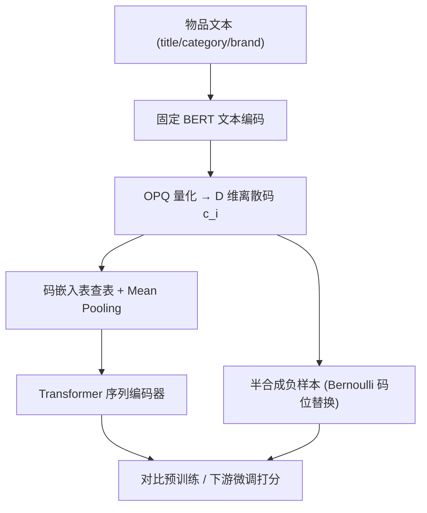

# Learning Vector-Quantized Item Representation for Transferable Sequential Recommenders (学习向量量化物品表征的可迁移序列推荐)

- **会议/期刊**: WWW 2023 (The Web Conference)
- **作者与机构**: Yupeng Hou, Wayne Xin Zhao (中国人民大学高瓴人工智能学院)；Zhankui He, Julian McAuley (UC San Diego)
- **推荐链路定位**: 召回 / 端到端序列建模（Next-Item 预测）
- **研究方向**: 序列与会话推荐 / 跨域与多场景推荐
- **论文原文**: [https://arxiv.org/abs/2210.12316v2](https://arxiv.org/abs/2210.12316v2)
- **开源代码**: [https://github.com/RUCAIBox/VQ-Rec](https://github.com/RUCAIBox/VQ-Rec)

## TL;DR (1分钟核心速览)

本文针对"PLM 文本表征直接绑定物品表征"导致的两大痛点——过度强调文本相似性而忽视序列协同信号、以及多域文本语义未对齐放大域间鸿沟——提出 **"text ⇒ code ⇒ representation"** 两步式物品表征：先用 OPQ 把 BERT 文本编码量化为 $32\times256$ 的离散码，再查码嵌入表并池化得物品向量。配合半合成+混合域难负样本对比预训练与基于可微置换矩阵的跨域微调，在 6 个 Amazon/电商基准的 `Leave-One-Out + Full-Ranking` 协议下，Office 上 Recall@10 相较 UniSRec 提升约 22%，且支持无须重训的 inductive 新物品推荐。

## Background & Motivation (背景与核心矛盾)

- **主流范式**: 以 ZESRec / UniSRec 为代表，用固定或微调的 PLM 将物品标题/描述编码为"通用物品表征"，在多域混合交互数据上预训练 Transformer 序列编码器，实现跨域迁移。
- **前人局限**: ①文本编码与物品表征"绑得太紧"，模型会过度放大文本相似度而弱化交互序列中的协同模式，在交互充足的大数据集（Arts/Office/Online Retail）上反被纯 ID 的 SASRec 追平；②多域文本分布与语义天然不对齐，这种紧绑定会把域间鸿沟直接注入表征，甚至引发负迁移（UniSRec 在 Arts/Office/Online Retail 上出现负迁移）。
- **核心洞察 (Key Insight)**: 离散码是一层"语义瓶颈"——它保留文本的可迁移语义，却切断了文本对推荐模型的直接梯度通路，使序列编码器可以去拟合交互结构；同时 OPQ 的 K-means 聚类天然产生近似均匀的码分布，理论上能最小化码碰撞概率、最大化物品可区分性。
- **本文切入点**: 在文本与物品表征之间插入中间离散索引层，并对"码学习—预训练—下游适配"三段分别设计专门策略。

## Method (核心方法设计)

### 1. 整体框架 (Overall Architecture)

离线阶段用固定 BERT 抽取物品文本 `[CLS]` 向量，在多域全部物品上跑 OPQ 得到 $D$组、每组$M$个质心，从而把每个物品压成$D$维离散码$\boldsymbol{c}_i$；在线阶段用码作为行索引去$D$张码嵌入表查表并 mean-pooling 得物品向量$\boldsymbol{v}_i$，喂入标准 SASRec 式自注意力编码器做下一物品预测。预训练用混合域 batch 内的其它物品作混合域负样本、用码位随机替换构造半合成负样本做 InfoNCE；迁移到下游域时冻结 Transformer，先用 Gumbel-Sinkhorn 学出可微置换矩阵把旧码嵌入重排对齐到新域码，再微调码嵌入表本身。整个链路不依赖物品 ID，故新物品只需编码文本即可即时打分。

### 2. 关键设计拆解 (Key Designs)

1. **向量量化物品表征（松弛文本-表征的强绑定）**：痛点是用文本编码直出表征会让文本语义支配推荐；本文改为两步映射。量化步骤对第 $k$段子向量取最近质心索引$c_{i,k}=\arg\min_{j}\|\boldsymbol{x}_{i,k}-\boldsymbol{a}_{k,j}\|_2$，再由$\boldsymbol{v}_i=\mathrm{Pool}([\boldsymbol{e}_{1,c_{i,1}};\dots;\boldsymbol{e}_{D,c_{i,D}}])$得最终表征。直觉上码嵌入表随机初始化后由交互梯度自由学习，而码本身只提供"物品在语义空间中的坐标"，于是文本成为弱先验而非强约束；且$O(d_VD)$的查表复杂度显著优于 UniSRec 适配器的$O(d_Wd_VD)$。
2. **半合成 + 混合域双重难负样本**：痛点一是码空间大小为 $M^D$（指数级），训练中出现的码组合极稀疏，随机负样本区分度低；痛点二是多域预训练需要跨域对比信号。做法是以真码为基底按 Bernoulli($\rho=0.75$) 逐位替换为均匀采样索引得$\tilde{\boldsymbol{v}}_i$（半合成硬负样本，保证与正样本"近而不相同"），同时因 batch 从多域采样，batch 内其它正样本天然构成混合域负样本。
3. **训练目标、负采样与推理效率**：总损失为单组 InfoNCE
$\ell=-\frac{1}{B}\sum_{j}\log\frac{\exp(\boldsymbol{s}_j\cdot\boldsymbol{v}_j/\tau)}{\exp(\boldsymbol{s}_j\cdot\tilde{\boldsymbol{v}}_j/\tau)+\sum_{j'=1}^{B}\exp(\boldsymbol{s}_j\cdot\boldsymbol{v}_{j'}/\tau)}$，$\tau=0.07$；负样本免额外采样开销（全部来自码扰动与 batch 内复用）。微调阶段仅学$D$个置换矩阵$\hat{\boldsymbol{E}}^{(k)}=\boldsymbol{\Pi}_k\boldsymbol{E}^{(k)}$，其中$\boldsymbol{\Pi}_k=\mathrm{Sinkhorn}(\boldsymbol{\Theta}_k)$由 Gumbel-Sinkhorn（3 次迭代）从随机矩阵$\boldsymbol{\Theta}_k\in\mathbb{R}^{M\times M}$ 松弛为双随机矩阵（依据 Birkhoff 定理），可微且近似双射，故微调参数量极小。

## Experimental Setup & Evaluation Protocol (实验设置与评估协议)

- **数据集与预处理**: 5 个 Amazon 子域（Food/Home/CDs/Kindle/Movies）混合成预训练语料，下游 5 个 Amazon 跨域集 + 1 个跨平台集（Online Retail）；均按 `5-core` 过滤，文本截断 512 词。

| 数据集 | #Users | #Items | #Interactions | 平均长度 / 平均词数 | 场景说明 |
| :--- | :---: | :---: | :---: | :---: | :--- |
| Pre-trained | 1,361,408 | 446,975 | 14,029,229 | 13.51 / 139.34 | 五域混合预训练 |
| Scientific | 8,442 | 4,385 | 59,427 | 7.04 / 182.87 | 跨域·小规模 |
| Pantry | 13,101 | 4,898 | 126,962 | 9.69 / 83.17 | 跨域·小规模 |
| Instruments | 24,962 | 9,964 | 208,926 | 8.37 / 165.18 | 跨域·中等 |
| Arts | 45,486 | 21,019 | 395,150 | 8.69 / 155.57 | 跨域·较大 |
| Office | 87,436 | 25,986 | 684,837 | 7.84 / 193.22 | 跨域·最大 |
| Online Retail | 16,520 | 3,469 | 519,906 | 26.90 / 27.80 | 跨平台（UK 电商） |

- **数据划分与防穿越**: 严格 `Leave-One-Out`——每用户最后一条交互为测试、倒数第二条为验证，其余训练；序列按时间戳排序，无未来信息泄漏。
- **排名评测协议**: 无偏 `Full-Ranking`，对每个测试序列在**全部候选物品**中排序（非采样排序），报告 Recall@{10,50} 与 NDCG@{10,50} 并对所有测试用户取平均。
- **对比基线与超参**: 基线含 ID 系（SASRec、BERT4Rec）、特征系（FDSA、S3-Rec）、迁移系（RecGURU、ZESRec、UniSRec），覆盖 ID / ID+T / T 三种输入形态；码方案 $(M=32)\times(D=256)$，batch 2048，预训练 300 epoch，学习率$\{3e^{-4},1e^{-3},3e^{-3}\}$，置换学习 epoch$\{3,5,10\}$，按验证集 NDCG@10 早停（patience 10）。

## Key Experimental Results (实验关键数据)

### 1. 主实验对比 (Main Results)

| 数据集 | 指标 | SASRec(ID) | BERT4Rec(ID) | FDSA(ID+T) | S3-Rec(ID+T) | ZESRec(T) | UniSRec(T) | **VQ-Rec(T)** | Improv. |
| :--- | :--- | :---: | :---: | :---: | :---: | :---: | :---: | :---: | :---: |
| Scientific | R@10 / N@10 | 0.1080 / 0.0553 | 0.0488 / 0.0243 | 0.0899 / 0.0580 | 0.0525 / 0.0275 | 0.0851 / 0.0475 | 0.1188 / 0.0641 | **0.1211 / 0.0643** | +1.9% |
| Pantry | R@10 / N@10 | 0.0501 / 0.0218 | 0.0308 / 0.0152 | 0.0395 / 0.0209 | 0.0444 / 0.0214 | 0.0454 / 0.0230 | 0.0636 / **0.0306** | **0.0660** / 0.0293 | +3.8% |
| Instruments | R@10 / N@10 | 0.1118 / 0.0612 | 0.0813 / 0.0620 | 0.1070 / 0.0796 | 0.1056 / 0.0713 | 0.0783 / 0.0497 | 0.1189 / 0.0680 | **0.1222 / 0.0758** | +2.8% |
| Arts | R@10 / N@10 | 0.1108 / 0.0587 | 0.0722 / 0.0479 | 0.1002 / 0.0714 | 0.1003 / 0.0601 | 0.0664 / 0.0375 | 0.1066 / 0.0586 | **0.1189 / 0.0703** | +11.5% |
| Office | R@10 / N@10 | 0.1056 / 0.0710 | 0.0825 / 0.0634 | 0.1118 / 0.0868 | 0.1030 / 0.0653 | 0.0641 / 0.0391 | 0.1013 / 0.0619 | **0.1236 / 0.0814** | +22.0% |
| Online Retail | R@10 / N@10 | 0.1460 / 0.0675 | 0.1349 / 0.0653 | 0.1490 / 0.0719 | 0.1418 / 0.0654 | 0.1103 / 0.0535 | 0.1449 / 0.0677 | **0.1557 / 0.0730** | +7.5% |
| Office | R@50 / N@50 | 0.1627 / 0.0835 | 0.1227 / 0.0721 | 0.1665 / 0.0987 | 0.1613 / 0.0780 | 0.1113 / 0.0493 | 0.1702 / 0.0769 | **0.1957 / 0.0972** | +15.0% |
| Online Retail | R@50 / N@50 | 0.3872 / 0.1201 | 0.3540 / 0.1131 | 0.3802 / 0.1223 | 0.3702 / 0.1154 | 0.2750 / 0.0896 | 0.3604 / 0.1149 | **0.3994 / 0.1263** | +10.8% |

`Improv.%` 以最强基线（多为 UniSRec）的 Recall@10 为分母。

### 2. 消融实验 (Ablation Study)

| 变体 | Scientific R@10 / N@10 | Office R@10 / N@10 | Online Retail R@10 / N@10 |
| :--- | :---: | :---: | :---: |
| (0) VQ-Rec 完整模型 | **0.1211 / 0.0643** | **0.1236 / 0.0814** | **0.1557 / 0.0730** |
| (1) w/o 多域预训练 | 0.1104 / 0.0593 | 0.1108 / 0.0666 | 0.1535 / 0.0717 |
| (2) w/o 半合成负样本 | 0.1194 / 0.0631 | 0.1227 / 0.0809 | 0.1529 / 0.0702 |
| (3) w/o 下游微调 | 0.0640 / 0.0361 | 0.0261 / 0.0150 | 0.0197 / 0.0095 |
| (4) 直接复用预训练 PQ 索引集 | 0.1168 / 0.0618 | 0.1182 / 0.0773 | 0.1521 / 0.0707 |
| (5) w/o 码-嵌入置换对齐 ($\boldsymbol{\Pi}_k$) | 0.1183 / 0.0612 | 0.1242 / 0.0824 | 0.1515 / 0.0695 |
| (6) 随机码（不保留文本语义） | 0.0905 / 0.0494 | 0.1134 / 0.0837 | 0.1589 / 0.0769 |

### 3. 关键实验发现 (Key Findings)

1. **下游微调是迁移的绝对命门**：去掉微调后 Online Retail 的 Recall@10 从 0.1557 崩到 0.0197（−87%），Office 从 0.1236 崩到 0.0261；说明码集与码嵌入表是"域相关"的，仅迁移 Transformer 序列编码器完全无法跨语义域工作，这也解释了为何"直接复用预训练 PQ 索引集"（变体 4）同样稳定掉点（Office R@10 −4.4%）。
2. **文本语义必须保留，但必须弱绑定**：随机码（变体 6）在 Scientific 上 R@10 仅 0.0905（−25%），证明码确实承载文本可迁移语义；但其在 Online Retail 上反超完整模型（0.1589 vs 0.1557），因该集平均文本仅 27.8 词、语义信息稀薄——即文本质量决定该范式的收益上界，是清晰的适用边界。
3. **容量与冷启双赢**：随训练数据比例从 20%→100%，VQ-Rec 在 Office/Online Retail 上 NDCG@10 曲线始终高于 SASRec(ID) 与 UniSRec(T) 且持续上升，说明码嵌入表比文本直连表征有更强拟合容量；同时图 4 显示在冷启动物品分组（Office `[0,5)`、Online Retail `[0,20)`）上相对 SASRec(ID) 的提升最大，而在高热分组也未见文本系模型的性能回落。

## Highlights & Limitations (亮点、对比与审稿批判)

- **与代表作对比 (vs. Prior Work)**: 相较 ZESRec 直接把 PLM 文本向量当物品表征、UniSRec 在文本表征上加 MoE 适配器并做序列级对比学习，本文的本质差异是引入**离散码瓶颈**解耦"语义输入"与"可学表征"，把迁移对象从"文本编码器"变为"码嵌入表 + 置换映射"，从而在同等文本输入下取得更好的大域拟合与无负迁移。
- **可迁移亮点**: ①"离散码 + 可微置换对齐"这一套参数高效域适配思路可直接搬到跨域 CTR、多场景多模态召回；②半合成负样本（按位 Bernoulli 扰动真码）是构造"近邻但不相同"硬负样本的通用技巧，适用于任何具有组合式离散 ID（如语义 ID 生成式推荐）的场景。
- **审稿级局限批判**: ①码方案 $(M=32)\times(D=256)$需在**全部预训练物品**上跑 OPQ，物品库达百万级时质心训练与码分配成本、以及码表显存（$D\times M\times d_V$）不可忽视，论文未给时间/显存实测；②微调分两阶段（先置换后码表）串行优化，且对置换学习 epoch 数与$\rho$ 敏感，论文仅在附录量级上搜索，缺乏对超参鲁棒性的系统敏感性分析；③评估虽为 Full-Ranking 且覆盖跨域+跨平台，但下游域全部来自 Amazon 同构 schema，对真正异构平台（如短视频 vs 电商）的泛化性证据仍偏弱。

## Rating (四维评分)

- **方法创新性 (Novelty)**: ⭐⭐⭐⭐ （以 OPQ 离散码作语义瓶颈解耦文本与表征，并用 Gumbel-Sinkhorn 松弛置换做双射对齐，机制新颖且有码均匀性/碰撞概率的理论直觉支撑）
- **评估协议与实验扎实度 (Protocol & Experiments)**: ⭐⭐⭐⭐ （6 数据集合成跨域+跨平台、Leave-One-Out + Full-Ranking 无偏协议、7 个强基线 + 6 组消融，唯缺显著性检验与多随机种子方差报告）
- **写作与数学规范度 (Clarity & Rigor)**: ⭐⭐⭐⭐⭐ （三条贡献与公式一一对应，码学习/预训练/微调分段清晰，复杂度 $O(d_VD)$vs$O(d_Wd_VD)$ 对比直观）
- **工业落地与复现价值 (Industrial & Practical Value)**: ⭐⭐⭐⭐ （代码与预训练模型已开源、免 ID 的 inductive 打分对冷启上线极友好，但全库 OPQ 与 $D$ 张码表的工程开销需实际压测）

