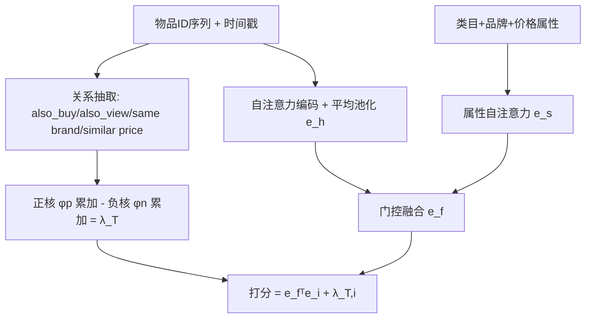
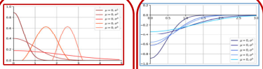

# Modeling Temporal Positive and Negative Excitation for Sequential Recommendation (面向序列推荐的时间正负激励建模)

- **会议/期刊**: WWW 2023
- **作者与机构**: Chengkai Huang, Shoujin Wang, Xianzhi Wang, Lina Yao (UNSW / UTS / CSIRO Data61)
- **推荐链路定位**: 召回/精排打分（Next-Item 序列打分）
- **研究方向**: 序列与会话推荐 / 图与知识图谱推荐（物品关系）
- **论文原文**: [https://arxiv.org/abs/2410.22013v1](https://arxiv.org/abs/2410.22013v1)
- **开源代码**: 基于 [ReChorus 基准](https://github.com/THUwangcy/ReChorus) 实现（作者未另发独立仓库）

## TL;DR (1分钟核心速览)

现有序列推荐只建模“物品 ID 层面的动态兴趣”，既忽视品牌/类目/价格这类**静态长期兴趣**，又把历史交互一律视作对下一物品的**正激励**。本文提出 SDIL：用改进的 Hawkes 强度函数同时累加正、负两类时间衰减核（同一 substitute 关系在短期为负、在生命周期节点转为正），再以属性自注意力学习静态兴趣并门控融合打分。在 Beauty/Cellphones/Toys 的 1:99 采样排序下，Cellphones MRR 相较最强基线 KDA 提升 10.45%，Beauty HR@10 提升 2.18%。

## Background & Motivation (背景与核心矛盾)

- **主流范式**: SASRec/TiSASRec 类自注意力序列编码器 + BPR 训练；亦有 Hawkes 过程类工作（SLRS+、Chorus）用时间衰减建模“重复消费/时序强度”。
- **前人局限**: ① 只建模 ID 级动态兴趣，类目、品牌、价位等**变化缓慢的静态偏好**被丢弃，序列变长后兴趣估计震荡严重；② 几乎所有时序模型默认历史事件只产生正激励，无法表达“刚买 iPhone 短期不会再买别家手机”的**负激励**。
- **核心洞察 (Key Insight)**: 同一条 substitute 关系（also_view / 同价位同类别）在不同时间尺度上**符号相反**——短期内为负激励（替代品互斥），在产品寿命周期附近转为正激励（换新）。因此“激励极性”应由时间核形状而非关系类别单独决定。
- **本文切入点**: 把强度函数拆成 $\lambda_0$（自注意力基本兴趣）与“正核和 − 负核和”，并用双峰/单峰高斯核给每条历史交互分配时变极性强度；再补一路属性级静态兴趣分支。

## Method (核心方法设计)

### 1. 整体框架 (Overall Architecture)

输入为定长 20 的物品 ID 序列及其时间戳、类目/品牌/价格分箱。DIM 分支先以位置编码 + 自注意力 + 平均池化得到历史兴趣 $e_h$，与目标物品内积构成基础强度$\lambda_0$；同时按四种显式关系抽取正、负激励事件，各自经可学习时间核$\varphi_p,\varphi_n$累加得到激励项$\lambda_T$。SIM 分支把属性向量加和融合后经无位置编码的多头自注意力池化得$e_s$。两路经门控融合成$e_f$，最终打分由$e_f^{\top}e_i$与$\lambda_{T,i}$ 相加给出，BPR 优化。

<figure class="paper-figure" markdown="span">
  <figcaption>图2：我们提出的 SDIL 框架示意图。SDIL 由三个主要模块组成：(a) 用户动态兴趣建模模块（DIM），(b) 用户静态兴趣建模模块（SIM），(c) 下一物品预测模块。DIM 通过细致建模用户历史交互对用户当前兴趣的时间敏感正激励和负激励，捕获用户的演化动态兴趣。SIM 从交互物品的属性信息中捕获用户相对稳定且高层的兴趣（例如，对物品类别、品牌的兴趣）。最后，</figcaption>
</figure>

### 2. 关键设计拆解 (Key Designs)

1. **反应式点过程：把“激励”拆成正负两项**：经典 Hawkes 只有正项，无法表达替代品互斥。本文改写强度函数为 $\lambda_T(t)=\lambda_0+\sum_{i:t_i<t_n}\varphi_p(t_n-t_i)-\sum_{j:t_j<t_n}\varphi_n(t_n-t_j)$，其中正项覆盖 also_buy/share_brand（互补，短期）与 also_view/similar_item（替代，寿命周期），负项仅覆盖替代关系。直觉：候选物品的排序分被“历史相关品的时间距离”显式加减，等于给每个候选做了关系级、时序级的软惩罚。

2. **双峰正核 + 单峰负核（可学习时间衰减）**：正核取双峰高斯 $\mathcal{K}_1(\Delta t)=\mathcal{N}(\Delta t\mid 0,\sigma_{v1})+\mathcal{N}(\Delta t\mid \mu_{v2},\sigma_{v2})$，前者刻画“买手机后短期买配件”的零均值衰减，后者刻画“$\mu_{v2}$时长后换新”的延迟正激励；负核为$\mathcal{K}_2(\Delta t)=-\mathcal{N}(\Delta t\mid 0,\sigma_{v3})$，短期强惩罚、随时间平滑消退。$\sigma_{v1},\mu_{v2},\sigma_{v2},\sigma_{v3}$ 均为**物品级可学习参数**，使模型能自动区分“快消”与“耐用品”的时间尺度——这是相对 Chorus 固定衰减形式的核心增量。

3. **静态兴趣门控融合与训练目标**：属性融合 $f_i=c_i+b_i+p_i$后经多头自注意力（刻意不加位置编码，因静态偏好与时刻无关）与平均池化得$e_s$；门控$e_f=g\odot e_s+(1-g)\odot e_h,\ g=\sigma(W_1e_s+W_2e_h+b)$自适应抑制两路冗余。总损失为 BPR：$\mathcal{L}=-\sum_u\sum_i\log\sigma(\hat{y}_{ui}-\hat{y}_{uj})$，$\hat{y}_{ui}=e_f^{\top}e_i+\lambda_{T,i}$，负样本为均匀随机采样；推理仅需一次前向 + 内积打分，无额外近邻检索开销。

## Experimental Setup & Evaluation Protocol (实验设置与评估协议)

- **数据集与预处理**: Amazon 三个子集，统一 `5-core` 过滤，序列按时间排序、截断/补齐至长度 20。

| 数据集 | #Users | #Items | 特征/场景说明 |
| :--- | :---: | :---: | :--- |
| Beauty | 22,363 | 12,101 | 美妆，长尾极重，序列短 |
| Cellphones | 27,879 | 10,429 | 手机配件，互补关系（买手机→买壳膜）最强 |
| Toys | 19,412 | 11,924 | 玩具，替代/礼品属性明显 |

- **数据划分与防穿越**: `Leave-One-Out` 变体——每用户最后一条交互作测试、倒数第二条作验证，其余训练，严格按时间戳排序。
- **排名评测协议**: `Sampled Ranking`，每个测试正样本配 **99 个随机负样本**（1:99）排序，指标 HR@{5,10,20}、NDCG@{5,10,20}、MRR；显著性用 paired t-test（$p<0.05$）。
- **对比基线与超参**: 10 个基线，覆盖非序列 (BPR)、RNN/CNN (GRU4Rec、Caser)、注意力 (NARM、SASRec)、时序 (TiSASRec、SLRS+、Chorus、AHMP) 与关系增强 (KDA)；嵌入与 batch 均为 64，DIM/SIM 层数 2、头数 4，Adam $1\times10^{-4}$（预训练嵌入$5\times10^{-4}$），150 epoch + 10 轮早停。

## Key Experimental Results (实验关键数据)

### 1. 主实验对比 (Main Results)

| Model | Beauty HR@10 | Beauty NDCG@10 | Cell. HR@10 | Cell. MRR | Toys HR@10 | Toys NDCG@10 |
| :--- | :---: | :---: | :---: | :---: | :---: | :---: |
| SASRec | 0.4590 | 0.3094 | 0.5595 | 0.2923 | 0.4570 | 0.3050 |
| TiSASRec | 0.4559 | 0.3036 | 0.5767 | 0.2904 | 0.4608 | 0.2901 |
| SLRS+ | 0.5337 | 0.3642 | 0.5641 | 0.3319 | 0.5345 | 0.3804 |
| Chorus | 0.5698 | 0.3762 | 0.5929 | 0.3386 | 0.5203 | 0.3480 |
| AHMP | 0.5519 | 0.3803 | 0.6132 | 0.3747 | 0.5587 | 0.3918 |
| KDA | 0.5997 | 0.4016 | 0.6745 | 0.3666 | 0.5882 | 0.4007 |
| **SDIL (Ours)** | **0.6128** | **0.4088** | **0.6792** | **0.4049** | **0.6069** | **0.4157** |
| Improv.% | +2.18% | +1.79% | +0.70% | **+10.45%** | +3.18% | +3.74% |

### 2. 消融实验 (Ablation Study)

| 变体 | 组成 | 性能趋势（原文图 3，柱状图未给数值） |
| :--- | :--- | :--- |
| SDIL-1 | 仅 SIM（静态兴趣） | 下降最大，长序列场景几乎不可用 |
| SDIL-2 | 仅 DIM（动态兴趣） | 次大降幅，静态偏好缺失 |
| SDIL-3 | DIM+SIM，但去掉激励项 $\lambda_T$ | 中等降幅，证明激励项非可有可无 |
| SDIL-TPE | 只保留正激励 $\varphi_p$ | 稳定低于全模型，验证负激励有效性 |
| SDIL | 完整模型 | 三数据集 HR@5/NDCG@5 均最优 |

### 3. 关键实验发现 (Key Findings)

1. **负激励的增益集中在“短窗口互斥”场景**：Cellphones 上 HR@10 仅 +0.70%，但 MRR 跃升 10.45%（0.3666→0.4049），说明负核主要把替代品从 Top-1/2 挤下去、改善头部精度而非拓宽召回，这与“买完手机短期不再买别家手机”的物理直觉完全吻合。
2. **时序建模的收益随基线强弱递减、随数据关系密度递增**：TiSASRec 甚至被 SASRec 反超（Beauty HR@10 0.4559 vs 0.4590），说明仅注入绝对时间间隔无效；而显式关系 + 极性核在关系标注最丰富的 Toys 上 NDCG@10 增益达 3.74%，说明**关系信号质量**是该方法的天花板。
3. **静态与动态两路互补而非冗余**：去掉任一路（SDIL-1/SDIL-2）都比去掉激励项（SDIL-3）降得更多，说明属性级静态兴趣在该框架中承担了“稳定先验”的角色，门控融合确实在做信息裁剪而非简单拼接。

## Highlights & Limitations (亮点、对比与审稿批判)

- **与代表作对比 (vs. Prior Work)**: 相对 SASRec/TiSASRec，本文把“时间间隔”从位置偏置升级为**带极性的强度函数**；相对 SLRS+/Chorus，本文的关键区别是核函数**参数物品级可学习且双峰**，能同时表达“短期互补”“长期换新”“短期互斥”三种相反效应，而非固定衰减；相对 KDA 的虚拟关系，本文只用数据集中已有的显式关系但赋予其时间极性，参数量更省。
- **可迁移亮点**: ① “同一关系、不同时间尺度 → 符号翻转”的思路可直接迁移到短视频/新闻序列（同一话题短期疲劳、长期回访）；② 物品级可学习核参数可视为轻量元学习，用于区分快消与耐用品。
- **审稿级局限批判**: ① 依赖数据集中预置的 also_buy/also_view/similar_item 关系，真实工业场景需自建关系抽取管线，且关系召回率直接决定上限；② 评测采用 1:99 采样排序而非 Full-Ranking，且序列截断至 20，长序列与全库排序下的表现未知；③ 主表中部分基线数值在三个数据集上完全重复（如 Caser MRR 恒为 0.2246、KDA MRR 在 Beauty 与 Toys 均为 0.3666），疑似实现或统计口径问题，削弱了对比可信度。

## Rating (四维评分)

- **方法创新性 (Novelty)**: ⭐⭐⭐⭐ （把 Hawkes 强度函数改造为“正负双核 + 物品级可学习时间尺度”，关系极性与时间尺度解耦的思路有新意）
- **评估协议与实验扎实度 (Protocol & Experiments)**: ⭐⭐⭐ （三数据集 + 10 基线 + 显著性检验较完整，但仅 1:99 采样排序、消融只给柱状图无具体数值，且个别基线数值可疑）
- **写作与数学规范度 (Clarity & Rigor)**: ⭐⭐⭐⭐ （强度函数与双核公式定义清晰、物理直觉解释充分，但缺少复杂度分析与核参数敏感性主表）
- **工业落地与复现价值 (Industrial & Practical Value)**: ⭐⭐⭐⭐ （推理仅一次前向无额外检索开销，基于 ReChorus 易复现；但依赖平台侧物品关系图谱构建）

