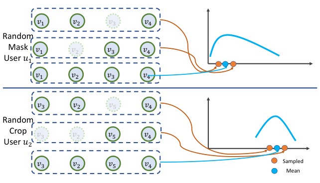
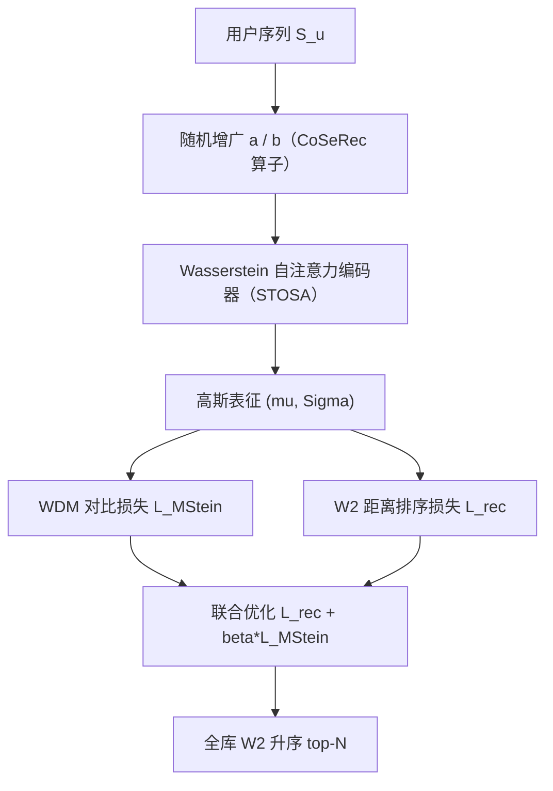

# Mutual Wasserstein Discrepancy Minimization for Sequential Recommendation

- **会议/期刊**: WWW 2023
- **作者与机构**: Ziwei Fan, Zhiwei Liu, Hao Peng, Philip S. Yu（University of Illinois at Chicago / Salesforce AI Research / 北京航空航天大学）
- **推荐链路定位**: 召回（序列编码）
- **研究方向**: 序列与会话推荐 / 自监督对比学习
- **论文原文**: [https://arxiv.org/abs/2301.12197v2](https://arxiv.org/abs/2301.12197v2)
- **开源代码**: [https://github.com/zfan20/MStein](https://github.com/zfan20/MStein)

## TL;DR (1分钟核心速览)

自监督序列推荐的对比损失 InfoNCE 本质是用 KL 散度估计互信息，存在三大缺陷：非对称、样本量指数级需求、非重叠分布下梯度爆炸/不稳定；同时随机数据增广被当作确定性样本处理，忽略了增广分布本身的**不确定性**。本文提出 Wasserstein Discrepancy Measurement (WDM)，以 2-Wasserstein 距离作为互信息的替代度量，并用高斯嵌入（STOSA 主干）承载增广过程的不确定性，形成对比损失 MStein。在 Beauty/Tools/Toys/Office 四个 Amazon 基准上以 Full-Ranking 协议评测，MRR 相对最优基线提升 2.53%–9.90%，Recall@1 最高提升 20.10%。

## Background & Motivation (背景与核心矛盾)

- **主流范式**: CL4Rec / S3-Rec / CoSeRec / DuoRec 在 SASRec 式 Transformer 上做随机 mask、crop、reorder 增广，再用 InfoNCE 拉近同一序列的两个增广视图、推远跨序列视图。
- **前人局限 1**: InfoNCE 的互信息下界依赖 KL 散度；当两条增广分布几乎不重叠（长尾用户、随机 crop 破坏序列相关性）时 KL 发散，梯度不稳定，且高置信下界需要 $N=\exp(I)$ 量级的批大小。
- **前人局限 2**: 现有方法只比较增广后的**具体样本**（realized samples），不建模增广分布自身的方差；对同一用户、不同增广策略引入的不确定性差异完全无感知。
- **核心洞察 (Key Insight)**: 随机增广 = 从用户专属的增广分布中采样（见图 1，$u_1$的分布比$u_2$平滑，crop 对$u_2$ 更易破坏序列相关性）。既然目标分布带方差，就应当用**度量分布间最优传输代价**的距离来定义互信息。
- **本文切入点**: 用对称、有界、可建模协方差的负 2-Wasserstein 距离替换 KL 散度，重写 InfoNCE 分母与分子，得到"互 Wasserstein 差异最小化"。

<figure class="paper-figure" markdown="span">
  <figcaption>图1：动机示例。我们仅展示随机掩码和裁剪作为示例，但其他数据增强也可视为从增强分布中采样。</figcaption>
</figure>

## Method (核心方法设计)

### 1. 整体框架 (Overall Architecture)

输入用户交互序列 $S_u$，经 STOSA 的 Wasserstein 自注意力编码为高斯序列表征$h_u=(\mathbf{h}^\mu_u,\mathbf{h}^\Sigma_u)$；训练时对同一序列采样两个随机增广视图$S_{u_a},S_{u_b}$（沿用 CoSeRec 的增广算子集合），编码后计算 WDM 对比损失，与 STOSA 原有的 Wasserstein 距离排序损失联合优化。推理阶段将序列分布与全库物品高斯嵌入逐一计算$W_2$ 距离，升序排列输出 top-N，无额外解码开销。

### 2. 关键设计拆解 (Key Designs)

1. **Wasserstein Discrepancy Measurement（把互信息换成传输代价）**：痛点源于 KL 的非对称与发散性，故定义 $I_{W_2}(x_a,x_b)\overset{def}{=}-W_2(x_a,x_b)$，其中对角高斯的 2-Wasserstein 距离为$\|\boldsymbol{\mu}_a-\boldsymbol{\mu}_b\|_2^2+\|\Sigma_a^{1/2}-\Sigma_b^{1/2}\|_F^2$。它是对称的、有限的（不要求分布重叠）、且协方差项天然承载增广不确定性——这正是 KL 在长尾用户上失效的地方。

2. **MStein 对比损失与对齐/均匀性的精确诱导**：将上式代入 InfoNCE 的分式结构，得 $\mathcal{L}_{\text{MStein}}=-\log\frac{\exp(-W_2(h_a,h_b))}{\exp(-W_2(h_a,h_b))+\sum_{j\in\mathcal{S}^-_B}\exp(-W_2(h_a,h_j))}$。分子即对齐项（均值 + 协方差两段欧氏距离），分母即均匀性项；与 Alignment/Uniformity 方法不同，本文的对齐/均匀性是**从损失式严格推出的**而非渐近近似，且额外作用于协方差嵌入（分布级对齐）。此外 Wasserstein 自注意力的$L_2$ 结构近似满足 Lipschitz 连续性，从理论上解释了扰动鲁棒性。

3. **训练目标、负采样与推理效率**: 总损失 $\mathcal{L}=\mathcal{L}_{rec}+\beta\mathcal{L}_{\text{MStein}}$，$\mathcal{L}_{rec}=\sum_t -\log\sigma\big(W_2(h_t,v^-_t)-W_2(h_t,v^+_t)\big)+\lambda\ell_{pvn}$，其中$\ell_{pvn}$ 为 STOSA 的正负样本对损失，训练仅用 1 个负样本（避免负样本数带来的不公平对比）。由于 WDM 对称，互信息估计在**小批量**下即可收敛，推理仅需一次前向 + 全库距离排序。

## Experimental Setup & Evaluation Protocol (实验设置与评估协议)

- **数据集与预处理**: 四个 Amazon 子集（Beauty / Tools / Toys / Office），沿用该基准的 `5-core` 过滤惯例。

| 数据集 | #Users | #Items | #Interactions | 稀疏度 | 特征/场景说明 |
| :--- | :---: | :---: | :---: | :---: | :--- |
| Beauty | 22.4k | 12.1k | 198.5k | 99.93% | 美妆评论序列 |
| Tools | 16.6k | 10.2k | 134.5k | 99.92% | 工具类评论序列 |
| Toys | 19.4k | 11.9k | 167.6k | 99.93% | 玩具评论序列 |
| Office | 4.9k | 2.4k | 53.6k | 99.55% | 办公用品，最稀疏小样本 |

- **数据划分与防穿越 (Splitting Strategy)**: 采用 `Leave-One-Out`（每用户最后 1 条测试、倒数第 2 条验证、其余训练），与 SASRec/BERT4Rec 基准一致。
- **排名评测协议 (Ranking Protocol)**: `Full-Ranking`（全库未交互物品排序），指标 Recall@1/5/10、NDCG@5/10、MRR。
- **对比基线与超参设置**: 三类基线——静态 BPRMF；非自监督序列 Caser/SASRec/BERT4Rec/STOSA；自监督 CL4Rec/DuoRec/CoSeRec，另加自制变体 CoSeRec(WDM)（仅换损失、保留确定性主干）。嵌入维度与 STOSA 对齐，$\beta$ 为对比损失权重，交叉熵类模型统一 1 个训练负样本。

## Key Experimental Results (实验关键数据)

### 1. 主实验对比 (Main Results)

| 数据集·指标 | SASRec | BERT4Rec | STOSA | DuoRec | CoSeRec | **MStein** | Improv. |
| :--- | :---: | :---: | :---: | :---: | :---: | :---: | :---: |
| Beauty Recall@1 | 0.0129 | 0.0119 | 0.0193 | 0.0158 | 0.0188 | **0.0220** | +14.39% |
| Beauty NDCG@10 | 0.0343 | 0.0321 | 0.0416 | 0.0375 | 0.0425 | **0.0463** | +9.00% |
| Beauty MRR | 0.0291 | 0.0294 | 0.0360 | 0.0325 | 0.0365 | **0.0398** | +9.11% |
| Tools Recall@1 | 0.0103 | 0.0059 | 0.0120 | 0.0108 | 0.0112 | **0.0144** | +20.10% |
| Tools MRR | 0.0207 | 0.0160 | 0.0226 | 0.0202 | 0.0223 | **0.0248** | +9.90% |
| Toys NDCG@10 | 0.0456 | 0.0260 | 0.0481 | 0.0461 | 0.0474 | **0.0524** | +8.91% |
| Toys MRR | 0.0385 | 0.0244 | 0.0415 | 0.0400 | 0.0405 | **0.0453** | +8.67% |
| Office Recall@10 | 0.0989 | 0.0848 | 0.1021 | 0.1005 | 0.1024 | **0.1155** | +5.96% |
| Office MRR | 0.0457 | 0.0408 | 0.0502 | 0.0482 | 0.0516 | **0.0529** | +2.53% |

### 2. 消融实验 (Ablation Study)

论文未设独立消融表，但主表中 `CoSeRec(WDM)` 提供了等价的分组件对照：同一 CoSeRec 增广、确定性主干，仅把 InfoNCE 换成 WDM。

| 配置 | Beauty NDCG@10 | Toys NDCG@10 | Tools MRR | Office MRR |
| :--- | :---: | :---: | :---: | :---: |
| CoSeRec（InfoNCE + 确定性嵌入） | 0.0425 | 0.0474 | 0.0223 | 0.0516 |
| CoSeRec(WDM)（仅换损失） | 0.0435 | 0.0502 | 0.0234 | 0.0519 |
| **MStein（WDM + 高斯主干）** | **0.0463** | **0.0524** | **0.0248** | **0.0529** |

### 3. 关键实验发现 (Key Findings)

1. **增益来自"距离度量"本身而非高斯头**：仅把 InfoNCE 换成 WDM（CoSeRec(WDM)），Beauty/Toys NDCG@10 即从 0.0425→0.0435、0.0474→0.0502（+2.4%/+5.9%），说明 2-Wasserstein 的对称有界性是主因；再叠加协方差建模（MStein）继续涨至 0.0463/0.0524，验证不确定性建模的独立贡献。
2. **样本效率提升约 8 倍**：Beauty 上 MStein 用 batch=16 即达到 MRR≈0.035，而 CoSeRec 需 batch=128 才达到同等水平，直接对应 Theorem 1 中 KL 互信息下界需 $N=\exp(I)$ 的指数需求，WDM 因对称性大幅降低批量门槛。
3. **噪声与长序列更鲁棒**：Beauty 上 MStein 在噪声比 0.4 时的 MRR 约等于 CoSeRec 在 0.3 时的水平；Toys 噪声比 0.9 时 CoSeRec 明显崩塌而 MStein 保持稳定。分组分析显示增益集中在**最长序列与最热门物品**分组——这些对象增广后不确定性最大（图 5/图 6），恰是 WDM 最能发挥作用的区间。

## Highlights & Limitations (亮点、对比与审稿批判)

- **与代表作对比 (vs. Prior Work)**: 与 CL4Rec/CoSeRec 相比，本文不改增广算子（甚至直接复用 CoSeRec 的增广），只改"如何度量两个视图的一致性"；与 DuoRec 的 Alignment+Uniformity 相比，本文的 A/U 是从 WDM 损失式中**严格推出**的，DuoRec 中只是渐近等价，且本文的 A/U 额外作用于协方差维度（分布级而非点级）；与 STOSA 相比，STOSA 只用 Wasserstein 距离做自注意力与排序损失，本文把它推进到自监督互信息估计。
- **可迁移亮点**: (1) 「对称有界距离 + 分式对比结构」这一替换套路可直接移植到图对比推荐（SGL/SimGCL）的 InfoNCE 上，尤其适合小批量训练场景；(2) 把协方差项纳入对齐/均匀性，等价于在表征空间做分布级正则，可缓解长尾用户增广破坏序列相关性的问题。
- **审稿级局限批判**: (1) WDM 仅对**对角**高斯有闭式解，协方差被限制为对角，跨维度相关性建模缺失；若换用全协方差，$W_2$需要矩阵平方根迭代，推理与训练开销会显著上升，论文未给出复杂度对比。(2) 消融不彻底：论文没有独立报告"去掉$\ell_{pvn}$"、"只用均值项$W_2$"、"$\beta$ 敏感性"等关键控制变量，且 `CoSeRec(WDM)` 的嵌入拼接方式改变了主干容量，与 CoSeRec 并非严格等参对照；此外增益在 Office 上仅 2.53%（MRR），说明小样本/短序列场景收益有限。

## Rating (四维评分)

- **方法创新性 (Novelty)**: ⭐⭐⭐⭐ （用 2-Wasserstein 距离重构对比互信息，并从损失式严格诱导 A/U 与 Lipschitz 近似，理论链条完整，但属"换度量"式改良而非新范式）
- **评估协议与实验扎实度 (Protocol & Experiments)**: ⭐⭐⭐⭐ （四数据集 + Full-Ranking + 噪声/数据量/批量/长尾四组敏感性分析较全面，但缺乏独立消融表与显著性检验）
- **写作与数学规范度 (Clarity & Rigor)**: ⭐⭐⭐⭐ （Theorem 1 与 A/U 分解推导清晰，符号与 STOSA 衔接自然；批次效率结论依赖单一数据集示例，略欠严谨）
- **工业落地与复现价值 (Industrial & Practical Value)**: ⭐⭐⭐⭐ （代码开源，改造成本极低——只需替换对比损失并保留高斯头；小批量友好直接降低训练显存门槛，适合在线增量训练）

